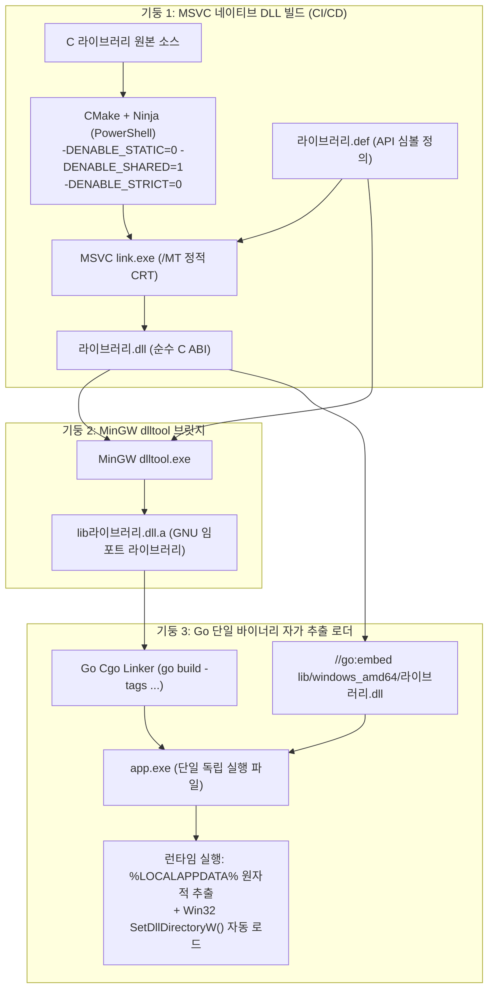

# Go 개발자를 위한 Windows Cgo 지옥 탈출기
## MSVC 전용 C 라이브러리를 MinGW 충돌 없이 단일 실행 파일(.exe)로 패키징하는 완벽 가이드

> **작성자**: LionSQL Database Engineering Team  
> **태그**: `Go`, `Golang`, `Cgo`, `Windows`, `MSVC`, `WiredTiger`, `SystemsProgramming`

---

## 1. 들어가며: 모든 Go 개발자가 마주치는 "Windows Cgo의 악몽"

Go 언어의 가장 큰 매력 중 하나는 **"어디서나 단 하나의 독립 실행 파일(Single Standalone Binary)로 빌드된다"**는 점입니다. 하지만 고성능 C/C++ 엔터프라이즈 라이브러리(WiredTiger, RocksDB, DuckDB, OpenCV, ONNX Runtime 등)를 Cgo를 통해 연동하는 순간, 윈도우 환경에서는 지옥문이 열립니다.

리눅스나 macOS에서는 `gcc`나 `clang`으로 정적 라이브러리(`libfoo.a`)를 빌드하고 Go 바이너리에 정적으로 묶어버리면 끝납니다. 하지만 윈도우에서는 다음과 같은 **구조적 모순(Architectural Deadlock)**에 직면하게 됩니다:

1. **Go Cgo의 MinGW GCC 강제**: Go 컴파일러는 윈도우에서 Cgo 코드를 빌드할 때 Microsoft Visual C++ (`cl.exe`)를 직접 지원하지 않으며, 오직 **MinGW GCC (`x86_64-w64-mingw32-gcc`)**만을 요구합니다.
2. **C 라이브러리의 MSVC 강결합**: 반면 대다수 고성능 C/C++ 라이브러리의 Windows 포팅 코드는 Windows 커널 및 **MSVC 고유 인트린식(`_InterlockedIncrement`, `_ReadWriteBarrier`, `__int64`, SEH)**을 전제로 작성되어 있어 MinGW로는 컴파일 자체가 불가능합니다.
3. **정적 라이브러리(`.lib`) 링킹의 절망**: "그렇다면 MSVC로 `.lib`를 빌드해서 Go Cgo에 넘겨주면 되지 않을까?" ➔ **수백 개의 `undefined reference to __chkstk`, `__security_cookie` 에러**가 발생하며 완전히 실패합니다.
4. **단일 바이너리 배포의 붕괴**: 동적 라이브러리(`.dll`)를 쓰자니, 최종 사용자에게 "DLL을 다운받아서 System32나 PATH에 수동으로 넣으세요"라고 요구해야 하므로 Go의 단일 바이너리 철학이 무너집니다.

LionSQL 데이터베이스 엔진 개발팀은 고성능 B+Tree MVCC 스토리지 엔진인 **WiredTiger (v11.3.1)**를 윈도우 Cgo 환경에 완벽하게 안착시키기 위해 수많은 실패를 겪었습니다.

본 아티클에서는 **"라이브러리 원작자의 MSVC 빌드를 100% 존중하면서, Go Cgo 링커와 충돌 없이 단일 무설치 실행 파일(`lionsql.exe`)로 배포하는 하이브리드 파이프라인"**의 전말과 완전한 해결책을 공유합니다.

---

## 2. 왜 정적 라이브러리(`.lib`)는 실패하고 마는가?

많은 개발자가 처음에 "MSVC로 정적 라이브러리(`.lib`)를 빌드해서 Go에 정적 링크하면 깔끔하겠지"라고 생각합니다. 하지만 이는 **서로 다른 C 런타임(CRT)의 ABI 충돌** 때문에 원천적으로 불가능합니다.

```
[ MSVC 컴파일러 ] ──> 정적 라이브러리 (.lib) ──> 내부 CRT 심볼 포함:
                                                  - __chkstk (스택 프로브)
                                                  - __security_cookie (버퍼 보호)
                                                  - _vsnprintf, __acrt_iob_func
                                                            │
                                                   (링크 시도 시 충돌!)
                                                            ▼
[ Go Cgo 링커 (MinGW ld.exe) ] ──> GNU CRT / UCRT 라이브러리만 탑재
                                   ==> "undefined reference to __chkstk" 
                                   ==> "undefined reference to __security_cookie"
```

MSVC가 생성한 정적 라이브러리는 기계어 코드 외에도 **MSVC 컴파일러 전용 내부 런타임 헬퍼**들을 직접 호출합니다. 반면 Go Cgo 링커는 GNU 계열의 링커이므로 MSVC 전용 CRT 내부 심볼을 해석할 수 없습니다.

### 💡 핵심 해결책: 동적 라이브러리(DLL)를 'ABI 방화벽'으로 사용하라

이 문제를 해결하는 유일하게 우아한 방법은 **동적 라이브러리(DLL)**를 사용하는 것입니다:
1. **MSVC 정적 CRT(`/MT`) 플래그 적용**: MSVC로 DLL을 빌드할 때 `/MT`를 주면, 모든 MSVC CRT 의존성이 **DLL 내부로 완벽히 캡슐화**됩니다.
2. **순수 C ABI 노출**: 외부에는 `wiredtiger_open`, `wiredtiger_strerror` 같은 순수 C 함수 규격만 노출됩니다.
3. **`dlltool` 브릿지**: MinGW의 `dlltool`을 이용해 DLL을 가리키는 GNU 포맷의 임포트 라이브러리(`libwiredtiger.dll.a`)를 생성하면, Go Cgo 링커는 아무런 CRT 에러 없이 깨끗하게 링크를 완료합니다.

---

## 3. 핵심 아키텍처: 3대 기둥 (The 3 Pillars)



---

## 4. 실전 구현 가이드 (Step-by-Step)

### 1단계: MSVC DLL 빌드 및 `.def` 심볼 익스포트
Windows MSVC는 소스코드에 `__declspec(dllexport)`가 붙어있지 않으면 함수를 외부로 내보내지 않습니다. 따라서 공개할 C 함수 목록을 담은 모듈 정의 파일(`.def`)을 준비합니다:

```def
; wiredtiger.def
EXPORTS
    wiredtiger_open
    wiredtiger_strerror
    wiredtiger_version
    wiredtiger_struct_size
```

CMake 및 Ninja를 통해 `/MT` 옵션으로 빌드합니다 (GitHub Actions PowerShell 스크립트):
```powershell
cmake -G "Ninja" `
  -DCMAKE_TOOLCHAIN_FILE="../cmake/toolchains/cl.cmake" `
  -DCMAKE_BUILD_TYPE=Release `
  -DCMAKE_C_FLAGS_RELEASE="/MT /O2 /Ob2 /DNDEBUG" `
  -DCMAKE_SHARED_LINKER_FLAGS="/DEF:../configs/wiredtiger.def" `
  -DENABLE_STATIC=0 `
  -DENABLE_SHARED=1 `
  -DENABLE_STRICT=0 `
  ..
ninja -v wiredtiger
```

### 2단계: `dlltool`로 Go Cgo용 임포트 라이브러리 추출
동일한 러너 환경에서 MinGW의 `dlltool`을 호출하여 Cgo가 링크할 수 있는 GNU ar 아카이브를 생성합니다:
```powershell
$env:PATH = "C:\msys64\mingw64\bin;$env:PATH"
dlltool -d wiredtiger.def -D wiredtiger.dll -l libwiredtiger.dll.a -m i386:x86-64
```
생성된 `wiredtiger.dll`과 `libwiredtiger.dll.a`를 Go 소스 트리의 `pkg/.../lib/windows_amd64/`에 커밋(벤더링)합니다.

### 3단계: Go Cgo 지시자 설정
Go 파일 상단에 윈도우 전용 링커 플래그를 설정합니다:
```go
//go:build cgo && windows,amd64

package mylib

/*
#cgo CFLAGS: -I${SRCDIR}/lib/windows_amd64/include
#cgo LDFLAGS: -L${SRCDIR}/lib/windows_amd64 -lwiredtiger
#include <wiredtiger.h>
*/
import "C"
```

### 4단계: `//go:embed`와 `SetDllDirectoryW`를 이용한 무설치 단일 바이너리
사용자가 DLL을 별도로 관리하지 않도록, 바이너리 실행 시 DLL이 없으면 스스로 `%LOCALAPPDATA%`에 추출하고 윈도우 동적 링커에 등록하는 로더를 작성합니다:

```go
//go:build windows && cgo

package mylib

import (
	_ "embed"
	"os"
	"path/filepath"
	"sync"
	"syscall"
	"unsafe"
)

//go:embed lib/windows_amd64/wiredtiger.dll
var embeddedDLL []byte

var (
	kernel32            = syscall.NewLazyDLL("kernel32.dll")
	procSetDllDirectory = kernel32.NewProc("SetDllDirectoryW")
	loadOnce            sync.Once
)

func setDllDirectory(dir string) error {
	p, err := syscall.UTF16PtrFromString(dir)
	if err != nil {
		return err
	}
	r1, _, err := procSetDllDirectory.Call(uintptr(unsafe.Pointer(p)))
	if r1 == 0 {
		return err
	}
	return nil
}

func init() {
	loadOnce.Do(func() {
		// 1. 실행 파일과 같은 위치에 이미 DLL이 있는지 확인
		if exePath, err := os.Executable(); err == nil {
			exeDir := filepath.Dir(exePath)
			if _, err := os.Stat(filepath.Join(exeDir, "wiredtiger.dll")); err == nil {
				_ = setDllDirectory(exeDir)
				return
			}
		}

		// 2. 캐시 디렉터리 (%LOCALAPPDATA%\MyApp\bin) 확인
		localAppData := os.Getenv("LOCALAPPDATA")
		if localAppData == "" {
			localAppData = os.TempDir()
		}
		targetDir := filepath.Join(localAppData, "MyApp", "bin")
		targetDLL := filepath.Join(targetDir, "wiredtiger.dll")

		if _, err := os.Stat(targetDLL); err == nil {
			_ = setDllDirectory(targetDir)
			return
		}

		// 3. 부재 시 원자적(Atomic) 추출 후 로드
		if len(embeddedDLL) > 0 {
			_ = os.MkdirAll(targetDir, 0755)
			tmpFile := targetDLL + ".tmp"
			if err := os.WriteFile(tmpFile, embeddedDLL, 0644); err == nil {
				_ = os.Rename(tmpFile, targetDLL)
				_ = setDllDirectory(targetDir)
			}
		}
	})
}
```

---

## 5. 가장 뼈아픈 교훈: "처음부터 파워쉘(PowerShell)로 시작하라"

CI/CD 구축 과정에서 우리는 수많은 빌드 실패를 겪었습니다. 놀랍게도 그 실패의 절반 이상은 Cgo나 MSVC 문제가 아니라 **"윈도우 러너에서 익숙한 Git Bash를 고집하다가 터진 셸 환경의 참사"**였습니다:

1. **`\a` 이스케이프 참사**: Git Bash 환경변수에서 `D:\a\_temp` 경로의 `\a`가 ASCII Bell(제어문자 `0x07`)로 파싱되어 디렉터리를 찾지 못함.
2. **CRLF 개행 붕괴**: Git 체크아웃 시 개행이 변환되어 백슬래시(`\`)로 이어진 멀티라인 명령어가 중간에 쪼개져 비정상 종료.
3. **`sed -i` 파일 핸들 락**: 윈도우 OS의 배타적 파일 잠금 메커니즘 때문에 인라인 치환이 파일 락 에러로 실패.
4. **파이썬 서브프로세스 확장자 누락**: POSIX 방식으로 작성한 파이썬 `subprocess`가 `.exe` 확장자 없는 명령어를 찾지 못함 (`WinError 2`).

> **💡 골든 룰 (Platform Primitives First)**:  
> 라이브러리 원작자(WiredTiger MongoDB 팀)의 공식 스크립트(`test/evergreen/build_windows.ps1`)는 이미 PowerShell로 작성되어 있었습니다.  
> **Windows CI 환경에서는 무조건 첫 줄부터 네이티브 PowerShell (`pwsh`)을 채택하십시오.** 비표준 POSIX 셸 에뮬레이션을 배제하는 것만으로도 전체 삽질 시간의 50%를 아낄 수 있습니다.

---

## 6. 결론 및 성과

이 하이브리드 아키텍처를 LionSQL 데이터베이스 엔진에 도입한 결과:

- **완전한 단일 실행 바이너리**: 사용자는 DLL이나 외부 C++ 런타임을 설치할 필요 없이 `lionsql.exe` 하나만 받아서 즉시 20,000+ TPS 고성능 B+Tree 엔진을 구동할 수 있게 되었습니다.
- **초고속 빌드 생산성**: 매번 10분씩 C 소스를 빌드하던 고통에서 벗어나, 이미 벤더링된 임포트 라이브러리를 통해 **단 2초 만에 Go 바이너리 컴파일이 완료**됩니다.
- **철저한 검증**: 실제 GitHub Actions의 Windows Server 2022 러너에서 엔진의 모든 단위 테스트 및 MVCC 트랜잭션 검증이 **100% PASS**되었습니다.

윈도우 환경에서 고성능 C/C++ 라이브러리의 Cgo 연동 문제로 고민하고 계신 모든 Go 엔지니어분들께 이 패턴이 명쾌한 해법이 되기를 바랍니다.

---
*실제 구현 코드 및 파이프라인 전체 워크플로는 [LionSQL GitHub Repository](https://github.com/MaroShim/LionSQL)에서 확인하실 수 있습니다.*
