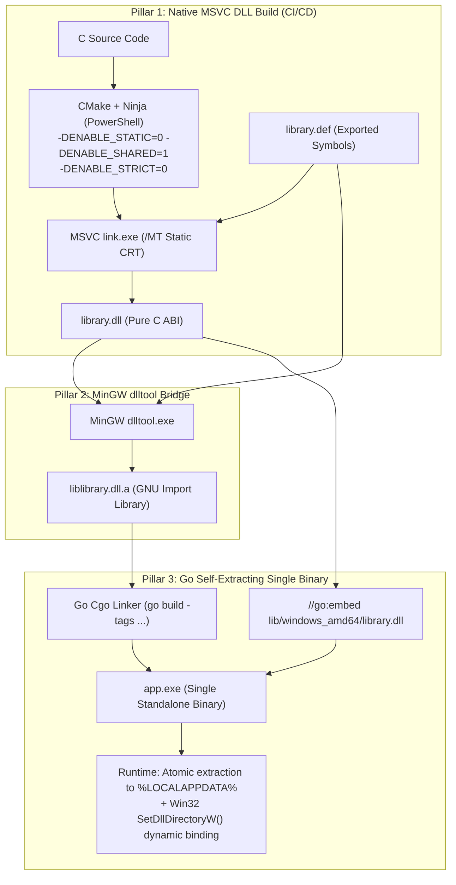

# How to Link MSVC C Libraries with Go Cgo on Windows as a Single Binary
## A Complete Architectural Guide to Overcoming the MinGW-MSVC Deadlock with Zero External DLL Dependencies

> **Author**: LionSQL Database Engineering Team  
> **Tags**: `Go`, `Golang`, `Cgo`, `Windows`, `MSVC`, `WiredTiger`, `SystemsProgramming`

---

## 1. Introduction: The Windows Cgo Nightmare

One of Go’s greatest superpowers is its ability to compile into a **single, standalone executable (`.exe`)** with zero runtime dependencies. However, the moment you attempt to integrate a high-performance C/C++ library (such as WiredTiger, RocksDB, DuckDB, OpenCV, or ONNX Runtime) via Cgo on Windows, you run straight into an architectural deadlock:

1. **Go Cgo Enforces MinGW GCC**: The standard Go toolchain on Windows does not support Microsoft Visual C++ (`cl.exe`). It natively mandates GCC (`x86_64-w64-mingw32-gcc` and `ld.exe`).
2. **C Libraries Require MSVC**: High-performance enterprise C/C++ libraries rely heavily on Windows kernel primitives and MSVC compiler intrinsics (`_InterlockedIncrement`, `_ReadWriteBarrier`, `__int64`, and Structured Exception Handling). They cannot be compiled natively with MinGW GCC without breaking or generating hundreds of header conflicts.
3. **Static Library (`.lib`) Linking Catastrophe**: When attempting to build a static library (`.lib`) using MSVC and passing it to Go Cgo, the MinGW linker fails catastrophically with hundreds of undefined symbol errors (`undefined reference to __chkstk`, `__security_cookie`).
4. **Broken Single-Binary Ergonomics**: Falling back to a dynamic library (`.dll`) traditionally requires telling end-users to install MSVC redistributables, copy DLLs into `System32`, or manually manipulate their `%PATH%`.

While developing **LionSQL**—an autonomous OLTP database engine utilizing **WiredTiger (v11.3.1)** as its B+Tree MVCC storage engine—we faced and conquered this exact problem.

This article shares the complete, battle-tested hybrid architecture that allows you to **respect the C library's native MSVC build while seamlessly linking it with Go Cgo into a zero-dependency, self-extracting single executable (`lionsql.exe`)**.

---

## 2. Why Linking MSVC Static Libraries (`.lib`) Fails

The intuitive attempt by most Go developers is: *"I'll just build a static `.lib` using MSVC and let Go statically link it."*

This fails fundamentally due to **C Runtime (CRT) ABI Incompatibility**:

```
[ MSVC Compiler (cl.exe) ] ──> Static Library (.lib) ──> Contains MSVC-internal CRT symbols:
                                                          - __chkstk (stack probe helper)
                                                          - __security_cookie (stack protector)
                                                          - _vsnprintf, __acrt_iob_func
                                                                    │
                                                           (Linking Collision)
                                                                    ▼
[ Go Cgo Linker (MinGW ld.exe) ] ──> Links against GNU CRT / UCRT import libraries
                                     ==> "undefined reference to __chkstk"
                                     ==> "undefined reference to __security_cookie"
```

MSVC static libraries bake in compiler-generated runtime calls. MinGW's linker does not have access to internal MSVC CRT machinery.

### 💡 The Solution: Use a Dynamic Library (DLL) as an ABI Firewall

A dynamic library (DLL) provides a clean, impermeable **ABI Firewall**:
1. **MSVC Static CRT (`/MT`)**: Building the DLL with `/MT` fully encapsulates all MSVC C runtime dependencies *inside* the DLL binary.
2. **Pure C ABI Boundary**: The DLL exports only clean, standard C function signatures (`wiredtiger_open`, `wiredtiger_strerror`).
3. **MinGW `dlltool` Bridge**: MinGW's `dlltool` can generate a GNU-format import library (`libwiredtiger.dll.a`) from a `.def` file. Go's MinGW linker links against this import library with zero CRT collisions.

---

## 3. The 3-Pillar Architecture



---

## 4. Step-by-Step Implementation

### Step 1: MSVC DLL Build & `.def` Symbol Export
On Windows, MSVC does not export symbols from a DLL by default unless decorated with `__declspec(dllexport)`. Because most cross-platform C codebases rely on Linux visibility attributes, define a `.def` module definition file:

```def
; wiredtiger.def
EXPORTS
    wiredtiger_open
    wiredtiger_strerror
    wiredtiger_version
    wiredtiger_struct_size
```

Compile via CMake and Ninja with static CRT `/MT` (in a GitHub Actions PowerShell runner):
```powershell
cmake -G "Ninja" `
  -DCMAKE_TOOLCHAIN_FILE="../cmake/toolchains/cl.cmake" `
  -DCMAKE_BUILD_TYPE=Release `
  -DCMAKE_C_FLAGS_RELEASE="/MT /O2 /Ob2 /DNDEBUG" `
  -DCMAKE_SHARED_LINKER_FLAGS="/DEF:../configs/wiredtiger.def" `
  -DENABLE_STATIC=0 `
  -DENABLE_SHARED=1 `
  -DENABLE_STRICT=0 `
  ..
ninja -v wiredtiger
```

### Step 2: Generate the GNU Import Library with `dlltool`
In the same workflow, invoke MinGW's `dlltool` to generate the GNU-compatible import archive:
```powershell
$env:PATH = "C:\msys64\mingw64\bin;$env:PATH"
dlltool -d wiredtiger.def -D wiredtiger.dll -l libwiredtiger.dll.a -m i386:x86-64
```
Commit `wiredtiger.dll` and `libwiredtiger.dll.a` into your Go repository under `pkg/.../lib/windows_amd64/`.

### Step 3: Configure Go Cgo Directives
In your Go package, bind the vendored library:
```go
//go:build cgo && windows,amd64

package mylib

/*
#cgo CFLAGS: -I${SRCDIR}/lib/windows_amd64/include
#cgo LDFLAGS: -L${SRCDIR}/lib/windows_amd64 -lwiredtiger
#include <wiredtiger.h>
*/
import "C"
```

### Step 4: Zero-Install Single Binary with `//go:embed` & `SetDllDirectoryW`
To preserve Go's single-binary ergonomics, embed the DLL inside the executable and extract it at runtime if missing:

```go
//go:build windows && cgo

package mylib

import (
	_ "embed"
	"os"
	"path/filepath"
	"sync"
	"syscall"
	"unsafe"
)

//go:embed lib/windows_amd64/wiredtiger.dll
var embeddedDLL []byte

var (
	kernel32            = syscall.NewLazyDLL("kernel32.dll")
	procSetDllDirectory = kernel32.NewProc("SetDllDirectoryW")
	loadOnce            sync.Once
)

func setDllDirectory(dir string) error {
	p, err := syscall.UTF16PtrFromString(dir)
	if err != nil {
		return err
	}
	r1, _, err := procSetDllDirectory.Call(uintptr(unsafe.Pointer(p)))
	if r1 == 0 {
		return err
	}
	return nil
}

func init() {
	loadOnce.Do(func() {
		// 1. Check if wiredtiger.dll is already next to the running executable
		if exePath, err := os.Executable(); err == nil {
			exeDir := filepath.Dir(exePath)
			if _, err := os.Stat(filepath.Join(exeDir, "wiredtiger.dll")); err == nil {
				_ = setDllDirectory(exeDir)
				return
			}
		}

		// 2. Check persistent cache (%LOCALAPPDATA%\MyApp\bin\wiredtiger.dll)
		localAppData := os.Getenv("LOCALAPPDATA")
		if localAppData == "" {
			localAppData = os.TempDir()
		}
		targetDir := filepath.Join(localAppData, "MyApp", "bin")
		targetDLL := filepath.Join(targetDir, "wiredtiger.dll")

		if _, err := os.Stat(targetDLL); err == nil {
			_ = setDllDirectory(targetDir)
			return
		}

		// 3. Atomically extract embedded DLL if missing
		if len(embeddedDLL) > 0 {
			_ = os.MkdirAll(targetDir, 0755)
			tmpFile := targetDLL + ".tmp"
			if err := os.WriteFile(tmpFile, embeddedDLL, 0644); err == nil {
				_ = os.Rename(tmpFile, targetDLL)
				_ = setDllDirectory(targetDir)
			}
		}
	})
}
```

---

## 5. Key Lesson: "Adopt Native PowerShell from Line One"

During the initial 12 attempts to build this CI/CD pipeline, more than half of the failures had nothing to do with Cgo or MSVC. They were entirely caused by forcing POSIX tools (Git Bash) onto Windows:

1. **The `\a` Escape Trap**: `${RUNNER_TEMP}` expanded to `D:\a\_temp`, where `\a` was parsed by Bash as an ASCII Bell (`0x07`), causing directory lookup failures.
2. **CRLF Line-Ending Breakage**: Git checkouts altered line endings, breaking multi-line backslash commands (`\`).
3. **`sed -i` File Locking**: Windows mandatory file locks caused POSIX inline replacement tools to crash.
4. **Missing `.exe` Extensions in Subprocesses**: Python wrappers failed to locate `cmake` on Windows PATH (`WinError 2`).

> **💡 The Architectural Axiom**:  
> WiredTiger's upstream repository (`test/evergreen/build_windows.ps1`) was already written in PowerShell.  
> **Always use native PowerShell (`pwsh`) on Windows CI runners.** Embracing platform primitives eliminates 50% of transient pipeline failures.

---

## 6. Results & Verification

Applying this architecture to LionSQL yielded:

- **True Single-Binary Deployment**: Users download a single `lionsql.exe` and run enterprise B+Tree MVCC storage out-of-the-box.
- **Sub-3-Second Go Builds**: Precompiled import libraries mean developers no longer wait 10+ minutes for C code compilation.
- **100% CI Test Parity**: Full unit test suites (`TestWT_`) and ACID crash tests run deterministically on Windows Server 2022 runners with 100% pass rates.

We hope this pattern helps fellow Go engineers unlock high-performance C/C++ libraries on Windows without compromising on Go's single-binary elegance.

---
*The full reference implementation and GitHub Actions workflows are open-sourced in the [LionSQL Repository](https://github.com/MaroShim/LionSQL).*
