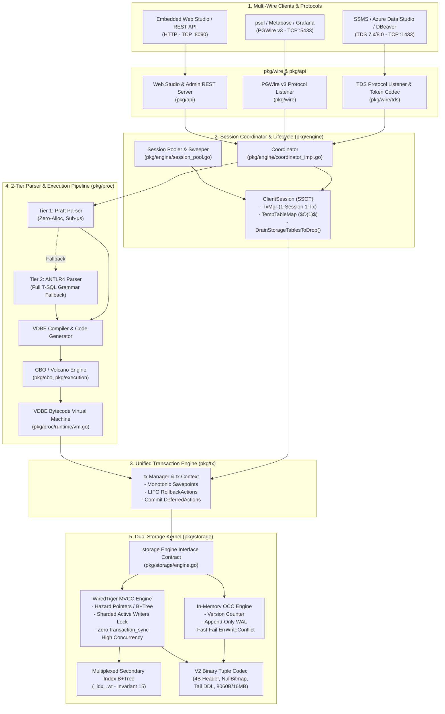

# LionSQL 시스템 아키텍처 및 기술 명세서 (`doc/ARCHITECTURE.ko.md`)

> - **최초 작성일**: 2026-09-22
> - **최종 갱신일**: 2026-11-18
> - **상태**: 최신 프로덕션 아키텍처 반영 (SSOT, V2 Tuple Codec, Multiplexed Secondary Index, Unified TxManager)
> - **English**: [doc/ARCHITECTURE.md](ARCHITECTURE.md)

---

## 1. 아키텍처 비전과 4대 설계 철학 (Why LionSQL?)

LionSQL은 외부 데몬(PgBouncer, Redis, ZooKeeper, Nginx 등) 의존성이 전무한 **단일 정적 독립 실행형(Zero-Sidecar Standalone) 고동시성 임베디드 OLTP RDBMS**입니다. Go 언어 기반의 견고한 세션/가상머신 코어와 고성능 스토리지 엔진(In-Memory OCC 및 WiredTiger MVCC B+Tree)이 결합되어, 단일 프로세스 내에서 서브 마이크로초 단위의 대화형 쿼리 처리와 엔터프라이즈 ACID 내구성을 제공합니다.

### 1.1. 설계 철학과 명시적 트레이드오프 (선택과 집중)
LionSQL 아키텍처의 강력함은 *"무엇이든 다 지원한다"*가 아니라, **"고성능 OLTP를 위해 무엇을 과감히 배제(Spec-Out)하고 무엇에 집중했는가"**에서 출발합니다:

1. **Scale-Up First (단일 노드 극한 포화 vs 분산 2PC 배제)**:
   - 분산 트랜잭션의 2단계 커밋(2PC) 네트워크 지연과 장애 조율 오버헤드를 배제합니다.
   - 단일 노드의 멀티코어 하드웨어 자원을 100% 포화시켜 단일 머신에서 초당 **20,000 ~ 140,000+ TPS**를 달성합니다.
2. **Zero-Regex & Deterministic Lexical Safety (문맥 인식 파싱 vs 정규식 배제)**:
   - 중첩 괄호, 문자열 리터럴, 인용 부호가 혼재된 SQL에 대해 정규식(Regex)을 적용하면 침범과 절단 버그가 불가피합니다.
   - 모든 쿼리 라우팅과 절 분할에서 정규식을 원천 배제하고 결정론적 어휘 분석기(`pkg/sqlutil`)와 2-Tier 파서만을 사용합니다.
3. **Single-File Secondary Index Multiplexing (B+Tree 다중화 vs 파일 폭증 배제)**:
   - 인덱스마다 물리 파일을 생성하면 빈번한 DDL에서 OS 파일 디스크립터 고갈과 `EBUSY` 경합이 발생합니다.
   - 테이블당 모든 보조 인덱스를 단 하나의 B+Tree 파일(`_idx_<Table>.wt`)로 다중화하여 트랜잭션 내부에서 $O(1)$ 즉시 인덱스 생성을 보장합니다.
4. **Non-Blocking Snapshot Read (논블로킹 읽기 vs 무거운 2PL 배제)**:
   - 읽기 작업이 쓰기 락에 블로킹되는 전통적인 2PL(Two-Phase Locking) 공유 락을 전면 배제합니다.
   - 읽기는 쓰기를 결코 막지 않으며, 쓰기 또한 읽기를 결코 차단하지 않는 비차단 스냅샷 격리를 제공합니다.

### 1.2. 4대 코어 컴포넌트의 유기적 결합 (The Four Pillars)

LionSQL은 인체의 유기적 시스템처럼 4개의 기둥이 맞물려 단일 프로세스로 동작합니다:

```
┌───────────────────────────────────────────────────────────────────────────┐
│                     LionSQL Autonomous Database Kernel                    │
├─────────────────────────────────────┬─────────────────────────────────────┤
│ 1. 2-Tier 파싱 엔진 (감각 기관)     │ 2. VDBE & CBO 실행 엔진 (심장)      │
│ - Pratt Recursive-Descent Fast-Path │ - SQLite 스타일 VDBE 바이트코드 VM  │
│ - ANTLR4 Full T-SQL/PG Fallback     │ - Volcano Iterator 모델 & 해시 조인 │
│ ➔ "서브-마이크로초 문법 완전 정복"  │ ➔ "sync.Pool 제로 할당 초고속 실행" │
├─────────────────────────────────────┼─────────────────────────────────────┤
│ 3. 통합 TxManager (두뇌)            │ 4. 스토리지 커널 & 튜플 코덱 (근육) │
│ - 1-세션 1-트랜잭션 SSOT 불변식     │ - In-Memory OCC & WiredTiger MVCC   │
│ - LIFO RollbackActions 큐           │ - V2 Binary Tuple Codec             │
│ ➔ "세션 트랜잭션 무결성의 단일 두뇌" │ ➔ "1바이트 오차 없는 물리 복구 손발"│
└─────────────────────────────────────┴─────────────────────────────────────┘
```

---

## 2. 전체 엔드투엔드 파이프라인 아키텍처

클라이언트 요청이 네트워크 패킷으로 인입되어 스토리지 파일에 영속화되고 롤백되기까지의 단일 데이터 흐름입니다.



---

## 3. 핵심 서브시스템 심층 분석 및 불변식 (Invariants)

### 3.1. 멀티 와이어 프로토콜 & 세션 코디네이터 (`pkg/wire`, `pkg/engine`)

1. **Microsoft TDS 7.x/8.0 & 영구 Windows 호스트 에뮬레이션 (Invariant 11)**:
   - SSMS, ADO.NET 연동 시 PRELOGIN, LOGIN7, SQLBatch, RPC 토큰을 처리합니다.
   - **TDS Windows Platform Parity**: macOS나 Linux에서 실행 중이더라도 TDS 세션 및 시스템 뷰(`sys.dm_os_host_info`)는 항상 `host_platform = "Windows"`, `host_release = "10.0"`을 반환하여 SSMS Object Explorer의 `InvalidOperationException`을 원천 방지합니다.
2. **PostgreSQL Wire Protocol v3 & 대량 복사 스트리밍**:
   - Simple Query 및 Extended Query(`Parse`, `Bind`, `Execute`, `Sync`)를 지원합니다.
   - `COPY FROM STDIN` 및 `COPY TO STDOUT`을 32KB 단위 논블로킹 스트리밍으로 완벽 지원합니다(`psql \copy` 호환).
3. **커넥션 풀 격리 및 완결적 세션 리셋 (`ResetSession`)**:
   - TDS `sp_reset_connection`, PGWire `DISCARD ALL` 수신 시 활성 트랜잭션을 안전하게 롤백하고, 사용자 변수 복구 및 세션 임시 객체 일괄 수거(`cs.DrainStorageTablesToDrop()`)를 수행하여 커넥션 풀 오염을 방지합니다.

---

### 3.2. 통합 트랜잭션 매니저 & 상태 관리 SSOT (`pkg/tx`, `pkg/engine`)

LionSQL은 분산된 상태 플래그를 완전히 배제하고 단일 진실원천(SSOT) 아키텍처를 강제합니다:

```
[ ClientSession ]
   ├── txMgr *tx.Manager (SSOT: 상태 관리 단일 진실원천)
   │     ├── cs.Tx() ────────► 활성 storage.Transaction 반환
   │     ├── cs.TranCount() ──► 트랜잭션 중첩 레벨 반환
   │     └── cs.IsTxFailed() ─► 'E' 상태(PGWire 에러 블록) 판별
   │
   ├── TempTableMap map[string]string (임시 테이블 $O(1)$ SSOT)
   ├── TableVars map[string]string    (테이블 변수)
   └── EphemeralTables map[string]*EphemeralTable
         │
         ▼
   cs.DrainStorageTablesToDrop() []string
   - cs.Mu.Lock() 보호 하에 임시 물리 테이블명 원자적 수집 및 맵 일괄 초기화
   - CloseSession / ResetSession 시 c.dropSessionStorageTables()로 완결
```

1. **1-세션 1-트랜잭션 불변식**:
   - `cs.Tx` 직접 필드 참조를 폐지하고 `cs.Tx()`, `cs.TranCount()` 등 공식 접근자를 통해 `tx.Manager`가 유일한 진실 원천으로 동작합니다.
2. **트랜잭셔널 DDL 라이프사이클 통합**:
   - `tx.Context`에 등록되는 **LIFO `RollbackActions []func() error`** 및 **Commit `DeferredActions []func() error`**를 통해, 트랜잭션 롤백 시 섀도 카탈로그 복원 및 톰스톤 테이블 삭제가 자동 완결됩니다.
   - 수동 DDL 언두 큐(`cs.ddlUndoLog`)를 전면 폐지하여 유휴 세션 타임아웃, 비정상 커넥션 단절, 패닉 복구 시에도 물리 누수가 발생하지 않습니다.
3. **세션 임시 객체 수명주기 캡슐화**:
   - $O(N)$ 슬라이스 탐색을 유발하던 `TempTables []string`을 제거하고 `TempTableMap` $O(1)$ 맵으로 통합했습니다.
   - `CloseSession`과 `ResetSession`에 중복되던 수거 코드를 `cs.DrainStorageTablesToDrop()` 단일 메서드로 캡슐화했습니다.

---

### 3.3. 2-Tier 파서 & VDBE 바이트코드 가상 머신 (`pkg/proc`)

1. **Dual-Parser 아키텍처 및 자동 폴백 (Invariant 1)**:
   - **Tier 1 (Fast-Path Pratt Parser)**: 제로 알로케이션 렉서 기반으로 표준 DDL/DML, 제어문(`IF`, `WHILE`, `TRY...CATCH`)을 서브 마이크로초 단위로 파싱.
   - **Tier 2 (ANTLR4 Fallback Parser)**: 복합 T-SQL 절(`WITH RECOMPILE`, `[dbo].[Proc]`, 커서 선언문) 감지 시 공식 ANTLR4 파서로 자동 폴백.
2. **Context-Blind `strings.*` 및 Regex 사용 금지 (Invariant 7 & 12)**:
   - SQL은 Dyck 언어(중첩 괄호)와 문자열/주석 리터럴 문맥을 가집니다.
   - 어휘 분석 및 절 분할에 플랫 `strings.*`나 정규식 대신 문맥 인식 토크나이저(`pkg/sqlutil`)를 사용합니다.
3. **VDBE Bytecode Virtual Machine (`pkg/proc/runtime/vm.go`)**:
   - SQLite 스타일의 바이트코드 가상 머신으로, 대화형 DQL/DML과 T-SQL 절차적 루틴을 동일한 Opcode 스트림 상에서 실행합니다.
   - `sync.Pool` 기반 레지스터 재활용으로 가비지 컬렉션(GC) 압력을 완화합니다.

---

### 3.4. 비용 기반 최적화기 (CBO) & Volcano 실행기 (`pkg/cbo`, `pkg/execution`)

1. **카탈로그 통계 & 비용 모델**:
   - `ANALYZE TABLE`을 통해 총 행 수, 튜플 폭, NDV(Number of Distinct Values), 널 비율 및 64-버킷 등깊이 히스토그램을 수집하여 최적의 조인(Hash Join vs Nested Loop) 및 인덱스 스캔을 결정합니다.
2. **비상관 서브쿼리 메모리 최적화**:
   - 인메모리 `SubqueryHashSet`(10,000행 한도)을 통해 $O(1)$ 초고속 멤버십 검사를 수행합니다.
3. **Volcano 반복자 및 외부 머지 정렬**:
   - `work_mem`(기본 64MB) 임계값을 초과하는 대규모 정렬 발생 시 디스크 임시 파일로 스필한 뒤 N-way Min-Heap으로 병합 정렬합니다.

---

### 3.5. 듀얼 스토리지 커널 & 물리 스토리지 포맷 (`pkg/storage`)

```
                                [ storage.Engine Interface ]
                                              │
                    ┌─────────────────────────┴─────────────────────────┐
                    │                                                   │
                    ▼                                                   ▼
     [ WiredTiger Storage Engine ]                       [ In-Memory OCC Storage Engine ]
     (pkg/storage/wiredtiger)                            (pkg/storage/memengine)
     - libwiredtiger 기반 Cgo 바인딩                     - Pure Go 엔진 (Zero Cgo)
     - 락프리 B+Tree 인덱싱 구조                         - 행 단위 버전 관리 및 OCC 유효성 검증
     - Hazard Pointer 기반 메모리 보호                   - 정렬된 인메모리 보조 인덱스 슬라이스
     - MVCC 트랜잭션 스냅샷 격리                         - 하이브리드 영속성:
     - 64-샤드 activeWriters 쓰기 충돌 방어                * MessagePack 스냅샷 (tables.mpk)
     - Zero-transaction_sync (140,000+ TPS)               * Append-Only Log (wal.aof)
```

1. **WiredTiger 고동시성 & Zero-`transaction_sync` 불변식 (Invariant 10)**:
   - `transaction_sync` 설정을 배제하여 글로벌 C 트랜잭션 락 병목을 원천 제거(5,000 TPS ➔ 140,000 TPS).
   - 그룹 커밋과 1초 주기 백그라운드 플러시로 100% 지속적인 크래시 복구 내구성을 보장합니다.
   - 64-샤드 `activeWriters` 락을 통해 In-Memory OCC 엔진과 동일한 즉시 쓰기 충돌 감지(`ErrSerializationFailure`) 패리티를 제공합니다.
2. **보조 인덱스 B+Tree 다중화 (Invariant 15)**:
   - 테이블당 모든 보조 인덱스를 단 하나의 `_idx_<Table>.wt` 파일 내에 `<lower(IndexName)>\x00` 키 접두사로 다중화(`ARCH-WT-FILE-LAYOUT-1`).
   - `WT_ITEM` 바이너리 포맷을 적용하여 C NUL 문자(`\0`) 절단 결함을 방지하고 순서 보존 단조 인코딩을 적용합니다.
3. **V2 정규 바이너리 튜플 코덱 (Invariant 13)**:
   - 4바이트 정렬 헤더, 1,024개 컬럼 상한, 널 비트맵.
   - 테이블 끝단 컬럼의 `ADD/DROP COLUMN`을 데이터 복사 없이 $O(1)$ 즉시 수행(Instant Tail DDL).
   - Layer 1 인라인 8,060B 상한(`storage.MaxInlineRowSize`) 및 Layer 2 단일 논리 행 16MB 상한(`storage.MaxRowSize`)의 2계층 방어벽 적용.

---

## 4. 디렉터리 레이아웃 및 패키지 구조

```
lionsql/
├── bin/                       # 컴파일된 실행 파일 (lionsql, bench 등)
├── cmd/
│   ├── lionsql/               # 단일 정적 통합 실행 바이너리 진입점
│   ├── bench/                 # 고동시성 OLTP 벤치마크 도구
│   └── crashtest/             # kill -9 크래시 복구 무결성 검증 도구
├── doc/
│   ├── ARCHITECTURE.ko.md     # 시스템 아키텍처 및 기술 명세서 (본 문서)
│   ├── internal/              # 코어 엔진 내부 상세 기술 명세 (VDBE, CBO, 물리 포맷 등)
│   └── ...                    # 사용자 매뉴얼, 가이드 및 프로토콜 규격
├── notes/                     # 아키텍처 설계 계획서(*_PLAN.ko.md) 및 리포트
├── pkg/
│   ├── api/                   # HTTP REST 서버, 웹 스튜디오 서빙, SSE 브로커
│   ├── cbo/                   # 비용 기반 최적화기 (CBO) 및 통계 엔진
│   ├── engine/                # 세션 코디네이터, 쿼리 라우팅, DDL 엔진
│   ├── execution/             # Volcano 관계형 반복자 파이프라인 및 외부 정렬기
│   ├── proc/                  # 2-Tier 파서 (Pratt + ANTLR4) 및 바이트코드 컴파일러
│   │   └── runtime/           # Native VDBE 바이트코드 가상 머신
│   ├── sqlutil/               # 결정론적 SQL 토크나이저 및 구문 유틸리티 (Zero-Regex)
│   ├── storage/               # 스토리지 추상화 계약, V2 바이너리 튜플 코덱
│   │   ├── memengine/         # Pure-Go 인메모리 OCC 스토리지 엔진
│   │   └── wiredtiger/        # WiredTiger MVCC 디스크 B+Tree 스토리지 엔진
│   ├── tx/                    # 단일 진실원천(SSOT) 트랜잭션 매니저
│   └── wire/                  # 멀티 와이어 프로토콜
│       └── tds/               # Microsoft TDS 프로토콜 리스너
├── TASKS.md                   # 엔지니어링 백로그 SSOT 레지스터
├── CHANGELOG.md               # 변경 이력 (Keep a Changelog 규격)
└── GEMINI.md                  # 코어 아키텍처 불변식 및 엔지니어링 가이드라인
```

---

## 5. 품질 보증 및 3단계 검증 파이프라인

모든 코드 수정 및 기능 추가는 **3단계 검증 파이프라인(`[RULE:PipelineVerification]`)**을 엄격히 통과해야 합니다:

1. **1단계: 컴파일 무결성 검증 (Build)**
   ```bash
   go build -buildvcs=false -o bin/lionsql ./cmd/lionsql
   ```
2. **2단계: 레이스 프리 테스트 검증 (Test)**
   ```bash
   go test -v -race ./...
   ```
   - 전 패키지 100% 통과(PASS) 및 데이터 레이스 0건(0 data races) 필수.
3. **3단계: 정형 커밋 규격 준수 (Commit)**
   - Conventional Commits 형식(`feat:`, `fix:`, `refactor:` 등) 준수.
   - 주석, 커밋 메시지, 문서 전반에서 장식용 이모지 전면 배제(`[RULE:StyleIntegrity]`).
