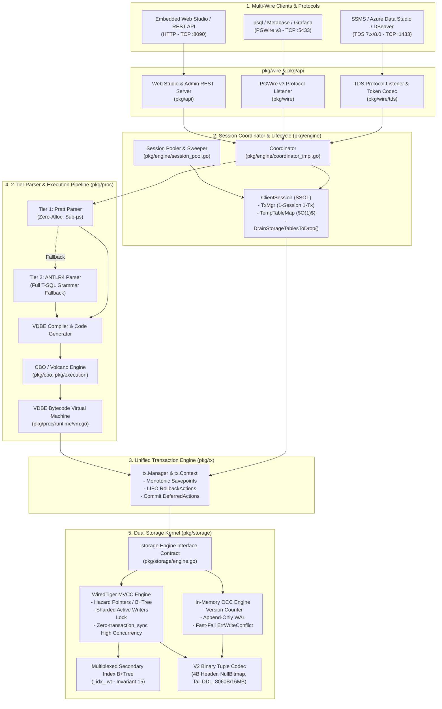
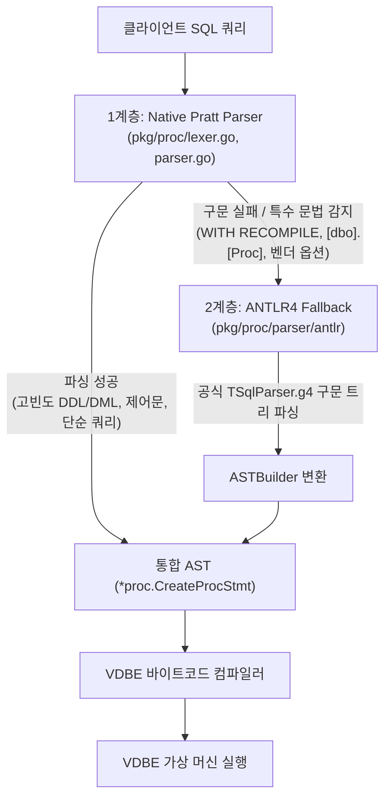

# LionSQL 시스템 아키텍처 및 기술 명세서 (`doc/ARCHITECTURE.ko.md`)

> - **최초 작성일**: 2026-09-22
> - **최종 갱신일**: 2026-11-18
> - **상태**: 최신 프로덕션 아키텍처 반영 (SSOT, V2 Tuple Codec, Multiplexed Secondary Index, Unified TxManager)
> - **English**: [doc/ARCHITECTURE.md](ARCHITECTURE.md)

---

## 1. 개요 및 아키텍처 비전

LionSQL은 외부 데몬(PgBouncer, Redis, ZooKeeper, Nginx 등) 의존성이 전무한 **단일 정적 독립 실행형(Zero-Sidecar Standalone) 고동시성 임베디드 OLTP RDBMS**입니다. Go 언어 기반의 견고한 세션/가상머신 코어와 고성능 스토리지 엔진(In-Memory OCC 및 WiredTiger MVCC B+Tree)이 결합되어, 단일 프로세스 내에서 서브 마이크로초 단위의 대화형 쿼리 처리와 엔터프라이즈 ACID 내구성을 제공합니다.

### 1.1. LionSQL 핵심 설계 원칙
1. **Scale-Up First (단일 노드 극한 포화)**: 분산 2PC(Two-Phase Commit)의 네트워크 오버헤드를 배제하고, 멀티코어 하드웨어 자원을 100% 활용하여 단일 노드에서 20,000~140,000+ TPS를 달성합니다.
2. **Multi-Wire Native Interoperability**: Microsoft SQL Server TDS(`:1433`), PostgreSQL Wire v3(`:5433`), REST/HTTP API 및 웹 스튜디오(`:8090`)를 단일 엔진에서 동시 서비스합니다.
3. **Single Source of Truth (SSOT)**: 트랜잭션, DDL 롤백 액션, 세션 임시 객체 수명주기를 분산된 상태 플래그 없이 단일 진실원천 객체(`tx.Manager`, `tx.Context`, `ClientSession`)로 일원화합니다.
4. **Zero-Regex & Deterministic Lexical Safety**: SQL 쿼리 라우팅 및 절 컴파일 과정에서 정규식(Regex)을 배제하고 결정론적 2-Tier 파서와 어휘 분석기(`pkg/sqlutil`)를 사용합니다.

---

### 1.2. 전체 시스템 계층 아키텍처 다이어그램



---

## 2. 핵심 아키텍처 하위 시스템

### 2.1. 세션 관리 및 트랜잭션 SSOT (`pkg/engine`, `pkg/tx`)

LionSQL은 다중 커넥션 풀링 환경에서 트랜잭션 상태 불일치를 원천 차단하기 위해 **1-세션 1-트랜잭션 불변식**을 엄격히 적용합니다.

```
[ ClientSession ]
   ├── txMgr *tx.Manager (SSOT: 상태 관리 단일 진실원천)
   │     ├── cs.Tx() ────────► 활성 storage.Transaction 반환
   │     ├── cs.TranCount() ──► 트랜잭션 중첩 레벨 반환
   │     └── cs.IsTxFailed() ─► 'E' 상태(PGWire 에러 블록) 판별
   │
   ├── TempTableMap map[string]string (임시 테이블 $O(1)$ SSOT)
   ├── TableVars map[string]string    (테이블 변수)
   └── EphemeralTables map[string]*EphemeralTable
         │
         ▼
   cs.DrainStorageTablesToDrop() []string
   - cs.Mu.Lock() 보호 하에 임시 물리 테이블명 원자적 수집 및 맵 일괄 초기화
   - CloseSession / ResetSession 시 c.dropSessionStorageTables()로 완결
```

1. **트랜잭셔널 DDL 라이프사이클 통합**:
   - `tx.Context`에 LIFO 순서로 등록되는 `RollbackActions []func() error` 및 커밋 시 실행되는 `DeferredActions []func() error`를 통해 DDL 롤백과 섀도 카탈로그 복구를 단일 트랜잭션 경계 내에서 완결합니다.
   - 기존의 세션별 수동 언두 큐(`cs.ddlUndoLog`)를 완전히 폐지하여 유휴 세션 타임아웃, 예기치 못한 패닉, 커넥션 단절 시에도 톰스톤 물리 테이블이 100% 자동 정리됩니다.
2. **커넥션 풀 리셋 완결성 (`ResetSession`)**:
   - TDS `sp_reset_connection` / `StatusResetConnection`, PGWire `DISCARD ALL` 수신 시 `ResetSession`이 미완료 트랜잭션을 롤백하고 세션 임시 객체를 전면 드레인/드롭하여 커넥션 풀 재사용 시 오염을 방지합니다.

---

### 2.2. Dual-Parser 아키텍처 및 자동 폴백 전략 (`pkg/proc`)

서브 마이크로초 지연시간과 Microsoft T-SQL 복합 스크립트 100% 호환성을 동시에 만족하기 위해 영구 2계층 파서 구조를 채택합니다.



- **1계층 (Fast-Path Native Pratt Parser)**: 제로 힙 할당 렉서 기반으로 표준 DDL/DML, 제어문(`IF`, `WHILE`, `TRY...CATCH`), 트랜잭션 구문을 문장당 서브 마이크로초 단위로 파싱.
- **2계층 (ANTLR4 Fallback Parser)**: 공식 Microsoft `TSqlParser.g4` 문법 기반 파서로, 대괄호 복합 식별자, `WITH RECOMPILE`, 복합 힌트 등 특수 문법을 자동 인지하여 폴백.

---

### 2.3. 비용 기반 최적화기 (CBO) & Volcano 실행 엔진 (`pkg/cbo`, `pkg/execution`)

1. **비용 기반 최적화기 (CBO)**:
   - 카탈로그 통계(`ANALYZE TABLE`) 기반 행 수, 튜플 폭, NDV(고유값 수), 널 비율, 64-버킷 등깊이 히스토그램을 토대로 물리 실행 계획(SeqScan vs IndexScan, HashJoin vs IndexNestedLoopJoin)을 수립합니다.
   - 비상관 서브쿼리를 위한 인메모리 `SubqueryHashSet`(10,000행 한도)을 통해 $O(1)$ 멤버십 조회를 수행합니다.
2. **Volcano 반복자 파이프라인 (`pkg/execution`)**:
   - `Init()`, `Next()`, `Close()` 인터페이스를 기반으로 하는 파이프라인 합성 모델.
   - `work_mem`(기본 64MB) 임계값 초과 시 디스크 임시 런 파일로 스필되는 외부 머지 소트(`SortIterator`) 지원.

---

### 2.4. Native VDBE 바이트코드 가상 머신 (`pkg/proc/runtime/vm.go`)

SQLite 스타일의 레지스터 기반 가상 머신으로, T-SQL 저장 프로시저의 제어 로직과 대화형 인터랙티브 SQL(`SELECT`, `INSERT`, `UPDATE`, `DELETE`)을 동일한 바이트코드 프로그램 상에서 실행합니다.

- **Zero-Parse 바이트코드 캐싱**: 프리페어드 스테이트먼트(`sp_prepare`, PGWire `Parse`)의 컴파일된 AST 및 Opcode 프로그램을 캐싱하여 런타임 어휘 분석 오버헤드를 생략.
- **`sync.Pool` 레지스터 풀링**: 쿼리 실행 시 레지스터 슬라이스를 풀링하여 메모리 할당 및 GC 부하를 최소화.

---

### 2.5. 듀얼 스토리지 커널 & 물리 스토리지 포맷 (`pkg/storage`)

LionSQL은 `storage.Engine` 인터페이스 계약 뒤로 두 가지 상호 보완적인 고성능 스토리지 엔진을 제공합니다.

#### (1) 스토리지 엔진 비교

| 항목 | WiredTiger MVCC (`wiredtiger`) | In-Memory OCC (`memengine`) |
|---|---|---|
| **구현 언어** | Cgo (`libwiredtiger` 임베디드) | Pure Go (`CGO_ENABLED=0` 지원) |
| **동시성 모델** | Hazard Pointer 기반 B+Tree MVCC | 단조 버전 카운터 기반 OCC |
| **쓰기 충돌 제어** | 64-샤드 `activeWriters` 락 기반 Fail-Fast 감지 | 트랜잭션 검증 시 즉시 `ErrWriteConflict` |
| **내구성 메커니즘** | WiredTiger 그룹 커밋 및 1초 주기 백그라운드 동기화 | MessagePack 스냅샷 + Append-Only Log (WAL) |
| **동시성 처리량** | **140,000+ TPS** (글로벌 동기화 락 배제) | **20,000+ TPS** (초저지연 인메모리) |

#### (2) 보조 인덱스 B+Tree 다중화 (Invariant 15)
- 테이블당 모든 보조 인덱스를 단 하나의 WiredTiger 파일(`_idx_<Table>.wt`)로 다중화(`ARCH-WT-FILE-LAYOUT-1`).
- 키 네임스페이스를 `<lower(IndexName)>\x00`로 접두하여 인덱스 생성/삭제 시 물리 파일 생성/삭제 오버헤드(`EBUSY`)를 전면 배제.
- `WT_ITEM` 바이너리 포맷을 적용하여 C NUL 문자(`\0`) 절단 결함을 원천 방지하고 순서 보존 단조 인코딩 적용.

#### (3) V2 정규 바이너리 튜플 코덱 (Invariant 13)
- **4바이트 정렬 헤더**: 버전(`0x02`), 플래그, `encodedCols` (최대 1,024개 컬럼 상한).
- **Instant Tail DDL**: 테이블 끝단 컬럼의 `ADD COLUMN` / `DROP COLUMN`을 물리 재기록 없이 $O(1)$ 시간에 수행.
- **2계층 행 크기 제한**: Layer 1 인라인 고정 크기 8,060B 상한 (`storage.MaxInlineRowSize`) 및 Layer 2 단일 논리 행 16MB 상한 (`storage.MaxRowSize`).

---

### 2.6. 멀티 와이어 프로토콜 & 클라이언트 도구 호환성 (`pkg/wire`)

1. **Microsoft SQL Server TDS 7.x/8.0 (`pkg/wire/tds`)**:
   - 기본 포트 `:1433`. PRELOGIN, LOGIN7, SQLBatch, RPC 토큰 완벽 에뮬레이션.
   - **TDS Windows Host Parity Invariant (Invariant 11)**: SSMS Object Explorer 호환을 위해 호스트 OS와 무관하게 시스템 뷰(`sys.dm_os_host_info`) 및 환경 배치가 항상 `Windows 10.0`을 반환.
2. **PostgreSQL Wire Protocol v3 (`pkg/wire`)**:
   - 기본 포트 `:5433`. Simple Query 및 Extended Query 지원.
   - `COPY FROM STDIN` / `COPY TO STDOUT` 스트리밍 지원 (`psql \copy` 및 `pg_dump` 호환).
3. **내장 웹 관리 스튜디오 (`pkg/api`, `pkg/ui`)**:
   - 기본 포트 `:8090` (`/_/` 경로에서 `embed.FS`로 서빙).
   - Server-Sent Events (SSE) 기반 실시간 데이터 동기화 및 쿼리 실행기, 테이블 뷰어, 백업/복원 UI 제공.

---

## 3. 디렉터리 레이아웃 및 패키지 구조

```
lionsql/
├── bin/                       # 컴파일된 실행 파일 (lionsql, bench 등)
├── cmd/
│   ├── lionsql/               # 단일 정적 통합 실행 바이너리 진입점
│   ├── bench/                 # 고동시성 OLTP 벤치마크 도구
│   └── crashtest/             # kill -9 크래시 복구 무결성 검증 도구
├── doc/
│   ├── ARCHITECTURE.ko.md     # 시스템 아키텍처 및 기술 명세서 (본 문서)
│   ├── internal/              # 코어 엔진 내부 상세 기술 명세 (VDBE, CBO, 물리 포맷 등)
│   └── ...                    # 사용자 매뉴얼, 가이드 및 프로토콜 규격
├── notes/                     # 아키텍처 설계 계획서(*_PLAN.ko.md) 및 리포트
├── pkg/
│   ├── api/                   # HTTP REST 서버, 웹 스튜디오 서빙, SSE 브로커
│   ├── cbo/                   # 비용 기반 최적화기 (CBO) 및 통계 엔진
│   ├── engine/                # 세션 코디네이터, 쿼리 라우팅, DDL 엔진
│   ├── execution/             # Volcano 관계형 반복자 파이프라인 및 외부 정렬기
│   ├── proc/                  # 2-Tier 파서 (Pratt + ANTLR4) 및 바이트코드 컴파일러
│   │   └── runtime/           # Native VDBE 바이트코드 가상 머신
│   ├── sqlutil/               # 결정론적 SQL 토크나이저 및 구문 유틸리티 (Zero-Regex)
│   ├── storage/               # 스토리지 추상화 계약, V2 바이너리 튜플 코덱
│   │   ├── memengine/         # Pure-Go 인메모리 OCC 스토리지 엔진
│   │   └── wiredtiger/        # WiredTiger MVCC 디스크 B+Tree 스토리지 엔진
│   ├── tx/                    # 단일 진실원천(SSOT) 트랜잭션 매니저
│   └── wire/                  # 멀티 와이어 프로토콜
│       └── tds/               # Microsoft TDS 프로토콜 리스너
├── TASKS.md                   # 엔지니어링 백로그 SSOT 레지스터
├── CHANGELOG.md               # 변경 이력 (Keep a Changelog 규격)
└── GEMINI.md                  # 코어 아키텍처 불변식 및 엔지니어링 가이드라인
```

---

## 4. 품질 보증 및 3단계 검증 파이프라인

모든 코드 수정 및 기능 추가는 **3단계 파이프라인(`[RULE:PipelineVerification]`)**을 엄격히 통과해야 합니다:

1. **컴파일 무결성 (Build)**:
   ```bash
   go build -buildvcs=false -o bin/lionsql ./cmd/lionsql
   ```
2. **동시성 레이스 프리 테스트 (Test)**:
   ```bash
   go test -v -race ./...
   ```
   - 전 패키지 100% 통과(PASS) 및 데이터 레이스 0건(0 data races) 필수.
3. **정형 커밋 및 이모지 엄금 (Commit)**:
   - Conventional Commits 형식(`feat:`, `fix:`, `refactor:` 등) 준수.
   - 주석, 커밋 메시지, 문서 전반에서 장식용 이모지 전면 배제(`[RULE:StyleIntegrity]`).
