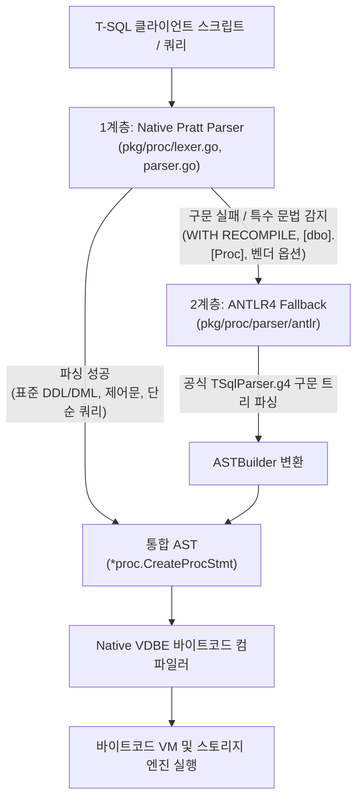

# LionSQL 시스템 아키텍처 및 기술 명세서 (`doc/ARCHITECTURE.ko.md`)

> - **최초 작성일**: 2026-09-22
> - **최종 갱신일**: 2026-11-12
> - **English**: [doc/ARCHITECTURE.md](ARCHITECTURE.md)

---

## 1. 개요 및 아키텍처 비전

LionSQL은 순수 Go 및 Cgo(WiredTiger)로 구현된 엔터프라이즈급 고동시성 임베디드 OLTP 데이터베이스 엔진입니다. 외부 운영 의존성(PgBouncer, Redis, ZooKeeper 등)이 전혀 없는 단일 정적 바이너리로 패키징되어 배포되며, 다중 스토리지 엔진 기반 ACID 보장, 완전한 Microsoft T-SQL 절차적 실행 엔진, 멀티 와이어 프로토콜 상호운용성(PostgreSQL v3 및 Microsoft TDS), 내장 커넥션 풀러, 그리고 내장 웹 관리 스튜디오(Web Studio)를 단일 프로세스 내에 유기적으로 통합합니다.

```
+---------------------------------------------------------------------------------------------------------+
|                                        Client Ecosystem & Interfaces                                    |
|   +--------------------------+   +--------------------------+   +-----------------------------------+   |
|   | PostgreSQL Tools / ORMs  |   | MSSQL Tools / Drivers    |   | HTTP REST / Embedded Web Studio   |   |
|   | (psql, DBeaver, GORM)    |   | (sqlcmd, SSMS, pymssql)  |   | (Browser Dashboard, Realtime SSE) |   |
|   | Port: 5433               |   | Port: 1433               |   | Port: 8090                        |   |
+---+--------------------------+---+--------------------------+---+-----------------------------------+---+
                                               |
                                               v
+---------------------------------------------------------------------------------------------------------+
|                                세션 및 커넥션 풀러 계층 (pkg/api)                                        |
|   - 고루틴 세션 다중화기 (PgBouncer 대체; 10,000+ 클라이언트 동시 연결 처리)                           |
|   - Bounded Worker Pool (MaxWorkers = NumCPU * 4, MaxIdleSessions = 64)                                 |
|   - Realtime Broker (Server-Sent Events pub/sub) 및 Superuser JWT / API Key 인증                        |
+---------------------------------------------------------------------------------------------------------+
                                               |
                                               v
+---------------------------------------------------------------------------------------------------------+
|                                컴파일러, 최적화기 및 플랜 캐시 계층 (pkg/proc, pkg/planner)             |
|   +-------------------------------------------------------------------------------------------------+   |
|   | Dual-Parser Engine:                                                                             |   |
|   |  - Fast-Path Native Pratt Parser (서브 마이크로초 지연시간, 제로 알로케이션)                    |   |
|   |  - Full-Spec ANTLR4 Fallback Parser (공식 Microsoft T-SQL 문법 풀 스펙)                         |   |
|   +-------------------------------------------------------------------------------------------------+   |
|   | Cost-Based Optimizer (CBO):                                                                     |   |
|   |  - 테이블/컬럼 통계 카탈로그 (ANALYZE TABLE, Equi-depth Histograms, NDV, Selectivity)              |   |
|   |  - 물리 실행 플랜 비용 모델 (Index Scan vs Seq Scan, Hash Join vs Nested Loop Join)             |   |
|   |  - EXPLAIN & EXPLAIN ANALYZE 플랜 트리 시각화기                                                 |   |
|   +-------------------------------------------------------------------------------------------------+   |
|   | Plan Cache: LRU 스레드 세이프 AST 및 바이트코드 프로그램 캐시                                   |   |
+---+-------------------------------------------------------------------------------------------------+---+
                                               |
                                               v
+---------------------------------------------------------------------------------------------------------+
|                  통합 실행 계층: Native VDBE Bytecode Virtual Machine (pkg/proc/runtime)                |
|   - 단일 엔진 패리티: 인터랙티브 DQL & DML (SELECT, INSERT, UPDATE, DELETE) 및 프로시저/트리거 통합     |
|   - PostgreSQL Wire 및 Microsoft TDS 전반의 Zero-Parse 프리페어드 스테이트먼트 바이트코드 캐싱         |
|   - sync.Pool 레지스터 할당기, 앰비언트 ACID 트랜잭션 바인딩 및 Opcode 디스패처                         |
|                                                                                                         |
|         ┌───────────────────────────────────────────────────┬──────────────────────────────────┐        |
|         ▼                                                   ▼                                  ▼        |
|   [Volcano Query Pipeline (OpRelQuery)]        [Secondary Index Scan (OpIndexScan)]  [Direct DML Ops]   |
|   - 합성 가능한 반복자 (HashJoin, GroupBy 등)  - SkipList & B+Tree 범위 스캔         - OpInsert/Update  |
|   - work_mem 메모리 거버너 및 외부 정렬        - 자동 술어 인덱스 매칭               - OpDelete         |
+---------------------------------------------------------------------------------------------------------+
                                               |
                                               v
+---------------------------------------------------------------------------------------------------------+
|                                      통합 스토리지 계층 (pkg/storage)                                   |
|   storage.Engine 인터페이스: TableSchema, IndexSchema, Value, Record, Session, Transaction              |
|   +----------------------------------------------+   +----------------------------------------------+   |
|   | WiredTiger Engine (pkg/storage/wiredtiger)   |   | Memory Engine (pkg/storage/memengine)        |   |
|   |  - 기본 프로덕션 디스크 엔진 (Cgo)           |   |  - Pure Go 엔진 / 밀폐형 테스트 엔진         |   |
|   |  - Hazard Pointer 기반 락프리 B+Tree         |   |  - Optimistic Concurrency Control (OCC)      |   |
|   |  - MVCC 읽기 전용 스냅샷 격리                |   |  - MessagePack 베이스 스냅샷 (tables.mpk)    |   |
|   |  - 로우레벨 디스크 체크포인트 & Write-Log    |   |  - Append-Only Write-Ahead Log (wal.aof)     |   |
|   +----------------------------------------------+   +----------------------------------------------+   |
+---------------------------------------------------------------------------------------------------------+
                                               |
                                               v
+---------------------------------------------------------------------------------------------------------+
|                                고가용성, 복제 및 백업 계층                                              |
|   - 1-Writer Multi-Reader 토폴로지: Linear WAL 스트리밍 및 Replica Broadcaster (pkg/replication)       |
|   - 무중단 페일오버 및 레플리카 프로모션 (/api/replication/promote, /api/replication/demote)            |
|   - 논블로킹 온라인 스냅샷 핫 백업 (.tar.gz 형태의 메타데이터, 스키마, 카탈로그, mpk 데이터 패키징)   |
|   - Point-in-Time 복구 엔진 (CLI: -backup / -restore, HTTP: /api/backup, /api/restore)                 |
|   - 데몬 생명주기 관리 (start, stop, restart, status 및 PID/락파일 제어)                               |
+---------------------------------------------------------------------------------------------------------+
```

---

## 2. 핵심 아키텍처 하위 시스템

### 2.1. Dual-Parser 아키텍처 및 자동 폴백 전략

서브 마이크로초 단위의 초고속 파싱 지연시간과 엔터프라이즈 Microsoft T-SQL 복합 스크립트에 대한 완벽한 문법 호환성을 동시에 확보하기 위해, LionSQL은 영구적인 2계층(Dual-Parser) 파서 아키텍처를 채택합니다.



#### 주요 특징:
1. **1계층 Fast-Path (Native Pratt Parser)**:
   - 자체 제작된 제로 알로케이션 렉서 및 재귀 하향 / Pratt 표현식 파서.
   - 고빈도 쿼리(`SELECT`, `INSERT`, `UPDATE`, `DELETE`, `IF...ELSE`, `WHILE`, `TRY...CATCH`, `BEGIN...COMMIT/ROLLBACK`)에 최적화.
   - 문장당 서브 마이크로초 단위의 파싱 속도 달성.
2. **2계층 Fallback (공식 Microsoft T-SQL ANTLR4 Parser)**:
   - 공식 ANTLR4 `TSqlParser.g4` 문법을 Go 언어로 컴파일하여 내장.
   - 대괄호 이스케이프 식별자(`[dbo].[accounts]`), 복합 프로시저 옵션(`WITH ENCRYPTION`, `WITH RECOMPILE`), 커서 선언문, 특수 DDL 절 등을 100% 호환 처리.
3. **플러그형 디커플링 (순환 의존성 완전 격리)**:
   - `pkg/proc` 패키지에 `ProcedureFallbackParser` 함수 훅을 선언.
   - `pkg/proc/parser/antlr/ast_builder.go`가 `init()` 시점에 폴백 구현체를 등록.
   - `pkg/proc`가 `pkg/proc/parser/antlr`를 직접 임포트하지 않으므로 순환 참조가 원천 차단됩니다.

---

### 2.2. 비용 기반 최적화기 (CBO) 및 통계 엔진

쿼리 최적화기는 논리적 동치 변환과 통계 기반 비용 추정을 통합하여 최적의 물리 실행 계획을 수립합니다.

```
[SQL Query]
    │
    ▼
[AST Logical Plan]
    │
    ▼
[Logical Planner] ───> 논리 연산자 (LogicalScan, LogicalFilter, LogicalJoin, LogicalAggregate)
    │
    ▼
[Cost-Based Physical Optimizer (pkg/planner/cost.go)]
    │   ├── 카탈로그 통계 (ANALYZE TABLE)
    │   │     ├── 행 수(Row Count), 페이지 수, 평균 튜플 바이트 폭
    │   │     └── 컬럼 통계 (NDV, 널 값 비율, 64-버킷 Equi-Depth 히스토그램)
    │   ├── 연산자 비용 모델:
    │   │     ├── SeqScan vs IndexScan (페이지 I/O + 튜플 CPU * 선택도)
    │   │     └── HashJoin vs IndexNestedLoopJoin (빌드/프로브 테이블 선정)
    │   └── 히스토그램 기반 범위 검색 선택도 추정
    ▼
[Physical Plan Tree] ───> [Volcano Iterator Pipeline]
```

#### 통계 메타데이터:
- **`ANALYZE TABLE <name>`**: 격리된 읽기 전용 트랜잭션 내에서 대상 테이블을 스캔하여 다음 통계를 수집:
  - 총 행 수 및 물리적 데이터 용량.
  - 컬럼별 고유 값 개수 (`NDV` - Number of Distinct Values).
  - 널 값 비율.
  - 비균등 데이터 분포 추적을 위한 64-버킷 등깊이 히스토그램 (`HistogramBucket{LowerBound, UpperBound, Count, DistinctCount}`).
- **`EXPLAIN` 및 `EXPLAIN ANALYZE`**: 각 파이프라인 단계별 추정 비용 범위(`cost=0.00..45.20 rows=100`)와 실제 실행 시간(Wall-clock) 및 반환 튜플 수를 시각화.

---

### 2.3. Volcano 관계형 실행 엔진 및 메모리 거버너

모든 관계형 쿼리는 Volcano 반복자 모델(`pkg/execution/`)을 통해 실행됩니다.

```go
type Iterator interface {
    Init(ctx context.Context) error
    Next() (Tuple, error)
    Close() error
}
```

#### 파이프라인 연산자:
- **`SeqScanIterator` & `IndexScanIterator`**: 순차 스캔 또는 보조 인덱스 범위를 통해 튜플 스트리밍.
- **`FilterIterator` & `ProjectIterator`**: 조건에 맞지 않는 행에 대해 힙 할당을 발생시키지 않는 즉석 식 평가.
- **`HashJoinIterator`**: CBO가 선정한 더 작은 릴레이션에 대해 인메모리 해시 테이블을 빌드하고 외부 스트림으로 프로브.
- **`IndexNestedLoopJoinIterator`**: 외부 튜플마다 내부 보조 인덱스를 직접 프로브.
- **`GroupByIterator`**: 해시 기반 및 사전 정렬 기반 스트리밍 그룹 집계(`COUNT`, `SUM`, `AVG`, `MIN`, `MAX`).
- **`SortIterator` (External Merge Sort 지원)**:
  - `work_mem` 임계값 대비 누적 튜플 메모리 사용량을 추적.
  - 메모리가 `work_mem`을 초과하면 인메모리 청크를 정렬하여 디스크 임시 런 파일(`lionsql-sort-run-*.tmp`)로 스필(Spill).
  - 스필된 런 파일들과 잔여 튜플들을 N-way Min-Heap(`tupleMergeHeap`)을 통해 병합.
  - `Close()` 시점에 모든 임시 런 파일을 안전하게 닫고 삭제.

#### 메모리 거버너 설정:
- 서버 기본값: `DefaultWorkMem = 64MB` (CLI `-work-mem=64MB`로 지정 가능).
- 동적 세션 오버라이드: `SET work_mem = '128MB'`, `SHOW work_mem`, `SELECT @@work_mem`.

---

### 2.4. Native VDBE 바이트코드 가상 머신 및 단일 엔진 실행

LionSQL은 저장 프로시저의 절차적 제어 로직과 대화형 인터랙티브 쿼리(`SELECT`, `INSERT`, `UPDATE`, `DELETE`)를 동일한 레지스터 기반 VDBE 가상 머신으로 일원화하여 실행합니다.

```
[인터랙티브 SQL / T-SQL 스크립트 / Prepared Stmt]
                       │
                       ▼
    [바이트코드 컴파일러 (pkg/proc/compiler.go)]
    - CompileQuery: SELECT 쿼리 ➔ OpRelQuery
    - CompileStatement: INSERT/UPDATE/DELETE ➔ OpInsert/Update/Delete
    - CompileProcedure: 저장 프로시저, 트리거, 사용자 정의 함수
                       │
                       ▼
         [바이트코드 프로그램 (Opcode 스트림)]
    00: OpInit           reg: 0
    01: OpOpenRead       table: "accounts"
    02: OpIndexScan      table: "accounts", idx: "idx_holder", val: "Alice"
    03: OpColumn         col: "balance", reg: 1
    04: OpLt             reg: 1, val: 500, jump: 08
    05: OpUpdate         table: "accounts", reg: 1
    06: OpCommit
    07: OpHalt           code: 0
    08: OpRaiseError     msg: "Insufficient funds"
    09: OpRollback
    10: OpHalt           code: -1
                       │
                       ▼
       [가상 머신 실행기 (pkg/proc/runtime/vm.go)]
    - 프로그램 카운터(IP) 기반의 순차적 Opcode 평가
    - sync.Pool 레지스터 배열 재활용으로 GC 압력 최소화
    - s.executor.ExecuteInTx를 통한 활성 세션 트랜잭션 바인딩
    - 조인/집계 처리를 위해 OpRelQuery를 통한 Volcano 파이프라인 연계
    - PGWire 및 TDS 캐시 기반의 제로 파싱 Prepared Statement 실행
```

#### 핵심 역량:
1. **인터랙티브 DQL & DML 단일화**:
   - `SELECT` 쿼리는 단일 인스트럭션 프로그램(`OpRelQuery`)으로 컴파일되어 Volcano 물리 실행 파이프라인을 구동하면서 트랜잭션 및 세션 컨텍스트를 바인딩합니다.
   - `INSERT`, `UPDATE`, `DELETE`는 `OpInsert`, `OpUpdate`, `OpDelete`로 컴파일되어 스키마 검증, Identity 컬럼 자동 추적, 영향받은 행 수(Rows Affected)를 정확히 반환합니다.
2. **Prepared Statement 바이트코드 캐싱**:
   - PostgreSQL Wire Protocol(`Parse`)과 Microsoft TDS(`sp_prepare`) 모두 매개변수화된 쿼리를 `*proc.Program` 인스턴스로 사전 컴파일하여 보관합니다.
   - `Execute` 및 `sp_execute` 호출 시 `s.executor.Run(program, ...)`을 직접 호출하여 어휘 분석 및 AST 생성 오버헤드를 완전히 생략합니다.
3. **보조 인덱스 Opcode `OpIndexScan`**:
   - B+Tree 또는 SkipList 보조 인덱스를 직접 스캔하여, 필터 조건이 인덱스 컬럼과 일치할 때 풀 테이블 스캔을 방지합니다.
4. **트리거용 가상 델타 테이블**:
   - 트리거 실행 중 임시 가상 테이블인 `INSERTED` 및 `DELETED`를 인메모리에 구체화하여 T-SQL 표준 트리거 로직을 완벽히 지원합니다.

---

### 2.5. 듀얼 스토리지 백엔드 및 동시성 아키텍처

LionSQL은 스토리지 계층을 `storage.Engine` 인터페이스 계약 뒤로 완전히 추상화하여, 워크로드 특성에 맞게 두 가지 구체적 엔진을 제공합니다.

```
                                [ storage.Engine Interface ]
                                              │
                    ┌─────────────────────────┴─────────────────────────┐
                    │                                                   │
                    ▼                                                   ▼
     [ WiredTiger Storage Engine ]                       [ In-Memory OCC Storage Engine ]
     (pkg/storage/wiredtiger)                            (pkg/storage/memengine)
     - libwiredtiger 기반 Cgo 바인딩                     - Pure Go 엔진 (Zero Cgo, 완전한 크로스 플랫폼)
     - 락프리 B+Tree 인덱싱 구조                         - 행 단위 버전 관리 및 OCC 유효성 검증
     - Hazard Pointer 기반 메모리 보호                   - 정렬된 인메모리 보조 인덱스 슬라이스
     - MVCC 트랜잭션 스냅샷 격리                         - 하이브리드 영속성:
     - 백그라운드 자동 디스크 체크포인트                   * MessagePack 베이스 스냅샷 (tables.mpk)
     - 로우레벨 디스크 WAL 쓰기 로깅                      * 단조 증가 LSN Append-Only Log (wal.aof)
                                                           * 백그라운드 자동 AOF rewrite 압축
```

#### 스토리지 엔진 비교:

| 항목 | WiredTiger (`wiredtiger`) | Memory Engine (`memengine`) |
|---|---|---|
| **구현 언어 및 빌드** | Cgo (`libwiredtiger` 라이브러리 필요) | Pure Go (`CGO_ENABLED=0` 단일 정적 컴파일 가능) |
| **동시성 제어 모델** | 다중 버전 동시성 제어 (MVCC) | 낙관적 동시성 제어 (OCC) |
| **디스크 자료구조** | Hazard Pointer 보호 락프리 B+Tree | 해시 맵 + 정렬된 슬라이스 인덱스 |
| **트랜잭션 내구성** | WiredTiger 디스크 체크포인트 및 로그 | MessagePack 스냅샷 + AOF Append 로그 하이브리드 |
| **Fsync 정책** | WiredTiger 하위 시스템 위임 | `FsyncEverySec`, `FsyncAlways`, `FsyncNone` |
| **주요 사용 사례** | 프로덕션 엔터프라이즈 멀티코어 대용량 OLTP | 임베디드 엣지, 경량 서버, 테스트/CI 환경 |

---

### 2.6. 멀티 와이어 프로토콜 및 내장 커넥션 풀러

외부 프록시 데몬(PgBouncer 등) 없이도 서로 다른 클라이언트 드라이버를 동시에 수용할 수 있도록 독립된 포트에서 멀티 와이어 프로토콜 리스너를 실행합니다.

```mermaid
sequenceDiagram
    autonumber
    participant Client as 클라이언트 애플리케이션 (psql / ORM / SSMS)
    participant Multiplexer as 고루틴 세션 다중화기 (pkg/api/pool.go)
    participant Worker as 실행 워커 풀 (Execution Worker Pool)
    participant Engine as 스토리지 엔진 (WiredTiger / Memory)

    Client->>Multiplexer: 연결 요청 (TCP 핸드셰이크 :5433 또는 :1433)
    Note over Multiplexer: 경량 Go 고루틴(~4KB) 즉시 생성.<br/>OS 프로세스 생성 오버헤드 전무.
    Multiplexer->>Multiplexer: 세션 풀에서 유휴 세션 획득
    Client->>Multiplexer: 쿼리 패킷 전송 ('Q' 또는 SQLBatch)
    Multiplexer->>Worker: 워커 채널로 쿼리 작업 큐잉
    Worker->>Engine: ACID 트랜잭션 컨텍스트 하에서 쿼리 실행
    Engine-->>Worker: 결과 튜플셋 / 영향받은 행 수 반환
    Worker-->>Multiplexer: 프로토콜 포맷 응답 패킷 반환
    Multiplexer-->>Client: RowDescription, DataRow, CommandComplete 스트리밍
    Multiplexer->>Multiplexer: 세션을 풀에 반환; 워커는 다음 작업 대기
```

#### 프로토콜 기능:
1. **PostgreSQL Wire Protocol v3 (`pkg/wire/`)**:
   - 기본 포트 `:5433`.
   - Simple Query(`'Q'`) 및 Extended Query 프로토콜(`'P'` Parse, `'B'` Bind, `'D'` Describe, `'E'` Execute, `'S'` Sync, `'C'` Close) 완전 지원.
   - `psql`, DBeaver, GORM, Prisma, node-postgres 등 표준 PostgreSQL 드라이버와 100% 호환.
2. **PostgreSQL 대량 복사 스트리밍 (`pkg/wire/copy.go`)**:
   - `COPY <table> FROM STDIN [WITH (FORMAT CSV, HEADER)]`:
     - 서버가 `CopyInResponse ('G')` 응답을 전송.
     - 클라이언트가 `CopyData ('d')` 청크를 스트리밍.
     - 서버가 CSV/TSV를 파싱하여 단일 ACID 트랜잭션 내에서 일괄 적재.
     - 완료 후 행 수와 함께 `CommandComplete ('C')` 전송.
   - `COPY <table> TO STDOUT [WITH (FORMAT CSV, HEADER)]`:
     - 서버가 `CopyOutResponse ('H')` 응답을 전송.
     - 논블로킹 스냅샷 트랜잭션 하에서 테이블 행들을 약 32KB 단위 `CopyData ('d')` 청크로 스트리밍.
     - `CopyDone ('c')` 및 `CommandComplete ('C')`로 종료.
   - `psql \copy` 및 `pg_dump` 완벽 호환.
3. **Microsoft SQL Server TDS 7.x/8.0 프로토콜 (`pkg/wire/tds/`)**:
   - 기본 포트 `:1433`.
   - SSMS(SQL Server Management Studio), `sqlcmd`, ADO.NET 연동을 위한 PRELOGIN, LOGIN7, SQLBatch, RPC 토큰 파싱 완전 지원.

---

### 2.7. 온라인 스냅샷 핫 백업 및 시점 복구 엔진

서비스 중단이나 쓰기 잠금 없이 가동 중인 데이터베이스를 안전하게 백업할 수 있는 온라인 핫 백업 엔진을 내장하고 있습니다.

```
운영 중인 데이터베이스 엔진 (실시간 읽기/쓰기 처리 중)
        │
        ▼ (읽기 전용 스냅샷 트랜잭션 오픈)
[시점 뷰 T0 (MVCC/OCC)] ─── 락 경합 전무; 쓰기 트랜잭션 차단 없음
        │
        ├── 스키마 스캔 ────────────> schemas.json
        ├── 카탈로그 스캔 ──────────> catalog/ (프로시저, 함수, 트리거)
        ├── 테이블 레코드 스트리밍 ──> data/<table_name>.jsonl (버퍼 청크)
        └── 요약 정보 연산 ─────────> manifest.json (타임스탬프, 행 수, 체크섬)
        │
        ▼ (Gzip & Tar 아카이빙 스트림)
[원자적 파일 기록기 (Rule: AtomicSaves)] ─── lionsql-backup-*.tmp 생성 ➔ 원자적 rename
        │
        ▼
[단일 백업 아카이브 완성: lionsql-backup-20240922-133000.tar.gz]
```

#### 백업 전달 채널:
- **HTTP 스트리밍 API**:
  - `GET /api/backup` 및 `POST /api/backup`: `application/gzip` 직접 스트리밍 다운로드 또는 `{"target": "path"}`를 통한 서버 디스크 스냅샷 저장.
  - `POST /api/restore`: 멀티파트 폼 업로드 또는 파일 경로 기반 복원(`{"source": "path"}`).
- **CLI 명령어**:
  - `lionsql -dir data -backup backup.tar.gz`
  - `lionsql -dir data -restore backup.tar.gz`
- **내장 Web Studio**:
  - 브라우저 상에서 원클릭 백업 다운로드 버튼 및 복원 업로드 모달 제공.

---

### 2.8. 내장 웹 관리 스튜디오 (Web Management Studio)

LionSQL은 브라우저에서 즉시 접속 가능한 모던 관리 대시보드(`pkg/ui/dashboard.html`, `/_/` 경로에서 `embed.FS`로 서빙)를 내장하고 있습니다.
1. **실시간 데이터 동기화**: Server-Sent Events (SSE) 스트림(`/api/realtime`)을 통해 테이블 변경 이벤트(`ActionCreate`, `ActionUpdate`, `ActionDelete`, `ActionImport`)가 열려 있는 모든 브라우저 탭에 즉시 푸시됩니다.
2. **인터랙티브 SQL 쿼리 스튜디오**: 쿼리 실행 이력, 즐겨찾기, 실시간 신택스 하이라이팅 및 `EXPLAIN ANALYZE` 실행 계획 시각화 지원.
3. **스프레드시트형 테이블 에디터**: 인플레이스 셀 편집, 컬럼 정렬, 페이지네이션 및 전문 텍스트 검색 지원.
4. **보안 및 API 키 발급**: 슈퍼유저 JWT 인증 및 읽기 전용, 테이블별 스코프 제한이 가능한 API 키 생성 기능.
5. **시스템 메트릭 모니터링**: 실시간 워커 풀 및 스토리지 세션 통계(`/api/pool/stats`) 제공.

---

## 3. 디렉터리 레이아웃 및 모듈 구조

```
lionsql/
├── bin/                       # 빌드된 바이너리 (server, bench)
├── cmd/
│   ├── server/                # 서버 진입점, CLI 플래그, 데몬 제어기
│   └── bench/                 # 고동시성 OLTP 및 스토리지 벤치마크 도구
├── doc/
│   ├── ADR.md                 # 아키텍처 결정 레코드 (ADR 001 - 018)
│   ├── ARCHITECTURE.md        # 전체 시스템 기술 명세서 (영문 원본)
│   └── ARCHITECTURE.ko.md     # 전체 시스템 기술 명세서 (한글 공식 문서)
├── pkg/
│   ├── api/                   # HTTP REST API, 세션 풀러, Realtime 브로커, 인증
│   ├── auth/                  # 비밀번호 해싱 (bcrypt), JWT 발급 및 무효화
│   ├── backup/                # 논블로킹 스냅샷 백업 및 복구 엔진
│   ├── catalog/               # 시스템 카탈로그, 테이블 스키마, 프로시저, 트리거, 통계
│   ├── config/                # JSON 및 CLI 설정 로더 및 계층적 해소기
│   ├── execution/             # Volcano 반복자 엔진, 메모리 거버너, 외부 정렬기
│   ├── planner/               # 비용 기반 최적화기 (CBO), 비용 공식, 히스토그램
│   ├── proc/                  # T-SQL 컴파일러, 네이티브 Pratt 파서, 플랜 캐시
│   │   ├── parser/antlr/      # 공식 Microsoft T-SQL ANTLR4 폴백 파서
│   │   └── runtime/           # Native VDBE 바이트코드 VM, 앰비언트 트랜잭션
│   ├── replication/           # 1-Writer Multi-Reader WAL 스트리밍, 브로드캐스터, 레플리카 클라이언트
│   ├── storage/               # 통합 storage.Engine 인터페이스, Value/Record 추상화
│   │   ├── memengine/         # WAL/AOF 영속성 지원 Pure-Go OCC 인메모리 엔진
│   │   └── wiredtiger/        # WiredTiger Cgo 스토리지 엔진 구현체
│   ├── ui/                    # 내장 HTML/CSS/JS 대시보드 (embed.FS)
│   └── wire/                  # 멀티 와이어 프로토콜: PostgreSQL v3, COPY, TDS 7.x/8.0
├── GEMINI.md                  # 프로젝트 엔지니어링 규칙 및 아키텍처 불변식
├── GEMINI.ko.md               # 프로젝트 엔지니어링 규칙 및 아키텍처 불변식 (한글)
├── TODO.ko.md                 # 일일 액티브 엔지니어링 백로그 및 태스크 트래커
└── go.mod                     # Go 모듈 정의
```

---

## 4. 운영 런북 및 CLI 레퍼런스

### 4.1. 서버 실행 및 CLI 옵션

```bash
# 기본 WiredTiger 스토리지 엔진으로 서버 시작
./bin/lionsql -http=127.0.0.1:8090 -pg=127.0.0.1:5433 -tds=127.0.0.1:1433 -dir=data

# Pure-Go 인메모리 엔진으로 서버 시작 (Cgo 의존성 전무)
./bin/lionsql -engine=memory -http=127.0.0.1:8090 -dir=data

# 쿼리 메모리 거버너 예산 및 워커 풀 설정
./bin/lionsql -work-mem=128MB -max-workers=32 -max-idle-sessions=128

# 데몬 모드 생명주기 제어
./bin/lionsql start -dev        # 백그라운드 데몬 구동
./bin/lionsql status            # 실행 중인 데몬 상태 및 PID 확인
./bin/lionsql restart -dev      # 무중단 안전 재기동
./bin/lionsql stop              # 데몬 정상 종료
```

### 4.2. 백업 및 복원 운영

```bash
# 오프라인 또는 CLI 기반 스냅샷 핫 백업
./bin/lionsql backup -dir=data -target=/backups/lionsql-snapshot.tar.gz

# 아카이브로부터 데이터베이스 복원
./bin/lionsql restore -dir=data -source=/backups/lionsql-snapshot.tar.gz

# curl을 이용한 온라인 라이브 백업 스트리밍 다운로드
curl -OJ http://127.0.0.1:8090/api/backup

# psql을 이용한 CSV 일괄 적재 (Bulk Copy)
psql -h 127.0.0.1 -p 5433 -d postgres -c "\copy accounts from 'accounts.csv' with (format csv, header)"

# psql을 이용한 CSV 일괄 추출
psql -h 127.0.0.1 -p 5433 -d postgres -c "\copy accounts to 'accounts.csv' with (format csv, header)"
```

---

## 5. 엔지니어링 품질 및 검증 파이프라인

모든 기능 구현, 버그 수정, 리팩토링은 다음의 **3단계 검증 파이프라인(`[RULE:PipelineVerification]`)**을 엄격히 통과해야 합니다:

1. **1단계: 컴파일 무결성 검증 (Build)**
   ```bash
   go build -tags wiredtiger -buildvcs=false -o bin/server ./cmd/server && \
   go build -tags wiredtiger -buildvcs=false -o bin/lionsql ./cmd/lionsql && \
   go build -tags wiredtiger -buildvcs=false -o bin/bench ./cmd/bench && \
   go build -tags wiredtiger -buildvcs=false -o bin/tpcc-runtime ./cmd/tpcc_runtime
   ```
2. **2단계: 레이스 프리 테스트 검증 (Test)**
   ```bash
   go test -tags wiredtiger -count=1 -v -race ./...
   ```
   **모든 패키지 100% 통과(PASS) 및 데이터 레이스 0건(0 data races)**을 만족해야 합니다.
3. **3단계: 정형 커밋 규격 준수 (Commit)**
   - Conventional Commits 형식(`feat(...)`, `fix(...)`, `refactor(...)` 등)을 엄격히 준수합니다.
   - 커밋 메시지, 소스 코드 주석, 로그 및 문서 전반에서 장식용 이모지를 엄격히 배제합니다(`[RULE:StyleIntegrity]`).
