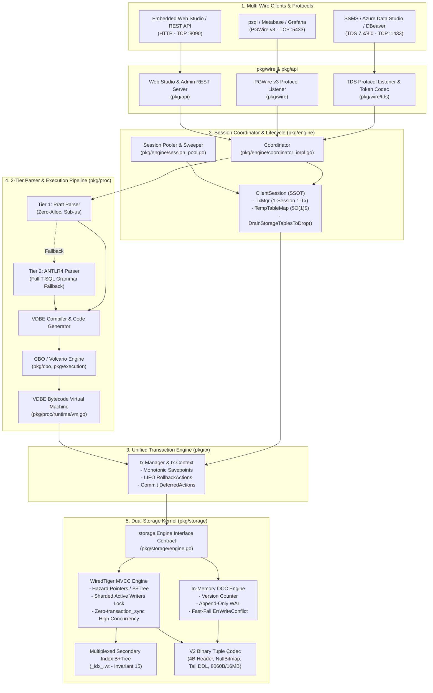

# LionSQL System Architecture & Technical Specification (`doc/ARCHITECTURE.md`)

> - **Created**: 2026-09-22
> - **Last Updated**: 2026-11-21
> - **Status**: Production Architecture Baseline (SSOT, V2 Tuple Codec, Multiplexed Secondary Index, Unified TxManager)
> - **Korean**: [doc/ARCHITECTURE.ko.md](ARCHITECTURE.ko.md)

---

## 1. Architectural Vision and Four Core Design Principles (Why LionSQL?)

LionSQL is a **Zero-Sidecar Standalone High-Concurrency Embedded OLTP RDBMS** engineered without any external daemon dependencies (no PgBouncer, Redis, ZooKeeper, Nginx, or etcd). Combining a robust Go-based session and virtual machine core with high-performance storage kernels (In-Memory OCC and WiredTiger MVCC B+Tree), it delivers sub-microsecond interactive query processing and enterprise ACID durability within a single unified process.

### 1.1. Design Philosophy & Explicit Trade-Offs (Focus & Elimination)
The strength of LionSQL's architecture stems not from claiming to *"support everything"*, but from **"what was deliberately eliminated (Spec-Out) and what was strictly focused on for extreme OLTP performance"**:

1. **Scale-Up First (Single-Node Hardware Saturation vs. Distributed 2PC Elimination)**:
   - Eliminates two-phase commit (2PC) network latency, distributed deadlock resolution, and multi-node coordination overhead.
   - Fully saturates multi-core hardware on a single node, delivering **20,000 to 140,000+ TPS** on commodity servers.
2. **Zero-Regex & Deterministic Lexical Safety (Context-Aware Parsing vs. Regular Expression Elimination)**:
   - Applying regular expressions (Type 3 grammars) to SQL containing nested parentheses, string literals, and identifiers inevitably causes boundary truncation and literal contamination bugs.
   - Permanently bans regular expressions from all query routing, clause compilation, and parameter extraction in favor of deterministic tokenizers (`pkg/sqlutil`) and a 2-Tier parser.
3. **Single-File Secondary Index Multiplexing (B+Tree Multiplexing vs. File Descriptor Proliferation)**:
   - Allocating separate physical files for every secondary index triggers OS file descriptor exhaustion, directory pollution, and `EBUSY` locking contention during frequent DDL operations.
   - Multiplexes all secondary indexes of a table into a single B+Tree file (`_idx_<Table>.wt`), guaranteeing $O(1)$ instant index creation inside transactions.
4. **Non-Blocking Snapshot Read (Non-Blocking Reads vs. Heavy 2PL Elimination)**:
   - Eliminates traditional Two-Phase Locking (2PL) shared read locks that stall readers on active writes.
   - Readers never block writers, and writers never block readers under Snapshot Isolation.

### 1.2. The Four Pillars (Organic Component Integration)

LionSQL operates as an organic single-process database kernel powered by four tightly integrated pillars:

```
┌───────────────────────────────────────────────────────────────────────────┐
│                     LionSQL Autonomous Database Kernel                    │
├─────────────────────────────────────┬─────────────────────────────────────┤
│ 1. 2-Tier Parsing Engine (Senses)   │ 2. VDBE & CBO Execution Engine (Heart)│
│ - Pratt Recursive-Descent Fast-Path │ - SQLite-style VDBE Bytecode VM     │
│ - ANTLR4 Full T-SQL/PG Fallback     │ - Volcano Iterator & Hash Join      │
│ ➔ "Sub-microsecond Syntax Mastery"  │ ➔ "sync.Pool Zero-Alloc Execution"  │
├─────────────────────────────────────┼─────────────────────────────────────┤
│ 3. Unified TxManager (Brain)        │ 4. Storage Kernel & Codec (Muscle)  │
│ - 1-Session 1-Tx SSOT Invariant     │ - In-Memory OCC & WiredTiger MVCC   │
│ - LIFO RollbackActions Queue        │ - V2 Canonical Binary Tuple Codec   │
│ ➔ "Single Brain of Session Integrity"│ ➔ "Zero-Drift Physical Durability" │
└─────────────────────────────────────┴─────────────────────────────────────┘
```

---

## 2. End-to-End Pipeline Architecture

The complete data pipeline illustrates how incoming client requests traverse network listeners, enter the session coordinator, compile into bytecode, execute against the unified transaction manager, and persist to physical storage.



---

## 3. Core Subsystems & Architectural Invariants

### 3.1. Multi-Wire Protocols & Session Coordinator (`pkg/wire`, `pkg/engine`)

1. **Microsoft TDS 7.x/8.0 & Permanent Windows Host Emulation (Invariant 11)**:
   - Implements full TDS PRELOGIN, LOGIN7, SQLBatch, and RPC token streaming for SSMS, ADO.NET, and DBeaver.
   - **TDS Windows Platform Parity**: Even when running natively on macOS or Linux, TDS environment batches and system views (`sys.dm_os_host_info`) unconditionally return `host_platform = "Windows"` and `host_release = "10.0"`. This prevents SSMS Object Explorer from throwing fatal `System.InvalidOperationException` caused by unsupported non-Windows OS identifiers.
2. **PostgreSQL Wire Protocol v3 & Streaming Bulk Copy**:
   - Supports both Simple Query and Extended Query (`Parse`, `Bind`, `Execute`, `Sync`) pipelines.
   - Fully supports `COPY FROM STDIN` and `COPY TO STDOUT` via non-blocking 32KB streaming chunks, providing native compatibility with `psql \copy` and high-speed data migration tools.
3. **Connection Pool Isolation & Complete Session Reset (`ResetSession`)**:
   - Handles TDS `sp_reset_connection` and PGWire `DISCARD ALL` by safely rolling back active transactions, clearing session variables, and purging session-scoped temporary objects via `cs.DrainStorageTablesToDrop()`, preventing state pollution across pooled connections.

---

### 3.2. Unified Transaction Manager & State Management SSOT (`pkg/tx`, `pkg/engine`)

LionSQL enforces a Single Source of Truth (SSOT) architecture, eradicating distributed status flags and disjoint state trackers:

```
[ ClientSession ]
   ├── txMgr *tx.Manager (SSOT: Single Source of Truth for Transaction State)
   │     ├── cs.Tx() ────────► Returns active storage.Transaction handle
   │     ├── cs.TranCount() ──► Returns transaction nesting level
   │     └── cs.IsTxFailed() ─► Determines 'E' status (PGWire Error Block)
   │
   ├── TempTableMap map[string]string (Temporary Table $O(1)$ SSOT)
   ├── TableVars map[string]string    (Table Variables)
   └── EphemeralTables map[string]*EphemeralTable
         │
         ▼
   cs.DrainStorageTablesToDrop() []string
   - Atomically collects temporary table names and clears internal maps under cs.Mu.Lock()
   - Invoked during CloseSession / ResetSession via c.dropSessionStorageTables()
```

1. **1-Session 1-Transaction Invariant**:
   - Direct field access to `cs.Tx` is prohibited; all transaction queries and operations must query `tx.Manager` via formal accessors (`cs.Tx()`, `cs.TranCount()`, `cs.IsTxFailed()`).
2. **Transactional DDL Lifecycle Integration**:
   - Registers **LIFO `RollbackActions []func() error`** and **Commit `DeferredActions []func() error`** into `tx.Context`.
   - On rollback, shadow catalog state restoration and physical tombstone cleanup execute deterministically without manual undo queues, preventing resource leaks even during unexpected client disconnects, timeouts, or recovered panics.
3. **Session Temporary Object Lifecycle Encapsulation**:
   - Replaced legacy $O(N)$ slice searches (`TempTables []string`) with an $O(1)$ `TempTableMap`.
   - Consolidated duplicate teardown routines across `CloseSession` and `ResetSession` into a single canonical `cs.DrainStorageTablesToDrop()` method.

---

### 3.3. 2-Tier Parser & VDBE Bytecode Virtual Machine (`pkg/proc`)

1. **Dual-Parser Architecture & Automatic Fallback (Invariant 1)**:
   - **Tier 1 (Fast-Path Native Pratt Parser)**: Zero-allocation, sub-microsecond recursive-descent parser handling standard DDL/DML, control flow (`IF`, `WHILE`, `TRY...CATCH`), and transaction statements.
   - **Tier 2 (Full-Grammar ANTLR4 Fallback)**: Official Microsoft T-SQL ANTLR4 grammar parser invoked automatically on syntax errors or vendor-specific clauses (`WITH RECOMPILE`, `[dbo].[Proc]`, complex hints).
2. **Zero-Regex and Context-Blind `strings.*` Elimination (Invariants 7 & 12)**:
   - SQL represents a Context-Free Grammar (Dyck language with nested parentheses, string literals, and comment blocks) that cannot be safely parsed with flat string functions or regular expressions.
   - All query routing, keyword extraction, and clause boundaries rely strictly on context-aware primitives in `pkg/sqlutil`.
3. **VDBE Bytecode Virtual Machine (`pkg/proc/runtime/vm.go`)**:
   - SQLite-style bytecode virtual machine executing both interactive DQL/DML queries and complex T-SQL procedures over a unified opcode pipeline.
   - Utilizes `sync.Pool` register recycling to eliminate memory allocations and garbage collection overhead on high-frequency paths.

---

### 3.4. Cost-Based Optimizer (CBO) & Volcano Executor (`pkg/cbo`, `pkg/execution`)

1. **Catalog Statistics & Cost Modeling**:
   - `ANALYZE TABLE` gathers row counts, tuple widths, Number of Distinct Values (NDV), null fractions, and 64-bucket equi-depth histograms to accurately determine physical join operators (Hash Join vs. Nested Loop Join) and index access paths.
2. **Uncorrelated Subquery In-Memory Optimization**:
   - Materializes uncorrelated subqueries into an in-memory `SubqueryHashSet` (up to 10,000 rows) for $O(1)$ membership checks.
3. **Volcano Iterator Pipeline & External Merge Sort**:
   - Relational operators follow the classic Volcano iterator contract (`Open`, `Next`, `Close`).
   - When sorting datasets that exceed the memory budget (`work_mem`, default 64MB), the executor spills sorted runs to temporary disk files and merges them via an N-way Min-Heap.

---

### 3.5. Dual Storage Kernel & Physical Storage Format (`pkg/storage`)

```
                                [ storage.Engine Interface ]
                                              │
                    ┌─────────────────────────┴─────────────────────────┐
                    │                                                   │
                    ▼                                                   ▼
     [ WiredTiger Storage Engine ]                       [ In-Memory OCC Storage Engine ]
     (pkg/storage/wiredtiger)                            (pkg/storage/memengine)
     - libwiredtiger Cgo bindings                        - Pure Go engine (Zero Cgo)
     - Lock-free B+Tree index structures                 - Row-level versioning & OCC validation
     - Hazard pointer memory protection                  - Sorted in-memory secondary index slices
     - MVCC transaction snapshot isolation               - Hybrid persistence model:
     - 64-shard activeWriters write conflict guard         * MessagePack Snapshot (tables.mpk)
     - Zero-transaction_sync (140,000+ TPS)               * Append-Only Write Log (wal.aof)
```

1. **WiredTiger High Concurrency & Zero-`transaction_sync` Invariant (Invariant 10)**:
   - Omitting `transaction_sync` from connection configuration eliminates global C-level transaction locks, scaling concurrent throughput from 5,000 TPS to over 140,000 TPS.
   - Durability is guaranteed via continuous write-ahead logging, WiredTiger group commit, and 1-second periodic background syncing.
   - 64-shard `activeWriters` locks provide fast-fail write conflict detection (`ErrSerializationFailure`) with zero full-table locking.
2. **Single-File Secondary Index Multiplexing (Invariant 15)**:
   - All secondary indexes of a table are multiplexed into a single `_idx_<Table>.wt` file namespaced by `<lower(IndexName)>\x00` (`ARCH-WT-FILE-LAYOUT-1`).
   - Utilizes `WT_ITEM` binary formatting to eliminate C NUL byte (`\0`) truncation defects while applying order-preserving monotonic scalar key encodings.
3. **V2 Canonical Binary Tuple Codec (Invariant 13)**:
   - 4-byte aligned header, 1,024 column limit, and tightly packed null bitmap.
   - Delivers $O(1)$ instant schema expansion (`ADD COLUMN`) and instant tail column removal (`DROP COLUMN`) without physical data rewrites (Instant Tail DDL).
   - Enforces a Two-Tier Row Size Firewall: Layer 1 inline limit of 8,060 bytes (`storage.MaxInlineRowSize`) and Layer 2 maximum logical record limit of 16MB (`storage.MaxRowSize`).

---

## 4. Directory Layout & Package Structure

```
lionsql/
├── bin/                       # Compiled executable binaries (lionsql, bench, etc.)
├── cmd/
│   ├── lionsql/               # Single standalone static executable entry point
│   ├── bench/                 # High-concurrency OLTP benchmark suite
│   └── crashtest/             # kill -9 crash recovery durability test suite
├── doc/
│   ├── ARCHITECTURE.md        # System Architecture & Technical Specification (this document)
│   ├── ARCHITECTURE.ko.md     # Korean System Architecture Specification
│   ├── internal/              # Internal specifications (VDBE, CBO, physical formats, etc.)
│   └── ...                    # User manuals, integration guides, and wire protocols
├── notes/                     # Architectural design plans (*_PLAN.ko.md) and technical reports
├── pkg/
│   ├── api/                   # HTTP REST server, Web Studio serving, and SSE streaming
│   ├── cbo/                   # Cost-Based Optimizer (CBO) and statistics engine
│   ├── engine/                # Session coordinator, query routing, and transactional DDL engine
│   ├── execution/             # Volcano relational iterator pipeline and external merge sort
│   ├── proc/                  # 2-Tier parser (Pratt + ANTLR4) and bytecode compiler
│   │   └── runtime/           # Native VDBE bytecode virtual machine
│   ├── sqlutil/               # Deterministic SQL tokenizers and syntax utilities (Zero-Regex)
│   ├── storage/               # Storage abstraction contract and V2 binary tuple codec
│   │   ├── memengine/         # Pure-Go In-Memory OCC storage engine
│   │   └── wiredtiger/        # WiredTiger MVCC disk B+Tree storage engine
│   ├── tx/                    # Single Source of Truth (SSOT) Transaction Manager
│   └── wire/                  # Multi-wire protocols
│       └── tds/               # Microsoft TDS wire protocol listener
├── TASKS.md                   # Engineering backlog SSOT register
├── CHANGELOG.md               # Cumulative change log (Keep a Changelog standard)
└── GEMINI.md                  # Core architectural invariants and engineering guidelines
```

---

## 5. Quality Assurance & 3-Stage Verification Pipeline

All pull requests, features, refactoring, and code modifications must strictly pass the **3-Stage Pipeline (`[RULE:PipelineVerification]`)**:

1. **Stage 1: Compilation Integrity (Build)**
   ```bash
   go build -buildvcs=false -o bin/lionsql ./cmd/lionsql
   ```
2. **Stage 2: Race-Free Test Verification (Test)**
   ```bash
   go test -v -race ./...
   ```
   - Requires 100% PASS across all packages with zero data races.
3. **Stage 3: Conventional Commit Discipline (Commit)**
   - Strict adherence to Conventional Commits format (`feat:`, `fix:`, `refactor:`, `docs:`).
   - Zero decorative emojis in code comments, logs, and commit messages (`[RULE:StyleIntegrity]`).
