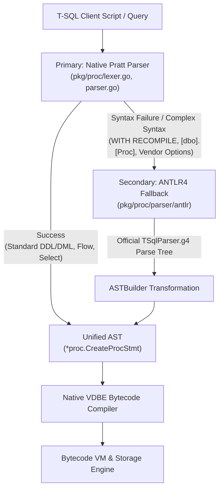

# SQLion System Architecture & Technical Specification

## 1. Executive Summary & Architectural Vision

SQLion is an enterprise-grade, high-concurrency embedded OLTP database engine written in pure Go and Cgo (WiredTiger). Packaged as a single standalone binary with zero external operational dependencies, it combines multi-engine ACID storage, full Microsoft T-SQL procedural execution, multi-wire protocol interoperability (PostgreSQL and TDS/MSSQL), an embedded connection pooler, and an embedded web management studio.

```
+---------------------------------------------------------------------------------------------------------+
|                                        Client Ecosystem & Interfaces                                    |
|   +--------------------------+   +--------------------------+   +-----------------------------------+   |
|   | PostgreSQL Tools / ORMs  |   | MSSQL / Azure Data Studio|   | HTTP REST / Embedded Web Studio   |   |
|   | (psql, DBeaver, GORM)    |   | (sqlcmd, SSMS, pymssql)  |   | (Browser Dashboard, Realtime SSE) |   |
|   | Port: 5433               |   | Port: 1433               |   | Port: 8090                        |   |
+---+--------------------------+---+--------------------------+---+-----------------------------------+---+
                                               |
                                               v
+---------------------------------------------------------------------------------------------------------+
|                                Session & Connection Pooler Layer (pkg/api)                              |
|   - Goroutine Connection Multiplexer (Replaces PgBouncer; 10,000+ client connections)                   |
|   - Bounded Worker Pool (MaxWorkers = NumCPU * 4, MaxIdleSessions = 64)                                 |
|   - Realtime Broker (Server-Sent Events pub/sub) & Superuser JWT / API Key Authentication               |
+---------------------------------------------------------------------------------------------------------+
                                               |
                                               v
+---------------------------------------------------------------------------------------------------------+
|                               Compiler, Optimizer & Plan Cache Layer (pkg/proc, pkg/planner)            |
|   +-------------------------------------------------------------------------------------------------+   |
|   | Dual-Parser Engine:                                                                             |   |
|   |  - Fast-Path Native Pratt Parser (sub-microsecond, zero-allocation)                             |   |
|   |  - Full-Spec ANTLR4 Fallback Parser (Official Microsoft T-SQL Grammar)                          |   |
|   +-------------------------------------------------------------------------------------------------+   |
|   | Cost-Based Optimizer (CBO):                                                                     |   |
|   |  - Table & Column Statistics Catalog (ANALYZE TABLE, Equi-depth Histograms, NDV, Selectivity)   |   |
|   |  - Physical Plan Cost Evaluation (Index Scan vs Seq Scan, Hash Join vs Nested Loop Join)        |   |
|   |  - EXPLAIN & EXPLAIN ANALYZE Plan Tree Visualizer                                               |   |
|   +-------------------------------------------------------------------------------------------------+   |
|   | Plan Cache: LRU Thread-Safe AST & Bytecode Program Cache                                        |   |
+---+-------------------------------------------------------------------------------------------------+---+
                                               |
                                               v
+---------------------------------------------------------------------------------------------------------+
|                  Unified Execution Layer: Native VDBE Bytecode Virtual Machine (pkg/proc/runtime)       |
|   - Single-Engine Parity: Interactive DQL & DML (SELECT, INSERT, UPDATE, DELETE) & Procedures/Triggers  |
|   - Zero-Parse Prepared Statement Bytecode Caching across PostgreSQL Wire and Microsoft TDS             |
|   - sync.Pool Register Allocator, Ambient ACID Transaction Binding, and Opcode Dispatcher               |
|                                                                                                         |
|         ┌───────────────────────────────────────────────────┬──────────────────────────────────┐        |
|         ▼                                                   ▼                                  ▼        |
|   [Volcano Query Pipeline (OpRelQuery)]        [Secondary Index Scan (OpIndexScan)]  [Direct DML Ops]   |
|   - Composable Iterators (HashJoin, etc.)      - SkipList & B+Tree Range Iteration   - OpInsert/Update  |
|   - work_mem Memory Governor & External Sort   - Automatic Predicate Index Matching  - OpDelete         |
+---------------------------------------------------------------------------------------------------------+
                                               |
                                               v
+---------------------------------------------------------------------------------------------------------+
|                                      Unified Storage Layer (pkg/storage)                                |
|   storage.Engine Contract: TableSchema, IndexSchema, Value, Record, Session, Transaction                |
|   +----------------------------------------------+   +----------------------------------------------+   |
|   | WiredTiger Engine (pkg/storage/wiredtiger)   |   | Memory Engine (pkg/storage/memengine)        |   |
|   |  - Default production engine (Cgo)           |   |  - Pure Go fallback / hermetic test engine   |   |
|   |  - Lock-free B+Tree with hazard pointers     |   |  - Optimistic Concurrency Control (OCC)      |   |
|   |  - MVCC read-only snapshot isolation         |   |  - MessagePack Base Snapshot (tables.mpk)    |   |
|   |  - Low-level disk checkpointing & write log  |   |  - Append-Only Write-Ahead Log (wal.aof)     |   |
|   +----------------------------------------------+   +----------------------------------------------+   |
+---------------------------------------------------------------------------------------------------------+
                                               |
                                               v
+---------------------------------------------------------------------------------------------------------+
|                               High Availability, Replication & Backup Layer                             |
|   - 1-Writer Multi-Reader Topology: Linear WAL Streaming & Replica Broadcaster (pkg/replication)        |
|   - Zero-Downtime Failover & Replica Promotion (/api/replication/promote, /api/replication/demote)       |
|   - Non-Blocking Online Snapshot Hot Backup (.tar.gz with manifest, schema, catalog, mpk data)          |
|   - Point-in-Time Restore Engine (CLI: -backup / -restore, HTTP: /api/backup, /api/restore)             |
|   - Daemon Lifecycle Management (start, stop, restart, status with PID and lockfiles)                   |
+---------------------------------------------------------------------------------------------------------+
```

---

## 2. Core Architectural Subsystems

### 2.1. Dual-Parser Architecture & Fallback Strategy

To balance sub-microsecond parsing latency with complete syntax compatibility for complex enterprise Microsoft T-SQL scripts, SQLion uses a dual-parser architecture:



#### Key Characteristics:
1. **Primary Fast-Path (Native Pratt Parser)**:
   - Hand-crafted zero-allocation lexer and recursive descent / Pratt expression parser.
   - Tailored for high-frequency queries (`SELECT`, `INSERT`, `UPDATE`, `DELETE`, `IF...ELSE`, `WHILE`, `TRY...CATCH`, `BEGIN...COMMIT/ROLLBACK`).
   - Achieves sub-microsecond parsing time per statement.
2. **Secondary Fallback (Official Microsoft T-SQL ANTLR4 Parser)**:
   - Compiles the official ANTLR4 `TSqlParser.g4` grammar into Go.
   - Handles bracket escapes (`[dbo].[accounts]`), complex vendor procedure options (`WITH ENCRYPTION`, `WITH RECOMPILE`), cursor declarations, and exotic DDL syntax.
3. **Pluggable Decoupling (Circular Dependency Immunity)**:
   - `pkg/proc` defines the `ProcedureFallbackParser` function hook.
   - `pkg/proc/parser/antlr/ast_builder.go` registers its fallback implementation in `init()`.
   - `pkg/proc` never imports `pkg/proc/parser/antlr`, preserving clean dependency graphs and eliminating circular imports.

---

### 2.2. Cost-Based Optimizer (CBO) & Statistics Engine

The query optimizer uses both logical equivalence transformations and statistical cost estimation:

```
[SQL Query]
    │
    ▼
[AST Logical Plan]
    │
    ▼
[Logical Planner] ───> Logical Operators (LogicalScan, LogicalFilter, LogicalJoin, LogicalAggregate)
    │
    ▼
[Cost-Based Physical Optimizer (pkg/planner/cost.go)]
    │   ├── Catalog Statistics (ANALYZE TABLE)
    │   │     ├── Row Count, Page Count, Average Tuple Width
    │   │     └── Column Stats (NDV, Null Count, Equi-Depth Histograms)
    │   ├── Operator Cost Model:
    │   │     ├── SeqScan vs IndexScan (Page I/O + Tuple CPU * Selectivity)
    │   │     └── HashJoin vs IndexNestedLoopJoin (Build Table Selection)
    │   └── Histogram Range Selectivity Estimation
    ▼
[Physical Plan Tree] ───> [Volcano Iterator Pipeline]
```

#### Statistical Metadata:
- **`ANALYZE TABLE <name>`**: Scans the target table within an isolated read-only transaction. Computes:
  - Total row count and physical data size.
  - Column distinct value counts (`NDV` - Number of Distinct Values).
  - Null value fractions.
  - 64-bucket Equi-Depth Histograms (`HistogramBucket{LowerBound, UpperBound, Count, DistinctCount}`) for non-uniform data distribution tracking.
- **`EXPLAIN` & `EXPLAIN ANALYZE`**: Displays estimated cost ranges (`cost=0.00..45.20 rows=100`) alongside actual wall-clock execution timings and tuple counts across all pipeline stages.

---

### 2.3. Volcano Relational Execution Engine & Memory Governor

All relational queries execute via the Volcano Iterator Model (`pkg/execution/`):

```go
type Iterator interface {
    Init(ctx context.Context) error
    Next() (Tuple, error)
    Close() error
}
```

#### Pipeline Operators:
- **`SeqScanIterator` & `IndexScanIterator`**: Stream rows sequentially or through secondary index ranges.
- **`FilterIterator` & `ProjectIterator`**: On-the-fly expression evaluation with zero heap allocations for filtered-out rows.
- **`HashJoinIterator`**: Builds an in-memory hash table on the smaller relation (determined by CBO) and probes with the streaming outer relation.
- **`IndexNestedLoopJoinIterator`**: Probes the inner index directly for each outer tuple.
- **`GroupByIterator`**: Hash-based and pre-sorted streaming group aggregations (`COUNT`, `SUM`, `AVG`, `MIN`, `MAX`).
- **`SortIterator` (with External Merge Sort)**:
  - Tracks accumulated tuple memory footprints against `work_mem`.
  - When memory exceeds `work_mem`, sorts the in-memory chunk and spills it to a disk run file (`sqlion-sort-run-*.tmp`).
  - Merges spilled run files and in-memory tuples via an N-way Min-Heap (`tupleMergeHeap`).
  - Deterministically closes and unlinks all temporary run files in `Close()`.

#### Memory Governor Configuration:
- Server-wide default: `DefaultWorkMem = 64MB` (set via CLI `-work-mem=64MB`).
- Dynamic session overrides: `SET work_mem = '128MB'`, `SHOW work_mem`, `SELECT @@work_mem`.

---

### 2.4. Native VDBE Bytecode Virtual Machine & Single-Engine Execution

SQLion unifies all procedural logic and interactive queries (`SELECT`, `INSERT`, `UPDATE`, `DELETE`) on the exact same register-based VDBE Virtual Machine:

```
[Interactive SQL / T-SQL Script / Prepared Stmt]
                       │
                       ▼
   [Bytecode Compiler (pkg/proc/compiler.go)]
   - CompileQuery: SELECT queries ➔ OpRelQuery
   - CompileStatement: INSERT/UPDATE/DELETE ➔ OpInsert/Update/Delete
   - CompileProcedure: Stored procedures, triggers, UDFs
                       │
                       ▼
        [Bytecode Program (Opcode Stream)]
   00: OpInit           reg: 0
   01: OpOpenRead       table: "accounts"
   02: OpIndexScan      table: "accounts", idx: "idx_holder", val: "Alice"
   03: OpColumn         col: "balance", reg: 1
   04: OpLt             reg: 1, val: 500, jump: 08
   05: OpUpdate         table: "accounts", reg: 1
   06: OpCommit
   07: OpHalt           code: 0
   08: OpRaiseError     msg: "Insufficient funds"
   09: OpRollback
   10: OpHalt           code: -1
                       │
                       ▼
      [Virtual Machine (pkg/proc/runtime/vm.go)]
   - Evaluates opcodes sequentially with program counter (IP)
   - Zero-allocation sync.Pool register array recycling
   - Executes within existing session transactions via s.executor.ExecuteInTx
   - Connects Volcano iterator engine via OpRelQuery for joins & aggregations
   - Zero-parse execution for prepared statements cached in PGWire & TDS
```

#### Key Capabilities:
1. **Interactive DQL & DML Unification**:
   - `SELECT` queries compile into single-instruction programs (`OpRelQuery`) executing the Volcano physical query pipeline while binding ambient transaction and session parameters.
   - `INSERT`, `UPDATE`, and `DELETE` compile into `OpInsert`, `OpUpdate`, and `OpDelete` with schema validation, identity column tracking, and row affected reporting.
2. **Prepared Statement Bytecode Caching**:
   - Both PostgreSQL Wire Protocol (`Parse`) and Microsoft TDS (`sp_prepare`) precompile parameterized queries into `*proc.Program` instances.
   - `Execute` and `sp_execute` invoke `s.executor.Run(program, ...)` directly, eliminating repeated lexical parsing and AST construction.
3. **Secondary Index Opcode `OpIndexScan`**:
   - Scans records through B+Tree or SkipList secondary indexes, avoiding full table scans when filter predicates match indexed columns.
4. **Virtual Delta Tables for Triggers**:
   - Materializes ephemeral virtual delta tables (`INSERTED` and `DELETED`) during trigger execution.

---

### 2.5. Dual Storage Backends & Concurrency Architecture

The database engine abstracts the storage tier behind the `storage.Engine` interface contract, providing two concrete implementations:

```
                                [ storage.Engine Interface ]
                                              │
                    ┌─────────────────────────┴─────────────────────────┐
                    │                                                   │
                    ▼                                                   ▼
     [ WiredTiger Storage Engine ]                       [ In-Memory OCC Storage Engine ]
     (pkg/storage/wiredtiger)                            (pkg/storage/memengine)
     - Cgo binding to libwiredtiger                      - Pure Go (Zero Cgo, cross-platform)
     - Lock-free B+Tree indexing                         - Row-level versioning & OCC validation
     - Hazard pointer memory protection                  - In-memory sorted secondary indexes
     - MVCC transaction snapshot isolation               - Hybrid persistence:
     - Automated background checkpointing                  * Base MessagePack snapshot (tables.mpk)
     - Low-level disk WAL write logging                    * Monotonic LSN Append-Only Log (wal.aof)
                                                           * Automatic AOF rewrite compaction
```

#### Comparison Matrix:

| Feature | WiredTiger (`wiredtiger`) | Memory Engine (`memengine`) |
|---|---|---|
| **Language & Build** | Cgo (requires `libwiredtiger`) | Pure Go (`CGO_ENABLED=0` compatible) |
| **Concurrency Control** | Multi-Version Concurrency Control (MVCC) | Optimistic Concurrency Control (OCC) |
| **Disk Data Structure** | Lock-Free B+Tree with hazard pointers | Hash Map + Sorted Index Entry Slices |
| **Transaction Durability** | WiredTiger disk checkpoints & log | Hybrid MessagePack snapshot + AOF log |
| **Fsync Policy** | Handled by WiredTiger subsystem | `FsyncEverySec`, `FsyncAlways`, `FsyncNone` |
| **Primary Use Case** | Production enterprise multi-core OLTP | Embedded systems, dev/test, CI pipelines |

---

### 2.6. Multi-Wire Protocols & Built-in Connection Pooler

SQLion exposes concurrent native wire protocol listeners on distinct ports, eliminating external protocol adapters:

```mermaid
sequenceDiagram
    autonumber
    participant Client as Client Application (psql / ORM / SSMS)
    participant Multiplexer as Goroutine Session Multiplexer (pkg/api/pool.go)
    participant Worker as Execution Worker Pool
    participant Engine as Storage Engine (WiredTiger / Memory)

    Client->>Multiplexer: Connect (TCP Handshake on :5433 or :1433)
    Note over Multiplexer: Spawns lightweight ~4KB Go goroutine.<br/>Zero OS process overhead.
    Multiplexer->>Multiplexer: Acquire idle session from SessionPool
    Client->>Multiplexer: Query Packet ('Q' or SQLBatch)
    Multiplexer->>Worker: Enqueue query job to worker channel
    Worker->>Engine: Execute query under ACID transaction
    Engine-->>Worker: Result rows / affected count
    Worker-->>Multiplexer: Formatted response packet
    Multiplexer-->>Client: Stream RowDescription, DataRows, CommandComplete
    Multiplexer->>Multiplexer: Return session to pool; Worker waits for next job
```

#### Protocol Features:
1. **PostgreSQL Wire Protocol v3 (`pkg/wire/`)**:
   - Port `:5433`.
   - Supports Simple Query (`'Q'`) and Extended Query protocols (`'P'` Parse, `'B'` Bind, `'D'` Describe, `'E'` Execute, `'S'` Sync, `'C'` Close).
   - Full compatibility with `psql`, DBeaver, GORM, Prisma, and PostgreSQL drivers.
2. **PostgreSQL Bulk Copy Streaming (`pkg/wire/copy.go`)**:
   - `COPY <table> FROM STDIN [WITH (FORMAT CSV, HEADER)]`:
     - Server issues `CopyInResponse ('G')`.
     - Client streams `CopyData ('d')` chunks.
     - Server parses CSV/TSV and batch-inserts rows inside an ACID transaction.
     - Sends `CommandComplete ('C')` with row count.
   - `COPY <table> TO STDOUT [WITH (FORMAT CSV, HEADER)]`:
     - Server issues `CopyOutResponse ('H')`.
     - Streams table rows in ~32KB `CopyData ('d')` chunks under a non-blocking snapshot transaction.
     - Concludes with `CopyDone ('c')` and `CommandComplete ('C')`.
   - Fully compatible with `psql \copy` and `pg_dump`.
3. **Microsoft SQL Server TDS 7.x/8.0 Protocol (`pkg/wire/tds/`)**:
   - Port `:1433`.
   - Supports PRELOGIN, LOGIN7, SQLBatch, and RPC token parsing for SSMS, Azure Data Studio, and `sqlcmd`.

---

### 2.7. Online Snapshot Hot Backup & Point-in-Time Restore Engine

SQLion includes a live database backup engine that operates without taking locks or pausing incoming read and write transactions:

```
Live Production Engine (Active Reads & Writes)
        │
        ▼ (Open Read-Only Snapshot Transaction)
[Point-in-Time View T0 (MVCC/OCC)] ─── Zero lock contention; writers never blocked
        │
        ├── Scan Schemas ──────────> schemas.json
        ├── Scan Catalog ──────────> catalog/ (procedures, functions, triggers)
        ├── Stream Table Records ──> data/<table_name>.jsonl (Buffered chunks)
        └── Compute Summary ───────> manifest.json (Timestamp, row counts, checksums)
        │
        ▼ (Gzip & Tar Stream)
[Atomic File Writer (Golden Rule 1)] ─── Write to sqlion-backup-*.tmp ➔ Atomic rename
        │
        ▼
[Self-Contained Backup Archive: sqlion-backup-20260922-133000.tar.gz]
```

#### Delivery Channels:
- **HTTP Streaming API**:
  - `GET /api/backup` & `POST /api/backup`: Direct streaming download as `application/gzip` or server-side disk snapshot via `{"target": "path"}`.
  - `POST /api/restore`: Multipart form upload or file-path restore (`{"source": "path"}`).
- **CLI Commands**:
  - `sqlion -dir data -backup backup.tar.gz`
  - `sqlion -dir data -restore backup.tar.gz`
- **Embedded Web Studio**:
  - One-click backup download button and restore upload modal.

---

### 2.8. Embedded Web Management Studio

SQLion embeds a PocketBase-style administration dashboard (`pkg/ui/dashboard.html` served from `/_/` via `embed.FS`):
1. **Real-Time Data Sync**: Server-Sent Events (SSE) stream (`/api/realtime`) automatically pushes table mutation events (`ActionCreate`, `ActionUpdate`, `ActionDelete`, `ActionImport`) to active browser tabs.
2. **Interactive SQL Query Studio**: Real-time syntax editor with query execution history, saved query favorites, and `EXPLAIN ANALYZE` execution plan visualization.
3. **Spreadsheet Table Editor**: In-place row editing, column sorting, pagination, and full-text record search.
4. **Security & API Keys**: Superuser JWT authentication with granular API key generation (read-only and table-scoped access tokens).
5. **System Metrics**: Real-time worker pool and storage session metrics (`/api/pool/stats`).

---

## 3. Directory Layout & Module Structure

```
/Users/maro/Projects/SQLion/
├── bin/                       # Compiled binaries (server, bench)
├── cmd/
│   ├── server/                # Server entry point, CLI flags, daemon control
│   └── bench/                 # High-concurrency OLTP & storage benchmarks
├── doc/
│   ├── ADR.md                 # Architecture Decision Records (ADRs 001 - 018)
│   └── ARCHITECTURE.md        # Complete System Technical Specification (This document)
├── pkg/
│   ├── api/                   # HTTP REST API, Session Pooler, Realtime Broker, Auth
│   ├── auth/                  # Password hashing (bcrypt), JWT generation & revocation
│   ├── backup/                # Non-blocking snapshot backup & restore engine
│   ├── catalog/               # System catalog, table schemas, procedures, triggers, stats
│   ├── config/                # JSON and CLI configuration loader and hierarchical resolution
│   ├── execution/             # Volcano Iterator engine, memory governor, external sort
│   ├── planner/               # Cost-Based Optimizer (CBO), cost formulas, histograms
│   ├── proc/                  # T-SQL compiler, native Pratt parser, plan cache
│   │   ├── parser/antlr/      # Official Microsoft T-SQL ANTLR4 fallback parser
│   │   └── runtime/           # Native VDBE Bytecode VM, ambient transactions
│   ├── replication/           # 1-Writer Multi-Reader WAL streaming, broadcaster, replica client
│   ├── storage/               # Unified storage.Engine interface, Value/Record abstractions
│   │   ├── memengine/         # Pure-Go OCC in-memory engine with WAL/AOF persistence
│   │   └── wiredtiger/        # WiredTiger Cgo storage engine implementation
│   ├── ui/                    # Embedded HTML/CSS/JS dashboard (embed.FS)
│   └── wire/                  # Multi-wire protocols: PostgreSQL v3, COPY, TDS 7.x/8.0
├── GEMINI.md                  # Project engineering rules and architectural invariants
├── TODO.md                    # Actionable daily engineering backlog and task tracker
└── go.mod                     # Go module definitions
```

---

## 4. Operational Runbook & CLI Reference

### 4.1. Server Invocation & Flags

```bash
# Standard startup with WiredTiger engine (default)
./bin/server -http=127.0.0.1:8090 -pg=127.0.0.1:5433 -tds=127.0.0.1:1433 -dir=data

# Pure-Go in-memory engine (zero Cgo dependency)
./bin/server -engine=memory -http=127.0.0.1:8090 -dir=data

# Configure query memory governor budget
./bin/server -work-mem=128MB -max-workers=32 -max-idle-sessions=128

# Daemon mode lifecycle controls
./bin/server -d               # Start daemon in background
./bin/server -status          # Check running daemon status and PID
./bin/server -restart         # Restart running daemon cleanly
./bin/server -stop            # Stop daemon gracefully
```

### 4.2. Backup & Restore Operations

```bash
# Offline or CLI-driven snapshot hot backup
./bin/server -dir=data -backup=/backups/sqlion-snapshot.tar.gz

# Restore database from archive
./bin/server -dir=data -restore=/backups/sqlion-snapshot.tar.gz

# Online live backup via curl
curl -OJ http://127.0.0.1:8090/api/backup

# Bulk copy import via psql
psql -h 127.0.0.1 -p 5433 -c "\copy accounts from 'accounts.csv' with (format csv, header)"

# Bulk copy export via psql
psql -h 127.0.0.1 -p 5433 -c "\copy accounts to 'accounts.csv' with (format csv, header)"
```

---

## 5. Engineering Quality & Verification Standards

All feature development, bug fixes, and refactorings must strictly satisfy the project's **3-Stage Verification Pipeline**:

1. **Stage 1: Compilation Integrity (Build)**
   ```bash
   go build -tags wiredtiger -buildvcs=false -o bin/server ./cmd/server && \
   go build -tags wiredtiger -buildvcs=false -o bin/bench ./cmd/bench
   ```
2. **Stage 2: Race-Free Test Verification (Test)**
   ```bash
   go test -tags wiredtiger -count=1 -v -race ./...
   ```
   Must achieve **100% PASS across all packages with 0 data races**.
3. **Stage 3: Conventional Commit (Commit)**
   - Follow Conventional Commits format (`feat(...)`, `fix(...)`, `refactor(...)`, etc.).
   - Strictly avoid decorative emojis in commit messages, comments, and documentation (Golden Rule 19).
