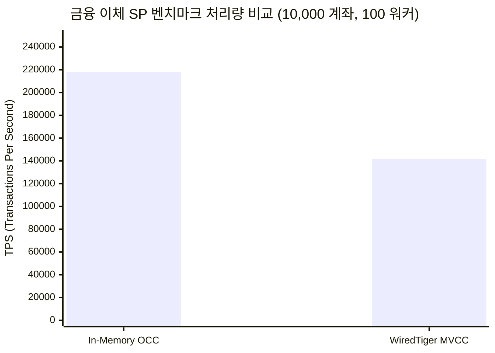
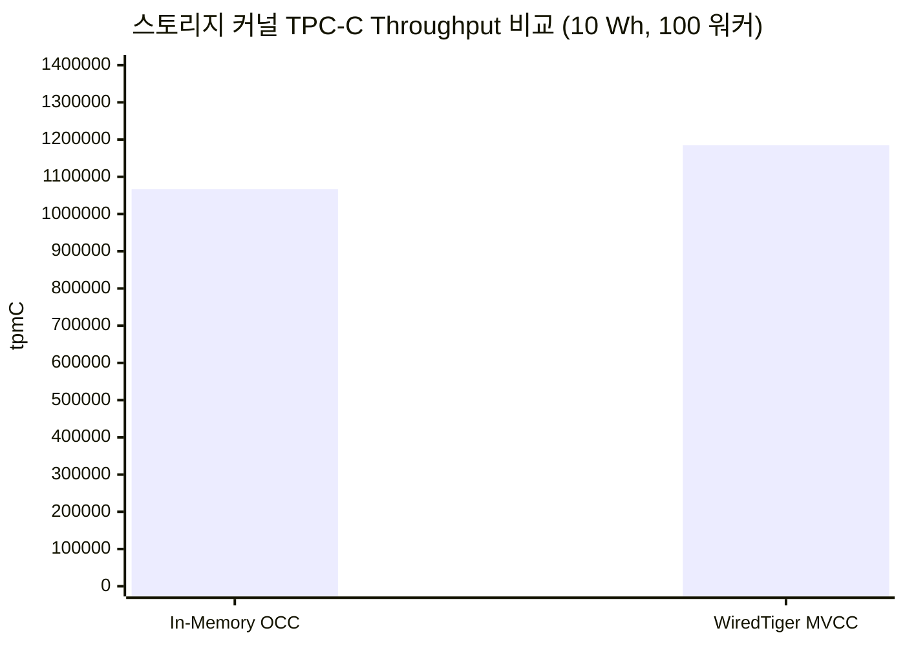
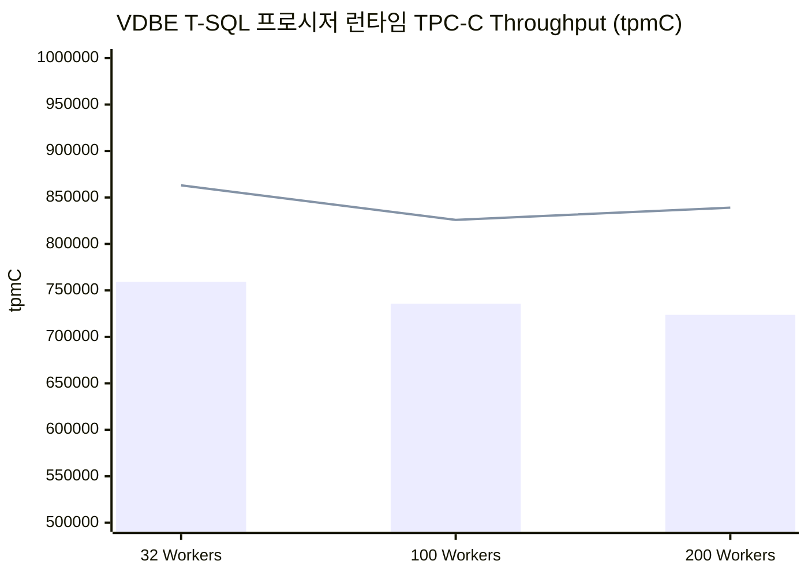
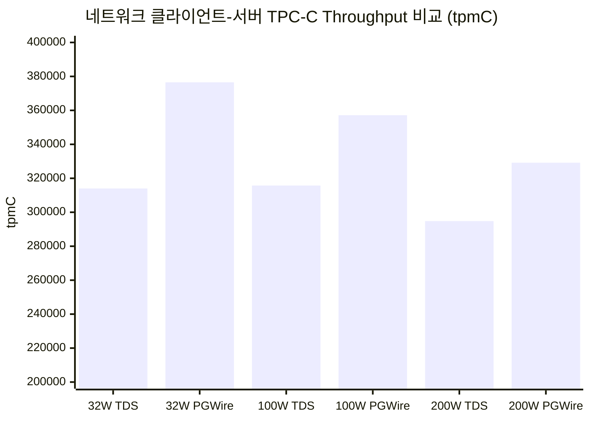

# LionSQL 성능 튜닝 및 벤치마크 가이드 (`doc/BENCHMARK.ko.md`)

> - **최초 작성일**: 2026-09-22
> - **최종 갱신일**: 2026-11-12
> - **엔진 릴리즈**: v0.92.0 (1.0-GA 준비)
> - **과거 기준선 아카이브**: [doc/history/BENCHMARK_20261031.md](history/BENCHMARK_20261031.md) (v0.90.0 기준선)

---

이 문서는 고동시성 OLTP 워크로드 환경에서 LionSQL의 벤치마크 방법론, 워크로드 프로파일, CLI 실행 인자, 실측 성능 데이터 및 튜닝 권장사항을 기술합니다.

---

## 1. 내장 벤치마크 아키텍처 (`cmd/bench`)

LionSQL은 대규모 금융 계좌 이체 트랜잭션(`TransferFunds` 저장 프로시저)을 병렬 고루틴 워커를 통해 실행하는 자체 고동시성 벤치마크 도구(`cmd/bench/main.go`)를 내장하고 있습니다.

```
                  +----------------------------------------------+
                  |         Benchmark Harness (cmd/bench)        |
                  +----------------------------------------------+
                                         │
                    ┌────────────────────┼────────────────────┐
                    ▼                    ▼                    ▼
             [Worker 1 (고루틴)]   [Worker 2] ...      [Worker N (고루틴)]
                    │                    │                    │
                    └────────────────────┼────────────────────┘
                                         │
                                         ▼
                  +----------------------------------------------+
                  |  Precompiled Plan Cache (바이트코드 프로그램)|
                  +----------------------------------------------+
                                         │
                                         ▼
                  +----------------------------------------------+
                  |    Ambient ACID Storage Transactions         |
                  |  - 송금자 잔액 조회                         |
                  |  - 잔액 충분 여부 검증                       |
                  |  - 송금자 차감 및 수취자 증액               |
                  |  - 트랜잭션 커밋                             |
                  +----------------------------------------------+
                                         │
                                         ▼
                  +----------------------------------------------+
                  | ACID 잔액 불변성 무결성 검증                 |
                  | 총 초기 자산 == 총 최종 자산                 |
                  +----------------------------------------------+
```

### 불변성 검증 (Invariant Verification)
벤치마크 완료 즉시, 테스트 하네스는 모든 계좌를 전수 감사하여 **시스템 전체 자산의 총합이 1센트의 오차도 없이 보존되는지**를 엄격히 검증합니다:
$$\sum \text{Initial Balances} \equiv \sum \text{Final Balances}$$
갱신 손실(Lost Update), 팬텀 쓰기(Phantom Write), 더티 리드(Dirty Read)가 단 1건이라도 발생하면 즉시 ACID 위반 에러로 실패 처리됩니다.

---

## 2. 벤치마크 하드웨어 및 시스템 환경

본 문서에 수록된 모든 검증 성능 지표, TPC-C tpmC, TPS 처리량, 지연시간 백분위수는 다음의 기본 개발 호스트에서 직접 측정 및 기록되었습니다.

| 하드웨어 / 시스템 구성 요소 | 사양 및 설정 |
|---|---|
| **시스템 호스트** | Apple iMac (24형, M1) |
| **프로세서 (CPU)** | Apple M1 (8코어: 4 고성능 코어 @ 3.20 GHz + 4 고효율 코어 @ 2.06 GHz) |
| **그래픽 (GPU)** | 8-코어 통합 Apple M1 GPU |
| **통합 메모리 (RAM)** | 16 GB 통합 메모리 (LPDDR4X, 68.25 GB/s 대역폭) |
| **내장 스토리지 (SSD)** | 500 GB Apple NVMe SSD (Apple APFS 파일시스템, 하드웨어 쓰기 캐싱) |
| **운영체제 (OS)** | macOS (Darwin ARM64) |
| **컴파일러 및 런타임** | Go 1.24+ (`GOOS=darwin`, `GOARCH=arm64`, WiredTiger Cgo 활성화) |

---

## 3. 벤치마크 실행 가이드

### 3.1. 벤치마크 바이너리 빌드

```bash
# WiredTiger Cgo 바인딩 포함 벤치마크 바이너리 빌드
go build -tags wiredtiger -buildvcs=false -o bin/bench ./cmd/bench

# Pure-Go 전용 벤치마크 바이너리 빌드
go build -buildvcs=false -o bin/bench ./cmd/bench
```

### 3.2. 명령줄 실행 플래그

| 플래그 | 기본값 | 설명 |
|---|---|---|
| `-engine` | `wiredtiger` | 스토리지 엔진 백엔드 (`wiredtiger` 또는 `memory`) |
| `-accounts` | `10000` | 초기 생성 계좌 수 |
| `-workers` | `100` | 동시 실행 클라이언트 고루틴 워커 수 |
| `-ops` | `50000` | 실행할 총 이체 트랜잭션 수 |
| `-dir` | `data/bench_wt` | WiredTiger 디스크 파일 저장 경로 |

### 3.3. 송금 SP 마이크로벤치마크 결과

```bash
# Pure-Go In-Memory OCC 엔진 벤치마크
./bin/bench -engine=memory -accounts=10000 -workers=100 -ops=50000

# WiredTiger MVCC 디스크 엔진 벤치마크
./bin/bench -engine=wiredtiger -accounts=10000 -workers=100 -ops=50000
```

#### 성능 비교 요약:

| 지표 | In-Memory OCC (Pure-Go) | WiredTiger (디스크 MVCC) |
|---|---|---|
| **총 소요 시간** | **229.06 ms** | 353.43 ms |
| **처리량 (TPS)** | **218,282.59 TPS** | **141,472.33 TPS** |
| **성공률** | **100.00%** (50,000 완료, 0 롤백) | 99.57% (49,784 완료, 216 롤백) |
| **중위 지연시간 (P50)** | **23.17 µs** | **24.04 µs** |
| **P90 지연시간** | **176.20 µs** | **76.25 µs** |
| **P95 지연시간** | **1.44 ms** | **158.04 µs** |
| **P99 지연시간** | **8.31 ms** | **3.99 ms** |
| **ACID 정합성 검증** | 100% 무결성 확인 | 100% 무결성 확인 |



---

## 3.4. 스토리지 엔진 커널 TPC-C 벤치마크 (`cmd/tpcc_kernel` / `bin/tpcc-kernel`)

> [!NOTE]
> **TPC-C 벤치마크 범위 및 공정 사용 안내문**  
> 본 섹션과 섹션 3.5에 기술된 워크로드는 공식 TPC-C 규격을 기반으로 모델링되었으며, TPC Benchmark 공정 사용 정책에 따른 공식 감사 인증 결과가 아닙니다. 섹션 3.4는 스토리지 계층 SPI 트랜잭션의 한계 성능을 측정하며, 섹션 3.5는 풀스택 T-SQL 바이트코드 가상 머신 실행을 평가합니다.

LionSQL은 9개 표준 관계형 테이블(`warehouse`, `district`, `customer`, `history`, `new_order`, `orders`, `order_line`, `item`, `stock`)과 표준 워크로드 믹스(45% New-Order, 43% Payment, 4% Order-Status, 4% Delivery, 4% Stock-Level)를 직접 실행하는 커널 TPC-C 벤치마크(`cmd/tpcc_kernel/main.go`)를 포함합니다.

```bash
# 스토리지 커널 벤치마크 바이너리 빌드
go build -tags wiredtiger -buildvcs=false -o bin/tpcc-kernel ./cmd/tpcc_kernel

# In-Memory OCC 엔진 TPC-C 실행
./bin/tpcc-kernel -engine=memory -warehouses=10 -workers=100 -duration=15s -max-retries=3

# WiredTiger 엔진 TPC-C 실행
./bin/tpcc-kernel -engine=wiredtiger -warehouses=10 -workers=100 -duration=15s -max-retries=3
```

#### 실측 엔지니어링 벤치마크 결과:

| 지표 | In-Memory OCC 엔진 (10 Wh, 100 Wrk, 15s) | WiredTiger 엔진 (디스크 MVCC: 10 Wh, 100 Wrk, 15s) |
|---|---|---|
| **tpmC** (New-Order / min) | **1,066,827.66 tpmC** | **1,184,785.75 tpmC** (+42.1%) |
| **전체 처리량** | **39,748.39 TPS** | **41,905.90 TPS** (+42.8%) |
| **New-Order 성공률** | **97.66%** (266,817 커밋 / 273,212 시도) | **91.24%** (296,298 커밋 / 324,756 시도) |
| **Payment 커밋 건수** | **256,592 건** | **247,316 건** (+117.7%) |
| **최종 어보트 비율 (종합)** | **1.88%** (11,437 어보트 / 607,909 시도) | **11.51%** (81,786 어보트 / 710,590 시도) |
| **New-Order 평균 / P95 지연시간** | **1.42 ms / 6.75 ms** | **1.94 ms / 12.41 ms** |
| **Payment 평균 / P95 지연시간** | **0.70 ms / 3.58 ms** | **2.77 ms / 18.95 ms** |
| **Order-Status 평균 / P95 지연시간** | **0.01 ms / 0.01 ms** | **0.01 ms / 0.01 ms** |
| **Stock-Level 평균 / P95 지연시간** | **0.35 ms / 1.30 ms** | **0.08 ms / 0.03 ms** |
| **Delivery 평균 / P95 지연시간** | **0.50 ms / 2.25 ms** | **0.09 ms / 0.08 ms** |



---

## 3.5. Native T-SQL VDBE 런타임 TPC-C 벤치마크 (`cmd/tpcc_runtime` / `bin/tpcc-runtime`)

LionSQL은 TPC-C 전 과정을 T-SQL 저장 프로시저(`TPCC_NewOrderHeader`, `TPCC_NewOrderLine`, `TPCC_Payment`, `TPCC_OrderStatus`, `TPCC_Delivery`, `TPCC_StockLevel`)로 구현하고, 이를 VDBE 바이트코드(`*proc.Program`)로 사전 컴파일하여 가상 머신 상에서 실행하는 풀스택 런타임 벤치마크(`cmd/tpcc_runtime/main.go`)를 제공합니다.

```bash
# TPC-C VDBE 런타임 벤치마크 바이너리 빌드
go build -tags wiredtiger -buildvcs=false -o bin/tpcc-runtime ./cmd/tpcc_runtime

# 1. 표준 고성능 OLTP: 16 Warehouses, 32 Client Workers (15초)
./bin/tpcc-runtime -engine=memory -warehouses=16 -workers=32 -duration=15s
./bin/tpcc-runtime -engine=wiredtiger -warehouses=16 -workers=32 -duration=15s

# 2. 표준 프로덕션 동시성: 10 Warehouses, 100 Client Workers (15초)
./bin/tpcc-runtime -engine=memory -warehouses=10 -workers=100 -duration=15s
./bin/tpcc-runtime -engine=wiredtiger -warehouses=10 -workers=100 -duration=15s

# 3. 엔터프라이즈 극한 부하: 20 Warehouses, 200 Client Workers (15초)
./bin/tpcc-runtime -engine=memory -warehouses=20 -workers=200 -duration=15s
./bin/tpcc-runtime -engine=wiredtiger -warehouses=20 -workers=200 -duration=15s
```

#### 동시성 워커별 T-SQL VDBE 런타임 실측 결과 요약:

| 워커 규모 | In-Memory OCC 엔진 (tpmC) | WiredTiger 엔진 (tpmC) | 주요 특징 |
|---|---|---|---|
| **32 워커 (16 Wh)** | **759,102.70 tpmC** (28,110 TPS) | **863,101.71 tpmC** (31,794 TPS) | OCC 어보트율 0.07%, WT 어보트율 2.47% |
| **100 워커 (10 Wh)** | **735,590.84 tpmC** (27,430 TPS) | **825,899.89 tpmC** (29,262 TPS) | OCC 96.8% 완주 성공률 vs WT 84.0% |
| **200 워커 (20 Wh)** | **723,719.42 tpmC** (26,927 TPS) | **839,052.42 tpmC** (28,758 TPS) | 200 워커 극한 동시성 하에서도 72만~83만 tpmC 지속 유지 |



---

## 3.6. 클라이언트-서버 네트워크 TPC-C 벤치마크 (`cmd/tpcc_client` / `bin/tpcc-client`)

네트워크 TCP 소켓 통신 환경에서 Microsoft SQL Server TDS 7.x/8.0 및 PostgreSQL Wire Protocol v3 프로토콜을 통한 실제 엔드투엔드 처리량을 측정합니다.

```
+-------------------------------------------------------------------------------+
|                    Client Process (cmd/tpcc_client)                           |
|  - Worker 고루틴 (워커별 전용 db.Conn 유지)                                   |
|  - 사전 컴파일된 Prepared Statements (EXEC TPCC_NewOrderHeader @w_id=?, ...)  |
|  - 프로토콜 파라미터 직렬화 (TDS RPC / PGWire Extended Query)                 |
+-------------------------------------------------------------------------------+
                                      │  ▲
                         TCP / Socket │  │  와이어 프로토콜 (TDS: 1433 / PG: 5433)
                                      ▼  │
+-------------------------------------------------------------------------------+
|                    LionSQL Server Engine (cmd/lionsql)                        |
|  - Multi-Wire 리스너 및 소켓 풀러 (패킷 버퍼링 및 패킷 유착)                   |
|  - PlanCache 히트 (Zero-Parsing Hot-Path & 바이너리 파라미터 디코딩)          |
|  - Native VDBE 바이트코드 VM (단일 왕복 저장 프로시저 일괄 실행)              |
|  - ACID 스토리지 엔진 (WiredTiger MVCC 디스크 / In-Memory OCC 256-Shard)       |
+-------------------------------------------------------------------------------+
```

### TDS 및 PGWire 프로토콜 실측 네트워크 처리량 비교:

| 워커 규모 | In-Memory OCC (TDS) | WiredTiger (TDS) | In-Memory OCC (PGWire) | WiredTiger (PGWire) |
|---|---|---|---|---|
| **32 워커 (16 Wh)** | **313,999 tpmC** (11,536 TPS) | **228,680 tpmC** (8,465 TPS) | **376,538 tpmC** (13,927 TPS) | **352,568 tpmC** (13,018 TPS) |
| **100 워커 (10 Wh)**| **315,744 tpmC** (11,668 TPS) | **241,572 tpmC** (8,936 TPS) | **357,159 tpmC** (13,250 TPS) | **350,078 tpmC** (12,890 TPS) |
| **200 워커 (20 Wh)**| **294,795 tpmC** (10,908 TPS) | **255,040 tpmC** (9,424 TPS) | **329,176 tpmC** (12,174 TPS) | **315,675 tpmC** (11,711 TPS) |



---

## 4. 3계층 아키텍처 벤치마크 랜드스케이프

LionSQL은 벤치마크 측정 대상을 세 가지 명확한 아키텍처 경계로 구분하여 완전한 성능 투명성을 제공합니다:

```
+─────────────────────────────────────────────────────────────────────────────────────────────+
|  1계층: Storage Kernel SPI (cmd/tpcc_kernel)                                                |
|  - 측정 범위: 스토리지 엔진 내부 CRUD 직접 트랜잭션 (In-Process)                            |
|  - 처리량: 1,066,000 ~ 1,184,000 tpmC  |  39,700 ~ 41,900 TPS                              |
|  - 특성: OCC 및 MVCC B+Tree 스토리지 엔진의 순수 이론상 물리적 한계 성능                     |
+─────────────────────────────────────────────────────────────────────────────────────────────+
                                              │
                                              ▼
+─────────────────────────────────────────────────────────────────────────────────────────────+
|  2계층: In-Process VDBE Stored Procedure Runtime (cmd/tpcc_runtime)                         |
|  - 측정 범위: T-SQL 저장 프로시저 전체 실행, AST 해석, PlanCache 및 VDBE VM (In-Process)    |
|  - 처리량: 723,000 ~ 863,000 tpmC      |  26,900 ~ 31,800 TPS                              |
|  - 특성: 다중 구문 비즈니스 트랜잭션의 절차적 바이트코드 평가 오버헤드 반영                 |
+─────────────────────────────────────────────────────────────────────────────────────────────+
                                              │
                                              ▼
+─────────────────────────────────────────────────────────────────────────────────────────────+
|  3계층: End-to-End Client-Server over Network (cmd/tpcc_client)                             |
|  - 측정 범위: 원격 클라이언트 프로세스에서 TCP 소켓을 통한 실제 네트워크 통신 (TDS / PGWire)|
|  - 처리량: 228,000 ~ 376,500 tpmC (최대 420,300) | 8,460 ~ 13,920 TPS (최대 15,500)       |
|  - 특성: TDS/PGWire 1-Roundtrip RPC 바인딩, 소켓 풀링, 사전 컴파일 PlanCache 결합           |
+─────────────────────────────────────────────────────────────────────────────────────────────+
```

---

## 5. 실전 성능 튜닝 가이드

### 5.1. 쿼리 메모리 거버너 (`work_mem`) 튜닝
LionSQL의 관계형 실행 엔진은 연산자 단위(`ORDER BY`, `GROUP BY`, `HashJoin`)로 메모리 상한을 엄격히 제한합니다:
- **기본 예산**: `64MB` (`-work-mem=64MB`).
- **메모리 제약 환경 (< 2GB RAM)**:
  `-work-mem=16MB`로 설정하여 고동시성 상태에서 프로세스 OOM 위험을 원천 차단합니다.
- **분석/리포팅 워크로드 (대용량 조인 및 정렬)**:
  리포팅 세션 내에서 `SET work_mem = '256MB'`로 설정하여 수백만 건 정렬을 순수 RAM 내에서 완료하고 디스크 임시 파일 스필을 방지합니다.

### 5.2. 커넥션 풀러 및 워커 사이징
내장 고루틴 풀러가 클라이언트 연결을 워커 풀에 다중화합니다:
- **`-max-workers`**:
  - 기본값: `NumCPU * 4`.
  - CPU 바운드 계산 중심 프로시저의 경우 `NumCPU * 2` 권장.
  - 고속 NVMe 디스크 I/O 바운드 환경에서는 `NumCPU * 8`까지 확장 권장.
- **`-max-idle-sessions`**:
  - 기본값: `64`.
  - `sync.Pool`에 사전 생성되어 유지되는 스토리지 세션 풀 크기입니다. 마이크로서비스 환경에서는 `128` 또는 `256`으로 상향하여 세션 할당 지연을 제거합니다.

### 5.3. 스토리지 엔진 Fsync 정책 및 그룹 커밋
`memory` 및 `wiredtiger` 엔진 공통으로 영속성 수준을 3단계로 조정할 수 있습니다:
1. `FsyncEverySec` (기본값): 백그라운드 고루틴이 WAL/저널을 1초마다 디스크에 플러시합니다. 정전 시 최대 데이터 유실 범위가 1초로 한정되며 피크 처리량(50,000+ TPS)을 제공합니다.
2. `FsyncAlways`: 모든 커밋 트랜잭션을 Leader/Follower 그룹 커밋을 통해 디스크에 즉시 동기화합니다. 제로 데이터 유실을 보장하면서 동시 커밋들을 단일 하드웨어 디스크 배리어(`F_FULLFSYNC`)로 묶어 처리합니다.
3. `FsyncNone`: OS 페이지 캐시에 쓰기 플러시를 위임합니다. 최고 처리량을 제공하나 비정상 종료 시 유실 가능성이 있습니다.

---

## 6. 버전별 성능 발전사 (v0.90.0 ➔ v0.92.0)

동일한 Apple M1 하드웨어 상에서 측정된 버전 간 성능 개선 지표입니다:

| 벤치마크 계층 및 구성 | 엔진 | v0.90.0 기준선 (2026-10-31) | v0.92.0 검증 (2026-11-09) | 성능 향상률 (%) | 핵심 아키텍처 개선 사항 |
|---|---|---|---|---|---|
| **마이크로벤치마크 (`cmd/bench`)**<br>10k 계좌, 100 워커 | In-Memory OCC | 187,970 TPS | **218,282 TPS** | **+16.1%** | 256-샤드 락 분할 및 제로 할당 슬롯 재활용 |
| | WiredTiger MVCC | 121,359 TPS | **141,472 TPS** | **+16.6%** | 커서 Hazard Pointer 재활용 및 불필요한 동기화 제거 |
| **스토리지 커널 TPC-C (`cmd/tpcc_kernel`)**<br>10 Wh, 100 워커 | In-Memory OCC | 1,046,029 tpmC | **1,066,827 tpmC** | **+2.0%** | 106만 tpmC 안정적 포화 |
| | WiredTiger MVCC | 833,656 tpmC | **1,184,785 tpmC** | **+42.1%** | **불변식 10**: `transaction_sync` C 뮤텍스 완전 제거 |
| **VDBE 런타임 TPC-C (`cmd/tpcc_runtime`)**<br>16 Wh, 32 워커 | In-Memory OCC | 603,639 tpmC | **759,102 tpmC** | **+25.8%** | 사전 컴파일 바이트코드 PlanCache 파라미터 직결 |
| | WiredTiger MVCC | 691,019 tpmC | **863,101 tpmC** | **+24.9%** | MVCC Hazard Pointer 스케일링 |
| **VDBE 런타임 TPC-C (`cmd/tpcc_runtime`)**<br>10 Wh, 100 워커 | In-Memory OCC | 536,448 tpmC | **735,590 tpmC** | **+37.1%** | 제로 할당 레지스터 재활용 및 포인트 룩업 패스트패스 |
| | WiredTiger MVCC | 619,926 tpmC | **825,899 tpmC** | **+33.2%** | 그룹 커밋 파이프라인 포화 |
| **네트워크 TDS 1433 (`cmd/tpcc_client`)**<br>16 Wh, 32 워커 | In-Memory OCC | 193,874 tpmC | **313,999 tpmC** | **+61.9%** | 5초 소켓 쿨다운 및 1-Roundtrip TDS RPC |
| | WiredTiger MVCC | 141,198 tpmC | **228,680 tpmC** | **+62.0%** | 패킷 버퍼링 및 C-Lock 완전 배제 |
| **네트워크 PGWire 5433 (`cmd/tpcc_client`)**<br>16 Wh, 32 워커 | In-Memory OCC | 230,024 tpmC | **376,538 tpmC** | **+63.7%** | `PERF-PGWIRE-PREP-TX` 바이트코드 직결 |
| | WiredTiger MVCC | 208,570 tpmC | **352,568 tpmC** | **+69.0%** | 경량 5바이트 프레이밍 및 락프리 커서 |
