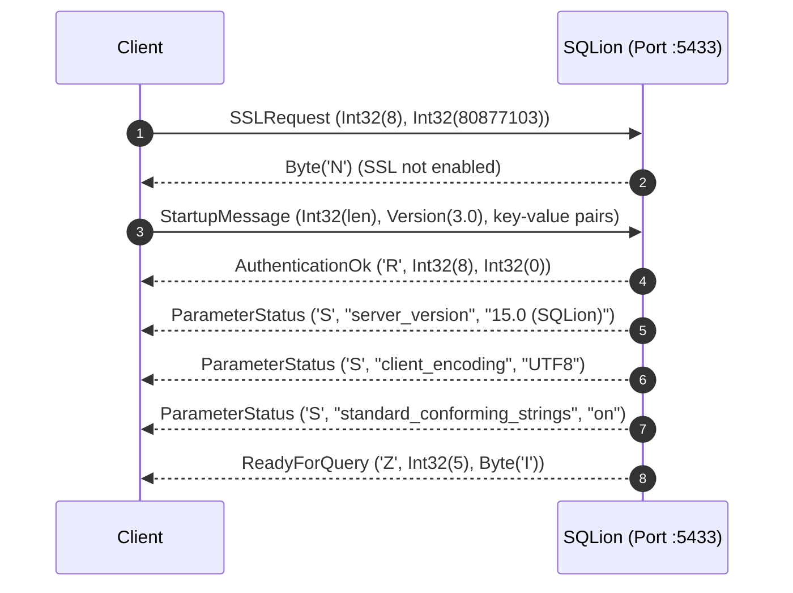
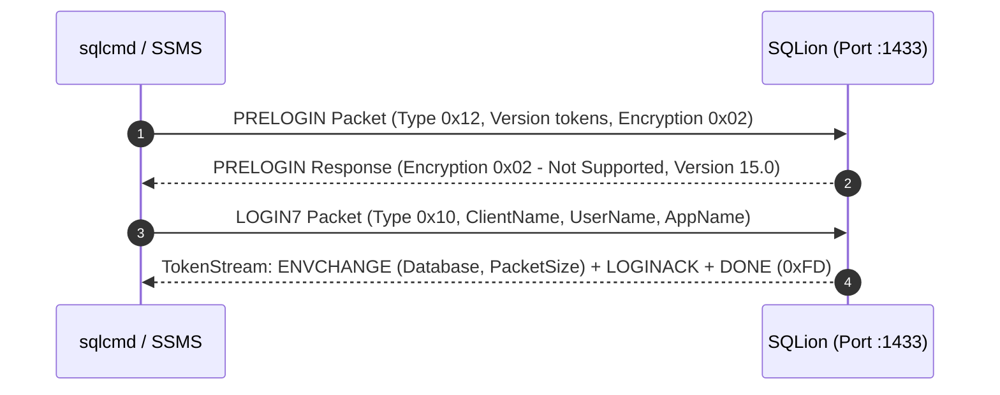

# SQLion Internals: Multi-Wire Protocol Mechanics (PostgreSQL v3 & MSSQL TDS)

This document details the binary framing, state machines, packet parsers, and multiplexing mechanisms implemented in SQLion's wire protocol subsystem (`pkg/wire/` and `pkg/wire/tds/`).

---

## 1. Multi-Protocol Wire Architecture

SQLion concurrently listens on standard database ports using native Go TCP servers, eliminating proxy layers:

```
                                 [ Client Applications ]
                                     │            │
             PostgreSQL Client Tools │            │ Microsoft Tools / SSMS
             (psql, DBeaver, GORM)   │            │ (sqlcmd, Azure Data Studio)
                                     ▼            ▼
                              [ Port :5433 ]   [ Port :1433 ]
                              (Postgres v3)    (TDS 7.x/8.0)
                                     │            │
                                     └─────┬──────┘
                                           │
                                           ▼
                       [ Goroutine Session Multiplexer (pkg/api/pool.go) ]
                         - Allocates lightweight ~4KB client goroutine
                         - Dispatches execution to worker pool
                         - Binds to ClientSession & Ambient Transaction
                                           │
                                           ▼
                       [ Unified SQL Compiler & Storage Kernel ]
```

---

## 2. PostgreSQL Wire Protocol v3 (`pkg/wire/`)

### 2.1. Handshake & Connection Initialization



---

### 2.2. Extended Query Protocol State Machine

For high-throughput ORMs (GORM, Prisma, Hibernate) and prepared statements, SQLion implements the Extended Query Protocol:

```
[ Client Message ] ──> Parse ('P')      ──> Compiles & stores PreparedStatement in session
                   ──> Describe ('D')   ──> Sends ParameterDescription ('t') & RowDescription ('T')
                   ──> Bind ('B')       ──> Binds parameter arguments to statement into Portal
                   ──> Execute ('E')    ──> Evaluates Portal query under session transaction
                   ──> Sync ('S')       ──> Flushes outputs and sends ReadyForQuery ('Z')
```

---

### 2.3. PostgreSQL Bulk Copy Streaming Protocol (`COPY`)

Implemented in `pkg/wire/copy.go`:

#### `COPY ... FROM STDIN` (Bulk Ingestion)
1. Client sends `'Q'` message: `COPY accounts FROM STDIN WITH CSV`.
2. Server responds with `CopyInResponse ('G')`:
   ```
   Byte1('G') | Int32(len) | Int8(format: 0) | Int16(numCols) | Int16[numCols](format codes)
   ```
3. Client streams arbitrary chunks of `CopyData ('d')` packets.
4. Client signals completion with `CopyDone ('c')`.
5. Server batch-inserts records within an ACID transaction and sends `CommandComplete ('C', "COPY <count>")` followed by `ReadyForQuery ('Z')`.

#### `COPY ... TO STDOUT` (Bulk Extraction)
1. Server receives `COPY accounts TO STDOUT WITH CSV`.
2. Server opens read-only snapshot transaction and issues `CopyOutResponse ('H')`.
3. Streams table rows in buffered ~32KB `CopyData ('d')` packets.
4. Concludes by sending `CopyDone ('c')`, `CommandComplete ('C')`, and `ReadyForQuery ('Z')`.

---

## 3. Microsoft SQL Server TDS Protocol (`pkg/wire/tds/`)

The Tabular Data Stream (TDS) protocol operates on port `1433` (default), adhering to the Microsoft TDS 7.x / 8.0 specification.

### 3.1. TDS Packet Header Structure

Every TDS communication is framed by an 8-byte header:

```
 0                   1                   2                   3
 0 1 2 3 4 5 6 7 8 9 0 1 2 3 4 5 6 7 8 9 0 1 2 3 4 5 6 7 8 9 0 1
+-+-+-+-+-+-+-+-+-+-+-+-+-+-+-+-+-+-+-+-+-+-+-+-+-+-+-+-+-+-+-+-+
|     Type      |    Status     |            Length             |
+-+-+-+-+-+-+-+-+-+-+-+-+-+-+-+-+-+-+-+-+-+-+-+-+-+-+-+-+-+-+-+-+
|             SPID              |   PacketID    |    Window     |
+-+-+-+-+-+-+-+-+-+-+-+-+-+-+-+-+-+-+-+-+-+-+-+-+-+-+-+-+-+-+-+-+
```

- **`Type` (Byte)**:
  - `0x01`: SQLBatch (Standard SQL text in UTF-16LE).
  - `0x03`: RPC (Remote Procedure Call token stream).
  - `0x04`: Tabular Result (Data streams from server).
  - `0x10`: PRELOGIN handshake packet.
  - `0x12`: LOGIN7 authentication packet.
- **`Status` (Byte)**: `0x01` indicates end-of-message (EOM).
- **`Length` (Uint16 Big-Endian)**: Total packet size including 8-byte header.

---

### 3.2. TDS Handshake Sequence



---

### 3.3. RPC Token Stream Handling

When client tools call stored procedures (e.g. `EXEC TransferFunds @from=1, @to=2, @amount=100`):
1. Client transmits a `Type 0x03` (RPC) TDS packet.
2. TDS parser decodes procedure name and parameter name/type/value tokens.
3. Maps parameters directly into the VDBE Bytecode VM register pool.
4. Executes procedure within an ambient transaction.
5. Returns tabular result tokens (`ColMetadata`, `Row`, `DoneInProc`, `Done`).

---

## 4. Built-in Connection Pooler Architecture

SQLion eliminates external PgBouncer instances by managing client connections directly inside the Go runtime:

```
[ 10,000+ External Client Connections ]
                    │
                    ▼ (Lightweight goroutines; ~4KB stack each)
      [ SessionPool / Worker Multiplexer ]
                    │
                    ├── Worker Dispatch Channel: chan Job (Capacity: MaxWorkers * 2)
                    │
                    ├── Worker Goroutines: [Worker 1] ... [Worker N] (MaxWorkers = NumCPU * 4)
                    │
                    └── Idle Session Cache: sync.Pool of storage.Session handles
```

- **Memory Efficiency**: 10,000 idle connections consume less than 50MB of server RAM.
- **Fairness & Queueing**: Jobs exceeding available worker capacity wait on bounded worker channels without timing out or dropping TCP sockets.
- **Real-Time Observability**: Pool saturation and queue depths are queryable via `GET /api/pool/stats`.

---

## 5. Zero-Allocation Response Packet Buffer Pooling (v0.11.0)

Under high-concurrency client connections streaming multi-thousand row result sets, per-row memory allocations create severe GC pressure. SQLion implements granular `sync.Pool` buffer recycling across both wire protocols:

### 5.1. PostgreSQL Wire Protocol (`WriteDataRow`)
- Preallocates 4KB slice buffers via `packetBufferPool = sync.Pool`.
- Calculates total row wire payload length in advance and slices the pooled buffer directly:
  ```go
  var packetBufferPool = sync.Pool{
      New: func() any {
          b := make([]byte, 4096)
          return &b
      },
  }
  ```
- Writes directly to network socket and returns buffers with capacity <= 64KB back to the pool.

### 5.2. Microsoft TDS Protocol (`BuildRow`)
- Employs `tdsRowBufferPool = sync.Pool` recycling `*bytes.Buffer` instances for ROW token (`0xD1`) construction.
- Eliminates repeated struct allocations per row and passes buffer pointers directly to `binary.Write`.

