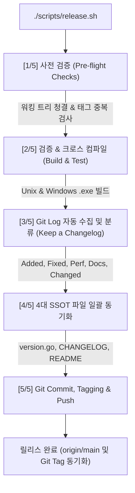

# LionSQL 릴리스 자동화 파이프라인 가이드 (`doc/RELEASE_AUTOMATION_GUIDE.ko.md`)

## 1. 개요 및 목적 (Overview & Motivation)

데이터베이스 엔진의 배포와 릴리스는 단순한 Git 태그 생성을 넘어 다음의 4가지 핵심 무결성을 엄격하게 보장해야 합니다:
1. **단일 진실 공급원(SSOT)의 일치**: 코드(`pkg/config/version.go`), 변경 이력(`CHANGELOG.md`), 메인 가이드(`README.md`, `README.ko.md`), 프로젝트 백로그(`TODO.md`)가 단 하나의 버전 문자열로 완벽히 동기화되어야 합니다.
2. **변경 로그의 자동 분류 및 누락 방지**: 이전 릴리스 태그 이후 커밋된 내용이 빠짐없이 [Keep a Changelog](https://keepachangelog.com/en/1.0.0/) 표준 규격에 맞추어 카테고리별로 정돈되어야 합니다.
3. **크로스 플랫폼 바이너리 빌드 무결성**: Unix(macOS/Linux) 바이너리뿐만 아니라 Windows 플랫폼 독립 실행 파일(`.exe`, amd64 및 arm64)이 정상 컴파일되어야 합니다.
4. **원자적(Atomic) 배포**: 검증, 파일 갱신, 커밋, 태깅, 푸시 과정 중 어느 하나라도 실패할 경우 시스템이 오염되지 않아야 합니다.

`scripts/release.sh`는 이러한 릴리스 전 과정을 **단 한 번의 명령어로 원자적으로 완수하는 엔터프라이즈 자동화 도구**입니다.

---

## 2. 5단계 파이프라인 아키텍처 및 동작 원리



### [Step 1] 사전 무결성 검증 (Pre-flight Git Checks)
* **워킹 트리 검사 (`git diff-index --quiet HEAD --`)**:
  * 커밋되지 않은 미작업 파일이 남아있으면 릴리스가 즉시 중단됩니다. (실수를 미연에 방지)
  * `--dry-run` 플래그 사용 시에는 작업 트리가 더러워도 미리보기가 허용됩니다.
* **태그 중복 검사 (`git rev-parse`, `git ls-remote`)**:
  * 로컬 및 원격 GitHub에 이미 동일한 태그가 존재하는지 사전에 검사하여 덮어쓰기 사고를 방지합니다.
* **이전 태그 탐색 (`git describe --tags --abbrev=0`)**:
  * 직전 릴리스 태그(예: `v0.90.0-beta3`)를 자동으로 감지하여 커밋 비교 범위(`PREV_TAG..HEAD`)를 설정합니다.

### [Step 2] 검증 파이프라인 및 크로스 컴파일 (Build & Test)
* **컴파일 및 단위 테스트**:
  * `go build -tags wiredtiger -buildvcs=false -o bin/lionsql ./cmd/lionsql`
  * `go test -tags wiredtiger -count=1 ./pkg/config/... ./pkg/storage/...`
  * 테스트 실패 시 배포를 즉시 중단합니다. (`--skip-tests` 플래그로 생략 가능)
* **Windows 정적 바이너리 크로스 컴파일**:
  * Windows 사용자를 위한 독립 실행 파일 2종을 Cgo 의존성 없이 순수 Go로 즉시 빌드합니다:
    * `CGO_ENABLED=0 GOOS=windows GOARCH=amd64 go build -o bin/lionsql.exe ./cmd/lionsql`
    * `CGO_ENABLED=0 GOOS=windows GOARCH=arm64 go build -o bin/lionsql-arm64.exe ./cmd/lionsql`

### [Step 3] Git Log 수집 및 변경 로그 카테고리화
`git log ${PREV_TAG}..HEAD`의 커밋 메시지를 역순(시간순)으로 파싱하여 Conventional Commits 규약에 맞춰 섹션을 자동 구성합니다:
* `feat(...)` 또는 `feat:` ➔ **`### Added`**
* `fix(...)` 또는 `fix:` ➔ **`### Fixed`**
* `perf(...)` 또는 `perf:` ➔ **`### Performance`**
* `docs(...)` 또는 `docs:` ➔ **`### Documentation`**
* `refactor(...)`, `chore(...)`, `test(...)` ➔ **`### Changed`**
* 각 항목 끝에 커밋 해시 단축형(`7자리`)을 자동으로 첨부합니다.

### [Step 4] 4대 버전 SSOT 원자적 치환
1. **`CHANGELOG.md`**:
   * 상단의 `## [Unreleased]` 아래에 새로운 `## [<version>] - <YYYY-MM-DD>` 섹션을 생성하고, 상단에는 깨끗한 빈 `## [Unreleased]`를 남깁니다.
2. **`pkg/config/version.go`**:
   * `const Version = "<version>"` 문자열을 원자적으로 교체합니다.
3. **`README.md` & `README.ko.md`**:
   * 최상단 버전 배지 SVG URL(`https://img.shields.io/badge/version-v...-blue.svg`)을 갱신합니다. (하이픈은 Shields.io 규약에 맞춰 `--`로 이스케이프)

### [Step 5] 원스톱 Git Commit, Tagging & Push
1. 변경된 파일(`CHANGELOG.md`, `version.go`, `README.md`, `README.ko.md`)을 스테이징.
2. `chore(release): bump version to <tag>` 커밋 생성.
3. 주석 달린 Git Tag(`git tag -a <tag> -m "Release <tag>"`) 생성.
4. 원격 GitHub 저장소(`origin`)로 브랜치 커밋과 태그를 동시에 푸시. (`--no-push` 플래그로 푸시 생략 가능)

---

## 3. CLI 사용법 및 옵션 플래그 (Usage Reference)

### 3.1. 기본 실행 문법
```bash
./scripts/release.sh <version> [options]
```
> `<version>` 인자는 `v0.90.0-beta4` 또는 `0.90.0-beta4` 형식 모두 지원합니다. (자동 정규화)

### 3.2. 주요 옵션 플래그

| 플래그 | 설명 | 사용 권장 시점 |
| :--- | :--- | :--- |
| **`--dry-run`** | 파일을 실제로 수정하거나 커밋/태깅하지 않고, 수집된 커밋과 CHANGELOG 미리보기만 출력합니다. | 릴리스 전 변경 사항을 사전 점검할 때 |
| **`--skip-tests`** | 빌드 및 `go test` 검증 단계를 건너뜁니다. | 사전에 이미 테스트를 모두 통과하여 빠른 배포를 원할 때 |
| **`--no-push`** | 로컬에서 버전 파일 갱신, 커밋, 태깅까지 수행하되, GitHub 푸시는 건너뜁니다. | 로컬에서 최종 확인 후 수동으로 원격에 올리고 싶을 때 |

---

## 4. 실무 사용 시나리오 예제

### 시나리오 1: 릴리스 전 드라이런(Dry-Run) 미리보기
```bash
./scripts/release.sh v0.90.0-beta4 --dry-run
```
* **출력 결과**:
  * 이전 태그 탐색 결과와 커밋 개수
  * 생성될 `## [0.90.0-beta4] - 2026-10-25` 릴리스 노트 미리보기
  * 변경 대상 파일 목록 확인
  * 실제 파일 수정 없이 종료 (Dry run completed successfully)

### 시나리오 2: 정식 프로덕션 릴리스 수행
```bash
./scripts/release.sh v0.90.0-beta4
```
* **동작**:
  1. 워킹 트리 및 태그 중복 검사
  2. Unix 및 Windows x64/ARM64 3대 정적 바이너리 컴파일 (`bin/lionsql`, `bin/lionsql.exe`, `bin/lionsql-arm64.exe`)
  3. `CHANGELOG.md`, `pkg/config/version.go`, `README.md` 동기화
  4. `chore(release): bump version to v0.90.0-beta4` 커밋 생성
  5. `v0.90.0-beta4` Git Tag 생성
  6. GitHub 원격 저장소(`origin`)로 커밋 및 태그 자동 푸시

### 시나리오 3: 로컬 검증 후 수동 푸시
```bash
# 1. 로컬에서 릴리스 커밋 및 태깅만 진행
./scripts/release.sh v0.90.0-beta4 --no-push

# 2. 로컬 diff 및 태그 최종 검토
git show HEAD
git tag -v v0.90.0-beta4

# 3. 이상 없을 시 수동 푸시
git push origin HEAD && git push origin v0.90.0-beta4
```

---

## 5. 결론 및 향후 유지보수 지침

`scripts/release.sh`는 버전 파편화와 수작업 휴먼 에러를 원천 차단하기 위해 고안되었습니다.
* **새로운 배포 대상 파일이 추가될 경우**: 본 스크립트의 `[4/5] Synchronizing Version SSOT Across Files` 블록에 파일 경로 및 정규식 치환식을 등록하여 단일 파이프라인으로 관리하십시오.
* **본 문서는 사용자 및 릴리스 담당자를 위한 공식 가이드(GUIDE)**이므로, 향후 릴리스 정책 변경 시 본 문서를 함께 갱신하십시오.
