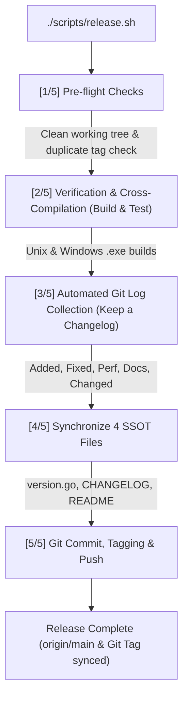

# LionSQL Release Automation Pipeline Guide (`doc/RELEASE_AUTOMATION_GUIDE.md`)

> - **Created**: 2026-11-02
> - **Last Updated**: 2026-11-02
> [한국어 문서 (Korean Version)](RELEASE_AUTOMATION_GUIDE.ko.md)

## 1. Overview & Motivation

Releasing a database engine requires strict guarantees beyond creating a simple Git tag:
1. **Single Source of Truth (SSOT) Consistency**: The source code (`pkg/config/version.go`), changelog (`CHANGELOG.md`), main documentation (`README.md`, `README.ko.md`), and project backlog (`TODO.md`) must be synchronized in lockstep with a single version string.
2. **Automated Changelog Categorization**: All commits since the previous release tag must be captured and categorized according to the [Keep a Changelog](https://keepachangelog.com/en/1.0.0/) standard without omissions.
3. **Cross-Platform Binary Integrity**: Both Unix (macOS/Linux) binaries and standalone Windows executables (`.exe` for amd64 and arm64) must compile cleanly.
4. **Atomic Release Execution**: If any step across verification, file updates, committing, tagging, or pushing fails, the repository state must remain clean and uncorrupted.

[`scripts/release.sh`](../scripts/release.sh) is an automated release tool that executes this entire workflow atomically in a single command.

---

## 2. 5-Stage Pipeline Architecture



### [Step 1] Pre-flight Git Integrity Checks
* **Working Tree Check (`git diff-index --quiet HEAD --`)**:
  * Aborts immediately if uncommitted changes exist in the working tree.
  * When `--dry-run` is passed, previewing is allowed even on a dirty working tree.
* **Duplicate Tag Check (`git rev-parse`, `git ls-remote`)**:
  * Verifies whether the target tag already exists locally or on the remote GitHub repository to prevent accidental overwrites.
* **Previous Tag Discovery (`git describe --tags --abbrev=0`)**:
  * Automatically detects the most recent release tag (e.g., `v0.90.0-beta3`) to establish the commit comparison range (`PREV_TAG..HEAD`).

### [Step 2] Verification Pipeline & 3 Official Target Cross-Compilations (Build & Test)
* **Compilation & Unit Tests**:
  * `go test -tags wiredtiger -count=1 ./pkg/config/... ./pkg/storage/...`
  * Aborts immediately if any test fails (can be bypassed via `--skip-tests`).
* **3 Official Platform Static Binaries**:
  * Compiles three standalone binaries across target OS and CPU architectures:
    1. **`bin/lionsql-darwin-arm64`**: macOS Apple Silicon (M1/M2/M3/M4, WiredTiger MVCC)
    2. **`bin/lionsql-linux-amd64`**: Linux x86_64 server (Pure Go Zero-CGo, OCC)
    3. **`bin/lionsql-windows-amd64.exe`**: Windows x86_64 (Pure Go Zero-CGo, 1ms high-resolution timer)

### [Step 3] Git Log Collection & Changelog Categorization
Parses `git log ${PREV_TAG}..HEAD` in chronological order and categorizes commits according to Conventional Commits:
* `feat(...)` or `feat:` -> **`### Added`**
* `fix(...)` or `fix:` -> **`### Fixed`**
* `perf(...)` or `perf:` -> **`### Performance`**
* `docs(...)` or `docs:` -> **`### Documentation`**
* `refactor(...)`, `chore(...)`, `test(...)` -> **`### Changed`**
* Appends the 7-character short commit hash to the end of each entry.

### [Step 4] Atomic Replacement Across 4 Version SSOT Files
1. **`CHANGELOG.md`**:
   * Inserts a new `## [<version>] - <YYYY-MM-DD>` section beneath `## [Unreleased]`, leaving an empty `## [Unreleased]` section at the top.
2. **`pkg/config/version.go`**:
   * Atomically updates `const Version = "<version>"`.
3. **`README.md` & `README.ko.md`**:
   * Updates the top version badge SVG URL (`https://img.shields.io/badge/version-v...-blue.svg`, escaping hyphens as `--` per Shields.io rules).

### [Step 5] One-Stop Git Commit, Tagging, Push & GitHub Release Publishing
1. Stages modified files (`CHANGELOG.md`, `version.go`, `README.md`, `README.ko.md`).
2. Creates the release commit: `chore(release): bump version to <tag>`.
3. Creates an annotated Git tag: `git tag -a <tag> -m "Release <tag>"`.
4. Pushes both the branch commit and tag to `origin` (can be skipped via `--no-push`).
5. **Automated GitHub Release & Binary Asset Upload**:
   - Detects an active `gh` CLI session and publishes the release to GitHub Releases (`https://github.com/MaroShim/LionSQL/releases`).
   - Populates the release notes from the generated Changelog and automatically applies `--prerelease` for `beta`/`rc` tags.
   - Uploads the three compiled binaries (`bin/lionsql-darwin-arm64`, `bin/lionsql-linux-amd64`, `bin/lionsql-windows-amd64.exe`) as downloadable release assets.

---

## 3. CLI Usage Reference & Option Flags

### 3.1. Basic Syntax
```bash
./scripts/release.sh <version> [options]
```
> `<version>` accepts both `v0.90.0-beta4` and `0.90.0-beta4` formats (normalized automatically).

### 3.2. Option Flags

| Flag | Description | Recommended Use Case |
| :--- | :--- | :--- |
| **`--dry-run`** | Prints collected commits and the generated CHANGELOG preview without modifying files, committing, or tagging. | Reviewing release notes before cutting a release |
| **`--skip-tests`** | Skips the build and `go test` verification stage. | Fast release when the full test suite has already passed |
| **`--no-push`** | Updates version files, commits, and tags locally without pushing to GitHub. | Inspecting local commit/tag state before manual push |
| **`--skip-github-release`** | Pushes Git commits and tags, but skips publishing a GitHub Release via `gh` CLI. | Publishing the GitHub Release manually via the web UI |

---

## 4. Practical Usage Scenarios

### Scenario 1: Pre-Release Dry-Run Preview
```bash
./scripts/release.sh v0.90.0-beta4 --dry-run
```
* **Output**:
  * Previous tag discovery and commit count
  * Preview of the generated `## [0.90.0-beta4] - 2026-10-25` release notes
  * List of target files to be updated
  * Exits cleanly without modifying any files (`Dry run completed successfully`)

### Scenario 2: Full Production Release
```bash
./scripts/release.sh v0.90.0-beta4
```
* **Actions**:
  1. Verifies clean working tree and tag uniqueness
  2. Compiles Unix and Windows x64/ARM64 static binaries
  3. Synchronizes `CHANGELOG.md`, `pkg/config/version.go`, `README.md`, and `README.ko.md`
  4. Creates `chore(release): bump version to v0.90.0-beta4` commit
  5. Creates annotated `v0.90.0-beta4` Git tag
  6. Pushes commit and tag to `origin` and publishes GitHub Release assets

### Scenario 3: Local Verification Followed by Manual Push
```bash
# 1. Create release commit and tag locally
./scripts/release.sh v0.90.0-beta4 --no-push

# 2. Inspect local diff and tag metadata
git show HEAD
git tag -v v0.90.0-beta4

# 3. Push manually once verified
git push origin HEAD && git push origin v0.90.0-beta4
```

---

## 5. Maintenance Guidelines

`scripts/release.sh` is designed to eliminate version fragmentation and manual human error.
* **Adding New Versioned Files**: Register any new version-bearing file path and replacement rule inside the `[4/5] Synchronizing Version SSOT Across Files` block of `scripts/release.sh`.
* Keep this guide synchronized whenever the release policy or target artifacts change.
