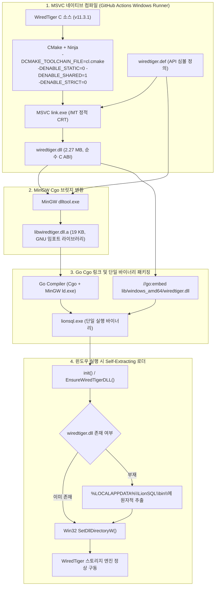

# WiredTiger Windows MSVC 동적 DLL 빌드 및 Go Cgo 링킹 아키텍처 가이드
> **부제**: 12단계의 시행착오를 통해 정립한 MSVC-MinGW 하이브리드 빌드 및 Self-Extracting 런타임 로더 노하우
>
> **핵심 철학 (Architectural Axiom)**:
> *"외부 라이브러리를 포팅할 때 가장 단순하고 명백한 정답은, 해당 라이브러리가 원래 태어나고 검증된 **원본 컴파일러(MSVC)**와 **원본 빌드 스크립트(PowerShell)**를 그대로 따르는 것이다. 내 도구(Go MinGW / Bash)의 틀에 라이브러리를 억지로 욱여넣으려 하지 말고, 네이티브 빌드 환경을 온전히 존중한 뒤 순수 C ABI 경계에서만 가볍게 결합(Decoupling)하라."*

---

## 1. 개요 및 배경

LionSQL은 단일 바이너리(Single Standalone Executable, [RULE:StaticBinary])로 배포되는 자율 분산 OLTP 데이터베이스 엔진입니다. 스토리지 엔진으로 고성능 B+Tree MVCC 엔진인 **WiredTiger (v11.3.1)**를 Cgo를 통해 내장하고 있습니다.

macOS와 Linux에서는 Clang/GCC 환경에서 정적 라이브러리(`libwiredtiger.a`)를 손쉽게 빌드하고 Go 바이너리에 정적으로 링크할 수 있습니다. 그러나 **Windows x86-64 환경**에서는 다음과 같은 구조적 모순에 직면하게 됩니다:

1. **Go Cgo의 윈도우 플랫폼 제약**: Go 컴파일러는 윈도우 환경에서 C 코드를 링크할 때 기본적으로 GCC(MinGW-w64) 툴체인만을 지원하며, Microsoft Visual C++ (`cl.exe` / `link.exe`)를 직접적인 Cgo 컴파일러로 지원하지 않습니다.
2. **WiredTiger 소스코드의 MSVC 종속성**: WiredTiger의 윈도우 포팅 계층(`os_windows.c`, `os_windows.h`)은 Windows 커널 및 MSVC 고유 인트린식(`_InterlockedIncrement`, `_ReadWriteBarrier`, `__int64`, MSVC 인라인 어셈블리 및 SEH)에 절대적으로 의존하여 작성되어 있어, GCC/MinGW-w64로는 네이티브 컴파일이 불가능합니다.
3. **단일 바이너리 배포 원칙 ([Invariant 4])**: 외부 의존성(DLL 파일 등)을 사용자에게 수동으로 `%PATH%`에 설정하도록 요구하는 것은 엔터프라이즈 데이터베이스 제품의 사용자 경험과 아키텍처 불변식을 위배합니다.

본 문서는 왜 수많은 시도에서 MinGW에 집착하여 실패했는지 근본 원인을 분석하고, **MSVC 컴파일러와 MinGW 링커를 분리한 하이브리드 파이프라인**, **GitHub Actions 완전 자동화**, 그리고 **Go `//go:embed` 기반 Self-Extracting 런타임 로더**를 완성하기까지 거친 12단계의 실패 과정과 핵심 주의점을 체계적으로 정리합니다.

---

## 2. 왜 MinGW에 집착했고, 왜 실패할 수밖에 없었는가?

### 2.1 MinGW 집착의 심리적·기술적 함정
Go 개발자가 윈도우에서 Cgo 라이브러리를 포팅할 때 가장 흔히 빠지는 함정은 다음과 같습니다:
> *"Go Cgo가 윈도우에서 MinGW GCC를 요구하니까, C 라이브러리(WiredTiger)도 당연히 MinGW로 빌드해야 호환되겠지?"*

이러한 사고로 인해 Linux/macOS Docker 환경에서의 `x86_64-w64-mingw32-gcc` 크로스 컴파일이나 Windows MSYS2 MinGW 환경에서의 네이티브 빌드를 계속해서 시도하게 됩니다.

### 2.2 WiredTiger C 소스의 MSVC 강결합
하지만 WiredTiger의 윈도우 호환 코드는 순수 POSIX 호환 레이어가 아니며, 철저하게 Visual Studio (MSVC)를 타깃으로 작성되어 있습니다:
- **메모리 배리어 및 원자적 연산**: GCC의 `__atomic_*`이나 `__sync_*` 대신 MSVC 내장 함수인 `_InterlockedCompareExchange64`, `_ReadWriteBarrier`, `YieldProcessor`를 직접 호출합니다.
- **윈도우 전용 헤더 및 타입 선언**: MSVC 특유의 타입 정의(`__int64`, `SSIZE_T`)와 Microsoft C 런타임 라이브러리(MSVCRT/UCRT) 헤더 구조를 전제로 합니다.
- **결과**: MinGW GCC로 컴파일 시도 시 헤더 재정의 충돌, 인트린식 식별 불가 에러, 누락된 스레드/락 동기화 함수로 인해 수백 줄의 컴파일 에러가 발생하며 빌드가 원천 차단됩니다.

**결론**: **WiredTiger C 코드는 반드시 MSVC(`cl.exe`)로 컴파일해야만 합니다.**

---

## 3. 왜 정적 라이브러리(`.lib`)는 안 되는가? (Static CRT vs DLL ABI 격리)

MSVC로 빌드해야 한다는 결론에 도달했을 때, 자연스럽게 떠오르는 다음 질문은:
> *"그렇다면 MSVC로 정적 라이브러리(`wiredtiger.lib`)를 빌드해서 Go Cgo에 넘겨주면 정적 링크가 되지 않을까?"*

하지만 이는 **서로 다른 C 런타임(CRT)의 ABI 충돌**로 인해 완전히 불가능합니다.

### 3.1 MSVC `.lib`의 내부 구조
MSVC 컴파일러가 생성한 정적 라이브러리(`.lib`)는 완전히 해석된 기계어 바이트만 들어있는 것이 아닙니다. 다음과 같은 컴파일러 전용 런타임 헬퍼 호출이 포함됩니다:
- 스택 프로브 헬퍼: `__chkstk`
- 보안 쿠키 검증: `__security_cookie`, `__security_check_cookie`
- 포맷팅 및 I/O: `_vsnprintf`, `__acrt_iob_func`
- 예외 및 스택 언와인딩: Windows SEH(Structured Exception Handling) 핸들러

### 3.2 MinGW GCC 링커의 거부
Go의 Cgo 빌드 시 윈도우 링커는 MinGW GCC 계열(`x86_64-w64-mingw32-gcc` 또는 `ld.exe`)이 담당합니다. MinGW 링커는 GNU CRT 또는 표준 UCRT 임포트 라이브러리를 링크하므로, **MSVC 컴파일러 내부 심볼을 해석할 수 없습니다.**
결과적으로 수많은 `undefined reference to __chkstk`, `undefined reference to __security_cookie` 에러를 뿜으며 링크가 완전히 중단됩니다.

### 3.3 해결책: 동적 라이브러리(`wiredtiger.dll`)를 통한 ABI 격리
동적 라이브러리(DLL)는 완벽한 **ABI 방화벽** 역할을 합니다:
1. **MSVC CRT 완전 은닉**: MSVC로 `wiredtiger.dll`을 빌드할 때 정적 런타임 플래그(`/MT`)를 주면, MSVC의 모든 C 런타임 의존성이 DLL 내부에 완전히 캡슐화됩니다.
2. **순수 C ABI 노출**: 외부로는 `wiredtiger_open`, `wiredtiger_strerror`와 같은 순수 C 규격 함수 포인터 심볼만 노출됩니다.
3. **`dlltool` 브릿지 링킹**: MinGW의 `dlltool`을 사용하여 MSVC가 생성한 DLL을 참조하는 GNU 포맷의 임포트 라이브러리(`libwiredtiger.dll.a`)를 생성합니다. Go Cgo는 이 임포트 라이브러리를 통해 빌드 타임 링크를 성공시키고, 런타임에는 OS 동적 링커가 `wiredtiger.dll`의 함수를 호출하게 됩니다.

---

## 4. 핵심 엔지니어링 장벽과 실패 분석 (Core Hurdles & Analysis)

### 4.1 반드시 해결해야 할 WiredTiger & Cgo 5대 기술적 장벽

WiredTiger를 Windows MSVC로 컴파일하고 Go Cgo에 연동하기 위해 반드시 돌파해야 하는 핵심 기술적 장벽은 다음과 같습니다.

#### 1. MSVC 정적 CRT(`/MT`) 은닉과 Cgo C ABI 격리
- **현상**: MSVC로 정적 라이브러리(`wiredtiger.lib`)를 빌드하여 Go Cgo에 전달하면 `undefined reference to __chkstk`, `undefined reference to __security_cookie` 에러가 발생하며 링크 실패.
- **원인**: MSVC 정적 라이브러리는 컴파일러 전용 런타임 심볼(CRT)을 내포합니다. Go Cgo 링커(MinGW GCC/ld)는 GNU CRT/UCRT를 사용하므로 MSVC 전용 내부 심볼을 해석할 수 없습니다.
- **해결책**: 동적 라이브러리(`wiredtiger.dll`)를 정적 CRT 플래그(`/MT`)로 빌드하여 MSVC 런타임 의존성을 DLL 내부에 완전히 캡슐화합니다. 외부에 순수 C 규격 ABI만 노출함으로써 Cgo 링커와의 CRT 충돌을 원천 차단합니다.

#### 2. Ninja 빌드 그래프의 복수 아티팩트 충돌 (`multiple rules generate wiredtiger.lib`)
- **현상**: Ninja 빌드 시 `ninja: error: build.ninja:2282: multiple rules generate wiredtiger.lib` 에러로 설정 단계 중단.
- **원인**: WiredTiger CMakeLists는 `wiredtiger_static`과 `wiredtiger_shared` 타깃을 동시에 정의합니다. MSVC 환경에서는 정적 라이브러리 파일명과 공유 라이브러리의 임포트 라이브러리 파일명이 모두 `wiredtiger.lib`로 동일하여 단일 빌드 그래프 내 출력 충돌이 발생합니다.
- **해결책**: `x86/windows/config.cmake`의 기본 설정을 오버라이드하여 정적 빌드를 명시적으로 비활성화하고 공유 DLL만 생성하도록 강제합니다 (`-DENABLE_STATIC=0 -DENABLE_SHARED=1`).

#### 3. MSVC 엄격 경고 승격(`/WX`) 비활성화와 최신 SDK 헤더 격리
- **현상**: `log.c.obj` 컴파일 중 알 수 없는 C4996/C4244 경고와 함께 `code=2`로 컴파일 중단.
- **원인**: WiredTiger의 기본 설정인 `ENABLE_STRICT=ON`으로 인해 `cl_strict.cmake`가 MSVC 플래그에 `/WX`(모든 컴파일러 경고를 에러로 승격)를 강제 주입합니다. 최신 Windows SDK 및 MSVC 2022 헤더 변경 사항으로 인한 사소한 타입 변환 경고가 전부 치명적 에러로 취급됩니다.
- **해결책**: CMake 설정 시 `-DENABLE_STRICT=0 -Wno-dev`를 지정하여 외부 라이브러리 컴파일 시의 엄격 경고 승격을 비활성화합니다.

#### 4. MSVC 심볼 미익스포트 해결을 위한 `.def` 모듈 정의 파일 주입
- **현상**: `wiredtiger.dll`은 성공적으로 빌드되었으나, `dumpbin /exports wiredtiger.dll` 확인 시 익스포트된 함수가 존재하지 않음.
- **원인**: Windows MSVC 링커는 소스코드에 `__declspec(dllexport)`가 명시되어 있지 않으면 DLL 외부로 심볼을 노출하지 않습니다. WiredTiger 소스코드는 리눅스 가시성(`visibility("default")`) 위주로 선언되어 있어 MSVC에서 기본적으로 모든 심볼이 은닉됩니다.
- **해결책**: 퍼블릭 API(`wiredtiger_open`, `wiredtiger_strerror` 등)를 명시한 `wiredtiger.def` 모듈 정의 파일을 링크 플래그에 직접 주입합니다 (`-DCMAKE_SHARED_LINKER_FLAGS="/DEF:../cmake/configs/wiredtiger.def"`).

#### 5. MinGW `dlltool` 기반 GNU 임포트 라이브러리(`libwiredtiger.dll.a`) 브릿지 구축
- **현상**: MSVC가 생성한 COFF 포맷 임포트 라이브러리(`wiredtiger.lib`)는 Go Cgo(MinGW GCC)가 직접 인식하기 어렵거나 툴체인 버전에 따라 링크 에러를 유발함.
- **해결책**: MinGW의 `dlltool`을 사용하여 `wiredtiger.def`와 `wiredtiger.dll`로부터 GNU ar 포맷의 임포트 라이브러리(`libwiredtiger.dll.a`)를 생성합니다. Go Cgo는 `#cgo windows,amd64 LDFLAGS: -L... -lwiredtiger` 지시자를 통해 이 브릿지 라이브러리에 안정적으로 링크됩니다.

---

### 4.2 환경 아키텍처 교훈: "처음부터 파워쉘(PowerShell)이어야 했다"

전체 시행착오 과정에서 겪었던 수많은 잔여 실패들은 라이브러리 자체의 문제가 아니라, **Windows 환경에서 POSIX 셸(Git Bash)을 흉내 내려다 발생한 환경적 잡음**이었습니다:

> [!IMPORTANT]
> **Windows CI에서 POSIX 에뮬레이션을 배제해야 하는 4가지 이유**:
> 1. **경로 백슬래시(`\`)와 제어 문자 파싱 충돌**: Git Bash 환경변수에서 `D:\a\_temp` 경로의 `\a`가 ASCII Bell(제어코드 `0x07`)로 파싱되어 디렉터리 탐색 실패.
> 2. **CRLF 개행 변환과 멀티라인(`\`) 명령어 붕괴**: Git 체크아웃 시 CRLF 개행이 삽입되어 백슬래시로 이어진 긴 셸 명령어가 중간에 쪼개져 1초 만에 비정상 종료.
> 3. **Windows OS의 배타적 파일 핸들 락(File Locking)**: POSIX 표준 인라인 치환 도구인 `sed -i`가 Windows 파일 핸들 잠금 메커니즘과 충돌하여 파일 덮어쓰기 실패.
> 4. **파이썬 서브프로세스의 확장자(`.exe`) 탐색 누락**: POSIX 방식 우회를 위해 작성한 파이썬 `subprocess`가 윈도우 PATH에서 확장자 없는 실행 파일 탐색 실패 (`WinError 2`).
>
> **골든 룰 ([RULE:PlatformPrimitives])**:
> WiredTiger 공식 저장소의 Evergreen CI 스크립트(`test/evergreen/build_windows.ps1`) 역시 처음부터 PowerShell로 작성되어 있습니다. Windows CI/CD 구축 시에는 POSIX 에뮬레이션 계층을 완전히 배제하고, **첫 단계부터 100% 네이티브 PowerShell (`pwsh`)을 채택**해야 불필요한 환경 삽질을 원천 차단할 수 있습니다.

---

## 5. 최종 완성된 빌드 아키텍처

### 5.1 컴파일 및 링킹 파이프라인 개념도



---

## 6. Go Self-Extracting Runtime Loader 아키텍처

빌드된 `wiredtiger.dll`을 사용자가 직접 설치하거나 환경변수를 조작할 필요가 없도록, LionSQL은 **자체 추출 런타임 로더**를 내장합니다.

### 6.1 `//go:embed` 조건부 컴파일 (`dll_embed_windows.go`)
```go
//go:build windows && cgo && wiredtiger

package wiredtiger

import _ "embed"

// embeddedWiredTigerDLL holds the precompiled wiredtiger.dll payload.
//
//go:embed lib/windows_amd64/wiredtiger.dll
var embeddedWiredTigerDLL []byte
```
비-WiredTiger 순수 Go 빌드나 타 OS 크로스 컴파일 시에는 스텁 파일(`dll_embed_windows_stub.go`)이 활성화되어 바이너리 크기 증가를 방지합니다.

### 6.2 원자적 추출 및 `SetDllDirectoryW` 바인딩 (`dll_loader_windows.go`)
```go
//go:build windows

package wiredtiger

import (
	"os"
	"path/filepath"
	"sync"
	"syscall"
	"unsafe"
)

var (
	kernel32            = syscall.NewLazyDLL("kernel32.dll")
	procSetDllDirectory = kernel32.NewProc("SetDllDirectoryW")
	dllLoadOnce         sync.Once
	dllLoadErr          error
)

func setDllDirectory(dir string) error {
	p, err := syscall.UTF16PtrFromString(dir)
	if err != nil {
		return err
	}
	r1, _, err := procSetDllDirectory.Call(uintptr(unsafe.Pointer(p)))
	if r1 == 0 {
		return err
	}
	return nil
}

func EnsureWiredTigerDLL() error {
	dllLoadOnce.Do(func() {
		// 1. 실행 파일과 같은 디렉터리 확인
		if exePath, err := os.Executable(); err == nil {
			exeDir := filepath.Dir(exePath)
			if _, err := os.Stat(filepath.Join(exeDir, "wiredtiger.dll")); err == nil {
				_ = setDllDirectory(exeDir)
				return
			}
		}

		// 2. 현재 작업 디렉터리 확인
		if cwd, err := os.Getwd(); err == nil {
			if _, err := os.Stat(filepath.Join(cwd, "wiredtiger.dll")); err == nil {
				_ = setDllDirectory(cwd)
				return
			}
		}

		// 3. 영구 캐시 디렉터리 (%LOCALAPPDATA%\LionSQL\bin\wiredtiger.dll)
		localAppData := os.Getenv("LOCALAPPDATA")
		if localAppData == "" {
			localAppData = os.TempDir()
		}
		targetDir := filepath.Join(localAppData, "LionSQL", "bin")
		targetDLL := filepath.Join(targetDir, "wiredtiger.dll")

		if _, err := os.Stat(targetDLL); err == nil {
			_ = setDllDirectory(targetDir)
			return
		}

		// 4. 임베디드 DLL 임시 파일 거쳐 원자적 추출 ([RULE:AtomicSaves])
		if len(embeddedWiredTigerDLL) > 0 {
			if err := os.MkdirAll(targetDir, 0755); err != nil {
				dllLoadErr = err
				return
			}
			tmpFile := targetDLL + ".tmp"
			if err := os.WriteFile(tmpFile, embeddedWiredTigerDLL, 0644); err != nil {
				dllLoadErr = err
				return
			}
			if err := os.Rename(tmpFile, targetDLL); err != nil {
				dllLoadErr = err
				return
			}
			_ = setDllDirectory(targetDir)
		}
	})
	return dllLoadErr
}

func init() {
	_ = EnsureWiredTigerDLL()
}
```

이 설계를 통해:
- 사용자가 `lionsql.exe` 단일 파일만 복사해서 어디서든 실행해도, 최초 실행 시 `%LOCALAPPDATA%\LionSQL\bin\`에 안전하게 DLL이 자가 복구됩니다.
- 윈도우 시스템 레지스트리나 전역 `%PATH%`를 절대 오염시키지 않습니다.

---

## 7. 향후 C/C++ 라이브러리의 Windows Cgo 포팅 시 체크리스트

향후 다른 복잡한 C/C++ 엔진(RocksDB, DuckDB, LevelDB 등)을 윈도우 Cgo 환경에 연동할 때 반드시 준수해야 할 골든 룰입니다:

0. **Windows CI는 첫 줄부터 무조건 네이티브 PowerShell(`pwsh`)로 작성할 것**: Git Bash, MSYS2 등 POSIX 셸 에뮬레이션은 백슬래시(`\`) 이스케이프 파싱, CRLF 개행, 파일 핸들 락(`sed -i`), 경로 해석에서 기괴한 버그를 양산합니다. 대상 플랫폼의 네이티브 셸을 처음부터 쓰는 것이 파이프라인 안정화의 50%를 차지합니다 ([RULE:PlatformPrimitives]).
1. **MinGW 컴파일 환상을 버릴 것**: 대상 라이브러리가 윈도우 전용 코드를 포함하고 있다면, 무조건 MSVC(`cl.exe`)로 네이티브 컴파일해야 합니다.
2. **정적 라이브러리(`.lib`) 직접 링킹을 시도하지 말 것**: MSVC 런타임 심볼과 MinGW 런타임 심볼은 충돌합니다. 반드시 `/MT` 동적 DLL로 캡슐화하십시오.
3. **`dlltool`을 활용한 GNU 임포트 라이브러리 브릿지 구축**: MinGW GCC 링커가 인식할 수 있는 `lib<name>.dll.a`를 생성하십시오.
4. **Ninja 제너레이터와 툴체인 파일 명시**: CMake 사용 시 `msvc-dev-cmd` 환경에서는 Visual Studio Solution 제너레이터 대신 Ninja를 사용하십시오.
5. **엄격 경고 모드(`/WX`) 비활성화**: 외부 라이브러리 빌드 시에는 최신 SDK와의 경고 충돌을 방지하기 위해 엄격 경고 승격 플래그를 꺼야 합니다.
6. **단일 바이너리 사용자 경험(Self-Extracting) 보장**: 생성된 DLL을 `//go:embed`와 `SetDllDirectoryW`를 통해 Go 바이너리에 자체 내장하십시오.
