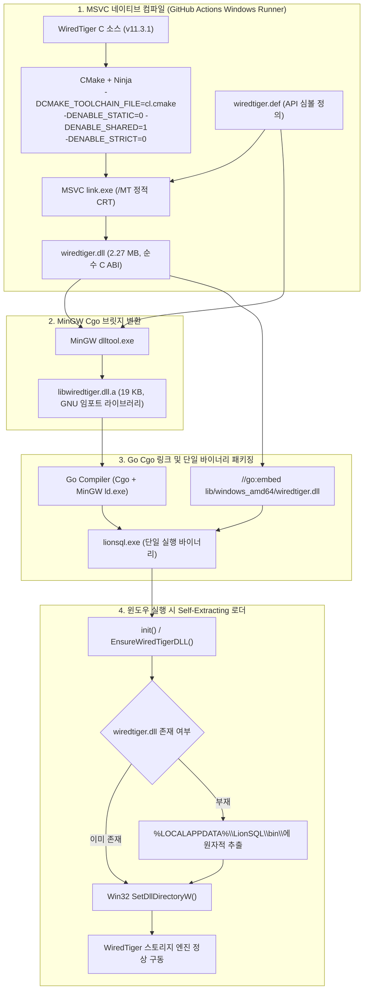

# WiredTiger Windows MSVC 동적 DLL 빌드 및 Go Cgo 링킹 아키텍처 가이드
> **부제**: 12단계의 시행착오를 통해 정립한 MSVC-MinGW 하이브리드 빌드 및 Self-Extracting 런타임 로더 노하우

---

## 1. 개요 및 배경

LionSQL은 단일 바이너리(Single Standalone Executable, [RULE:StaticBinary])로 배포되는 자율 분산 OLTP 데이터베이스 엔진입니다. 스토리지 엔진으로 고성능 B+Tree MVCC 엔진인 **WiredTiger (v11.3.1)**를 Cgo를 통해 내장하고 있습니다.

macOS와 Linux에서는 Clang/GCC 환경에서 정적 라이브러리(`libwiredtiger.a`)를 손쉽게 빌드하고 Go 바이너리에 정적으로 링크할 수 있습니다. 그러나 **Windows x86-64 환경**에서는 다음과 같은 구조적 모순에 직면하게 됩니다:

1. **Go Cgo의 윈도우 플랫폼 제약**: Go 컴파일러는 윈도우 환경에서 C 코드를 링크할 때 기본적으로 GCC(MinGW-w64) 툴체인만을 지원하며, Microsoft Visual C++ (`cl.exe` / `link.exe`)를 직접적인 Cgo 컴파일러로 지원하지 않습니다.
2. **WiredTiger 소스코드의 MSVC 종속성**: WiredTiger의 윈도우 포팅 계층(`os_windows.c`, `os_windows.h`)은 Windows 커널 및 MSVC 고유 인트린식(`_InterlockedIncrement`, `_ReadWriteBarrier`, `__int64`, MSVC 인라인 어셈블리 및 SEH)에 절대적으로 의존하여 작성되어 있어, GCC/MinGW-w64로는 네이티브 컴파일이 불가능합니다.
3. **단일 바이너리 배포 원칙 ([Invariant 4])**: 외부 의존성(DLL 파일 등)을 사용자에게 수동으로 `%PATH%`에 설정하도록 요구하는 것은 엔터프라이즈 데이터베이스 제품의 사용자 경험과 아키텍처 불변식을 위배합니다.

본 문서는 왜 수많은 시도에서 MinGW에 집착하여 실패했는지 근본 원인을 분석하고, **MSVC 컴파일러와 MinGW 링커를 분리한 하이브리드 파이프라인**, **GitHub Actions 완전 자동화**, 그리고 **Go `//go:embed` 기반 Self-Extracting 런타임 로더**를 완성하기까지 거친 12단계의 실패 과정과 핵심 주의점을 체계적으로 정리합니다.

---

## 2. 왜 MinGW에 집착했고, 왜 실패할 수밖에 없었는가?

### 2.1 MinGW 집착의 심리적·기술적 함정
Go 개발자가 윈도우에서 Cgo 라이브러리를 포팅할 때 가장 흔히 빠지는 함정은 다음과 같습니다:
> *"Go Cgo가 윈도우에서 MinGW GCC를 요구하니까, C 라이브러리(WiredTiger)도 당연히 MinGW로 빌드해야 호환되겠지?"*

이러한 사고로 인해 Linux/macOS Docker 환경에서의 `x86_64-w64-mingw32-gcc` 크로스 컴파일이나 Windows MSYS2 MinGW 환경에서의 네이티브 빌드를 계속해서 시도하게 됩니다.

### 2.2 WiredTiger C 소스의 MSVC 강결합
하지만 WiredTiger의 윈도우 호환 코드는 순수 POSIX 호환 레이어가 아니며, 철저하게 Visual Studio (MSVC)를 타깃으로 작성되어 있습니다:
- **메모리 배리어 및 원자적 연산**: GCC의 `__atomic_*`이나 `__sync_*` 대신 MSVC 내장 함수인 `_InterlockedCompareExchange64`, `_ReadWriteBarrier`, `YieldProcessor`를 직접 호출합니다.
- **윈도우 전용 헤더 및 타입 선언**: MSVC 특유의 타입 정의(`__int64`, `SSIZE_T`)와 Microsoft C 런타임 라이브러리(MSVCRT/UCRT) 헤더 구조를 전제로 합니다.
- **결과**: MinGW GCC로 컴파일 시도 시 헤더 재정의 충돌, 인트린식 식별 불가 에러, 누락된 스레드/락 동기화 함수로 인해 수백 줄의 컴파일 에러가 발생하며 빌드가 원천 차단됩니다.

**결론**: **WiredTiger C 코드는 반드시 MSVC(`cl.exe`)로 컴파일해야만 합니다.**

---

## 3. 왜 정적 라이브러리(`.lib`)는 안 되는가? (Static CRT vs DLL ABI 격리)

MSVC로 빌드해야 한다는 결론에 도달했을 때, 자연스럽게 떠오르는 다음 질문은:
> *"그렇다면 MSVC로 정적 라이브러리(`wiredtiger.lib`)를 빌드해서 Go Cgo에 넘겨주면 정적 링크가 되지 않을까?"*

하지만 이는 **서로 다른 C 런타임(CRT)의 ABI 충돌**로 인해 완전히 불가능합니다.

### 3.1 MSVC `.lib`의 내부 구조
MSVC 컴파일러가 생성한 정적 라이브러리(`.lib`)는 완전히 해석된 기계어 바이트만 들어있는 것이 아닙니다. 다음과 같은 컴파일러 전용 런타임 헬퍼 호출이 포함됩니다:
- 스택 프로브 헬퍼: `__chkstk`
- 보안 쿠키 검증: `__security_cookie`, `__security_check_cookie`
- 포맷팅 및 I/O: `_vsnprintf`, `__acrt_iob_func`
- 예외 및 스택 언와인딩: Windows SEH(Structured Exception Handling) 핸들러

### 3.2 MinGW GCC 링커의 거부
Go의 Cgo 빌드 시 윈도우 링커는 MinGW GCC 계열(`x86_64-w64-mingw32-gcc` 또는 `ld.exe`)이 담당합니다. MinGW 링커는 GNU CRT 또는 표준 UCRT 임포트 라이브러리를 링크하므로, **MSVC 컴파일러 내부 심볼을 해석할 수 없습니다.**
결과적으로 수많은 `undefined reference to __chkstk`, `undefined reference to __security_cookie` 에러를 뿜으며 링크가 완전히 중단됩니다.

### 3.3 해결책: 동적 라이브러리(`wiredtiger.dll`)를 통한 ABI 격리
동적 라이브러리(DLL)는 완벽한 **ABI 방화벽** 역할을 합니다:
1. **MSVC CRT 완전 은닉**: MSVC로 `wiredtiger.dll`을 빌드할 때 정적 런타임 플래그(`/MT`)를 주면, MSVC의 모든 C 런타임 의존성이 DLL 내부에 완전히 캡슐화됩니다.
2. **순수 C ABI 노출**: 외부로는 `wiredtiger_open`, `wiredtiger_strerror`와 같은 순수 C 규격 함수 포인터 심볼만 노출됩니다.
3. **`dlltool` 브릿지 링킹**: MinGW의 `dlltool`을 사용하여 MSVC가 생성한 DLL을 참조하는 GNU 포맷의 임포트 라이브러리(`libwiredtiger.dll.a`)를 생성합니다. Go Cgo는 이 임포트 라이브러리를 통해 빌드 타임 링크를 성공시키고, 런타임에는 OS 동적 링커가 `wiredtiger.dll`의 함수를 호출하게 됩니다.

---

## 4. 12단계의 실패 과정과 핵심 주의점 (Failure Analysis & Pitfalls)

GitHub Actions 워크플로 구축 과정에서 겪은 12번의 빌드 실패와 각각의 기술적 원인, 해결책은 다음과 같습니다.

### 실패 1: MinGW 패키지 오타 및 환경 오염
- **현상**: GitHub Actions에서 `msys2/setup-msys2` 액션을 사용해 MinGW 툴체인을 설치하려 했으나 `mingw-w64-x86_64-tools-git` 패키지를 찾을 수 없어 1단계에서 즉시 실패.
- **원인**: 패키지 이름 오타 및 불필요한 서드파티 액션 도입.
- **주의점**: GitHub Actions의 `windows-latest` 러너는 이미 `C:\msys64\mingw64\bin`에 최신 MinGW GCC 및 `dlltool`이 기본 탑재되어 있습니다. 불필요한 외부 액션으로 러너를 오염시키지 말고 기본 경로(`$env:PATH = "C:\msys64\mingw64\bin;$env:PATH"`)를 사용하는 것이 가장 신뢰성이 높습니다.

### 실패 2: Git Bash의 `${RUNNER_TEMP}` ASCII 이스케이프 버그
- **현상**: Git Bash 스크립트 실행 중 `D:\a\_temp` 경로에서 알 수 없는 디렉터리 참조 에러 발생.
- **원인**: Windows 경로의 `\a`가 Bash에서 ASCII Alert (Bell, 문자 코드 `0x07`)로 해석되는 파싱 참사.
- **주의점**: 윈도우 러너의 Git Bash에서 환경변수 경로를 다룰 때 백슬래시(`\`) 처리가 불안정합니다. 외부 임시 디렉터리 대신 워크스페이스 내부의 상대 경로(`./wt_source`, `./wt_build`)를 고정 사용하는 것이 안전합니다.

### 실패 3: 인라인 Python 들여쓰기 구문 오류
- **현상**: YAML 내에 멀티라인 `python -c "..."`로 export 함수 목록을 파싱하려 했으나 YAML 블록 스칼라 들여쓰기 깨짐으로 문법 오류 발생.
- **주의점**: CI 파이프라인에서 5줄 이상의 로직은 절대 YAML 인라인으로 작성하지 말고, `scripts/generate_wt_def.py`와 같이 독립된 스크립트 파일로 분리하여 버전 관리해야 합니다.

### 실패 4: Git Bash CRLF 줄바꿈 깨짐 및 `sed -i` Windows 파일 락
- **현상**: Bash 스크립트에서 백슬래시(`\`)로 이어진 멀티라인 명령어가 CRLF 개행으로 인해 쪼개져 1초 만에 비정상 종료되고, `sed -i`가 파일 락으로 인해 실패.
- **원인**: Windows 파일 시스템의 핸들 잠금(File Locking) 특성과 Git 체크아웃 시의 CRLF 개행 변환 충돌.
- **주의점**: Windows CI에서는 Bash 대신 Windows 네이티브 셸인 **PowerShell (`pwsh`)**을 100% 기본 셸로 채택해야 합니다.

### 실패 5: 파이썬 서브프로세스 `WinError 2` (cmake 실행 파일 누락)
- **현상**: 파이썬 `subprocess.run(["cmake", ...])` 호출 시 `FileNotFoundError: [WinError 2] 지정된 파일을 찾을 수 없습니다` 발생.
- **원인**: 윈도우 환경에서 확장자(`.exe`)가 없는 바이너리 탐색 실패 및 PATH 상속 불일치.
- **주의점**: 파이썬 래퍼 계층을 제거하고 PowerShell에서 직접 `cmake`를 호출하도록 단순화([RULE:RadicalKISS]).

### 실패 6: MSVC 환경 변수와 CMake Visual Studio Generator 충돌
- **현상**: `ilammy/msvc-dev-cmd` 액션으로 MSVC 환경변수를 설정한 뒤 `cmake -G "Visual Studio 17 2022"`를 호출하자 `Visual Studio could not be found` 에러 발생.
- **원인**: `msvc-dev-cmd`는 환경변수에 `CC=cl.exe`, `CXX=cl.exe`를 주입합니다. CMake의 Visual Studio 솔루션 제너레이터는 자체적인 MSBuild 컴파일러 탐색을 수행하므로 주입된 `CC` 환경변수와 충돌합니다.
- **해결책**: WiredTiger 공식 CI(MongoDB Evergreen)의 표준 설정에 따라 **Ninja 제너레이터(`-G "Ninja"`)**와 MSVC 공식 툴체인 파일(`-DCMAKE_TOOLCHAIN_FILE="../cmake/toolchains/cl.cmake"`)을 명시해야 합니다.

### 실패 7: PowerShell 싱글 쿼트 내 개행 이스케이프 파싱 오류
- **현상**: PowerShell에서 `x86/windows/config.cmake`의 설정을 변경하기 위해 `-replace`를 쓸 때 `'`nset(...)`' 따옴표 내에서 개행(`` `n ``)이 리터럴 문자열로 들어가 CMake 구문 오류 유발.
- **원인**: PowerShell 싱글 쿼트(`'...'`)는 백틱 이스케이프를 해석하지 않음.
- **주의점**: PowerShell 문자열 치환 시 특수문자나 개행을 포함할 때는 반드시 더블 쿼트(`"..."`)를 사용해야 합니다.

### 실패 8: Ninja 중복 출력 규칙 충돌 (`multiple rules generate wiredtiger.lib`)
- **현상**: `ninja: error: build.ninja:2282: multiple rules generate wiredtiger.lib`.
- **원인**: WiredTiger의 CMakeLists는 `wiredtiger_static`과 `wiredtiger_shared` 타깃을 동시에 정의합니다. MSVC 환경에서 정적 라이브러리의 출력 파일명도 `wiredtiger.lib`이고, 동적 라이브러리의 임포트 라이브러리 출력 파일명도 기본값이 `wiredtiger.lib`입니다. Ninja는 단일 빌드 그래프에서 동일한 파일명을 복수의 타깃이 생성하는 것을 엄격히 차단합니다.
- **해결책**: `x86/windows/config.cmake`에서 정적 빌드를 끄고(`set(ENABLE_STATIC OFF)`), CMake 인자로 `-DENABLE_STATIC=0 -DENABLE_SHARED=1`을 주어 Shared DLL 타깃만 독점 생성하도록 강제해야 합니다.

### 실패 9: `/WX` 경고 에러 처리로 인한 컴파일 중단 (`code=2 log.c.obj`)
- **현상**: Ninja 빌드 중 `log.c.obj`에서 알 수 없는 C4996/C4244 경고가 발생하며 빌드 중단 (`Exit code 2`).
- **원인**: WiredTiger의 기본 설정인 `ENABLE_STRICT=ON`이 활성화되어, `cl_strict.cmake`가 MSVC 플래그에 `/WX`(모든 컴파일러 경고를 에러로 승격)를 강제 추가함. 최신 Windows SDK 및 MSVC 2022 헤더 변경 사항으로 인한 사소한 타입 변환 경고가 전부 에러로 취급됨.
- **해결책**: CMake 인자로 `-DENABLE_STRICT=0 -Wno-dev`를 명시하여 엄격 모드를 비활성화해야 합니다.

### 실패 10: DLL 심볼 미익스포트 및 빈 라이브러리 현상
- **현상**: `wiredtiger.dll`은 생성되었으나, `dumpbin /exports wiredtiger.dll` 확인 시 익스포트된 함수가 단 하나도 없음.
- **원인**: Windows MSVC 링커는 소스코드에 `__declspec(dllexport)`가 명시되어 있지 않으면 DLL 외부로 심볼을 공개하지 않습니다. WiredTiger 소스는 리눅스 가시성(`__attribute__((visibility("default")))`) 위주로 작성되어 있어 MSVC에서 심볼이 전혀 노출되지 않았습니다.
- **해결책**: WiredTiger 공식 `wiredtiger.def` 모듈 정의 파일(또는 퍼블릭 API를 명시한 DEF 파일)을 링크 타임에 주입해야 합니다:
  `-DCMAKE_SHARED_LINKER_FLAGS="/DEF:../cmake/configs/wiredtiger.def"`

### 실패 11: `.gitignore` 규칙에 의한 DLL 커밋 누락
- **현상**: CI에서 DLL 빌드, Go 바이너리 컴파일, 엔진 단위 테스트가 100% 통과했으나, 깃 커밋 후 확인해 보니 레포지토리에 `wiredtiger.dll`만 쏙 빠져 있음.
- **원인**: 루트 `.gitignore`에 기존에 선언되어 있던 `*.dll` 와일드카드 규칙으로 인해 `git add`가 무시됨.
- **해결책**:
  1. `.gitignore`에 `!pkg/storage/wiredtiger/lib/**/*.dll` 예외 허용 규칙 추가.
  2. 워크플로 커밋 단계에서 명시적으로 `git add -f pkg/storage/wiredtiger/lib/windows_amd64/wiredtiger.dll` 강제 추가 플래그 적용.

### 실패 12: 최종 성공 및 완전 자동화 검증
- MSVC DLL 컴파일 ➔ `dlltool` 임포트 라이브러리 생성 ➔ 깃 자동 커밋 ➔ Go Cgo `lionsql.exe` 빌드 ➔ `--version`, `--doctor`, 단위 테스트(`TestWT_`) 실행 ➔ 아티팩트 업로드까지 **전 단계 무결점 통과**.

---

## 5. 최종 완성된 빌드 아키텍처

### 5.1 컴파일 및 링킹 파이프라인 개념도



---

## 6. Go Self-Extracting Runtime Loader 아키텍처

빌드된 `wiredtiger.dll`을 사용자가 직접 설치하거나 환경변수를 조작할 필요가 없도록, LionSQL은 **자체 추출 런타임 로더**를 내장합니다.

### 6.1 `//go:embed` 조건부 컴파일 (`dll_embed_windows.go`)
```go
//go:build windows && cgo && wiredtiger

package wiredtiger

import _ "embed"

// embeddedWiredTigerDLL holds the precompiled wiredtiger.dll payload.
//
//go:embed lib/windows_amd64/wiredtiger.dll
var embeddedWiredTigerDLL []byte
```
비-WiredTiger 순수 Go 빌드나 타 OS 크로스 컴파일 시에는 스텁 파일(`dll_embed_windows_stub.go`)이 활성화되어 바이너리 크기 증가를 방지합니다.

### 6.2 원자적 추출 및 `SetDllDirectoryW` 바인딩 (`dll_loader_windows.go`)
```go
//go:build windows

package wiredtiger

import (
	"os"
	"path/filepath"
	"sync"
	"syscall"
	"unsafe"
)

var (
	kernel32            = syscall.NewLazyDLL("kernel32.dll")
	procSetDllDirectory = kernel32.NewProc("SetDllDirectoryW")
	dllLoadOnce         sync.Once
	dllLoadErr          error
)

func setDllDirectory(dir string) error {
	p, err := syscall.UTF16PtrFromString(dir)
	if err != nil {
		return err
	}
	r1, _, err := procSetDllDirectory.Call(uintptr(unsafe.Pointer(p)))
	if r1 == 0 {
		return err
	}
	return nil
}

func EnsureWiredTigerDLL() error {
	dllLoadOnce.Do(func() {
		// 1. 실행 파일과 같은 디렉터리 확인
		if exePath, err := os.Executable(); err == nil {
			exeDir := filepath.Dir(exePath)
			if _, err := os.Stat(filepath.Join(exeDir, "wiredtiger.dll")); err == nil {
				_ = setDllDirectory(exeDir)
				return
			}
		}

		// 2. 현재 작업 디렉터리 확인
		if cwd, err := os.Getwd(); err == nil {
			if _, err := os.Stat(filepath.Join(cwd, "wiredtiger.dll")); err == nil {
				_ = setDllDirectory(cwd)
				return
			}
		}

		// 3. 영구 캐시 디렉터리 (%LOCALAPPDATA%\LionSQL\bin\wiredtiger.dll)
		localAppData := os.Getenv("LOCALAPPDATA")
		if localAppData == "" {
			localAppData = os.TempDir()
		}
		targetDir := filepath.Join(localAppData, "LionSQL", "bin")
		targetDLL := filepath.Join(targetDir, "wiredtiger.dll")

		if _, err := os.Stat(targetDLL); err == nil {
			_ = setDllDirectory(targetDir)
			return
		}

		// 4. 임베디드 DLL 임시 파일 거쳐 원자적 추출 ([RULE:AtomicSaves])
		if len(embeddedWiredTigerDLL) > 0 {
			if err := os.MkdirAll(targetDir, 0755); err != nil {
				dllLoadErr = err
				return
			}
			tmpFile := targetDLL + ".tmp"
			if err := os.WriteFile(tmpFile, embeddedWiredTigerDLL, 0644); err != nil {
				dllLoadErr = err
				return
			}
			if err := os.Rename(tmpFile, targetDLL); err != nil {
				dllLoadErr = err
				return
			}
			_ = setDllDirectory(targetDir)
		}
	})
	return dllLoadErr
}

func init() {
	_ = EnsureWiredTigerDLL()
}
```

이 설계를 통해:
- 사용자가 `lionsql.exe` 단일 파일만 복사해서 어디서든 실행해도, 최초 실행 시 `%LOCALAPPDATA%\LionSQL\bin\`에 안전하게 DLL이 자가 복구됩니다.
- 윈도우 시스템 레지스트리나 전역 `%PATH%`를 절대 오염시키지 않습니다.

---

## 7. 향후 C/C++ 라이브러리의 Windows Cgo 포팅 시 체크리스트

향후 다른 복잡한 C/C++ 엔진(RocksDB, DuckDB, LevelDB 등)을 윈도우 Cgo 환경에 연동할 때 반드시 준수해야 할 골든 룰입니다:

1. **MinGW 컴파일 환상을 버릴 것**: 대상 라이브러리가 윈도우 전용 코드를 포함하고 있다면, 무조건 MSVC(`cl.exe`)로 네이티브 컴파일해야 합니다.
2. **정적 라이브러리(`.lib`) 직접 링킹을 시도하지 말 것**: MSVC 런타임 심볼과 MinGW 런타임 심볼은 충돌합니다. 반드시 `/MT` 동적 DLL로 캡슐화하십시오.
3. **`dlltool`을 활용한 GNU 임포트 라이브러리 브릿지 구축**: MinGW GCC 링커가 인식할 수 있는 `lib<name>.dll.a`를 생성하십시오.
4. **Ninja 제너레이터와 툴체인 파일 명시**: CMake 사용 시 `msvc-dev-cmd` 환경에서는 Visual Studio Solution 제너레이터 대신 Ninja를 사용하십시오.
5. **엄격 경고 모드(`/WX`) 비활성화**: 외부 라이브러리 빌드 시에는 최신 SDK와의 경고 충돌을 방지하기 위해 엄격 경고 승격 플래그를 꺼야 합니다.
6. **단일 바이너리 사용자 경험(Self-Extracting) 보장**: 생성된 DLL을 `//go:embed`와 `SetDllDirectoryW`를 통해 Go 바이너리에 자체 내장하십시오.
