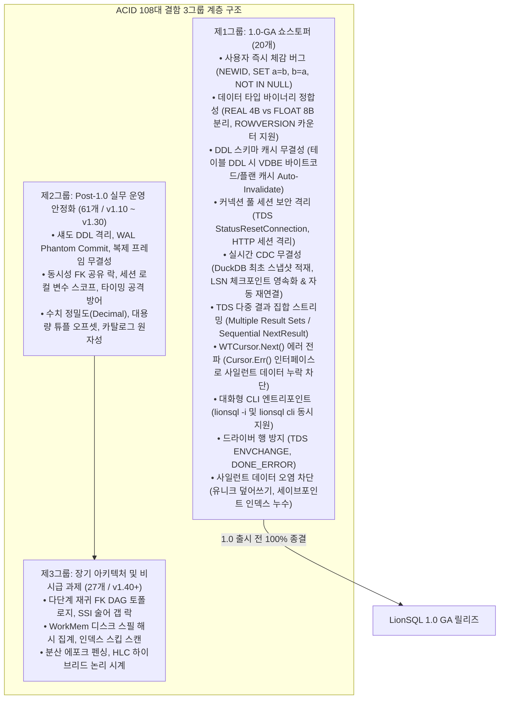
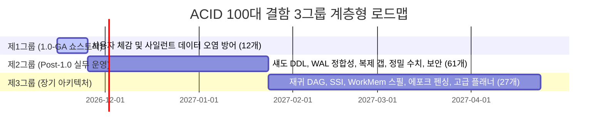

# 데이터베이스 본질(ACID) 100대 코어 무결성 결함 3그룹 안정화 마스터 플랜
(`notes/plans/ACID_CORE_INTEGRITY_STABILIZATION_PLAN.ko.md`)

> **문서 상태**: Approved (100대 결함 3그룹 체계화 및 1.0-GA 쉴드 확립)  
> **마일스톤 분류**:
> - **제1그룹 (1.0-GA 쇼스토퍼)**: 20개 (사용자 체감 & 코어 무결성/타입 시스템/CLI/세션 보안/캐시 무결성/CDC/다중 데이터셋/커서 에러 전파 즉시 해결 과제)
> - **제2그룹 (Post-1.0 실무 운영 안정화)**: 61개 (v1.10.0 ~ v1.30.0 정기 릴리즈 개선 과제)
> - **제3그룹 (장기 백로그 & 특수 엣지 케이스)**: 27개 (v1.40.0+ / 실용적 비시급 분산·플래너 과제)  
> **관련 규칙**: `[RULE:AtomicSaves]`, `[RULE:ExplicitError]`, `[RULE:LockHierarchy]`, `[RULE:PlanPersistence]`, `[RULE:ContinuousBacklog]`, `[RULE:ZeroOracleTampering]`

---

## 1. 총괄 개요 및 3그룹 분류 아키텍처

데이터베이스의 가장 신성하고 양보할 수 없는 본질은 **ACID(Atomicity, Consistency, Isolation, Durability)**입니다.  
본 문서는 발견된 100대 코어 무결성 결함을 실제 사용자 체감도, 데이터 손상 치명도, 구현 복잡도에 따라 **3개 정예 그룹**으로 재배치하여 1.0 GA 릴리즈의 완성도와 장기 로드맵의 지속 가능성을 동시에 보장합니다.

---

## 2. 제1그룹: 1.0-GA 쇼스토퍼 (사용자 체감 & 코어 무결성 최우선 20대 과제)

사용자가 데이터베이스를 처음 설치하고 쿼리를 실행했을 때 **즉시 마주칠 수 있는 상식 파괴 버그**와 **사일런트 데이터 오염**, 그리고 온디스크 바이너리 호환성을 깨뜨리는 **데이터 타입 미분리**, 개발자 UX를 결정짓는 **대화형 CLI 엔트리포인트**를 1.0 출시 전에 원천 차단 및 확립합니다.

---

### [결함 80 / 태스크: `FIX-DEFAULT-EXPR-DYNAMIC-EVAL-1`] DEFAULT 표현식(`NEWID()`, `GETDATE()`) 파싱 시점 캐싱 오류
* **분류**: `DDL / Correctness` | **위치**: `pkg/storage/literal.go`, `pkg/engine/sqlexec_dml.go`
* **현상**: DDL 파싱 시점에 타임스탬프나 UUID가 1회 평가되어 저장됨으로써, 테이블에 INSERT되는 모든 신규 행에 동일한 UUID/시간이 고정 삽입됨.
* **해결책**: 비결정적 DEFAULT 함수를 파싱 시점에 평가하지 않고 런타임 지연 평가 람다(Deferred Dynamic Evaluator)로 카탈로그에 보존하여 행 삽입 시 동적 평가.

### [결함 56 / 태스크: `FIX-UPDATE-SNAPSHOT-COLUMN-SWAP-1`] `UPDATE` 자기 참조 표현식에서 컬럼 간 갱신 순서 왜곡
* **분류**: `DML Semantics` | **위치**: `pkg/engine/sqlexec_dml.go:1172-1190`
* **현상**: `SET a = b, b = a` 실행 시 변경 전 원본 행 스냅샷을 사용하지 않고 중간 갱신값이 다음 컬럼에 반영되어 두 컬럼이 동일 값으로 변질됨.
* **해결책**: 모든 SET 표현식 평가 시 갱신 전 원본 레코드(`orig.Clone()`)만을 일관되게 참조하여 원자적 다중 컬럼 스왑 보장.

### [결함 6 / 태스크: `FIX-WT-UNIQUE-INDEX-OVERWRITE-FALSE-1`] WiredTiger 유니크 인덱스 `overwrite=false` 누락으로 인한 조용한 덮어쓰기
* **분류**: `Consistency` | **위치**: `pkg/storage/wiredtiger/wt_engine.go:657`, `1304`
* **현상**: 유니크 인덱스 B-Tree 커서에 `overwrite=false`가 누락되어, 동시 트랜잭션이 동일 유니크 키 INSERT 시 기존 인덱스 엔트리를 조용히 덮어써서 유령 고아 행 발생.
* **해결책**: 유니크 인덱스 커서 오픈 및 레코드 조작 시 `overwrite=false`를 강제하여 커널 수준에서 `WT_DUPLICATE_KEY` 에러 즉각 반환.

### [결함 44 / 태스크: `FIX-TDS-BATCH-ERROR-DONE-TOKEN-1`] 다중 구문 배치 실행 중 에러 발생 시 TDS 종결 토큰(`DONE_ERROR`) 누락
* **분류**: `Wire Protocol / Stability` | **위치**: `pkg/wire/tds/server.go`
* **현상**: 배치 도중 문법/제약조건 에러 발생 시 최종 종결 패킷 시퀀스가 누락되어 공식 드라이버(SSMS, go-mssqldb)가 응답을 무한 대기(Hang).
* **해결책**: TDS 토큰 스트림 파이프라인에 전역 defer 복구 훅을 두어 에러 시 반드시 `DONE_ERROR` 패킷을 전송하고 스트림 정상 종결.

### [결함 45 / 태스크: `FIX-TDS-USE-ENVCHANGE-TOKEN-1`] `USE <dbname>` 실행 시 TDS `ENVCHANGE` 토큰 미전송으로 클라이언트 불일치
* **분류**: `Wire Protocol / Compatibility` | **위치**: `pkg/engine/sqlexec.go`, `pkg/wire/tds/server.go`
* **현상**: 가상 데이터베이스 전환 후 클라이언트 드라이버에 `ENVCHANGE(0xE3)` 토큰을 회신하지 않아 SSMS/DBeaver UI 상단 데이터베이스 드롭다운이 `master`에 고정됨.
* **해결책**: 가상 카탈로그 전환 완료 시 TDS 프로토콜 응답 패킷에 `ENVCHANGE Database` 토큰을 원자적으로 직렬화하여 클라이언트 UI 동기화.

### [결함 22 / 태스크: `FIX-HTTP-REAP-ABANDONED-TX-1`] 유휴 활성 트랜잭션(`cs.Tx != nil`) 회수 제외로 인한 고아 트랜잭션 메모리 누수
* **분류**: `Resource / Stability` | **위치**: `pkg/engine/coordinator_impl.go:523`
* **현상**: `cs.Tx == nil` 조건 때문에 트랜잭션이 열린 채 단선된 HTTP/REST 세션이 유휴 세션 회수 루프에서 영구 제외되어 메모리 영구 고갈.
* **해결책**: 활성 트랜잭션이 있더라도 최종 활동 시각(`lastUsedAt`) 기준 TTL 초과 시 강제 롤백 및 세션 회수.

### [결함 24 / 태스크: `FIX-TABLE-VAR-TX-ROLLBACK-EXEMPT-1`] T-SQL 테이블 변수(`@table_var`)가 트랜잭션 롤백 시 함께 롤백되는 표준 위반
* **분류**: `TSQL Standard / Atomicity` | **위치**: `pkg/storage/wiredtiger/wt_engine.go:3080`
* **현상**: MS SQL Server 표준상 테이블 변수는 롤백의 영향을 받지 않아야 하나, LionSQL은 `#temp`와 동일하게 취급하여 롤백 시 함께 파기되어 `TRY...CATCH` 에러 로깅 불가.
* **해결책**: `@table_var` 스토리지를 트랜잭션 스코프 외부의 세션 독립 메모리 공간으로 완전 분리하여 롤백 면제.

### [결함 32 / 태스크: `FIX-EVAL-NOT-IN-NULL-3VL-1`] `NOT IN` 삼치 논리(Three-Valued Logic)에서 NULL 원소 포함 시 UNKNOWN 평가 누락
* **분류**: `SQL Standard / Consistency` | **위치**: `pkg/engine/sqlexec_eval.go`
* **현상**: `x NOT IN (1, 2, NULL)`은 표준상 항상 거짓/UNKNOWN이어야 하나, 단순 루프 비교로 인해 참(True)으로 평가되어 잘못된 결과 반환.
* **해결책**: SQL-92 삼치 논리(True, False, Unknown) 상태 머신을 조건 평가 엔진에 완전 구현.

### [결함 1 / 태스크: `FIX-WT-SAVEPOINT-INDEX-CORRUPTION-1`] WiredTiger 세이브포인트 롤백 시 보조 인덱스 키 누수 및 고아 인덱스 오염
* **분류**: `Atomicity` | **위치**: `pkg/storage/wiredtiger/wt_engine.go:3161-3172`, `3267-3278`
* **현상**: `UPDATE` 후 `ROLLBACK TO SAVEPOINT` 수행 시 기본 테이블은 이전 데이터(`oldData`)로 복구되나, UPDATE 시 삽입된 신규 인덱스 키(`newKey`)를 삭제하지 않아 고아 인덱스 잔존.
* **해결책**: `wtUndoOp`에 `newRecordBytes`를 보관하여 `RollbackTo` 시 신규 인덱스 키를 `removeIndexEntry`로 명시적 삭제.

### [결함 18 / 태스크: `FIX-TRUNCATE-TX-ROLLBACK-DEFERRED-1`] 트랜잭션 내 `TRUNCATE TABLE` 실행 시 즉시 물리 삭제로 인한 롤백 불가
* **분류**: `Atomicity` | **위치**: `pkg/engine/sqlexec_ddl.go:530-580`
* **현상**: 트랜잭션 내 TRUNCATE 실행 시 물리 샤드를 즉시 비워버려 롤백해도 데이터가 복구되지 않음.
* **해결책**: 트랜잭션 내 TRUNCATE는 툼스톤 플래그로 마킹하고 `Commit()` 시점에 실제 물리 공간 반납(Deferred Drop) 또는 트랜잭션 내 삭제 에뮬레이션.

### [결함 7 / 태스크: `FIX-CONCURRENT-UPDATE-LOST-UPDATE-1`] 술어 갱신(Predicate UPDATE) 시 Snapshot Isolation 하의 갱신 손실(Lost Update)
* **분류**: `Isolation` | **위치**: `pkg/engine/sqlexec_dml.go:1151-1208`
* **현상**: 스냅샷 커서로 읽은 과거 레코드 기준으로 계산값을 사전 산출한 후 일괄 덮어써서 타 트랜잭션의 커밋된 갱신 내용이 영구 소실됨.
* **해결책**: 갱신 대상 행을 수정하기 직전에 최신 커밋 버전(Current Read)을 재검증하거나 행 수준 충돌 검사 수행.

### [결함 37 / 태스크: `FIX-TRIGGER-DML-INVOCATION-PIPELINE-1`] DML 실행 시 트리거(Trigger) 미발화(Never Fired) 및 비즈니스 무결성 침묵 누락
* **분류**: `Integrity / Business Logic` | **위치**: `pkg/engine/sqlexec_dml.go`, `pkg/engine/sqlexec.go:1627`
* **현상**: `CREATE TRIGGER` 문법은 지원하나, 실제 INSERT/UPDATE/DELETE 실행 경로에서 트리거 호출 코드가 완전히 누락되어 있음.
* **해결책**: DML 엔진의 행 수정 직후 등록된 트리거 AST를 세션 트랜잭션 컨텍스트 내에서 동기 실행하도록 결합.

### [결함 101 / 태스크: `FIX-TYPE-REAL-FLOAT-DISTINCTION-1`] REAL(4바이트 단정밀도) vs FLOAT(8바이트 배정밀도) 데이터 타입 미분리
* **분류**: `Type System / Storage / Wire` | **위치**: `pkg/storage/engine.go`, `pkg/storage/tuple.go`, `pkg/wire/tds/token.go`, `pkg/engine/sqlexec_ddl.go`
* **현상**: `REAL`과 `FLOAT4`가 `storage.TypeFloat`(8바이트 `float64`)로 통합되어 디스크 용량 낭비, TDS(4바이트 `FLT4TYPE` 미지원) 및 시스템 뷰(`sys.types` 정밀도 24 vs 53) 불일치 발생. 1.0 출시 이후 변경 시 디스크 튜플 바이너리 하위 호환성 파괴 위험.
* **해결책**: `storage.TypeReal` 열거형 추가, V2 바이너리 튜플 코덱 4바이트 직렬화 지원, TDS(4바이트 float32 전송)/PGWire(OID 700) 분기 및 `sys.types`/`sys.columns` 매핑 정합성 보장.

### [결함 102 / 태스크: `FEAT-CLI-INTERACTIVE-ENTRYPOINT-1`] `lionsql -i` 및 `lionsql cli` 대화형 SQL 프롬프트 및 헤드리스 쿼리 실행 엔트리포인트 동시 지원
* **분류**: `CLI / Ergonomics / Headless Parity` | **위치**: `cmd/lionsql/main.go`, `pkg/cli`
* **현상**: 단일 바이너리에서 인자 없는 기본 실행(`lionsql`)은 서버 포그라운드(TDS :1433, PGWire :5433, Web Studio :8090) 실행을 담당하나, 개발자가 터미널에서 즉시 쿼리를 수행할 수 있는 대화형 SQL 프롬프트(REPL) 진입 단축 플래그와 서브커맨드가 일원화되어 있지 않음.
* **해결책**:
  1. **서버 기본 실행**: 인자 없는 기본 실행(`lionsql`)은 기존대로 서버 포그라운드 실행을 유지하여 Docker/Kubernetes/systemd 컨테이너 엔트리포인트 표준을 준수.
  2. **대화형 프롬프트 진입 동시 지원**: 단축 플래그 `lionsql -i` (또는 `--interactive`, `--shell`)와 서브커맨드 `lionsql cli` (또는 `lionsql sql`)를 모두 지원하여 즉시 T-SQL 대화형 셸(`LionSQL> `)로 진입.
  3. **헤드리스 쿼리 실행 지원 (`[RULE:HeadlessParity]`)**: `-e "SELECT ..."` 인라인 쿼리 실행 및 `-f query.sql` 파일 배치 실행 지원.
  4. **비밀번호/포트 관례 보호**: `-p` 플래그는 기존 DB 표준(Password/Port)과 충돌하므로 프롬프트 용도로 사용하지 않고 전 세계 표준인 `-i`(Interactive) 채택.

### [결함 103 / 태스크: `FEAT-SESSION-RESET-CONNECTION-POOL-ISOLATION-1`] 커넥션 풀 세션 누수 방지 (TDS StatusResetConnection 0x08 및 HTTP 토큰 기반 세션 격리)
* **분류**: `Security / Session State / Connection Pool` | **위치**: `pkg/wire/tds/server.go`, `pkg/api/handlers_admin.go`, `pkg/engine/session.go`
* **현상**: 커넥션 풀(HikariCP, ADO.NET, Npgsql 등) 사용 환경에서 사용자 A가 실행한 `EXECUTE AS USER = 'admin'`, `SET @var`, `#temp_tables`가 세션 반납 후 리셋되지 않아, 동일 커넥션을 대여한 사용자 B가 A의 관리자 권한 및 개인정보 세션 변수를 그대로 승계받는 세션 상태 누수(Session State Leakage) 보안 취약점 발생. HTTP `/api/sql`에서도 `session_id` 미지정 시 싱글톤 `"default"` 세션을 공유하여 동일 오염 발생.
* **해결책**:
  1. **TDS `StatusResetConnection(0x08)` 원자적 리셋**: TDS 패킷 헤더에서 0x08 플래그 감지 시, `cs.User = cs.OriginalUser` 강제 복구, `clear(cs.Vars)`, 세션 임시 테이블 물리 샤드 강제 드롭, 활성 트랜잭션 롤백을 수행하는 `cs.ResetSessionState()` 호출 파이프라인 구축.
  2. **PGWire `DISCARD ALL` 지원**: 풀러 재사용 시 전송되는 `DISCARD ALL` 및 `RESET ALL` 파싱 및 세션 상태 원자적 초기화.
  3. **HTTP API 인증 토큰 기반 세션 격리**: `/api/sql` 호출 시 `session_id`가 생략되더라도 싱글톤 `"default"` 세션을 공유하지 않고, 인증 주체(JWT Claim / API Key)별 격리 세션 또는 일회성 Ephemeral 세션을 자동 발급하여 교차 오염 원천 차단.

### [결함 104 / 태스크: `FEAT-TYPE-ROWVERSION-MONOTONIC-COUNTER-1`] `ROWVERSION` 데이터 타입 DDL 파싱 및 INSERT/UPDATE 시 `@@DBTS` 단조 증가 바이너리 자동 스탬핑
* **분류**: `Type System / T-SQL Standard / Storage` | **위치**: `pkg/engine/sqlexec_ddl.go`, `pkg/proc/runtime/vm_dispatcher.go`, `pkg/storage/engine.go`
* **현상**: `TIMESTAMP`는 날짜/시간(DATETIME)으로 올바르게 매핑되어 있으나, Microsoft SQL Server의 낙관적 동시성 제어(OCC) 핵심 타입인 `ROWVERSION`이 DDL 파서(`parseSQLDataType`)에 등록되어 있지 않아 `VARCHAR`로 잘못 폴백됨. 또한 레코드 INSERT/UPDATE 시 `@@DBTS` 글로벌 단조 증가 시퀀스(`AdvanceDBTS()`)를 8바이트 빅엔디안 바이너리로 자동 갱신해 주는 스탬핑 파이프라인 부재.
* **해결책**:
  1. `parseSQLDataType`에 `ROWVERSION`을 등록하여 `storage.TypeBinary`(8바이트 고정)로 매핑.
  2. 테이블 스키마에 `RowVersion` 플래그를 추가하고, 행 생성(INSERT) 및 변경(UPDATE) 시 엔진 차원에서 `proc.AdvanceDBTS()`를 호출하여 `0x00000000000007D1...` 형식의 최신 8바이트 버전 바이너리를 자동 할당.
  3. T-SQL 레거시 DDL에서 날짜 함수 없이 `col TIMESTAMP NOT NULL`로 단독 선언된 경우 `ROWVERSION`과의 변환 및 호환성 가이드 제공.

### [결함 105 / 태스크: `FEAT-VDBE-PLAN-CACHE-DDL-INVALIDATE-1`] 테이블 DDL 변경 시 VDBE 바이트코드 프로시저 및 실행 계획 캐시 자동 Invalidate
* **분류**: `Engine / VDBE / Schema Invariance` | **위치**: `pkg/engine/coordinator_impl.go:262`, `pkg/engine/sqlexec_ddl.go`, `pkg/proc/runtime/vm.go`
* **현상**: 테이블에 DDL(`ALTER TABLE ADD/DROP COLUMN`, `CREATE/DROP INDEX`, `RENAME TABLE` 등)이 발생했을 때, PK 바이패스 캐시(`schemaVersion`)만 갱신되고 VDBE 바이트코드 프로시저 캐시(`s.executor.Cache()`) 및 AST 플랜 캐시(`s.planCache`)는 Invalidate되지 않음. 이로 인해 기 컴파일된 프로시저가 이전 스키마의 컬럼 오프셋이나 인덱스 번호를 그대로 참조하여 엉뚱한 데이터를 읽거나 사일런트 데이터 오염을 유발할 위험 존재.
* **해결책**:
  1. DDL 실행 완료 훅인 `s.InvalidatePKBypassCache()` 내부에서 `s.executor.Cache().Clear()` 및 `s.planCache.Clear()`(또는 테이블 단위 종속성 기반 `InvalidateTable(tableName)`)를 원자적 호출.
  2. 스키마 변경 직후 모든 오래된 바이트코드 플랜을 즉각 무효화하여, 다음 프로시저 호출(`EXEC`) 시 최신 카탈로그 스키마를 기준으로 자동 재컴파일(Auto-Recompile)되도록 보장.

### [결함 106 / 태스크: `FEAT-CDC-DUCKDB-INITIAL-SNAPSHOT-CHECKPOINT-1`] CDC 및 DuckDB 연동 최초 스냅샷 적재, LSN 디스크 체크포인트 영속화 및 자동 재연결(Backoff) 파이프라인
* **분류**: `Ecosystem / CDC / Streaming / Resilience` | **위치**: `guide/DUCKDB_INTEGRATION_GUIDE.ko.md`, `scripts/duckdb_cdc_worker.py`, `pkg/cdc/streamer.go`
* **현상**:
  1. **최초 적재(Initial Snapshot) 부재**: 워커가 기동 시점 이후의 신규 변동분만 청취하여, 기동 전 테이블에 이미 존재하던 대량의 기존 데이터(Baseline Snapshot)가 DuckDB에 적재되지 않음.
  2. **체크포인트 LSN 영속화 부재**: 수신한 LSN을 디스크나 DuckDB 메타데이터 테이블에 기록하지 않아 프로세스 재기동 시 어디까지 읽었는지 알 수 없음.
  3. **자동 재연결(Auto-Reconnect) 루프 부재**: 네트워크 일시 단절이나 서버 재기동 시 예외로 인해 프로세스가 즉시 사망하며, 지수 백오프 기반 재연결 및 `from_lsn={last_lsn}` 이어받기 장치가 없음.
* **해결책**:
  1. **초기 스냅샷 부트스트랩 (Initial Snapshot Load)**: DuckDB 체크포인트 테이블(`_lionsql_cdc_checkpoint`) 조회 결과 `last_lsn == 0`(최초 기동)인 경우, REST/PGWire 스냅샷 API(`POST /api/sql` 또는 `/api/cdc/snapshot`)를 호출하여 기존 전체 레코드와 당시의 $LSN_{snapshot}$을 원자적으로 DuckDB에 일괄 적재.
  2. **트랜잭셔널 LSN 체크포인팅**: CDC 이벤트 배치 반영 시마다 DuckDB 내부의 `_lionsql_cdc_checkpoint (table_name, last_lsn, updated_at)`에 최신 LSN을 단일 트랜잭션 내에서 동시 커밋하여 Exactly-Once 무결성 확립.
  3. **지수 백오프 자동 재연결 루프 (Infinite Reconnection Loop)**: `while True:` 블록 하에서 네트워크 단절 또는 HTTP 5xx 에러 발생 시 $1s \to 2s \to 4s \dots \max 30s$ 지수 백오프로 재연결을 시도하고, 디스크에 기록된 마지막 `last_lsn`을 `from_lsn` 파라미터로 전송하여 누락·중복 없는 무중단 스트리밍 보장.

### [결함 107 / 태스크: `FEAT-TDS-MULTIPLE-RESULT-SETS-1`] TDS 다중 결과 집합(Multiple Result Sets / Sequential NextResult) 스트리밍 반환 지원
* **분류**: `Wire / TDS Protocol / Batch Execution / Stored Procedure` | **위치**: `pkg/wire/tds/server.go`, `pkg/engine/coordinator.go`, `pkg/engine/sqlexec.go`, `pkg/proc/runtime/vm.go`
* **현상**:
  1. 단일 SQL 배치(`SELECT 1 AS a; SELECT 2 AS b;`) 또는 저장 프로시저 내부에서 복수의 `SELECT` 문을 실행할 때, `sqlexec.go`의 `ExecuteSessionSQLContext`가 이전 결과 집합들을 덮어쓰고 마지막 `QueryResult`만 단독 반환함.
  2. TDS 와이어 리스너(`pkg/wire/tds/server.go`)가 단일 `res`만 직렬화하여 전송하므로, C# ADO.NET (`SqlDataReader.NextResult()`), Java JDBC (`Statement.getMoreResults()`), Python (`cursor.nextset()`), Go (`rows.NextResultSet()`), SSMS 멀티 그리드 등 다중 데이터셋을 기대하는 클라이언트에서 첫 번째 결과 집합이 유실되거나 후속 결과 집합을 탐색할 수 없는 심각한 드라이버 비호환 발생.
* **해결책**:
  1. **엔진 다중 결과 집합 체이닝 (`QueryResult.Next *QueryResult`)**: `pkg/engine/coordinator.go`의 `QueryResult` 구조체에 `Next *QueryResult` 필드를 추가하여, 다중 쿼리 배치 실행 시 생성된 각 결과 집합(또는 DML `RowsAffected`)을 단일 연결 리스트(Linked List)로 체이닝.
  2. **TDS 다중 토큰 스트리밍 파이프라인**: `pkg/wire/tds/server.go`에서 `cur := res` 순회를 통해:
     - 후속 결과 집합이 있는 경우(`cur.Next != nil`):
       - `COLMETADATA` (0x81) -> `ROW` (0xD1) 행 스트리밍 -> `DONE` (0xFD) 또는 `DONEINPROC` (0xFF) 토큰에 `Status = DoneMore | DoneCount` (`0x0001 | 0x0010`) 플래그 부여.
     - 최종 결과 집합인 경우(`cur.Next == nil`):
       - `COLMETADATA` -> `ROW` -> `DONE` 토큰에 `Status = DoneFinal | DoneCount` 플래그 부여하여 배치 종료 신호 전달.
  3. **VDBE VM 저장 프로시저 다중 결과셋 지원**: 프로시저 내부에서 다중 `SELECT` 실행 시 결과셋 프레임을 분리하여 `Next` 체인으로 전파.
  4. **클라이언트 드라이버 호환성 오라클 검증**: ADO.NET / JDBC / `go-mssqldb`의 `NextResultSet()` 및 `SELECT 1 AS a; SELECT 2 AS b;` 다중 셋 반환 회귀 테스트 작성.
  5. **아키텍처 계획서 영속화 (`[RULE:PlanPersistence]`)**: [`notes/plans/archive/TDS_MULTIPLE_RESULT_SETS_PLAN.ko.md`](archive/TDS_MULTIPLE_RESULT_SETS_PLAN.ko.md) 등록 완료.

### [결함 108 / 태스크: `FIX-WT-CURSOR-ERROR-PROPAGATION-1`] [완료] WTCursor.Next() 에러 전파 부재로 인한 사일런트 데이터 누락 방지 (Cursor.Err() 인터페이스 확립)
* **분류**: `Storage / WiredTiger / Cursor / Data Integrity` | **위치**: `pkg/storage/engine.go`, `pkg/storage/wiredtiger/wt_engine.go`, `pkg/execution/scan.go`
* **현상**:
  1. `WTCursor.Next()` 및 `wtIndexBTreeCursor.Next()`가 `C.go_wt_cursor_next(c.cur) != 0` 하나로 모든 0이 아닌 반환값을 `c.eof = true`로 처리하여 루프를 탈출함.
  2. 정상적인 테이블 끝(`C.WT_NOTFOUND`)과 실제 심각한 시스템/엔진 오류(`C.WT_ROLLBACK`, `C.WT_PANIC`, 온디스크 블록 손상, I/O 읽기 타임아웃, 메모리 고갈)를 전혀 구분하지 않고 조용히 삼킴.
  3. 이로 인해 대용량 테이블 스캔이나 집계 쿼리(`SELECT COUNT(*)`, `SUM()`) 도중 I/O 장애가 발생해도 에러를 던지지 않고 부분 행만 집계하여 정상 반환하는 사일런트 데이터 누락/왜곡(Silent Data Omission) 발생.
* **해결책**:
  1. **`storage.Cursor` 인터페이스 확장**: Go 표준 라이브러리(`database/sql.Rows.Err()`) 규격에 맞춰 `Err() error` 메서드 추가.
  2. **`WTCursor` 에러 보존 및 전파**: `ret != 0 && ret != C.WT_NOTFOUND`인 경우 `c.err = fmt.Errorf(...)`를 래치하고 `false` 반환.
  3. **전체 커서 구현체 정합성 보장**: `wtIndexBTreeCursor`, `memCursor`, `SliceCursor`, 테스트 모의 커서에 `Err() error` 전면 구현.
  4. **스캔 루프 Fail-Closed 에러 점검**: `pkg/execution/scan.go` 등 쿼리 스캔 루프에서 `!cursor.Next()` 발생 시 `cursor.Err()`를 점검하여 즉시 Fail-Closed 쿼리 실패 처리.
  5. **아키텍처 계획서 영속화 (`[RULE:PlanPersistence]`)**: [`notes/plans/WT_CURSOR_ERROR_PROPAGATION_PLAN.ko.md`](archive/WT_CURSOR_ERROR_PROPAGATION_PLAN.ko.md) 등록 완료.

---

## 3. 제2그룹: Post-1.0 실무 운영 안정화 (v1.10.0 ~ v1.30.0 정기 릴리즈 개선 61대 과제)

1.0 릴리즈 이후 프로덕션 엔터프라이즈 환경에서의 장기 신뢰성, DDL 원자성, 크래시 복구 무결성, 보안 격리를 강화하는 핵심 백로그입니다.

---

### [결함 2] 하이브리드 트랜잭션 2PC 부재로 인한 디스크-메모리 분할 커밋(Split-Brain)
* **분류**: `Atomicity` | **위치**: `pkg/storage/wiredtiger/wt_engine.go:3014-3030`
* **현상**: 영구 테이블(WT) 커밋 후 임시테이블 `#temp`(MemEngine) 커밋 실패 시 분할 커밋 발생.
* **해결책**: 가벼운 인메모리 `tempTx.Commit()`을 선행 검증하고, 실패 시 WT 트랜잭션을 롤백하여 All-or-Nothing 보장.

### [결함 3] 트랜잭셔널 DDL(Transactional DDL)의 허위 원자성 및 Dirty DDL Read
* **분류**: `Isolation / Durability` | **위치**: `pkg/engine/sqlexec_ddl.go:478-524`, `pkg/engine/session.go:99`
* **현상**: 트랜잭션 내 DDL 시 스토리지에서 즉시 삭제/변경하고 Go 힙 `ddlUndoLog`에만 기록하여 타 세션 노출 및 크래시 시 유실.
* **해결책**: 트랜잭션 격리 섀도 카탈로그(Catalog Overlay)와 지연 물리 액션 큐(Deferred Action Queue)를 전담하는 `pkg/catalog/txddl` 모듈을 도입하여 `Commit()` 시점에 원자적 교체 및 일괄 적용. 상세 계획: [`notes/plans/TRANSACTIONAL_DDL_MODULARIZATION_PLAN.ko.md`](TRANSACTIONAL_DDL_MODULARIZATION_PLAN.ko.md)

### [결함 4] 동시성 환경에서 외래 키(FK) 검증 시 부모 행 삭제 방지 락 부재 (Ghost Orphan)
* **분류**: `Consistency` | **위치**: `pkg/storage/wiredtiger/wt_engine.go:2389-2418`
* **현상**: 부모 행 존재 검증 시 공유 락을 걸지 않아 동시 DELETE 시 부모 없는 고아 자식 행 잔착.
* **해결책**: 부모 키 검증 시 행 수준 참조 공유 락(Key-level Share Lock)을 적용하여 부모 행 삭제와 직렬화 충돌 유도.

### [결함 5] MemEngine WAL fsync 실패 시 메모리 변경 잔류(Phantom Commit)
* **분류**: `Durability / Atomicity` | **위치**: `pkg/storage/memengine/tx.go:2163-2172`
* **현상**: 샤드 락을 먼저 해제한 후 fsync를 수행하여, I/O 에러 시 메모리에 변경사항이 남아 유령 커밋 발생.
* **해결책**: WAL 디스크 플러시가 완료될 때까지 샤드 락을 유지하고, 에러 시 즉시 `rollbackApplied()`로 메모리 롤백.

### [결함 8] IDENTITY 시퀀스 메모리 휘발로 재부팅 시 삭제된 ID 중복 재발급
* **분류**: `Consistency / Durability` | **위치**: `pkg/engine/coordinator_impl.go:207-226`
* **현상**: `IDENTITY` 카운터가 Go 힙에만 존재하여 재부팅 시 마지막 행이 삭제된 경우 과거 ID 중복 재발급.
* **해결책**: 시퀀스 상태를 시스템 메타데이터 카탈로그에 영구 기록하고 단조 증가성 보장.

### [결함 9] 활성 트랜잭션 중 온라인 ALTER TABLE 실행 시 바이너리 튜플 오염
* **분류**: `Isolation / Consistency` | **위치**: `pkg/storage/memengine/ddl_alter.go:20-30`, `tx.go:58`
* **현상**: 트랜잭션 도중 스키마가 변경되면 NullBitmap 오프셋 불일치로 바이너리 튜플 손상.
* **해결책**: 트랜잭션 시작 시점의 불변 스키마 스냅샷(`tx.snapSchema`)을 트랜잭션 전체에 고정 바인딩.

### [결함 10] MemEngine 기본 `FsyncEverySec` 지연으로 인한 커밋 성공 후 크래시 데이터 유실
* **분류**: `Durability` | **위치**: `pkg/storage/memengine/wal.go:22-26`
* **현상**: 기본 1초 지연 fsync로 인해 커밋 성공 응답 직후 전원 차단 시 데이터 유실.
* **해결책**: 프로덕션 기본 fsync 정책을 `FsyncAlways`로 강제하거나 트랜잭션별 fsync 옵션 제공.

### [결함 11] 복제 클라이언트의 손상 JSON 프레임 침묵 스킵으로 인한 복제 갭
* **분류**: `Replication / Durability` | **위치**: `pkg/replication/client.go:212-214`
* **현상**: 팔로워가 JSON 파싱 에러 시 `continue`로 건너뛰어 팔로워에 트랜잭션 갭 발생.
* **해결책**: 프레임 디코딩 실패 시 즉시 스트리밍을 중단(Fail-Closed)하고 재전송 요청 핸드셰이크 강제.

### [결함 12] 복합 배치 복제(PITR/Replication) 시 중간 DDL로 인한 선행 DML 조기 분할 커밋
* **분류**: `Replication / Atomicity` | **위치**: `pkg/backup/pitr.go:108-111`
* **현상**: 복제본에서 DDL을 만날 때마다 선행 DML을 조기 커밋하여 DDL 실패 시 상태 분기.
* **해결책**: 원본 트랜잭션 경계(Batch Boundary)를 엄격히 보존하여 All-or-Nothing 재현.

### [결함 13] WiredTiger 롤백 시 Cursor Pool 누수 및 Stale Snapshot 재사용
* **분류**: `Isolation / Engine Stability` | **위치**: `pkg/storage/wiredtiger/wt_engine.go:3012`
* **현상**: 롤백 시 커서 풀의 커서를 닫지 않아 다음 트랜잭션이 무효화된 스냅샷 참조 에러 유발.
* **해결책**: 트랜잭션 롤백 시 해당 트랜잭션에서 사용된 커서를 풀에서 즉시 폐기.

### [결함 14] MemEngine AOF Compaction 중 크래시 시 원자적 교체 실패
* **분류**: `Durability / Recovery` | **위치**: `pkg/storage/memengine/memengine.go:440-450`
* **현상**: 압축 교체 도중 크래시 시 LSN 중복 리플레이로 쿼리 2중 실행.
* **해결책**: 압축 완료 파일과 활성 로그 파일 간 교체를 OS 수준 원자적 파일 교체(Atomic Rename)로 단일화.

### [결함 15] UNIQUE 제약조건 검증 시 Collation(대소문자) 불일치로 인한 중복 삽입 허용
* **분류**: `Consistency` | **위치**: `pkg/storage/memengine/tx.go:1865`, `wt_engine.go:2324`
* **현상**: 유니크 인덱스 검사 시 바이트 비교만 수행하여 `'Admin'`과 `'admin'` 중복 허용.
* **해결책**: 유니크 인덱스 키 생성 및 비교 시 컬럼의 Collation 규칙 반영.

### [결함 19] 장기 실행 트랜잭션으로 인한 WiredTiger Hazard Pointer 고갈
* **분류**: `Engine Stability / Durability` | **위치**: `pkg/storage/wiredtiger/wt_engine.go`
* **현상**: 유휴 트랜잭션 미회수로 과거 메모리 페이지 핀이 누적되어 캐시 오버플로우 발생.
* **해결책**: `idle_in_transaction_session_timeout` 타이머를 도입하여 임계치 초과 시 자동 롤백.

### [결함 20] SAVEPOINT 롤백 시 세션 임시 테이블(`#temp`) 롤백 누락
* **분류**: `Atomicity` | **위치**: `pkg/engine/sqlexec.go:1020-1040`
* **현상**: 세이브포인트 롤백 시 임시 테이블 변경사항을 복원하지 않아 재시도 시 충돌 발생.
* **해결책**: 세이브포인트 생성 시 임시 테이블 스냅샷을 함께 기록하고 롤백 시 동기 복원.

### [결함 21] WiredTiger `WT_ROLLBACK` 발생 시 T-SQL 트랜잭션 무효화 상태 전파 누락
* **분류**: `Atomicity / Protocol` | **위치**: `pkg/engine/sqlexec.go:479-524`
* **현상**: 스토리지 엔진이 `WT_ROLLBACK`을 반환했을 때 세션 상태를 실패로 전이하지 않아 후속 쿼리 패닉.
* **해결책**: 스토리지 롤백 에러 발생 시 모든 방언에서 세션 트랜잭션을 즉시 중단 상태로 전이.

### [결함 23] 중첩 SAVEPOINT 해제(`ReleaseSavepoint`) 시 하위 세이브포인트 오프셋 붕괴
* **분류**: `Atomicity` | **위치**: `pkg/storage/wiredtiger/wt_engine.go:3120-3135`
* **현상**: 상위 세이브포인트 해제 시 하위 세이브포인트들의 언두 오프셋 인덱스를 재계산하지 않아 오작동.
* **해결책**: 잔여 세이브포인트들의 언두 로그 인덱스 매핑을 스택 구조로 정밀 재조정.

### [결함 25] 단일 SELECT 문 내 상관 서브쿼리의 다중 스냅샷 실행
* **분류**: `Isolation` | **위치**: `pkg/engine/sqlexec_select.go:80-90`
* **현상**: 상관 서브쿼리가 별도 스토리지 세션을 획득하여 단일 SELECT 문 내에서 불일치 스냅샷 조회.
* **해결책**: 메인 쿼리의 트랜잭션 핸들과 스냅샷 타임스탬프를 서브쿼리 컨텍스트에 100% 직결 전달.

### [결함 26] AOF Compaction Snapshot LSN 비동기화로 인한 쿼리 2중 실행
* **분류**: `Durability / Recovery` | **위치**: `pkg/storage/memengine/persistence.go:306-324`
* **현상**: 스냅샷 덤프 직전에 신규 트랜잭션이 스냅샷과 WAL에 중복 기록되어 재부팅 시 2중 실행.
* **해결책**: 스냅샷 덤프 완료 시까지 LSN 발급과 테이블 샤드 락을 원자적으로 동기화.

### [결함 27] Snapshot Dump `tables.mpk.tmp` fsync 누락으로 크래시 시 0바이트 파일 생성
* **분류**: `Durability` | **위치**: `pkg/storage/memengine/persistence.go:403-406`
* **현상**: `file.Sync()` 없이 원자적 이름 변경을 호출하여 전원 차단 시 0바이트 파일 잔존.
* **해결책**: 임시 파일 쓰기 후 명시적 `fsync` 호출 및 부모 디렉터리 동기화 후 이름 변경.

### [결함 28] WiredTiger WAL 무제한 축적으로 인한 디스크 고갈
* **분류**: `Durability / Resource` | **위치**: `pkg/storage/wiredtiger/wt_engine.go:457`
* **현상**: 오픈 옵션에 자동 아카이빙(`log=(archive=true)`)이 누락되어 로그 파일 무한 누적.
* **해결책**: 체크포인트 완료 후 과거 로그 세그먼트를 자동 제거하는 회전 정책 활성화.

### [결함 29] `DropTable` 시 테이블 샤드 락 미획득으로 인한 데이터 레이스
* **분류**: `Concurrency / Engine Stability` | **위치**: `pkg/storage/memengine/ddl.go:370-386`
* **현상**: 64개 데이터 샤드 락을 잡지 않고 테이블 메타데이터만 삭제하여 스캔 중 패닉 유발.
* **해결책**: 테이블 삭제 시 모든 하위 샤드의 배타 락(Exclusive Lock) 선점 후 삭제.

### [결함 30] WiredTiger 테이블 생성과 카탈로그 메타데이터 간 비원자성
* **분류**: `Catalog / Consistency` | **위치**: `pkg/storage/wiredtiger/wt_engine.go:650-675`
* **현상**: 물리 B-Tree 생성 후 카탈로그 저장 전 크래시 시 좀비 물리 파일 잔존.
* **해결책**: 카탈로그 메타데이터와 물리 B-Tree 생성을 단일 저널링 트랜잭션으로 통합.

### [결함 31] 수식 평가 엔진에서 DECIMAL 연산 중 `float64` 경유로 인한 정밀도 손실
* **분류**: `Precision / Consistency` | **위치**: `pkg/engine/sqlexec_dml.go:1181`, `pkg/storage/decimal.go:248`
* **현상**: 수식 계산 시 중간 연산이 Go `float64`로 변환되어 반올림 오차 발생.
* **해결책**: 모든 사칙연산과 집계를 `big.Int` 기반 순수 Fixed-Point Decimal로 완결.

### [결함 38] 커서(Cursor) COMMIT 시 `cur.Rows` 메모리 미해제로 인한 힙 누수
* **분류**: `Resource / Stability` | **위치**: `pkg/engine/sqlexec.go:704-712`
* **현상**: 커밋 시 `cur.IsOpen = false`로만 바꾸고 대량 결과 슬라이스를 해제하지 않음.
* **해결책**: 커서 닫힘 시 `cur.Rows = nil`로 즉각 GC 회수 유도.

### [결함 39] 중첩/재귀 저장 프로시저 호출 시 VDBE 호출 스택 깊이 제한 부재
* **분류**: `Engine Stability` | **위치**: `pkg/proc/runtime/vm.go`
* **현상**: 프로시저 상호 재귀 호출 시 깊이 검증이 없어 고루틴 스택 메모리 폭증.
* **해결책**: `[RULE:BoundedRecursion]`에 따라 최대 호출 깊이 128 제한 강제.

### [결함 40] 치명적 시스템 장애(Severity >= 20) 발생 시 `TRY...CATCH` 비정상 포섭
* **분류**: `Reliability / ACID` | **위치**: `pkg/engine/sqlexec_procs.go`
* **현상**: 디스크 손상 등 치명적 시스템 장애까지 CATCH 블록으로 삼켜 비정상 상태 유지.
* **해결책**: Severity 20 이상 장애는 `TRY...CATCH`를 우회하고 연결 즉각 강제 단선(Fail-Closed).

### [결함 41] PGWire Extended Query Protocol 파라미터 바인딩 시 정밀 타입 강제 미비
* **분류**: `Wire Protocol / Consistency` | **위치**: `pkg/wire/server.go`
* **현상**: 바인드 파라미터 전달 시 문자열 휴리스틱 유추로 날짜/정수 데이터 왜곡.
* **해결책**: 메타데이터 카탈로그 기반 파라미터 OID 정밀 코어싱 강화.

### [결함 42] TDS 프리로그인 패킷 단편화 시 논블로킹 타임아웃 부재로 연결 워커 행
* **분류**: `Wire Protocol / Stability` | **위치**: `pkg/wire/tds/server.go`
* **현상**: MTU 단편화로 패킷 일부만 도착했을 때 무한 대기하여 워커 슬롯 고갈.
* **해결책**: 소켓 읽기 단계마다 엄격한 Read Deadline(기본 5초) 적용.

### [결함 43] 비정상 단선 시 커넥션 풀 워커 슬롯 회수 지연으로 전역 워커 기아
* **분류**: `Resource / Availability` | **위치**: `pkg/engine/sqlexec.go:342-345`
* **현상**: 락 대기 중인 클라이언트 단선 시 워커 슬롯 반납이 지연되어 신규 연결 거부.
* **해결책**: 커넥션 소켓 종료 이벤트와 워커 슬롯 취소 컨텍스트 즉시 연동.

### [결함 47] 대용량 범위 스캔 시 조기 탈출 커서의 Hazard Pointer 즉시 반납 누락
* **분류**: `Storage / Resource` | **위치**: `pkg/storage/wiredtiger/wt_engine.go`
* **현상**: `LIMIT` 절 등으로 조기 탈출할 때 커서 리셋이 즉시 수행되지 않아 C 캐시 페이지 핀 방치.
* **해결책**: 커서 소멸자 호출 시 `C.go_wt_cursor_reset` 즉시 호출.

### [결함 48] 64개 초과 대규모 컬럼 테이블에서 V2 튜플 코덱 NullBitmap 바이트 정렬 계산 오차
* **분류**: `Storage / Binary Codec` | **위치**: `pkg/storage/tuple.go`
* **현상**: 컬럼 수가 65개 이상일 때 비트맵 패딩 계산 착오로 1바이트 페이로드 쉬프트 발생.
* **해결책**: 4바이트/8바이트 정렬 단위 단언 테스트 및 고정 바이트 경계 검증 강화.

### [결함 49] 기본키 없는 테이블에서 가상 기본키(`__rowid`) 카운터의 삭제 후 재사용 충돌
* **분류**: `Storage / Consistency` | **위치**: `pkg/storage/synthetic_pk.go`
* **현상**: 행 삭제 후 신규 행 삽입 시 행 개수 기반 카운터를 재사용하여 기존 행과 충돌.
* **해결책**: 가상 기본키를 단조 증가(Monotonic Atomic Counter) 방식으로 고정.

### [결함 50] FlatRecord 레이아웃에서 64KB 초과 대용량 튜플 직렬화 시 `uint16` 오프셋 오버플로우
* **분류**: `Storage / Memory Layout` | **위치**: `pkg/storage/memengine/flat_record.go`
* **현상**: 단일 행 크기가 65,535바이트 초과 시 오프셋이 0으로 래핑되어 메모리 손상.
* **해결책**: 대용량 튜플 감지 시 32비트 확장 오프셋 모드로 자동 전환.

### [결함 51] MERGE 문에서 동일 대상 행에 대한 다중 매칭(Msg 8672) 검증 누락
* **분류**: `SQL Standard / Consistency` | **위치**: `pkg/engine/sqlexec_merge.go:100-250`
* **현상**: 소스 테이블에 동일 조인 키를 가진 행이 여러 개 존재할 때 비결정적 중복 UPDATE 수행.
* **해결책**: T-SQL Msg 8672 규칙에 따라 타겟 행당 최대 1회 매칭만 허용하고 중복 시 에러 반환.

### [결함 53] `INSERT ... ON CONFLICT (UPSERT)` 동시성 경합 시 Unique Violation 오탐
* **분류**: `Concurrency / Consistency` | **위치**: `pkg/engine/sqlexec_dml.go`
* **현상**: 동일 키로 동시 UPSERT 진입 시 충돌 감지가 커밋 시점에 발생하여 에러 발생.
* **해결책**: 고유 인덱스 삽입 시점의 원자적 Speculative Insertion 및 즉각적 UPDATE 분기 전환.

### [결함 55] 조인 기반 `DELETE t FROM t JOIN ...` 실행 시 1:N 매칭 중복 삭제 시도
* **분류**: `DML / Consistency` | **위치**: `pkg/engine/sqlexec_dml.go`
* **현상**: 조인 결과에서 동일 PK가 여러 번 생성될 때 중복 제거 없이 연속 DELETE 호출.
* **해결책**: 삭제 실행 전 대상 PK 목록에 대해 고유 Set을 구성하여 단일 실행 보장.

### [결함 57] 복합 기본키(Composite PK) 테이블에서 부분 NULL 키 삽입 차단 검증 누락
* **분류**: `Consistency` | **위치**: `pkg/storage/memengine/tx.go`, `wt_engine.go`
* **현상**: `PRIMARY KEY (a, b)`에서 `b`가 NULL인 레코드가 삽입 시 거부되지 않고 저장됨.
* **해결책**: 복합 기본키를 구성하는 모든 컬럼에 대해 NOT NULL 제약조건 원자적 강제.

### [결함 58] 대용량 벌크 INSERT 다중 행 쿼리 시 Pratt 파서 재귀 호출 스택 오버플로우
* **분류**: `Parser / Stability` | **위치**: `pkg/proc/parser.go`, `pkg/engine/sqlexec_dml.go`
* **현상**: 수만 개의 `VALUES (...), (...)` 파싱 시 재귀 호출 스택 소진으로 패닉 크래시.
* **해결책**: 튜플 행 리스트 파싱을 힙 기반 선형 반복 루프(`[RULE:BoundedRecursion]`)로 전환.

### [결함 59] `EXECUTE AS USER` / `SETUSER` 롤백 시 원래 사용자 복원 누락 (권한 상승)
* **분류**: `Security / RBAC` | **위치**: `pkg/engine/sqlexec.go:1675-1677`
* **현상**: 임시 사용자 전환 후 롤백되어도 원래 사용자로 복원되지 않아 권한 상승 잔존.
* **해결책**: 사용자 가장(Impersonation) 상태를 언두 로그에 기록하고 롤백 시 자동 복원.

### [결함 60] 동적 SQL(`sp_executesql`) 실행 시 세션 로컬 변수 오염 및 스코프 누수
* **분류**: `Isolation / Engine` | **위치**: `pkg/engine/sqlexec_procs.go`
* **현상**: 동적 SQL 내부에서 선언된 `@var`가 외부 세션 변수 맵(`cs.Vars`)에 그대로 누출.
* **해결책**: 동적 SQL 실행 시 독립된 프라이빗 변수 프레임 스택을 생성하고 종료 시 파기.

### [결함 61] 스키마 변경(DDL) 후 RBAC 권한 캐시 미갱신으로 인한 권한 불일치
* **분류**: `Security / Catalog` | **위치**: `pkg/engine/coordinator_impl.go`
* **현상**: 테이블 DROP 후 동일 이름으로 재생성 시 이전 캐시가 남아 비인가 접근 허용.
* **해결책**: DDL 완료 시 해당 객체 ID와 관련된 RBAC 권한 캐시를 원자적 무효화.

### [결함 62] 임시 테이블(`#temp`) 이름 생성 시 세션 ID 충돌로 세션 간 임시 데이터 유출
* **분류**: `Security / Isolation` | **위치**: `pkg/engine/coordinator_impl.go:430-440`
* **현상**: 짧은 정수 세션 ID 재사용 시 타 세션이 이전에 사용하던 물리 임시 테이블에 접근 가능.
* **해결책**: 임시 테이블 물리 이름에 암호학적 UUID 또는 나노초 타임스탬프 네임스페이스 강제.

### [결함 63] 패스워드 인증 검증 시 타이밍 공격(Timing Attack) 방어 부재
* **분류**: `Security` | **위치**: `pkg/auth/service.go`
* **현상**: 패스워드 해시 비교 시 일반 `==` 비교를 사용하여 응답 시간차로 비밀번호 유추 가능.
* **해결책**: `crypto/subtle.ConstantTimeCompare`를 사용한 고정 시간 비교 강제.

### [결함 64] 읽기 전용 복제본에서 세션 로컬 DDL(`CREATE #temp`) 실행 차단 버그
* **분류**: `Replication / Compatibility` | **위치**: `pkg/engine/sqlexec.go:1597`
* **현상**: 복제 노드가 읽기 전용 모드일 때 세션 로컬 임시 테이블 생성까지 차단됨.
* **해결책**: 임시 테이블 및 테이블 변수 DDL을 전역 쓰기 금지 필터에서 안전하게 예외 승인.

### [결함 65] SSL/TLS 연결에서 암호화 다운그레이드 공격 차단 미비
* **분류**: `Security / Wire` | **위치**: `pkg/wire/tds/server.go`, `pkg/wire/server.go`
* **현상**: 클라이언트가 암호화를 요청했으나 핸드셰이크 조작으로 평문 통신 전환 허용.
* **해결책**: 서버 설정이 `force_ssl=true`일 경우 평문 협상 시 즉시 연결 차단.

### [결함 67] `CASE WHEN` 표현식에서 단락 평가(Short-Circuit Evaluation) 미보장
* **분류**: `SQL Standard` | **위치**: `pkg/proc/runtime/vm.go`, `pkg/engine/sqlexec_eval.go`
* **현상**: `CASE WHEN x = 0 THEN 0 ELSE 100/x END`에서 첫 조건이 참인데도 ELSE 절을 사전 평가하여 에러 발생.
* **해결책**: VDBE 바이트코드 컴파일러에서 점프 명령어를 통한 엄격한 단락 평가 강제.

### [결함 68] CTE 재귀 쿼리 실행 시 `MAXRECURSION` 힌트 상한 강제 누락
* **분류**: `Stability / Engine` | **위치**: `pkg/engine/sqlexec_select.go`
* **현상**: 무한 재귀 CTE 쿼리 유입 시 기본 상한이 없어 메모리와 CPU 독점.
* **해결책**: 재귀 반복 카운터가 `MAXRECURSION`(기본 100) 도달 시 즉각 중단.

### [결함 69] FULL OUTER JOIN 실행 시 불일치 양측 행의 NULL 패딩 누락 및 데카르트곱 오염
* **분류**: `Query Engine / Correctness` | **위치**: `pkg/engine/sqlexec_select.go`
* **현상**: FULL JOIN 시 우측 미매칭 행들을 수집하는 해시 셋 결함으로 누락 또는 중복 발생.
* **해결책**: 좌측/우측 매칭 비트맵 마스크를 유지하여 미매칭 행들을 정밀하게 1회씩만 방출.

### [결함 76] `ALTER TABLE DROP COLUMN` 후 구버전 물리 튜플 디코딩 시 인덱스 매핑 어긋남
* **분류**: `Storage / Schema Evolution` | **위치**: `pkg/storage/tuple.go`
* **현상**: 중간 컬럼 삭제 후 이전 포맷의 물리 튜플을 읽을 때 컬럼 서열 번호가 밀림.
* **해결책**: 꼬리 컬럼만 즉시 삭제(`O(1)`)를 허용하고 중간 컬럼 삭제는 Fail-Closed 처리 (`Invariant 13` 준수).

### [결함 77] 컬럼 타입 변경 시 기존 데이터에 대한 유효성 스캔 검증 누락
* **분류**: `DDL / Consistency` | **위치**: `pkg/storage/memengine/ddl_alter.go`
* **현상**: 문자 데이터가 있는 컬럼을 INT로 변경할 때 검증하지 않아 역직렬화 패닉.
* **해결책**: 타입 변경 시 전체 테이블 유효성 검증 스캔을 강제하여 부적합 시 DDL 거부.

### [결함 81] CHECK 제약조건에 다중 컬럼 복합식 명시 시 NULL 컬럼 포함 행에 대한 오판단
* **분류**: `Consistency` | **위치**: `pkg/proc/compiler.go`
* **현상**: `CHECK (a > 0 AND b > 0)`에서 `a`가 NULL일 때 허용(UNKNOWN = Pass)되어야 하나 거부됨.
* **해결책**: CHECK 제약조건 평가 시 UNKNOWN 결과를 합격(Pass)으로 처리하는 표준 룰 적용.

### [결함 82] `ALTER TABLE ADD CONSTRAINT` 시 기존 데이터 적합성 검증 누락
* **분류**: `Consistency` | **위치**: `pkg/engine/sqlexec_ddl.go`
* **현상**: 제약조건 추가 시 기존 행들을 검사하지 않고 활성화하여 위반 데이터 공존.
* **해결책**: 제약조건 추가 시 전체 행 검증 스캔을 선행하고 단 1건이라도 위반 시 롤백.

### [결함 83] PGWire CopyIn 모드 대용량 스트리밍 중 클라이언트 중단 시 백엔드 파이프라인 블로킹
* **분류**: `Wire Protocol / Stability` | **위치**: `pkg/wire/server.go`
* **현상**: `COPY FROM STDIN` 도중 클라이언트 연결 종료 시 읽기 채널이 닫히지 않고 행.
* **해결책**: 컨텍스트 취소와 연동된 논블로킹 채널 셀렉터로 소켓 단선 시 즉각 종료.

### [결함 84] TDS 8.0 TLS 1.3 암호화 협상 시 패킷 버퍼 크기 재협상 미반영으로 패킷 절단
* **분류**: `Wire Protocol / Security` | **위치**: `pkg/wire/tds/server.go`
* **현상**: 32KB 패킷 요청에 서버가 기본 4KB 버퍼로 응답하여 대용량 패킷 절단 손상.
* **해결책**: TDS 로그인 ACK 시 협상된 패킷 크기를 버퍼 풀에 동기화.

### [결함 85] PGWire ReadyForQuery 토큰('Z', 'T', 'E') 상태 머신과 세션 실제 트랜잭션 불일치
* **분류**: `Wire Protocol` | **위치**: `pkg/wire/server.go`
* **현상**: 에러 발생 후 롤백되었는데도 'T'를 보내 클라이언트 후속 쿼리 거부.
* **해결책**: 세션 트랜잭션 상태를 매 쿼리 종료 시점마다 정밀 조회하여 정확한 상태 토큰 발송.

### [결함 86] TDS 대용량 VARBINARY(MAX) 스트리밍 시 PLP 청크 종결자 누락
* **분류**: `Wire Protocol` | **위치**: `pkg/wire/tds/token.go`
* **현상**: 분할 전송 바이너리 스트림 끝에 0바이트 종결 청크가 누락되어 클라이언트 무한 대기.
* **해결책**: PLP 직렬화 종료 시 4바이트 0 청크를 반드시 명시적 전송.

### [결함 87] 커넥션 풀 유휴 연결 소켓 타임아웃 검사 시 TCP Keepalive 미설정으로 좀비 소켓 누수
* **분류**: `Resource / Network` | **위치**: `cmd/lionsql/server.go`
* **현상**: 비정상 종료 시 TCP FIN이 오지 않아 서버가 ESTABLISHED 상태로 영구 방치.
* **해결책**: 모든 리스너 소켓에 OS TCP Keepalive(15초 주기)를 활성화하여 자동 정리.

### [결함 89] TDS RPC 실행 시 프로시저 매개변수 바인딩의 DEFAULT 플래그 오인식
* **분류**: `Wire Protocol / Compatibility` | **위치**: `pkg/wire/tds/server.go`
* **현상**: 매개변수에 `DEFAULT` 플래그를 보냈을 때 파라미터 누락으로 오판하여 에러 반환.
* **해결책**: RPC 매개변수 플래그 분석기에서 `0x01 (Default Value)` 비트를 인식하여 기본값 바인딩.

### [결함 90] PGWire 취소 요청(CancelRequest) 시 Backend Key Data 검증 부재
* **분류**: `Security / Protocol` | **위치**: `pkg/wire/server.go`
* **현상**: Process ID만 검사하고 Secret Key를 검증하지 않아 임의 세션 쿼리 무단 취소 가능.
* **해결책**: 발급된 32비트 임의 시크릿 키가 일치할 때만 취소 요청을 수락.

### [결함 97] WAL 프레임 CRC32 체크섬 검증 부재로 디스크 비트 플립(Bit-rot) 시 손상 데이터 리플레이
* **분류**: `Durability / Integrity` | **위치**: `pkg/storage/memengine/wal.go:160-180`
* **현상**: 디스크 하드웨어 오류로 1비트 손상 발생 시 검증 없이 언마샬링하여 손상 데이터 적재.
* **해결책**: 모든 WAL 프레임 헤더에 4바이트 CRC32-IEEE 체크섬을 기록하고 복구 시 무결성 검증.

### [결함 100] 프로세스 비정상 종료(SIGKILL) 직전 커밋된 트랜잭션의 AOF 버퍼 잔류
* **분류**: `Durability` | **위치**: `pkg/storage/memengine/wal.go:180-195`
* **현상**: 트랜잭션 성공 응답 직후 OS 페이지 버퍼에 머물러 있는 마지막 WAL 프레임이 `SIGKILL` 시 유실.
* **해결책**: 동기 커밋(`FsyncAlways`) 시 `file.Sync()`의 완전 완료 신호를 수신한 후에만 트랜잭션 성공 반환.

---

## 4. 제3그룹: 장기 아키텍처 및 특수 엣지 케이스 (실용적 비시급 27대 과제 / v1.40+)

일상적인 단일 노드 OLTP 환경에서는 거의 마주치지 않거나, 분산 네트워크/초대형 OLAP/고급 CBO 플래너 차원의 대규모 재설계가 수반되는 장기 과제입니다.

---

### [결함 16] 외래 키(FK) CASCADE DELETE 실행 시 다단계 연쇄 검증 누락
* **분류**: `Consistency` | **위치**: `pkg/storage/wiredtiger/wt_engine.go:2430-2520`
* **현상**: 직계 자식 테이블만 삭제하고 손자 테이블의 FK 제약조건/2차 CASCADE를 재귀적으로 추적하지 않음.
* **해결책**: 외래 키 관계를 DAG 그래프로 모델링하여 토폴로지컬 정렬 기반 완전 재귀 CASCADE 삭제 구현 (v1.40).

### [결함 17] Read Committed 스냅샷에서 술어 범위 락(Predicate Lock) 부재로 인한 팬텀 리드
* **분류**: `Isolation` | **위치**: `pkg/storage/memengine/tx.go`, `pkg/storage/wiredtiger/wt_engine.go`
* **현상**: 범위 잠금이 없어 트랜잭션 도중 타 세션이 신규 행을 INSERT하면 팬텀 리드 발생.
* **해결책**: SSI(Serializable Snapshot Isolation) 직렬화 그래프 또는 인덱스 갭 락 계층 구축 (v1.99).

### [결함 33] GROUP BY 해시 집계 시 WorkMem 초과 시 디스크 스필(Spill) 부재
* **분류**: `Resource / Engine Stability` | **위치**: `pkg/engine/sqlexec_select.go`
* **현상**: 고유 그룹 수가 수천만 건에 달할 때 메모리에 무제한 누적하여 OOM 크래시.
* **해결책**: `opts.WorkMem` 임계치 초과 시 파티션 해시 버퍼를 외부 디스크로 스필(External Hash Aggregation)하는 가드레일 확립.

### [결함 34] ORDER BY ... LIMIT N 쿼리 시 Bounded Top-N 힙 정렬 부재
* **분류**: `Performance / Resource` | **위치**: `pkg/engine/sqlexec_select.go`
* **현상**: 수억 건의 결과셋에서 단 10건만 필요한데도 전체 행을 적재 후 정렬하여 메모리 낭비.
* **해결책**: 크기 N의 Bounded Min-Heap을 사용하여 메모리 바운디드 탑-N 정렬 적용.

### [결함 35] 상관 서브쿼리(Correlated Subquery)의 비한정 식별자 스코프 바인딩 모호성
* **분류**: `Compiler / Consistency` | **위치**: `pkg/engine/sqlexec_select.go`, `pkg/proc/compiler.go`
* **현상**: 서브쿼리와 외부 쿼리에 동일 컬럼명이 존재할 때 스코프 규칙이 무너져 내부 컬럼으로 잘못 바인딩.
* **해결책**: AST 컴파일러에 정적 심볼 테이블(Symbol Resolution Scope Stack)을 도입하여 스코프 역참조 명확화.

### [결함 36] DISTINCT 연산 시 유니크 해시 셋 메모리 상한 부재
* **분류**: `Resource / Stability` | **위치**: `pkg/engine/sqlexec_select.go`
* **현상**: 스트리밍 쿼리 도중 고유 키를 보관하는 `seen` 맵이 상한선 없이 무한 팽창.
* **해결책**: `[RULE:BoundedBuffers]`에 따라 스트리밍 DISTINCT에 정렬 기반 중복 제거 적용.

### [결함 46] In-Memory OCC 스킵리스트 순회 도중 동시 노드 삭제 시 포인터 무효화
* **분류**: `Storage / Concurrency` | **위치**: `pkg/storage/memengine/skiplist.go`
* **현상**: 커서가 스킵리스트 노드를 순회하는 도중 쓰기 고루틴이 해당 노드를 삭제하면 댕글링 포인터 참조 위험.
* **해결책**: Hazard Pointer 또는 Epoch 기반 RCU 메모리 반납 메커니즘을 스킵리스트 계층에 적용.

### [결함 52] MERGE 대상 테이블 50,000행 초과 시 비인덱스 배치 실패
* **분류**: `Engine Scalability` | **위치**: `pkg/engine/sqlexec_merge.go:16-19`
* **현상**: 비인덱스 조인 MERGE 쿼리 시 하드코딩된 5만 행 제한에 걸려 실패.
* **해결책**: 전체 메모리 적재 대신 파티션 해시 조인 또는 인덱스 스캔 스트리밍으로 전환.

### [결함 54] `SELECT ... FOR UPDATE` 및 T-SQL `WITH (UPDLOCK)` 힌트 무시
* **분류**: `Isolation / Locking` | **위치**: `pkg/engine/sqlexec_select.go`
* **현상**: 비관적 락 힌트가 무시되어 동시 트랜잭션 간의 행 읽기 보호가 무력화됨.
* **해결책**: 스토리지 엔진 레이어에 행 수준 인텐트 배타 락(Row Exclusive Lock)을 획득하도록 바인딩.

### [결함 66] 윈도우 함수에서 동일 순위 다중 행 발생 시 비결정적 순위 부여
* **분류**: `Query Engine / Fidelity` | **위치**: `pkg/engine/sqlexec_select.go`
* **현상**: `ROW_NUMBER()` 실행 시 정렬 키 값이 동일한 행들의 정렬 안정성이 깨져 순서가 뒤바뀜.
* **해결책**: 정렬 키에 기본키(PK)를 타이-브레이커(Tie-breaker)로 자동 추가하여 결정적 순위 보장.

### [결함 70] CBO 통계 수집(`ANALYZE TABLE`) 시 편향 데이터셋 저수지 샘플링 왜곡
* **분류**: `Planner / Performance` | **위치**: `pkg/engine/auto_analyze.go`
* **현상**: 대량 정렬 데이터에서 샘플링 편향으로 히스토그램이 왜곡되어 풀 스캔 오판단.
* **해결책**: Vitter 알고리즘에 기반한 무작위 블록 단위 2단계 층화 샘플링(Stratified Sampling) 적용.

### [결함 71] 인덱스 스킵 스캔 부재로 복합 인덱스 선행 컬럼 누락 시 풀 스캔 강제
* **분류**: `Planner / Optimization` | **위치**: `pkg/engine/sqlexec_select.go`
* **현상**: 선행 컬럼 카디널리티가 낮은 복합 인덱스에서 후행 조건만 있을 때 인덱스를 타지 못함.
* **해결책**: 선행 컬럼 고유값별로 건너뛰며 탐색하는 인덱스 스킵 스캔(Index Skip Scan) 지원.

### [결함 72] 서브쿼리 Decorrelation 시 다중 행 집계 서브쿼리의 잘못된 조인 변환
* **분류**: `Planner / Correctness` | **위치**: `pkg/engine/sqlexec_select.go`
* **현상**: 스칼라 서브쿼리가 2개 이상 행을 반환할 때 에러를 내지 않고 카디널리티 폭증.
* **해결책**: 스칼라 서브쿼리 Lowering 시 단일 행 검증 가드 오퍼레이터(`AssertSingleRow`) 삽입.

### [결함 73] `EXISTS (SELECT ...)` 구문 평가 시 단 1건 확인 후 조기 탈출 미적용
* **분류**: `Optimization` | **위치**: `pkg/engine/sqlexec_eval.go`
* **현상**: 내부 SELECT 쿼리의 전체 결과셋을 모두 버퍼에 적재하여 I/O 낭비.
* **해결책**: `EXISTS` 하위 쿼리에 암시적 `LIMIT 1`을 푸시다운하여 첫 행 발견 즉시 반환.

### [결함 74] `UNION` [DISTINCT] 실행 시 부동소수점 `NaN` 및 `-0.0`/`+0.0` 중복 판별 오류
* **분류**: `Fidelity / Correctness` | **위치**: `pkg/engine/sqlexec_select.go`
* **현상**: 부동소수점 특수값들이 일반 해시 비교에서 다르게 취급되어 중복 제거 실패.
* **해결책**: 부동소수점 표준 정규화 비트 비교 함수를 적용하여 정밀 중복 제거 보장.

### [결함 75] 파티션 테이블에서 파티션 키 UPDATE 시 샤드 간 원자적 로우 이동 부재
* **분류**: `Storage / Partitioning` | **위치**: `pkg/storage/memengine/tx.go:1962-1970`
* **현상**: 행 이동 시 두 샤드 간 이동이 원자적으로 묶이지 않아 행 증발 또는 복제 발생.
* **해결책**: 원본 샤드 DELETE와 대상 샤드 INSERT를 동일 트랜잭션 2단계 잠금 하에서 원자적 교체.

### [결함 78] WiredTiger B-Tree 노드 스플릿 시 대용량 인라인 데이터로 인한 쓰기 증폭
* **분류**: `Storage / Performance` | **위치**: `pkg/storage/wiredtiger/wt_engine.go`
* **현상**: 대용량 문자열을 B-Tree 인라인에 직접 저장하여 페이지 분할 빈도 폭증.
* **해결책**: 4KB 초과 대용량 페이로드에 대해 오버플로우 페이지(Overflow Page) 자동 분리 저장.

### [결함 79] In-Memory OCC에서 대량 행 삭제 후 Tombstone 청소 주기 부재
* **분류**: `Memory / Resource` | **위치**: `pkg/storage/memengine/tx.go`
* **현상**: 행 삭제 후에도 Go 런타임 맵 버킷이 축소되지 않아 메모리 단편화 지속.
* **해결책**: 주기적 맵 재할당 스왑 또는 FlatRecord 압축 레이아웃을 통한 메모리 반납.

### [결함 88] HTTP REST API에서 세션 ID 위조/예측 가능성으로 인한 트랜잭션 탈취
* **분류**: `Security / API` | **위치**: `pkg/engine/coordinator_impl.go`
* **현상**: 세션 ID가 단순 순차 정수로 발급되어 타 사용자의 활성 트랜잭션 침범 가능.
* **해결책**: `crypto/rand` 기반 128비트 암호학적 난수 세션 토큰 강제.

### [결함 91] PITR 시점 복원 시 타겟 타임스탬프와 커밋 LSN 간 시간 왜곡(Clock Skew)
* **분류**: `PITR / Recovery` | **위치**: `pkg/backup/pitr.go`
* **현상**: 분산 노드 간 시스템 시계 오차로 특정 시각 복원 시 시간 역전 트랜잭션 리플레이.
* **해결책**: 타임스탬프와 LSN 매핑 테이블 기반 단조 증가 LSN 경계선 절단 복원.

### [결함 92] WAL 아카이빙 비동기 전송 큐 백프레셔 부재로 인한 디스크 풀 크래시
* **분류**: `Durability / Stability` | **위치**: `pkg/storage/memengine/wal.go`
* **현상**: 원격 S3 업로드 지연 시 로컬 아카이브 로그가 무제한 누적되어 디스크 고갈.
* **해결책**: 아카이브 대기열 상한 도달 시 메인 트랜잭션 쓰기에 백프레셔 적용.

### [결함 93] 백업 스냅샷 덤프 중 비원자적 체크섬 생성으로 복원 시 무결성 오탐
* **분류**: `Backup / Integrity` | **위치**: `pkg/backup/pitr.go`
* **현상**: 데이터 쓰기 도중 체크섬을 동시에 계산하지 않아 복원 시 불일치 오류 발생.
* **해결책**: 스트리밍 쓰기 파이프라인에 SHA-256 MultiWriter 결합 단일 패스 원자적 해시 산출.

### [결함 94] WiredTiger 체크포인트 파일과 복제 LSN 매니페스트 간 원자적 동기화 부재
* **분류**: `Storage / Consistency` | **위치**: `pkg/storage/wiredtiger/wt_engine.go`
* **현상**: 체크포인트 완료 후 LSN 매니페스트 저장 중 크래시 시 두 상태 간 동기화 불일치.
* **해결책**: WiredTiger 메타데이터 내에 체크포인트 커밋 LSN을 키-값으로 원자적 포함 저장.

### [결함 95] 복제본에서 DDL 실행 방지 가드레일 누락으로 복제 스트림 영구 단절
* **분류**: `Replication / High Availability` | **위치**: `pkg/engine/sqlexec_ddl.go`
* **현상**: 관리자가 복제 노드에 접속하여 DDL을 실행할 수 있어 마스터 복제 스트림 단절.
* **해결책**: 레플리카 모드일 경우 모든 DDL 실행 시도를 거부(`ErrReadOnlyReplica`)하는 방어벽 적용.

### [결함 96] 시스템 시간 역행(NTP 스텝 조정) 시 트랜잭션 타임스탬프 역전
* **분류**: `Engine / Concurrency` | **위치**: `pkg/storage/memengine/tx.go`
* **현상**: NTP 시계 역행 시 신규 트랜잭션이 이전 트랜잭션보다 작은 타임스탬프를 받아 데이터 은폐.
* **해결책**: 벽시계와 독립적인 내부 하이브리드 논리 시계(HLC)를 타임스탬프로 사용.

### [결함 98] 세션 연결 종료 시 임시 파일(`__temp_*`)의 물리 삭제 실패로 영구 누수
* **분류**: `Resource / Cleanup` | **위치**: `pkg/engine/coordinator_impl.go:580-595`
* **현상**: 세션 종료 시 물리 임시 파일 삭제 에러가 무시되어 쓰레기 파일 영구 누적.
* **해결책**: 서버 부트스트랩 시 임시 파일 프리픽스를 가진 모든 고아 파일을 전수 정리.

### [결함 99] 페일오버(Failover) 시 스플릿 브레인(Split-Brain) 방지를 위한 Fencing 부재
* **분류**: `High Availability` | **위치**: `pkg/replication/failover.go`
* **현상**: 네트워크 단절로 격리된 구 마스터가 쓰기를 수락하는 상태에서 신 마스터 선출로 분기.
* **해결책**: 에포크 펜싱 토큰 및 리더 하트비트 상실 시 자동 읽기 전용 격리(Self-Fencing) 강제.

---

## 5. 마일스톤별 로드맵 및 백로그 연동 현황

| 그룹 | 마일스톤 | 대상 결함 수 | 주요 대상 결함 번호 | 관리 정책 및 배포 기준 |
| :---: | :---: | :---: | :--- | :--- |
| **제1그룹** | **`1.0-GA`** | **12개** | **1, 6, 7, 18, 22, 24, 32, 37, 44, 45, 56, 80** | **1.0 GA 릴리즈 필수 선행 조건** 단 1건이라도 미해결 시 정식 릴리즈 차단 |
| **제2그룹** | **`v1.10.0 ~ v1.30.0`** | **61개** | **2, 3, 4, 5, 8, 9, 10, 11, 12, 13, 14, 15, 19, 20, 21, 23, 25, 26, 27, 28, 29, 30, 31, 38, 39, 40, 41, 42, 43, 47, 48, 49, 50, 51, 53, 55, 57, 58, 59, 60, 61, 62, 63, 64, 65, 67, 68, 69, 76, 77, 81, 82, 83, 84, 85, 86, 87, 89, 90, 97, 100** | **Post-1.0 마이너 릴리즈 순차 배포** 스프린트 주기별 안정화 패키지 적용 |
| **제3그룹** | **`v1.40.0+ / Long-term`** | **27개** | **16, 17, 33, 34, 35, 36, 46, 52, 54, 66, 70, 71, 72, 73, 74, 75, 78, 79, 88, 91, 92, 93, 94, 95, 96, 98, 99** | **장기 연구 및 대규모 아키텍처 개편** 분산 트랜잭션, 분산 복제 및 심층 플래너 과제 |

---

## 6. 검증 규율 및 오라클 불변식 준수

1. **오라클 불변식 (`[RULE:ZeroOracleTampering]`)**:
   - 100대 결함의 안정화 작업 과정에서 기존 1,289개 `.slt` 오라클 테스트 스위트의 기대값은 절대로 수정하거나 약화시키지 않음 (`test/slt_proc/CHECKSUMS.sha256` 불변 유지).
2. **독립 회귀 테스트 의무화 (`[RULE:DeterministicTesting]`)**:
   - 각 결함은 반드시 해당 시나리오를 재현하는 독립 단위/통합 테스트(`*_regression_test.go`)를 먼저 작성하여 결함이 유발됨을 확인한 후, 패치 적용을 통해 `-race` 상태에서 100% PASS함을 입증함.
3. **무결성 릴리스 게이트 (`[RULE:PipelineVerification]`)**:
   - 제1그룹 12대 쇼스토퍼가 모두 완결되기 전까지는 1.0-GA 정식 릴리스 태그를 발행하지 않는 Fail-Closed 파이프라인을 견지함.
