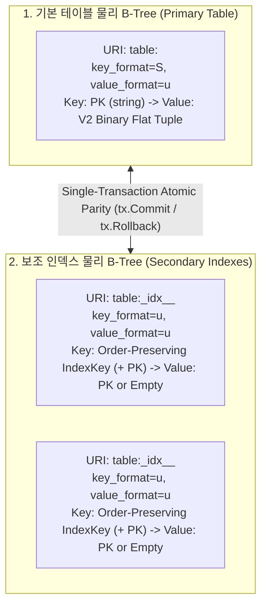
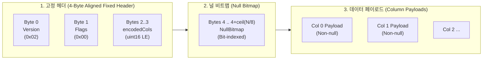
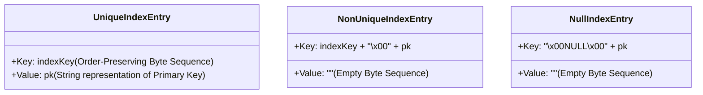

# LionSQL 물리 스토리지 포맷 공식 규격서
(Physical Storage Specification: Table Tuples & Secondary Index B-Trees)
`doc/internal/PHYSICAL_TABLE_FORMAT.ko.md`

> - **최초 작성일**: 2026-11-14
> - **최종 갱신일**: 2026-11-14
> - **문서 상태**: 공식 물리 스토리지 규격서 (Physical Storage Specification SSOT)
> - **통합 범위**: 기본 테이블 물리 바이너리 튜플 V2 포맷 + 보조 인덱스 B-Tree 키/값 포맷 일원화
> - **연계 불변식**:
>   - `GEMINI.md` [Invariant 13: Single Canonical V2 Binary Tuple Codec (4-Byte Aligned Header, Flags, Instant Tail DDL)]
>   - `GEMINI.md` [Invariant 15: Canonical Secondary Index Key/Value Codec (Order-Preserving Binary Encoding & Single-Transaction B-Tree Parity)]
> - **연계 엔지니어링 컨텍스트**:
>   - `notes/ENGINEERING_CONTEXT.ko.md` [불변식 ㉚: 스키마 진화, 단일 V2 바이너리 튜플 코덱 및 Instant Tail DDL 불변식]
>   - `notes/ENGINEERING_CONTEXT.ko.md` [불변식 ㉜: 보조 인덱스 정렬 보존 바이너리 코덱 및 물리 B-Tree 실체화 불변식]
> - **참조 소스 코드**:
>   - [`pkg/storage/tuple.go`](../pkg/storage/tuple.go): V2 바이너리 튜플 인코더/디코더
>   - [`pkg/storage/engine.go`](../pkg/storage/engine.go): `TableSchema.IndexURI`, `ParsePKValue`
>   - [`pkg/storage/wiredtiger/wt_engine.go`](../pkg/storage/wiredtiger/wt_engine.go): B-Tree 커서 및 인덱스 동기화
>   - [`pkg/storage/memengine/flat_record.go`](../pkg/storage/memengine/flat_record.go): 인메모리 포인터리스 플랫 레코드

---

## 1. 개요 및 스토리지 네임스페이스 규약 (Physical Namespaces & Architecture)

LionSQL은 단일 독립 실행 파일(Standalone Executable) 내에서 초고속 인메모리 OCC 스토리지 엔진(`memengine`)과 고신뢰성 디스크 MVCC 스토리지 엔진(`wiredtiger`)을 동시에 운용합니다.

WiredTiger 디스크 엔진에서 데이터는 **기본 테이블(Primary Table)**과 **보조 인덱스(Secondary Index)**라는 두 종류의 물리 B-Tree 테이블로 완전히 분리 격리되어 저장되며, 기본 키(Primary Key)와 단일 트랜잭션 경계를 매개로 원자적으로 상호 결합됩니다.



### 1.1 기본 테이블 물리 URI (`table:<PhysicalTableName>`)
```
URI: table:<PhysicalTableName>
config: "key_format=S,value_format=u"
```
- **Key (`key_format=S`, String)**:
  - 메인 테이블의 기본 키(Primary Key) 문자열을 저장합니다 (`row.Values[pkColIdx].String()`).
  - 단일 정수 PK, 복합 PK, 또는 시스템 자동 생성 PK가 사전순으로 정렬됩니다.
- **Value (`value_format=u`, Raw Binary Items, `WT_ITEM`)**:
  - 행(Row) 전체를 나타내는 단일의 **V2 바이너리 튜플 바이트 스트림**을 무손실 저장합니다.
- **`PhysicalTableName` 불변성**:
  - 테이블 이름 변경(`RenameTable`, 트랜잭션 DDL 톰스톤 등) 시에도 물리 URI는 변경되지 않고 보존됩니다.

### 1.2 보조 인덱스 물리 URI (`table:_idx_<PhysicalTableName>_<IndexName>`)
```
URI: table:_idx_<PhysicalTableName>_<IndexName>
config: "key_format=u,value_format=u"
```
- **`key_format=u` (Raw Binary Items, `WT_ITEM`)**:
  - `key_format=S` (C NUL-종단 문자열)를 사용할 경우, 복합 컬럼 구분자나 NULL 마커로 사용되는 `\x00` 바이트에서 문자열이 조기 절단(NUL-termination truncation)되는 치명적 결함이 발생합니다.
  - `key_format=u`를 채택하여 임의의 바이너리 바이트 시퀀스를 완벽히 보존하며, WiredTiger B-Tree의 기본 바이트 단위 `memcmp` 비교를 통해 Go 언어의 문자열 사전순 정렬(`str1 < str2`)과 100% 동일한 정렬 동작을 보장합니다.
- **`value_format=u` (Raw Binary Items, `WT_ITEM`)**:
  - 인덱스 엔트리에 대응하는 기본 키(Primary Key) 문자열을 바이트 손실 없이 저장합니다.

### 1.3 In-Memory OCC 플랫 레코드 (`memengine`)
In-Memory OCC 엔진은 포인터 추적으로 인한 CPU 캐시 미스와 Go GC 스캔 오버헤드를 원천 차단하기 위해 무압축 고정 오프셋 기반의 **포인터리스 플랫 레코드(Pointer-Free Flat Record)** 레이아웃을 사용하며 (`Invariant 14 Spec-Out`), 디스크 동기화(AOF/Snapshot) 시에는 본 V2 바이너리 튜플 코덱으로 상호 직렬화됩니다. 보조 인덱스는 $O(\log N)$ 동시성 SkipList로 관리됩니다.

---

## 2. 기본 테이블 V2 바이너리 튜플 코덱 (Primary Table & Tuple V2 Layout)

과거 레거시 버전(V1)의 가변 디코딩 휴리스틱과 스키마 변경 시의 전수 재작성(Full Table Rewrite) 병목을 영구 제거하고, 현대 메이저 RDBMS(PostgreSQL `HeapTupleHeaderData`, MySQL 8.0 InnoDB `info_bits`/`n_fields`)와 대등한 **자기완비적(Self-Describing) 4바이트 32비트 정렬 고정 헤더를 갖춘 단일 표준 V2 바이너리 튜플 코덱(`0x02`)**을 확립하였습니다 (`ADR-031`, `PERF-WT-INSTANT-ADD-COL-1`).



### 2.1 4바이트 32비트 고정 헤더 (Header Specification)
모든 튜플의 선두 4바이트는 32비트 정렬 규격을 준수합니다.

| 바이트 오프셋 | 필드명 | 데이터 타입 | 설명 및 불변식 |
| :--- | :--- | :--- | :--- |
| **Byte 0** | `Version` | `uint8` (`0x02`) | **TupleCodecV2 고정 매직 바이트**. `0x02`가 아닌 버퍼는 즉시 `ErrInvalidTupleHeader`로 Fail-Fast 차단. |
| **Byte 1** | `Flags` | `uint8` (`0x00`) | 미래 확장성 선할당 플래그 비트 필드 (하단 참조). |
| **Bytes 2..3** | `encodedCols` | `uint16` (LE) | 해당 튜플에 실제 인코딩된 컬럼의 총 개수 ($0 \sim 1,024$). **SQL Server 호환 표준 상한 (`storage.MaxColumnsPerTable = 1024`)**. DDL 생성 및 튜플 디코딩 시 1,024개 초과 시 즉시 `ErrTooManyColumns` / `ErrInvalidTupleHeader`로 Fail-Closed 차단. |

#### 헤더 플래그 비트 정의 (Byte 1)
| 비트 마스크 | 식별자 | 설명 |
| :--- | :--- | :--- |
| `0x01` | `TupleFlagNoNulls` | 예약됨: 행 내에 NULL 컬럼이 전무하여 널 비트맵을 생략한 압축 모드 |
| `0x02` | `TupleFlagCompressed` | 예약됨: 행 페이로드가 LZ4/Snappy 등으로 인라인 압축됨 |
| `0x04` | `TupleFlagToast` | 예약됨: 거대 LOB/바이너리 데이터가 외부 TOAST B-Tree 포인터로 격리됨 |
| `0x08` | `TupleFlagExtended` | 예약됨: 확장 헤더 메타데이터가 존재함 |

### 2.2 널 비트맵 (Null Bitmap)
- **크기**: `nullBitmapLen = (encodedCols + 7) / 8` 바이트
- **위치**: 바이트 오프셋 `4`부터 시작하여 `4 + nullBitmapLen`까지 위치.
- **인덱싱 규약**: $i$번째 컬럼이 `NULL`인 경우, `buf[4 + (i/8)] |= 1 << (i % 8)` 비트가 `1`로 세팅됩니다.
- **페이로드 0바이트 최적화**: `NULL`로 세팅된 컬럼은 페이로드 영역에 **0바이트**를 차지하며, 어떠한 바이트도 기록되지 않습니다.

### 2.3 튜플 페이로드 직렬화 규약
NULL이 아닌 컬럼 값들은 스키마에 정의된 순서대로 널 비트맵 바로 뒤부터 빈틈없이 밀집 직렬화됩니다.

- **`TypeInt`**: ZigZag 변형 `binary.PutVarint` ($1 \sim 10$ 바이트). 작은 정수는 1~2바이트로 밀집 압축.
- **`TypeFloat`**: `binary.LittleEndian.PutUint64` (8 바이트 고정 IEEE 754).
- **`TypeBool`**: `uint8` (1 바이트, `1`=true, `0`=false).
- **`TypeDateTime`**: `binary.LittleEndian.PutUint64` (8 바이트 고정 UTC `UnixNano()`).
- **`TypeDate`**: `binary.LittleEndian.PutUint64` (8 바이트 고정 UTC `Unix()`).
- **`TypeVarChar`, `TypeJSON`, `TypeUUID`, `TypeTime`, `TypeDecimal`, `TypeBinary`**: Uvarint 길이 + 원시 바이트 배열.

### 2.4 $O(1)$ Instant Tail DDL 및 스키마 진화 불변식
LionSQL은 디스크에 저장된 튜플을 물리적으로 전수 재작성(Full Table Rewrite)하지 않고 메타데이터만 즉시 변경하는 **$O(1)$ Instant DDL**을 표준으로 채택합니다 (`GEMINI.md` [Invariant 13]).

1. **컬럼 추가 (`ALTER TABLE ADD COLUMN`)**:
   - 신규 컬럼은 항상 스키마의 맨 끝(Tail)에 배치되며, 디스크 상의 기존 행들을 전혀 건드리지 않고 스키마 메타데이터만 갱신 후 즉각 반환합니다.
   - 디코더(`DecodeTupleToRowWithArena`)는 구버전 튜플(`encodedCols < len(schema.Columns)`)을 읽을 때 부족한 뒷단 컬럼에 대해 기본값(`col.Default`) 또는 `NULL`을 메모리 상에서 즉시 온더플라이 패딩합니다.
2. **컬럼 삭제 (`ALTER TABLE DROP COLUMN`) 및 중간 컬럼 Fail-Closed 불변식**:
   - **Tail 컬럼 삭제**: 맨 끝(Tail) 컬럼 삭제는 $O(1)$로 안전하며, 디코더는 스키마 컬럼 수 이후의 잔여 꼬리 바이트를 안전하게 무시합니다.
   - **중간 컬럼 삭제 금지**: 데이터가 존재하는 테이블에서 중간 컬럼(Middle Column) 삭제 요청은 즉시 **`ErrDropColumnNotTail` 에러와 함께 Fail-Closed로 거부**됩니다.
   - **Copy-and-Switch 표준**: 런타임 중간 컬럼 삭제는 온라인 OLTP의 심각한 운영 안티패턴이므로, 테이블 구조 개편 시 엔터프라이즈 정석인 **Copy-and-Switch** (`CREATE TABLE new AS SELECT ...` 후 원자적 `RENAME`)를 공식 해법으로 규정합니다.

### 2.5 2계층 레코드 크기 상한 규약 (Two-Tier Row Size Limits)
LionSQL은 SQL Server 100% 호환성 및 WiredTiger 32KB B-Tree 리프 페이지 패킹 효율과 동시성 워커 풀 OOM 방어를 위해 엄격한 **2계층 레코드 크기 상한 정책**을 강제합니다:

| 계층 | 상한 크기 | 상수 명칭 | 검증 시점 및 Fail-Closed 동작 |
| :--- | :--- | :--- | :--- |
| **Layer 1: In-Row 인라인 상한** | **8,060 Bytes** | `storage.MaxInlineRowSize` | **DDL 정의 시점**: 고정 길이 컬럼들의 인라인 합계(`FixedRowSize()`)가 8,060 바이트를 초과하면 `CREATE TABLE` / `ALTER TABLE` 단계에서 즉시 `ErrInlineRowTooLarge`로 거부. SQL Server 물리 제약 및 32KB B-Tree Fan-out 보장. |
| **Layer 2: Max Logical Row 상한** | **16 MB** | `storage.MaxRowSize` | **튜플 인코딩/디코딩 시점**: LOB(`VARCHAR(MAX)`, `JSON`, `TEXT`)를 포함한 단일 논리 튜플의 바이트 크기가 16MB를 초과하면 `EncodeRowToBuffer` 및 `readTupleHeader`에서 즉시 `ErrRowTooLarge`로 거부. 고동시성 워커 풀(32 워커) 메모리 폭주 및 OOM 차단. |

### 2.6 제로 알로케이션 단일 컬럼 추출 (`ExtractColumnFromTuple`)
전체 행을 디코딩하지 않고 단일 컬럼 값만 조건 평가(`WHERE`)나 프로젝션에 필요한 경우, `ExtractColumnFromTuple`을 통해 힙 할당 없이 $O(1)$로 값을 즉시 추출합니다 (0 allocs, 25.8ns; 전체 디코딩 223ns 대비 8.6배 가속).

---

## 3. 보조 인덱스 물리 B-Tree 코덱 (Secondary Index B-Tree Layout)

보조 인덱스는 메인 테이블의 PK 외에 추가 컬럼 조합에 대해 $O(\log N)$ 탐색, 범위 스캔(Range Scan), 그리고 고유성 제약(Unique Constraint)을 제공하는 핵심 자료구조입니다 (`GEMINI.md` [Invariant 15]).



### 3.1 순서 보존 단조 증가 인코딩 (`storage.EncodeIndexKeyPart`)
모든 인덱스 키는 B-Tree 내에서 이진 바이트 비교(`memcmp`)만으로 데이터 타입 고유의 정렬 순서가 완벽히 유지되도록 순서 보존 바이트 시퀀스로 변환됩니다.

| 데이터 타입 (`storage.DataType`) | 인코딩 방식 | 크기 및 특징 | 정렬 불변식 |
| :--- | :--- | :--- | :--- |
| **`TypeInt`** (signed 64-bit) | `u := uint64(v.IVal) ^ 0x8000000000000000` 후 16자리 Hex 문자열 | 16 바이트 고정 | 최상위 부호 비트 반전으로 `MinInt64(00...00) < -1(7f...ff) < 0(80...00) < 1(80...01) < MaxInt64(ff...ff)` 순서 완벽 보존 |
| **`TypeFloat`** (IEEE 754 float64) | 부호 비트 확인 후 양수는 부호비트 반전, 음수는 전체 비트 반전 후 16자리 Hex | 16 바이트 고정 | 음수 부동소수점부터 양수 부동소수점까지 단조 증가 순서 보존 |
| **`TypeDateTime`** | ISO 8601 UTC `2006-01-02T15:04:05.000000000Z` 문자열 | 30 바이트 고정 | UTC 기준 사전순 비교와 시간순 비교가 정확히 일치 |
| **`TypeDate`** | `YYYY-MM-DD` 문자열 | 10 바이트 | 사전순 정렬 |
| **`TypeTime`** | `HH:MM:SS` 문자열 | 8 바이트 | 사전순 정렬 |
| **`TypeVarChar` / `TypeJSON`** | 원본 UTF-8 바이트 시퀀스 | 가변 길이 | 사전순 정렬 |
| **`TypeUUID`** | 정규화된 36자리 소문자 하이픈 UUID 문자열 | 36 바이트 | 사전순 정렬 |
| **`NULL`** | `\x00NULL` | 5 바이트 | 최하위 바이트 `0x00`으로 시작하여 모든 ASCII/UTF-8 문자보다 항상 최우선 정렬 |

### 3.2 고유 인덱스 레이아웃 (Unique Index: `idx.Unique == true`)
1. **Non-Null 데이터 엔트리**:
   - **Key**: `indexKey` (단일: `EncodeIndexKeyPart(col)`, 복합: `col1 + "\x00" + col2 + ...`)
   - **Value**: `pk` (메인 테이블의 기본 키 문자열)
   - **충돌 감지**: B-Tree에서 `search(indexKey)` 시 엔트리가 이미 존재하고 저장된 `pk != currentPK`이면 즉시 `ErrUniqueViolation` 발생 ($O(\log N)$).
2. **NULL 데이터 엔트리 (SQL 표준 다중 NULL 허용 규약)**:
   - SQL 표준 및 ANSI 규약에 따라, 고유 인덱스라도 `NULL` 값은 여러 행에 걸쳐 중복 저장될 수 있습니다.
   - 고유 인덱스에서 `keyVal.IsNull == true`인 행은 단일 `indexKey` 대신 **비고유 엔트리 포맷(`\x00NULL\x00 + pk`, Value `""`)**으로 분기 저장되어, 중복 제약 위반 없이 B-Tree 내에 안전하게 공존합니다.

### 3.3 비고유 인덱스 레이아웃 (Non-Unique Index: `idx.Unique == false`)
WiredTiger B-Tree는 기본적으로 키의 유일성을 전제하므로, 동일한 인덱스 키를 가진 복수 행을 분실 없이 정렬 보관하기 위해 **기본 키(Primary Key)를 인덱스 키의 접미사로 합성**합니다.
- **Key**: `indexKey + "\x00" + pk`
- **Value**: `""` (0바이트 빈 값)
- **특징**: 메인 테이블의 PK는 고유하므로, 합성된 인덱스 키 전체는 항상 고유성이 보장되며, B-Tree 내에서 동일한 `indexKey`를 가진 엔트리들이 `pk` 순으로 오름차순 밀집 클러스터링됩니다.

### 3.4 복합 인덱스 프리픽스 매칭 (`compareCompositePrefix`)
복합 인덱스 `(tenant_id, user_id)`에서 사용자가 `WHERE tenant_id = 10`과 같이 선행 컬럼 일부만 조건으로 제공한 경우:
- `curKey`와 `boundKey`를 `\x00` 구분자로 분할하여 `boundKey`에 명시된 컬럼 수만큼만 비교합니다.
- 선행 컬럼이 일치하면 `0`을 반환하여 유효한 엔트리로 인정하고, 상한선 초과 시 즉시 순회를 중단($O(\log N + M)$)합니다.

---

## 4. 데이터 타입별 직렬화 비교 매트릭스 (Row Codec vs Index Codec)

동일한 스칼라 데이터 타입이라도 기본 테이블(Row)과 보조 인덱스(Index)는 설계 목적에 따라 서로 다른 최적화 인코딩을 적용합니다.

| 데이터 타입 | 기본 테이블 튜플 (Row Tuple V2) | 보조 인덱스 B-Tree 키 (Index Key) | 목적 차이 |
| :--- | :--- | :--- | :--- |
| **`TypeInt`** | ZigZag 변형 `binary.PutVarint` (1~10B) | 부호 비트 반전 후 16자리 Hex (16B) | Row는 **저장 공간 최소화**, Index는 **이진 정렬 순서 보존** |
| **`TypeFloat`** | `PutUint64` LE (8B) | 부호 비트 조작 후 16자리 Hex (16B) | Row는 **원시 비트 보존**, Index는 **부동소수점 단조 증가 순서** |
| **`TypeDateTime`** | `PutUint64` UTC `UnixNano()` (8B) | ISO 8601 UTC 포맷 문자열 (30B) | Row는 **나노초 정수 압축**, Index는 **사전순=시간순 일치** |
| **`TypeDate`** | `PutUint64` UTC `Unix()` (8B) | `YYYY-MM-DD` 문자열 (10B) | Row는 **초단위 정수 압축**, Index는 **사전순 정렬** |
| **`TypeTime`** | Uvarint 길이 + 문자열 (가변) | `HH:MM:SS` 문자열 (8B) | Row는 **가변 Uvarint**, Index는 **사전순 정렬** |
| **`TypeVarChar`** | Uvarint 길이 + UTF-8 바이트 (가변) | UTF-8 원본 바이트 (가변) | Row는 **길이 기반 빠른 점프**, Index는 **사전순 memcmp** |
| **`NULL`** | 널 비트맵 비트 세팅 (페이로드 0B) | `\x00NULL` (5B, `0x00` 시작) | Row는 **공간 낭비 제로**, Index는 **최우선 오름차순 정렬** |

---

## 5. 트랜잭션 ACID 수명주기 및 DDL 원자적 동기화 불변식

1. **단일 트랜잭션 원자적 동기화 (Single-Transaction Parity)**:
   - 기본 테이블 쓰기(`table:<name>`)와 모든 보조 인덱스 B-Tree 쓰기는 **단일 WiredTiger `WT_SESSION` 트랜잭션 핸들 내에서 원자적으로 실행**됩니다.
   - 트랜잭션 롤백(`tx.Rollback()`) 시 기본 테이블과 보조 인덱스 변경 사항이 동시 무효화됩니다.
2. **세이브포인트(Savepoint) 보상 로직**:
   - `RollbackToSavepoint` 실행 시 내부 `undoLog`를 역순 순회하며:
     - Undo Insert: 메인 테이블 행 삭제 및 모든 보조 인덱스 B-Tree 엔트리 삭제.
     - Undo Delete / Update: 메인 테이블 구 데이터 복원 및 이전 보조 인덱스 B-Tree 엔트리 복원.
3. **DDL 물리 격리 및 정리**:
   - `CreateIndex`: 기존 행 대상 인덱스 B-Tree 백필(Backfill) 및 고유성 검증.
   - `DropIndex`: 커서 풀 evict ➔ `go_wt_session_drop` 물리 B-Tree 즉시 삭제.
   - `DropTable`: 메인 테이블과 연관된 모든 보조 인덱스 B-Tree 일괄 자동 삭제.
   - `TruncateTables`: 연결된 모든 보조 인덱스 B-Tree 일괄 Truncate.
4. **트랜잭셔널 DDL 롤백 (`FEAT-TRANSACTIONAL-DDL-1`)**:
   - `BEGIN TRAN` 내에서 수행된 `CREATE/DROP TABLE`, `ALTER TABLE`, `CREATE/DROP INDEX`는 `ClientSession.ddlUndoStack`을 통해 `ROLLBACK` 시 100% 원복됩니다.
