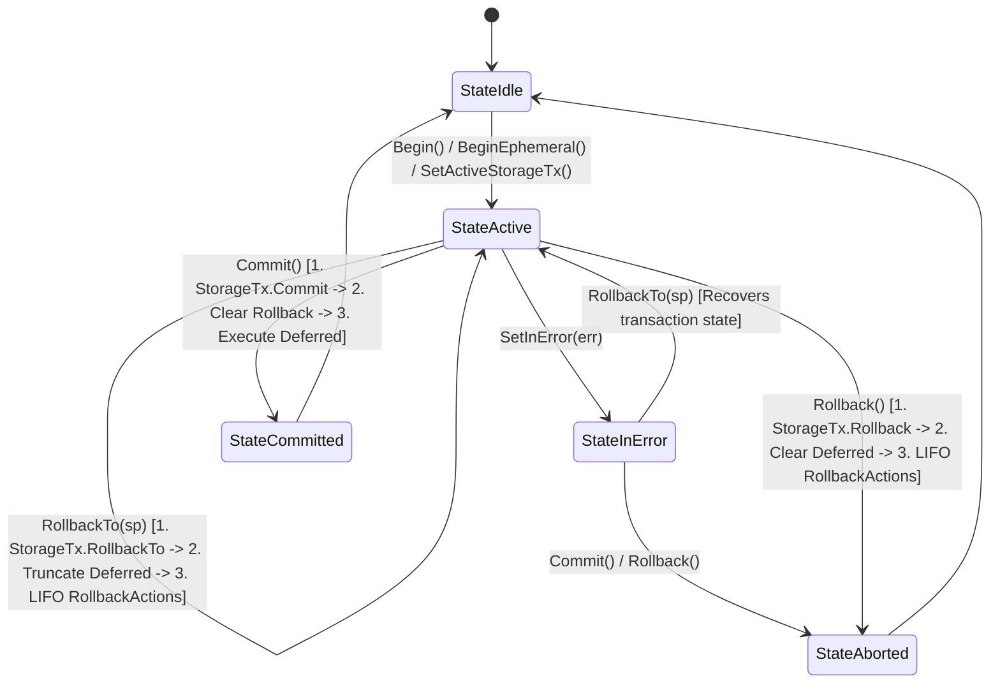

# LionSQL 세션 — 트랜잭션 — 커서 생명주기 및 락 계층 아키텍처 명세서
(`doc/internal/SESSION_TX_CURSOR_LIFECYCLE.ko.md`)

> - **작성일**: 2026-11-23
> - **적용 범위**: `pkg/engine`, `pkg/tx`, `pkg/storage/wiredtiger`, `pkg/storage/memengine`
> - **핵심 준수 규칙**: `[RULE:LockHierarchy]`, `[RULE:HandleHygiene]`, `[RULE:CleanTeardown]`, `[RULE:DoubleCloseSafety]`, `[RULE:ConcurrencySafety]`

---

## 1. 개요 및 설계 배경

LionSQL은 단일 프로세스 내에서 고동시성 클라이언트 세션, 다단계 ACID 트랜잭션(세이브포인트 및 트랜잭셔널 DDL 포함), 그리고 CGo 기반 WiredTiger B+Tree 커서(`WT_SESSION*`, `WT_CURSOR*`)와 순수 Go 인메모리 OCC 커서를 동시에 운용합니다.

특히 WiredTiger C 커널에서는 **하나의 `WT_SESSION*` 핸들과 그로부터 파생된 모든 `WT_CURSOR*` 핸들이 내부 C 상태(`WT_SESSION_IMPL`)를 공유**하며, C 레벨에서 스레드 안전성(Thread-Safety)을 제공하지 않습니다. 따라서 트랜잭션이나 커서가 C 리소스를 사용하는 도중에 세션 종료(`Session.Close()`)나 롤백이 비동기적으로 개입하면 **C 힙 Use-After-Free(`SIGSEGV`)** 또는 **스테일 커서(Stale Cursor)의 후속 트랜잭션 침범**이 발생할 수 있습니다.

본 문서는 이를 원천 차단하기 위해 확립된 **세션(Session) — 트랜잭션(Transaction) — 커서(Cursor) 3계층 종속 생명주기**와 **정규 락 계층(Canonical Lock Hierarchy)**을 명세합니다.

---

## 2. 3계층 종속 생명주기 모델 (3-Tier Ownership & Cascade Teardown)

모든 실행 리소스는 엄격한 부모-자식 소유권 트리(**Session ➔ Transaction ➔ Cursor**)를 형성하며, 부모 리소스가 종료될 때는 반드시 자식 리소스를 먼저 무효화·회수한 뒤 자신의 물리 핸들을 해제합니다.

```
+-----------------------------------------------------------------------------------+
| Tier 1: Session Layer (ClientSession / tx.Manager / storage.Session / WTSession)  |
|  - 1-Session 1-Active-Tx 불변식 보장                                               |
|  - C 커널 WT_SESSION* 핸들 및 세션 레벨 커서 풀(cursorPool, allCursors) 소유       |
+-----------------------------------------------------------------------------------+
                                         │
                                         ▼ (1 : 0..1 Active)
+-----------------------------------------------------------------------------------+
| Tier 2: Transaction Layer (tx.Context / storage.Transaction / WTTx / MemTx)       |
|  - Savepoints 스택, ShadowCatalog 오버레이, DeferredActions, RollbackActions 소유  |
|  - 활성 스캔 커서 목록(openCursors []storage.Cursor) 및 행 잠금(acquiredLocks) 소유|
+-----------------------------------------------------------------------------------+
                                         │
                                         ▼ (1 : 0..N Open)
+-----------------------------------------------------------------------------------+
| Tier 3: Cursor Layer (WTCursor / wtIndexBTreeCursor / ArenaRowCursor)             |
|  - 부모 WTTx 및 WTSession 참조 보유                                                |
|  - WT_CURSOR* 대여(acquireCursor) ➔ 순회(Next/Row/Record) ➔ 반납(releaseCursor)    |
+-----------------------------------------------------------------------------------+
```

### 2.1. 핵심 생명주기 불변식 (Lifecycle Invariants)

1. **Invariant L-1 (Cursor-to-Transaction Binding & Auto-Reclamation)**:
   - 모든 스토리지 커서(`WTCursor`, `wtIndexBTreeCursor`)는 자신을 생성한 `WTTx`의 `tx.openCursors` 슬라이스에 등록됩니다.
   - 호출자가 명시적으로 `cursor.Close()`를 호출하지 않더라도, 트랜잭션이 `Commit()` 또는 `Rollback()`될 때 `tx.closeOpenCursorsLocked()`가 가장 먼저 호출되어 모든 열린 커서를 `c.closed = true; c.cur = nil`로 무효화하고 C 커서를 세션 커서 풀(`s.cursorPool`)로 즉시 회수합니다.
   - 따라서 `tx1`에서 생성된 스테일 커서는 `tx1`이 종료된 직후 영구 불능 상태가 되며, 동일 세션에서 시작된 후속 `tx2`를 절대 침범할 수 없습니다.

2. **Invariant L-2 (Session-to-Transaction & Cursor Synchronized Teardown)**:
   - `WTSession.Close()` 및 `WTSession.Reset()`은 자신의 `WT_SESSION*` 및 `allCursors`(`WT_CURSOR*`)를 해제하기 전에, 반드시 현재 활성 트랜잭션(`curTx := s.currentTx`)의 뮤텍스(`curTx.mu`)를 먼저 획득하여 진행 중인 모든 트랜잭션 C 호출이 끝날 때까지 대기합니다.
   - `curTx.mu` 획득 후 `curTx.closed = true`, `curTx.closeOpenCursorsLocked()`, `curTx.releaseAcquiredLocksLocked()`를 수행하여 자식 트랜잭션과 손자 커서들을 먼저 안전하게 닫은 뒤에만 `C.go_wt_cursor_close` 및 `C.go_wt_session_close`를 호출합니다.

3. **Invariant L-3 (Cursor C-Call Guard under `WTSession.mu`)**:
   - `WTCursor`와 `wtIndexBTreeCursor`의 모든 메서드(`Next()`, `Record()`, `Row()`, `RawTuple()`, `Close()`)는 C 커서 포인터(`c.cur`)에 접근하기 전 반드시 `c.sess.mu.Lock()`을 획득하고 다음 조건을 검증합니다:
     ```go
     if c.closed || c.cur == nil || c.eof || c.err != nil || c.sess.closed || c.sess.sess == nil {
         return false // 또는 error("cursor closed")
     }
     ```
   - 이로써 커서 순회(`C.go_wt_cursor_next`, `C.go_wt_cursor_get_val_raw`), 단건 조회(`WTTx.getRawBytesLocked`), 그리고 세션 종료(`WTSession.Close`)가 단일 `WT_SESSION*` 위에서 100% 상호 배제(Mutual Exclusion)됩니다.

---

## 3. 통합 트랜잭션 매니저(`pkg/tx.Manager`)의 세이브포인트 및 롤백 생명주기

[`pkg/tx/manager.go`](file:///Users/maro/Projects/SQLion/pkg/tx/manager.go)는 세션의 물리 스토리지 트랜잭션(`StorageTx`), 트랜잭셔널 DDL 오버레이(`ShadowCatalog`), 지연 커밋 큐(`DeferredActions`), 롤백 복구 큐(`RollbackActions`), 세이브포인트 스택(`SavepointStack`)을 단일 진실 공급원(SSOT)으로 통합 관장합니다.

### 3.1. 상태 전이 및 LIFO 롤백 순서



### 3.2. 왜 `StorageTx` DML 롤백이 DDL `RollbackActions`보다 먼저 실행되어야 하는가?

트랜잭션 또는 세이브포인트 구간 내에서 다음과 같은 순서로 작업이 수행되었다고 가정합니다:
1. `SAVEPOINT sp1;`
2. `CREATE TABLE t_new ...` 또는 `ALTER TABLE t_existing ADD COLUMN col_b INT;` (DDL: `RollbackActions`에 컬럼/테이블 삭제 등록)
3. `INSERT INTO t_new ...` 또는 `UPDATE t_existing SET col_b = 99 ...` (DML: 스토리지 undo log에 기록)
4. `ROLLBACK TO SAVEPOINT sp1;` (또는 `ROLLBACK;`)

이때 시간 역순(LIFO) 원칙에 따라 `Manager.RollbackTo(name)` 및 `Manager.Rollback(ctx)`는 반드시 다음 순서를 강제합니다:

1. **Step 1 (물리 스토리지 DML 롤백)**: `m.current.StorageTx.RollbackTo(name)` (또는 `StorageTx.Rollback()`)
   - 열린 스캔 커서들을 먼저 닫고(`closeOpenCursorsLocked()`), 3번에서 수행된 DML 변경분(튜플 및 보조 인덱스 엔트리)을 undo log를 통해 원상복구합니다.
   - 이때 테이블과 컬럼 스키마가 아직 존재하므로 WiredTiger 커서 작업이 `EBUSY`나 스키마 불일치 없이 깨끗하게 롤백됩니다.
2. **Step 2 (지연 커밋 액션 취소)**: `m.current.DeferredActions = m.current.DeferredActions[:sp.DeferredOffset]`
   - 세이브포인트 이후 예약된 물리적 테이블 삭제(`DROP TABLE` 지연 실행 등)를 취소합니다.
3. **Step 3 (카탈로그 및 `ShadowCatalog` DDL 역순 복구)**: `actionsToRun`을 LIFO 역순(`len-1` ➔ `0`)으로 실행
   - 2번에서 추가되었던 컬럼/테이블을 카탈로그에서 제거하거나, `DROP TABLE`로 마킹되었던 `ShadowCatalog.MarkTableDropped`를 `UnmarkTableDropped`로 즉시 복원합니다.

---

## 4. 정규 락 계층 규약 (Canonical Lock Hierarchy — `[RULE:LockHierarchy]`)

데드락(AB-BA Lock Inversion)과 C 리소스 경합을 원천 차단하기 위해, 스토리지 엔진 및 트랜잭션 계층의 뮤텍스는 반드시 아래의 **단방향 정규 순서(1 ➔ 6)**로만 중첩 획득해야 합니다:

| 계층 순서 | 뮤텍스 명칭 | 보호 대상 리소스 | 비고 |
| :---: | :--- | :--- | :--- |
| **1 (최상위)** | `ClientSession.TxMgr.mu` (`Manager.Lock()`) | 세션 단위 SQL 명령 직렬화 | 세션당 동시 쿼리 실행 방지 |
| **2** | `ClientSession.Mu` | 세션 로컬 변수(`Vars`), 커서 맵(`Cursors`) | 메타데이터 접근 보호 |
| **3** | `Engine.sessMu` | 활성 `WTSession` 레지스트리 맵 (`engine.sessions`) | `NewSession`, `WTSession.Close` 시 단기 획득 후 즉시 해제 |
| **4** | **`WTTx.mu`** | 트랜잭션 상태(`closed`, `undoLog`, `openCursors`, `savepoints`) | **반드시 `WTSession.mu`보다 먼저 획득** |
| **5** | **`WTSession.mu`** | C `WT_SESSION*` 핸들, `WT_CURSOR*` 풀(`cursorPool`, `allCursors`), C 커서 호출 | `WTTx` 내부 및 `WTCursor` C 호출 시 획득 |
| **6 (최하위)** | `WTTx.lockMu` ➔ `wtLockShard.mu` | `activeWriters` 1024-샤드 Fail-Fast 행 잠금 테이블 | 다중 샤드 해제 시 `shardIdx` 오름차순 정렬 획득 |

### 4.1. 금지되는 역방향 락 획득 (Strictly Prohibited Anti-Patterns)
- **`WTSession.mu`를 보유한 상태에서 `WTTx.mu` 획득 금지**:
  - `WTSession.Close()` 및 `WTSession.Reset()`은 `s.mu`를 잠깐 잡아 `curTx := s.currentTx` 포인터만 읽고 즉시 `s.mu.Unlock()`을 해제한 뒤, **`curTx.mu.Lock()`(4단계) ➔ `s.mu.Lock()`(5단계)** 순서로 획득해야 합니다.
- **`WTCursor` 내부에서 `WTTx.mu` 재획득 금지**:
  - `WTTx` 내부의 FK 제약 조건 검사(`wt_engine.go:3381`, `3457`)는 이미 `WTTx.mu`(4단계)를 보유한 상태에서 `scanLocked`로 생성한 `WTCursor.Next()` / `Record()` / `Close()`를 호출합니다.
  - 따라서 `WTCursor`는 **`WTSession.mu`(5단계)만 획득**해야 하며, 이를 통해 4단계 ➔ 5단계 락 계층이 완벽히 유지됩니다.

---

## 5. 회귀 검증 테스트 스위트 매핑

본 생명주기 아키텍처의 모든 불변식은 다음 자동화 테스트 스위트(`-race` 포함)에 의해 상시 검증됩니다:

- [`pkg/storage/wiredtiger/session_close_race_test.go`](file:///Users/maro/Projects/SQLion/pkg/storage/wiredtiger/session_close_race_test.go):
  - `TestWTSession_CloseInvalidatesOpenCursorsAndTransactions`: 열린 테이블/인덱스 커서 및 활성 트랜잭션이 존재하는 상태에서 `sess.Close()` 호출 시 C `SIGSEGV` 방지 및 20라운드 동시 스캔/조회/종료 스트레스 검증.
  - `TestWTSession_TxCommitOrRollbackInvalidatesAndReclaimsOpenCursors`: `cur.Close()` 없이 `tx1.Commit()` 후 `tx2` 시작 시 `tx1`의 스테일 커서 자동 무효화 및 커서 풀 회수 검증.
- [`pkg/engine/savepoint_ddl_rollback_test.go`](file:///Users/maro/Projects/SQLion/pkg/engine/savepoint_ddl_rollback_test.go):
  - `TestSavepoint_DDLRollbackIntegrity`: 세이브포인트 내 `ALTER TABLE ADD COLUMN` + `UPDATE` 후 `ROLLBACK TO SAVEPOINT` 시 DML/DDL LIFO 복구 검증.
  - `TestSavepoint_DropTable_ShadowCatalogRecovery`: 세이브포인트 내 `DROP TABLE` 후 `ROLLBACK TO SAVEPOINT` 시 `ShadowCatalog` 즉시 복원 검증.
  - `TestSavepoint_SetActiveStorageTx_And_DirectTxMgrSavepoint`: `SetActiveStorageTx` 경유 트랜잭션의 컨텍스트 초기화 및 `TxMgr.Savepoint`/`RollbackTo`의 `StorageTx` 일원화 검증.
