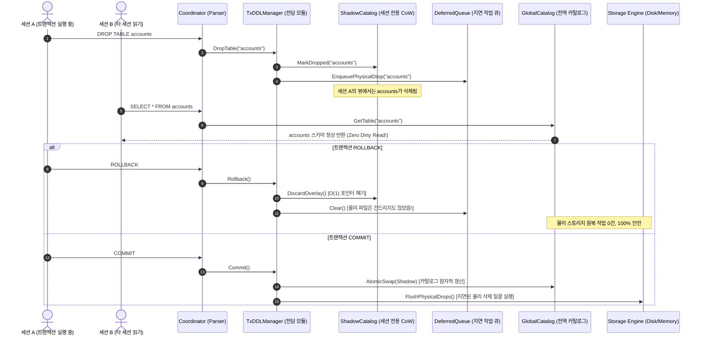

# 트랜잭셔널 DDL 섀도 카탈로그 및 지연 작업 큐 아키텍처 명세서
(`doc/internal/TRANSACTIONAL_DDL_SHADOW_CATALOG_ARCHITECTURE.ko.md`)

> - **문서 유형**: 아키텍처 설계 명세서 (Architectural Specification)
> - **버전**: v1.0.0
> - **작성일자**: 2026-11-15
> - **대상 모듈**: `pkg/catalog/txddl` (신규 전담 패키지) 및 `pkg/engine`
> - **연계 규칙**: `[RULE:AtomicSaves]`, `[RULE:ConflictPrevention]`, `[RULE:ModularAbstraction]`, `[RULE:RadicalKISS]`, `[RULE:StyleIntegrity]`
> - **핵심 키워드**: Shadow Catalog, Copy-on-Write (CoW), Deferred Action Queue, Dirty DDL Read Prevention, O(1) Rollback

---

## 1. 아키텍처 배경 및 해결 과제 (Problem Statement)

### 1.1 기존 톰스톤 리네임 방식의 근본적 결함
기존 LionSQL 구현에서는 트랜잭션 블록(`BEGIN TRANSACTION` ... `COMMIT` / `ROLLBACK`) 내에서 DDL이 실행될 때, `sqlexec_ddl.go` 내부에서 스토리지 엔진의 테이블을 즉시 조작하고 `_tombstone_txID_tableName` 형태로 물리 이름을 변경한 후 세션 힙의 `ddlUndoLog` 스택에 롤백 액션을 등록하는 방식을 사용했습니다.

이 구조는 다음의 치명적인 결함들을 발생시킵니다:
1. **Dirty DDL Read (미커밋 DDL의 타 세션 노출)**:
   - 세션 A가 트랜잭션 내에서 `DROP TABLE users;`를 실행하면, 아직 커밋되지 않았음에도 스토리지 엔진에서 `users`가 즉시 톰스톤으로 리네임되거나 카탈로그에서 제거됩니다.
   - 이 시점에 동시 실행 중인 타 세션 B가 `SELECT * FROM users;`를 실행하면 `table not found` 오류가 발생하여 트랜잭션 격리성(Read Committed / Snapshot Isolation)이 완전히 파괴됩니다.
2. **톰스톤 파일 잔존 및 크래시 누출 (Tombstone Leakage)**:
   - 롤백 도중 서버 전원 차단, `kill -9`, 또는 I/O 장애가 발생하면 톰스톤으로 바뀐 테이블이 원래 이름으로 복구되지 못하고 영구 댕글링 파일로 디스크에 남습니다.
3. **스파게티 결합도 (Violating SRP & Radical KISS)**:
   - 2,300줄 이상의 `sqlexec_ddl.go` 안에 AST 파싱, 권한 검사, 스토리지 물리 조작, 톰스톤 작명, Undo 스택 푸시 코드가 강하게 결합되어 유지보수와 검증이 극도로 어렵습니다.

---

## 2. 섀도 카탈로그 & 지연 작업 큐 아키텍처 (Core Architecture)

본 아키텍처는 **"트랜잭션이 확정(COMMIT)되기 전까지는 물리 스토리지를 절대 파괴하지 않는다"**는 대원칙 하에, 두 가지 핵심 컴포넌트를 중심으로 동작합니다.



---

## 3. 핵심 컴포넌트 상세 설계

### 3.1 `ShadowCatalog` (Copy-on-Write 카탈로그 오버레이)
`ShadowCatalog`는 전역 카탈로그의 불변 스냅샷 위에 세션 전용 변경 사항을 얹는 **경량 CoW(Copy-on-Write) 오버레이 계층**입니다.

```go
package txddl

import (
	"sync"
	"lionsql/pkg/storage"
)

type ShadowCatalog struct {
	mu            sync.RWMutex
	baseCatalog   storage.CatalogReader           // 전역 카탈로그 불변 읽기 참조
	createdTables map[string]*storage.TableSchema // 트랜잭션 내 CREATE TABLE
	alteredTables map[string]*storage.TableSchema // 트랜잭션 내 ALTER TABLE (복제본)
	droppedTables map[string]bool                 // 트랜잭션 내 DROP TABLE 마킹
	createdIdxs   map[string][]storage.IndexSchema
	droppedIdxs   map[string]map[string]bool      // tableName -> indexName -> true
}
```

#### 스키마 조회 라우팅 알고리즘:
1. `droppedTables[tableName] == true`이면 즉시 `ErrTableNotFound` 반환.
2. `createdTables[tableName]`에 존재하면 해당 신규 스키마 반환.
3. `alteredTables[tableName]`에 존재하면 변경된 스키마 반환.
4. 위 오버레이에 없으면 `baseCatalog.GetTable(tableName)`을 호출하여 커밋된 기본 스키마 반환.

#### 아키텍처 특성:
- **완전한 읽기 격리**: 세션 A가 수행한 모든 변경은 오직 세션 A의 `ShadowCatalog`에만 국한되며, 세션 B는 `baseCatalog`를 직접 조회하므로 미커밋 변경을 절대 볼 수 없습니다.
- **$O(1)$ 무비용 롤백**: 롤백 시 별도의 역연산 DDL을 디스크에 수행할 필요 없이, 세션에 바인딩된 `ShadowCatalog` 맵만 해제하면 즉시 원래 상태로 복귀합니다.

---

### 3.2 `DeferredActionQueue` (지연 물리 작업 큐)
비가역적이거나 디스크 파괴적인 물리 연산(파일 삭제, B-Tree drop 등)은 트랜잭션이 완전히 커밋될 때까지 지연되어 큐에 보류됩니다.

```go
type DeferredActionType uint8

const (
	ActionPhysicalDropTable DeferredActionType = iota
	ActionPhysicalDropIndex
	ActionPhysicalTruncate
)

type DeferredAction struct {
	Type      DeferredActionType
	TableName string
	IndexName string
	CleanupFn func(engine storage.Engine) error
}

type DeferredActionQueue struct {
	mu      sync.Mutex
	actions []DeferredAction
}
```

#### 동작 규칙:
1. **`DROP TABLE` 실행 시**:
   - 물리 스토리지를 즉시 삭제하지 않음.
   - `ShadowCatalog.droppedTables`에 마킹하고, `DeferredActionQueue`에 `ActionPhysicalDropTable` 등록.
2. **`ROLLBACK` 발생 시**:
   - `DeferredActionQueue.actions = nil`로 큐를 비움.
   - 물리 파일은 애초에 손대지 않았으므로 톰스톤 복구나 크래시 정합성 훼손 위험이 0%입니다.
3. **`COMMIT` 발생 시**:
   - 1단계: 전역 카탈로그에 `ShadowCatalog` 변경 사항 원자적 스왑.
   - 2단계: WAL에 DDL 커밋 프레임 플러시.
   - 3단계: `DeferredActionQueue.Flush(engine)`를 호출하여 실제 물리 파일/B-Tree를 백그라운드에서 안전하게 일괄 회수.

---

### 3.3 `TxDDLManager` 파사드 인터페이스
엔진 실행부(`pkg/engine`)는 복잡한 내부 큐나 스토리지 포인터를 직접 다루지 않고, `txddl.Manager` 인터페이스만을 호출합니다.

```go
package txddl

import (
	"context"
	"lionsql/pkg/storage"
)

type Manager interface {
	// 생명주기 관리
	BeginTx(sessionID string) (*TxContext, error)
	CommitTx(ctx context.Context, sessionID string) error
	RollbackTx(ctx context.Context, sessionID string) error

	// 트랜잭셔널 DDL 연산
	CreateTable(ctx context.Context, sessionID string, schema *storage.TableSchema) error
	DropTable(ctx context.Context, sessionID string, tableName string) error
	AlterTable(ctx context.Context, sessionID string, tableName string, mutator func(*storage.TableSchema) error) error
	CreateIndex(ctx context.Context, sessionID string, index *storage.IndexSchema) error
	DropIndex(ctx context.Context, sessionID string, tableName, indexName string) error

	// 활성 세션 카탈로그 뷰 획득
	GetCatalogView(sessionID string) storage.CatalogReader
}
```

---

## 4. WAL 기록 및 장애 Fail-Closed 보장 규칙

DDL 작업이 영구 저장소에 반영될 때 발생하는 I/O 실패에 대해 다음 불변식을 강제합니다:

1. **Write-WAL-First 원칙 (선기록 후상태갱신)**:
   - 파괴적 작업(`Truncate`, `Rename`)은 메모리 샤드를 조작하기 전에 반드시 WAL 프레임을 먼저 영속화해야 합니다.
   - WAL 프레임 기록 실패 시 메모리 데이터는 단 1바이트도 수정되지 않아야 합니다.
2. **Symmetric Rollback 원칙 (실패 시 즉시 대칭 원복)**:
   - `CreateTable`, `CreateIndex` 등 메모리 등록이 선행되어야 하는 작업의 경우, WAL 기록이 실패하면 직전에 변경한 `e.tables` 또는 `td.Indexes` 맵에서 해당 항목을 즉시 제거하고 외래키 캐시를 재구축하여 fail-closed를 보장합니다.
3. **Rollback 무결성 및 인덱스 복원 결함 격리**:
   - 트랜잭션 롤백 과정에서 보조 인덱스 복원 오류가 발생하더라도 메인 레코드와 카탈로그의 원복은 중단 없이 끝까지 완료되어야 하며, 손상된 인덱스는 `Disabled = true`로 격리 마킹되어 테이블 스캔으로 안전하게 폴백되어야 합니다.

---

## 5. 기대 효과 및 시스템 개선 지표

1. **동시성 격리성 100% 확립**:
   - 타 세션의 트랜잭션 내 `DROP TABLE` / `ALTER TABLE` 수행 중에도 다른 세션의 쿼리가 블로킹되거나 `table not found` 오류를 만나는 Dirty Read 결함이 완전히 해소됩니다.
2. **복구 신뢰성 극대화 (Zero Orphan Artifacts)**:
   - 톰스톤 테이블 리네임 메커니즘을 영구 폐기함으로써, 크래시 발생 시 디스크에 고아 테이블 파일이 누출되는 현상을 원천 방지합니다.
3. **코드베이스 대폭 슬림화 (`[RULE:RadicalKISS]`)**:
   - `sqlexec_ddl.go`에서 수백 줄에 달하는 세션별 `ddlUndoLog` 스택 수동 조작 및 분기문을 전면 제거하고 단일 파사드 호출로 일원화합니다.
