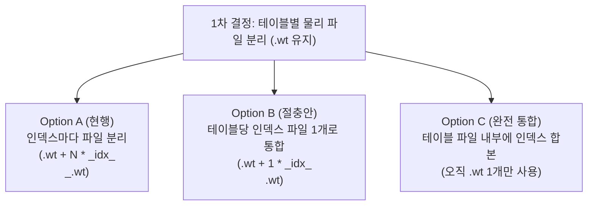

# WiredTiger 물리 파일 레이아웃 및 인덱스 멀티플렉싱 아키텍처 설계 계획 (`WIREDTIGER_FILE_LAYOUT_AND_INDEX_MULTIPLEXING_PLAN`)

- **작성일**: 2026-11-17
- **대상 모듈**: `pkg/storage/wiredtiger`, `pkg/storage/storage.go`
- **관련 불변식**: `Invariant 10` (WiredTiger High-Concurrency), `Invariant 15` (Canonical Secondary Index Key/Value Codec), `[RULE:RadicalKISS]`
- **목적**: WiredTiger 스토리지 엔진에서 (1) **테이블별 물리 파일을 분리할 것인지 여부**와, (2) **세컨더리 인덱스 파일을 어떻게 배치할 것인지**(개별 파일 vs 테이블당 단일 인덱스 파일 vs 테이블 데이터 파일 내 합본)에 대한 아키텍처 대안별 장단점과 공학적 트레이드오프를 정밀 분석한다.

---

## 1. 배경 및 현행 구조 진단

현재 LionSQL의 WiredTiger 엔진(`pkg/storage/wiredtiger/wt_engine.go`)은 다음과 같이 물리 `.wt` 파일을 생성한다:
- **본 테이블 (Primary Table)**: `table:<TableName>` ➔ `<TableName>.wt` (`key_format=S, value_format=u`)
- **세컨더리 인덱스 (Secondary Index)**: `table:_idx_<TableName>_<IndexName>` ➔ `_idx_<TableName>_<IndexName>.wt` (`key_format=u, value_format=u`)
- **시스템 메타데이터**: `WiredTiger.wt`, `WiredTiger.turtle`, `_catalog.wt`, `WiredTigerLog.*` 등 약 10~11개 파일

### 현행 구조의 현상 (`data_answer` 사례)
- 사용자 테이블 27개 + 세컨더리 인덱스 45개 + 시스템 파일 11개 = **단일 데이터 디렉터리 내 총 83개 파일 생성**.
- 테이블 수가 200개, 테이블당 평균 인덱스가 4개인 중대형 스키마의 경우 `200 + 800 + 11 = 1,011개`의 `.wt` 파일이 생성되며, WiredTiger 체크포인트(Checkpoint) 순회 시간 및 OS 파일 디스크립터(`ulimit -n`) 소모량이 선형 증가한다.

---

## 2. 1차 의사결정 축: 테이블별로 파일을 따로 만들 것인가? (Table File Layout)

첫 번째 근본 질문은 **"테이블마다 `<Table>.wt` 파일을 따로 만들 것인가(File-per-Table), 아니면 SQLite나 구형 InnoDB(`ibdata1`)처럼 모든 테이블을 단 하나의 `data.wt` 파일에 몰아넣을 것인가(Single Unified File)"**이다.

### Axis 1-A: 전체 테이블 단일 파일 통합 (`Single Unified Database File: data.wt`)
모든 테이블의 레코드를 `<TableID>\x00<PrimaryKey>` 형태의 복합 키로 묶어 단 하나의 `data.wt` B-Tree에 저장하는 방식이다.

- **장점**:
  1. **극단적인 파일 개수 최소화**: 테이블이 10개든 10,000개든 데이터 파일은 `data.wt` 딱 1개로 고정된다.
  2. **OS 파일 핸들(FD) 고갈 원천 차단**: 테이블 수와 무관하게 파일 디스크립터를 1개만 사용한다.
- **단점 (치명적 한계)**:
  1. **`DROP TABLE` / `TRUNCATE TABLE` 시 디스크 용량 즉시 회수 불가 및 $O(N)$ 지연**:
     - 개별 파일 구조에서는 `DROP TABLE`이 `session->drop("table:X")` 호출 한 번($O(1)$, 수 밀리초)으로 끝나며 OS 파일이 즉시 `unlink`되어 수십 GB의 디스크 공간이 그 자리에서 반환된다.
     - 반면 단일 파일(`data.wt`)에서는 수천만 건의 키 범위를 순회하며 지워야 하고($O(N)$), 지운 뒤에도 파일 크기가 줄어들지 않아(Free Page Fragmentation) 전체 DB `compact`를 돌리기 전까지 디스크 공간이 OS로 반환되지 않는다(MySQL `innodb_file_per_table=OFF` 시절의 고질적 장애 원인).
  2. **단일 B-Tree 루트/내부 페이지 경합 및 체크포인트 병목**:
     - 서로 전혀 무관한 테이블(`Orders`와 `AuditLogs`)에 동시 폭주 쓰기가 발생할 때 동일한 B-Tree 트리와 페이지 Eviction 큐를 공유하여 캐시 간섭(Cache Thrashing)이 발생한다.
  3. **물리 파일 단위 손상 격리(Blast Radius) 상실**:
     - 단일 `.wt` 파일의 B-Tree 메타 페이지에 결함이 생기면 특정 테이블 하나가 아니라 데이터베이스 전체가 마비된다.

### Axis 1-B: 테이블별 독립 파일 유지 (`File-per-Table: <Table>.wt`) — **[강력 권장]**
PostgreSQL(테이블당 릴레이션 파일), 현대 MySQL InnoDB(`innodb_file_per_table=ON` 기본값), RocksDB(Column Family별 SST 분리)가 표준으로 채택한 방식이다.

- **장점**:
  1. **$O(1)$ 즉각적인 `DROP TABLE` / `TRUNCATE TABLE` 및 100% 공간 회수**: 파일 삭제만으로 단편화 없이 디스크 공간을 즉시 회수한다.
  2. **테이블 간 B-Tree 물리적 격리**: 핫 테이블(Hot OLTP Table)과 콜드 아카이브 테이블(Cold Log Table)의 B-Tree 루트 페이지 및 워킹셋(Working Set)이 완벽히 분리된다.
  3. **직관적인 운영 가시성**: `ls -lh`만으로 어떤 테이블이 몇 MB/GB를 차지하는지 운영자가 즉시 파악할 수 있다.
- **결론 (1차 축)**:
  - **테이블 데이터 파일은 반드시 테이블별로 분리(`<Table>.wt`)하는 것을 유지해야 한다.** 테이블은 생성/삭제 빈도가 낮고 개수 자체도 수십~수백 개 수준이므로 테이블당 파일 1개는 OLTP 엔진에서 가장 이상적인 물리 격리 단위다.

---

## 3. 2차 의사결정 축: 세컨더리 인덱스 파일을 어떻게 배치할 것인가? (Index Layout 3대 대안 비교)

테이블별로 `<Table>.wt`를 둔다는 전제하에, 파일 개수를 폭증시키는 주범인 **세컨더리 인덱스(`_idx_*`)**를 어떻게 배치할 것인지에 대해 질문하신 **3가지 선택지(Option A, B, C)**를 비교 분석한다.

---

### Option A (현행): 인덱스마다 파일을 각각 따로 생성 (`Per-Index File: _idx_<Table>_<Idx>.wt`)

테이블 `Users`에 인덱스가 4개 있으면 `Users.wt` 외에 `_idx_Users_idx1.wt` ~ `_idx_Users_idx4.wt` 4개 파일을 각각 생성하는 현재 방식이다.

#### 장점
1. **`DROP INDEX`가 $O(1)$로 즉각 완료됨**:
   - 특정 인덱스 하나만 지울 때 `session->drop("table:_idx_Users_idx1")` 호출 한 번으로 파일이 즉시 삭제되고 디스크 공간이 회수된다.
2. **인덱스 스캔 시 Prefix 비교 오버헤드 Zero**:
   - 해당 `.wt` 파일 안에는 오직 그 인덱스의 키만 존재하므로, 커서 순회(`cursor_next`, `cursor_prev`) 시 다른 인덱스 영역으로 넘어갔는지(Prefix boundary check) 검사할 필요가 없다.
3. **Unique 인덱스의 네이티브 `overwrite=false` 활용**:
   - 인덱스마다 독립 테이블이므로 Unique 인덱스는 커서 오픈 시 `overwrite=false`를 지정해 WiredTiger C 커널의 `WT_DUPLICATE_KEY` 검사에 직접 위임할 수 있다.

#### 단점
1. **파일 개수 폭증 ($1 + K$ 배수)**:
   - 테이블당 인덱스가 평균 3~5개만 되어도 전체 `.wt` 파일 개수가 테이블 수의 **4~6배**로 폭증한다 (`data_answer`: 테이블 27개인데 파일 83개).
2. **`CREATE INDEX` 시 무거운 파일 생성 및 체크포인트 부하**:
   - 인덱스를 추가할 때마다 `session->create`로 물리 파일을 새로 만들고 `WiredTiger.wt` 메타데이터를 갱신해야 하므로 DDL 지연과 파일 핸들 소모가 크다.
3. **트랜잭션 내부 `INSERT/UPDATE/DELETE` 시 다중 B-Tree 커서 오픈 비용**:
   - 인덱스가 5개인 테이블에 1건 `INSERT`할 때 6개의 서로 다른 `.wt` B-Tree 핸들에서 커서를 열어야 한다.

---

### Option B: 테이블 하나에 인덱스 파일 하나로 통합 (`Per-Table Unified Index File: _idx_<Table>.wt`)

테이블 `Users`의 본 데이터는 `Users.wt`에 두고, `Users`에 속한 **모든 세컨더리 인덱스(1개든 10개든)는 단 하나의 `_idx_Users.wt` 파일 안에 멀티플렉싱**하는 방식이다.
- **물리 키 구조 (`key_format=u`)**: `<IndexName>\x00<EncodedIndexKey>` (또는 2바이트 `<IndexID>` 프리픽스 + `<EncodedIndexKey>`)
- 인덱스가 0개인 테이블은 `_idx_<Table>.wt` 파일을 아예 생성하지 않는다(지연 생성).

#### 장점
1. **인덱스 파일 개수 70~85% 즉시 감축 (상한선 고정)**:
   - 테이블에 인덱스를 5개, 10개씩 만들어도 파일은 `<Table>.wt`와 `_idx_<Table>.wt` **최대 2개**로 영구 고정된다.
   - 인덱스가 없는 테이블은 1개, 인덱스가 있는 테이블은 2개이므로 디렉터리 파일 수가 획기적으로 줄어든다 (`data_answer` 기준 83개 ➔ 약 50개 이하, 인덱스 밀집 스키마에서는 1/5 수준으로 감소).
2. **본 테이블(`<Table>.wt`)과 인덱스(`_idx_<Table>.wt`)의 완벽한 물리적/포맷 분리**:
   - 현재 LionSQL의 본 테이블은 `key_format=S`(C 문자열 키)를 쓰고, 인덱스는 `\x00` 바이트가 포함된 바이너리 키(`key_format=u`)를 사용한다.
   - Option B는 본 테이블(`Users.wt`)을 전혀 건드리지 않으므로, **Full Table Scan(`Scan`)이나 PK Point Lookup(`Get`) 핫패스에 단 1ns의 오버헤드나 코드 변경도 유발하지 않는다.**
3. **`DROP TABLE` 및 `TRUNCATE TABLE` 시 $O(1)$ 즉시 삭제 완벽 보존**:
   - 테이블을 삭제하거나 비울 때 `<Table>.wt`와 `_idx_<Table>.wt` 딱 2개만 `session->drop` / `session->truncate`하면 되므로, 현행 방식보다 오히려 루프 횟수가 줄어들어 **더 빠르고 100% 디스크 공간이 즉시 회수**된다.
4. **2번째 이후 `CREATE INDEX` 시 파일 생성(`session->create`) Zero**:
   - 이미 `_idx_<Table>.wt`가 존재하므로 새 파일을 만들 필요 없이 기존 `_idx_<Table>.wt` 커서에 `<NewIdxName>\x00...` 키들을 삽입(Backfill)하기만 하면 된다.
5. **단일 인덱스 커서 재사용으로 `INSERT/UPDATE/DELETE` 경량화**:
   - 한 테이블에 인덱스가 5개 있어도 `_idx_<Table>.wt`에 대한 커서 1개만 열어서 5개의 인덱스 엔트리를 연속으로 `insert`/`remove`할 수 있다.

#### 단점
1. **개별 `DROP INDEX` 시 Prefix 범위 삭제($O(\text{rows})$) 필요**:
   - 특정 인덱스 하나만 지울 때는 `_idx_<Table>.wt` 전체를 지울 수 없으므로, `<IndexName>\x00` 프리픽스를 가진 키 범위를 커서로 순회하며 `remove`해야 한다.
   - 단, 테이블에 남은 **마지막 인덱스**를 지울 때는 `_idx_<Table>.wt` 파일 자체를 `session->drop`($O(1)$)하여 깨끗하게 정리할 수 있다.
2. **인덱스 커서 스캔 시 Prefix 경계 체크 1회 추가**:
   - `wtIndexBTreeCursor.Next()` / `Prev()`에서 현재 읽은 키가 `<IndexName>\x00` 프리픽스로 시작하는지(`bytes.HasPrefix`) 확인하고, 다른 인덱스 영역으로 넘어가면 즉시 `EOF`를 반환해야 한다 (메모리 상수 시간 비교로 비용은 수 나노초 미만).

---

### Option C: 테이블 파일을 인덱스까지 함께 사용 (`Single Table+Index File: <Table>.wt`)

SQLite나 CockroachDB/TiKV의 테이블 인코딩처럼, 별도의 `_idx_*.wt` 파일을 아예 만들지 않고 **`<Table>.wt` 파일 하나에 본 테이블 레코드와 모든 세컨더리 인덱스를 함께 저장**하는 방식이다.
- **물리 키 구조 (`key_format=u`로 전면 통일 필요)**:
  - 본 테이블 데이터 레코드: `r\x00<PrimaryKey>` ➔ `Value = Tuple V2 Bytes`
  - 세컨더리 인덱스 엔트리: `i\x00<IndexName>\x00<EncodedIndexKey>` ➔ `Value = PrimaryKey (or empty)`

#### 장점
1. **가장 직관적인 1 Table = 1 File (`<Table>.wt`) 달성**:
   - 인덱스가 아무리 많아도 `_idx_*.wt` 파일이 **0개**가 된다.
   - `data_answer` 기준 세컨더리 인덱스 파일 45개가 통째로 사라져 전체 파일 수가 **83개 ➔ 38개**로 절반 이하로 줄어든다.
2. **`CREATE TABLE`, `DROP TABLE`, `TRUNCATE TABLE`의 원자적 단일 파일 제어**:
   - 테이블의 생명주기가 단일 `<Table>.wt` 파일 1개와 1:1로 완벽히 일치한다.
3. **트랜잭션 커서 및 캐시 단일화**:
   - 한 테이블에 대한 데이터 쓰기와 인덱스 쓰기가 동일한 B-Tree 파일 내에서 이루어진다.

#### 단점 (주의해야 할 엔지니어링 비용)
1. **본 테이블 포맷(`key_format=S` ➔ `key_format=u`) 전면 교체 및 하위 호환성 파괴**:
   - 현재 `wt_engine.go`의 모든 PK 조회/스캔/파티션/카운트 코드는 본 테이블이 `key_format=S`(C string, `\x00` 불허)라는 전제하에 `C.go_wt_cursor_get_key(cur, &pKey)`를 호출하고 있다.
   - 반면 세컨더리 인덱스는 복합 키 구분자와 NULL 표현(`\x00NULL`) 때문에 반드시 `key_format=u`(raw binary `WT_ITEM`)여야 한다(`Invariant 15`).
   - 따라서 본 테이블에 인덱스를 합치려면 본 테이블도 `key_format=u`로 바꾸고 모든 테이블 스캔/조회 C 래퍼 호출부를 `get_key_raw` + `r\x00` 프리픽스 제거 로직으로 전면 재작성해야 한다.
2. **Full Table Scan (`SELECT * FROM T`) 시 인덱스 영역 침범 방지 가드 필수**:
   - 기존에는 `<Table>.wt`를 처음부터 끝까지 `cursor_next`로 읽으면 곧바로 전체 행 스캔이었다.
   - 데이터와 인덱스가 한 B-Tree에 섞이면, `r\x00` 영역이 끝나고 `i\x00`(인덱스 영역)가 시작되는 즉시 커서를 멈추도록 **엔진 내 모든 테이블 순회 루프(15개 이상의 call site: `Scan`, `Update`, `Delete`, `DropPartition`, `CreateIndex backfill`, `AlterTable`, `Count` 등)에 상한 경계 체크를 빠짐없이 심어야 한다.** 하나라도 누락되면 인덱스 엔트리를 테이블 행(Tuple V2)으로 디코딩하려다 `ErrInvalidTupleHeader` 장애가 발생한다.
3. **데이터(큰 Value)와 인덱스(작은 Value)의 B-Tree 버퍼 풀 성질 혼재**:
   - 본 테이블 리프 페이지는 수백 바이트~수 KB의 행 페이로드를 담고, 인덱스 리프 페이지는 수십 바이트의 키만 고밀도로 담는다. 별도 B-Tree일 때는 인덱스 페이지들이 메모리에 고밀도로 캐싱되어 Index-Only / Range Scan에 유리하지만, 단일 파일로 합치면 관리 설정(Page size, Prefix compression 등)을 다르게 줄 수 없다.

---

## 4. 종합 비교 매트릭스 (Summary Matrix)

| 평가 항목 | Option A (현행: 인덱스별 파일) `<T>.wt` + $K \times$ `_idx_<T>_<I>.wt` | Option B (테이블당 인덱스 파일 1개) `<T>.wt` + `1` $\times$ `_idx_<T>.wt` | Option C (테이블 파일에 완전 합본) 오직 `<T>.wt` 1개 |
| :--- | :---: | :---: | :---: |
| **디스크 파일 개수** (테이블 $N$, 인덱스 $M$) | $N + M$ (매우 많음, `data_answer`: 72개) | $\le 2N$ (대폭 감소, 인덱스 없는 테이블은 1개) | **$N$ (최소, `data_answer`: 27개)** |
| **Full Table Scan / PK 조회 성능 및 안전성** | **최상** (데이터 전용 B-Tree, 경계 체크 불필요) | **최상** (데이터 전용 B-Tree 그대로 유지) | **주의** (모든 테이블 스캔에 `r\x00` 경계 체크 필수) |
| **`DROP / TRUNCATE TABLE` 비용** | $O(1)$ ($1+K$개 파일 drop) | **$O(1)$ (최대 2개 파일 drop)** | **$O(1)$ (1개 파일 drop)** |
| **`CREATE INDEX` 비용 (2번째 이후)** | 느림 (`session->create` 새 파일 생성) | **빠름 (파일 생성 없이 키만 삽입)** | **빠름 (파일 생성 없이 키만 삽입)** |
| **`DROP INDEX` 비용** | **$O(1)$ (`session->drop`)** | $O(\text{rows})$ (Prefix 범위 삭제, 마지막 인덱스는 $O(1)$) | $O(\text{rows})$ (Prefix 범위 삭제) |
| **구현 복잡도 및 회귀 위험도 (`[RULE:RadicalKISS]`)** | 변경 없음 | **낮음** (인덱스 함수 5곳만 국소 수정, 본 테이블 코드 불변) | **높음** (본 테이블 `key_format=S` ➔ `u` 변경 및 15+ 루프 수정) |
| **B-Tree 캐시 효율 (데이터 vs 인덱스 분리)** | **우수** (인덱스 전용 고밀도 페이지) | **우수** (인덱스 전용 고밀도 페이지) | 보통 (단일 B-Tree 공유) |

---

## 5. 트랜잭션(TX) 처리 관점에서의 DDL & DML 심층 영향 분석

WiredTiger C 커널의 트랜잭션 메커니즘과 LionSQL이 추진 중인 **`REFACTOR-TRANSACTIONAL-DDL-ISOLATION-1` (`txddl`)** 및 **`ARCH-UNIFIED-TX-MANAGER`** 아키텍처 관점에서 보면, 인덱스 파일 구조는 단순한 파일 개수를 넘어 **트랜잭션 격리성, `EBUSY` 락 경합, 커서 캐시 효율**에 결정적인 차이를 만든다.

### 5.1 WiredTiger C 커널의 핵심 물리 제약 (Schema-Level vs Row-Level Op)
WiredTiger에서 연산은 크게 두 가지로 나뉜다:
1. **스키마/파일 레벨 연산 (`WT_SESSION::create`, `drop`, `truncate`)**:
   - 물리 `.wt` 파일을 생성/삭제하고 `WiredTiger.wt` 메타데이터 테이블을 수정하는 무거운 연산이다.
   - **치명적 제약 1 (Non-Transactional File Drop/Create)**: 활성 `WT_SESSION` 트랜잭션 도중 파일 `create`/`drop`은 일반 MVCC 행 롤백처럼 되돌릴 수 없다.
   - **치명적 제약 2 (`EBUSY` Exclusivity Lock)**: `session->drop("table:...")`이나 물리 `truncate`를 호출할 때 다른 어떤 세션이라도 해당 URI의 커서를 열어두고 있으면 즉시 **`EBUSY` (Error 16)**를 반환하며 실패한다 (`wt_engine.go:840`의 `evictAllCursors` 및 10회 `checkpoint + sleep` 재시도 루프가 존재하는 이유).
2. **레코드 레벨 연산 (`WT_CURSOR::insert`, `update`, `remove`)**:
   - 이미 열려 있는 `.wt` 파일 내부의 B-Tree에 키-값을 추가/삭제하는 순수 MVCC 연산이다.
   - **완전한 트랜잭션 지원**: `WT_SESSION::begin_transaction` 내부에서 수행되면 타 세션에 전혀 노출되지 않으며(Snapshot Isolation), `rollback_transaction` 또는 `RollbackToSavepoint` 호출 시 100% 원자적으로 즉시 롤백된다. 다른 세션의 읽기/쓰기 커서와 `EBUSY` 충돌을 절대 일으키지 않는다.

---

### 5.2 Transactional DDL (`CREATE INDEX` / `DROP INDEX` in TX)에 미치는 영향

`BEGIN; CREATE INDEX idx_a ON users(email); INSERT INTO users ...; ROLLBACK;` 시나리오를 비교하면 다음과 같다:

| DDL TX 시나리오 | Option A (현행: 인덱스별 파일) `_idx_<T>_<I>.wt` | Option B (테이블당 인덱스 파일 1개) `_idx_<T>.wt` | Option C (테이블 파일에 완전 합본) `<T>.wt` |
| :--- | :--- | :--- | :--- |
| **TX 내부 `CREATE INDEX`** | 매번 새 물리 파일 `session->create` 호출 필요 ➔ 스키마 락 획득 및 롤백 시 물리 파일 `session->drop` 강제 필요 | `_idx_<T>.wt`를 테이블 생성 시 미리 만들어 두면, `CREATE INDEX`는 **파일 생성(`session->create`) 없이 순수 B-Tree `cursor->insert`만으로 수행!** ➔ `tx.Rollback()` 시 파일 삭제 없이 WT MVCC가 자동 롤백 | 이미 `<T>.wt`가 존재하므로 **파일 생성(`session->create`)이 100% 불필요!** `i\x00<Idx>\x00...` 키들을 현재 `WTTx`로 `insert`하면 끝 ➔ `tx.Rollback()` 시 WT가 데이터와 인덱스를 한꺼번에 자동 롤백 |
| **TX 내부 `DROP INDEX`** | 지금 당장 물리 파일을 지우면 타 세션 쿼리가 깨지고(Dirty DDL Read) 롤백 시 인덱스를 통째로 재빌드해야 함 (`sqlexec_ddl.go:560`의 현행 문제) | **Shadow Catalog에서 논리적으로만 숨기거나**, 현재 TX 안에서 Prefix 키를 `cursor->remove` ➔ 타 세션은 스냅샷으로 기존 인덱스를 계속 정상 조회하며, `ROLLBACK` 시 재빌드 불필요! | Option B와 동일: 파일 drop이 전혀 없으므로 `EBUSY` 에러가 원천 소멸하고, Shadow Catalog 또는 MVCC 롤백으로 완벽 복구 |
| **동시 실행 쿼리와의 `EBUSY` 충돌** | `DROP INDEX` 시 `evictAllCursors` 필수, 타 세션 활성 시 `EBUSY` 발생 | 파일 자체를 drop하지 않으므로 **`EBUSY` 충돌 0건** | 파일 자체를 drop하지 않으므로 **`EBUSY` 충돌 0건** |

> **핵심 통찰 (DDL 측면)**:
> - **Option A(현행)**에서는 인덱스의 생성과 삭제가 곧 **"OS 물리 파일의 생성과 삭제(`session->create` / `session->drop`)"**이기 때문에 WiredTiger의 MVCC 트랜잭션 보호막 바깥으로 튀어나가며, `EBUSY` 에러와 복잡한 `DDLUndoOp` 물리 복구 코드를 강제한다.
> - 반면 **Option B**(테이블 생성 시 `_idx_<T>.wt` 동반 생성) 또는 **Option C**를 채택하면, **`CREATE INDEX`와 `DROP INDEX`가 "파일 관리 연산"에서 "단순 B-Tree Key-Value DML 연산"으로 격하**된다! 즉, `WTTx` 트랜잭션 하나로 DDL(인덱스 빌드)과 DML이 완벽히 하나의 원자적 단위로 묶인다.

---

### 5.3 DML 트랜잭션 (`INSERT` / `UPDATE` / `DELETE` / `SAVEPOINT`)에 미치는 영향

이번에는 일반적인 OLTP DML 트랜잭션(`wt_engine.go:2395` `insertLocked`, `updateLocked`, `deleteLocked`, `RollbackToSavepoint`)을 비교한다.

#### 1) 세션 커서 캐시(`WTSession.cachedCursors`) 및 CGo 호출 횟수
- **Option A (현행)**:
  - 테이블 `Users`에 인덱스가 5개 있을 때 `INSERT` 1건을 수행하면:
  - 본 테이블 커서 1번 + 인덱스별 서로 다른 URI(`table:_idx_Users_1` ~ `5`)에 대해 `acquireCursor` / `releaseCursor`를 **5번** 호출해야 한다.
  - 세션마다 테이블당 $1 + 5 = 6$개의 `WT_CURSOR` C 구조체를 캐시에 유지해야 하므로, 동시 세션 100개 $\times$ 테이블 30개 $\times$ 인덱스 5개 = **18,000개의 열린 WT_CURSOR**가 메모리를 점유한다.
- **Option B (`_idx_<T>.wt` 통합)**:
  - 인덱스가 5개든 10개든 인덱스 URI는 오직 `table:_idx_Users` **딱 1개**다.
  - `insertLocked`에서 `idxCur, _ := tx.sess.acquireCursor("table:_idx_Users")`를 **단 1번만 획득**한 뒤, `for _, idx := range tbl.Indexes` 루프를 돌며 5개의 인덱스 키를 연속으로 `insertIndexEntry`하고 마지막에 1번만 `releaseCursor`하면 된다!
  - 열린 `WT_CURSOR` 개수가 테이블당 최대 2개(본 테이블 1 + 통합 인덱스 1)로 줄어들어 **세션 메모리와 뮤텍스 락/언락 비용이 60~80% 감소**한다.
- **Option C (`<T>.wt` 완전 합본)**:
  - 이미 본 테이블 행을 넣기 위해 열어둔 `cur`(`table:Users`) **커서 단 1개**를 그대로 재사용하여 본 레코드(`r\x00...`) 1개와 인덱스 엔트리(`i\x00...`) 5개를 한 자리에서 연속 삽입한다.
  - 커서 추가 획득 비용이 **완전한 Zero(0)**가 된다.

#### 2) Unique 인덱스 중복 검사 (`checkUniqueIndexesLocked`)
- **Option A / B / C 공통**:
  - 이미 `wt_engine.go:2344`는 `insertIndexEntry` 전에 `tx.checkUniqueIndexesLocked`를 호출하여 B-Tree `cursor_search`로 중복 키 여부를 명시적으로 검사하고 있다(`Invariant 15`).
  - 따라서 Option B나 C처럼 하나의 `.wt` 파일 안에 Unique 인덱스와 Non-Unique 인덱스가 함께 들어있어도, 키 프리픽스(`<IdxName>\x00<EncodedKey>`)로 완벽히 네임스페이스가 분리되므로 Unique 제약 조건 검증과 트랜잭션 충돌 감지(`WT_ROLLBACK` -> `ErrSerializationFailure`)는 100% 동일하게 동작한다.

#### 3) ARIES Savepoint 부분 롤백 (`RollbackToSavepoint`)
- 현재 `wt_engine.go:3750`의 `RollbackToSavepoint`는 `PhysiologicalRecord.NewIdx`와 `OldIdx` 배열을 순회하며 각 인덱스의 `img.URI`로 커서를 빌려와 `removeIndexEntry` / `insertIndexEntry`를 역재생한다.
- **Option B / C 적용 시**: 모든 `IndexImage`가 동일한 `_idx_<T>.wt` (또는 `<T>.wt`) URI를 가리키므로, 세이브포인트 롤백 시에도 여러 파일의 커서를 여닫지 않고 **단일 커서로 모든 인덱스 Undo를 고속 처리**할 수 있다.

---

### 5.4 Option B 세부 의사결정: `_idx_<Table>.wt` 지연 생성(Lazy) vs 테이블 생성 시 동반 생성(Eager)

Option B(`_idx_<Table>.wt` 테이블당 인덱스 파일 1개)를 채택할 때, **"`_idx_<Table>.wt` 파일을 언제 물리적으로 생성(`session->create`)할 것인가?"**에 대해 두 가지 세부 전략이 존재하며 각각의 장단점이 명확히 대비된다:

| 비교 항목 | **Option B-1: 지연 생성 (Lazy Creation)** (최초 `CREATE INDEX` 시점에 생성, 마지막 인덱스 `DROP` 시 파일 삭제) | **Option B-2: 즉시 동반 생성 (Eager Creation)** (`CREATE TABLE` 시 `<T>.wt`와 `_idx_<T>.wt`를 항상 1쌍으로 생성) |
| :--- | :--- | :--- |
| **디스크 파일 개수** | **최소** (인덱스가 아예 없는 테이블은 `_idx_<T>.wt` 파일이 0개) | 항상 $2N$개 (인덱스가 없는 테이블도 빈 4KB `_idx_<T>.wt` 보유) |
| **1번째 `CREATE INDEX` in TX** | 최초 1회는 물리 파일 생성(`session->create`) 발생 ➔ 롤백 시 빈 파일이 남거나 `session->drop` 필요 | **1번째 `CREATE INDEX`부터 100% 파일 생성 Zero!** 모든 인덱스 생성이 순수 B-Tree `cursor->insert` (MVCC)로 통일됨 |
| **`DROP INDEX` (마지막 인덱스)** | 마지막 인덱스 삭제 시 `session->drop` 호출 ➔ 타 세션 커서가 열려 있으면 `EBUSY` 체크 필요 | 파일 drop 없이 Prefix 키만 삭제 ➔ **`DROP INDEX` 시 `EBUSY` 발생 가능성 0% (영구 제거)** |
| **코드 분기 복잡도 (`[RULE:RadicalKISS]`)** | "지금 `_idx_<T>.wt` 파일이 존재하는가?" 여부를 `CreateIndex`, `DropIndex`, `TruncateTable`, `DropTable`마다 체크해야 함 | **불변식(Invariant) 확립**: *"모든 영구 테이블은 `<T>.wt`와 `_idx_<T>.wt` 1쌍을 무조건 가진다"* ➔ 존재 여부 분기문 Zero |
| **`CREATE TABLE` 속도** | `session->create` 1회 호출 | `session->create` 2회 호출 (`CREATE TABLE`에 `UNIQUE` 컬럼 제약이 있으면 어차피 B-1도 2회 호출됨) |

#### 심층 평가: B-1(Lazy) vs B-2(Eager) 중 무엇이 더 유리한가?
1. **실무 스키마에서의 파일 개수 차이**:
   - 실무 애플리케이션(`data_answer`, GoCD, Wiki.js 등)에서는 거의 모든 테이블(75~90%)이 최소 1개 이상의 `UNIQUE` 제약이나 세컨더리 인덱스를 가진다 (`data_answer`도 27개 테이블 중 20개 테이블이 인덱스를 가짐).
   - 즉, B-1(Lazy)로 아낄 수 있는 파일은 인덱스가 하나도 없는 소수 테이블 몇 개(예: 27개 중 7개)뿐이다.
2. **트랜잭션 엔진(`txddl` / `Unified TxManager`) 단순성 차이**:
   - **B-1(Lazy)**을 쓰면 "첫 번째 인덱스를 만들 때"와 "두 번째 인덱스를 만들 때"의 물리적 동작이 달라진다(첫 번째는 `session->create` 스키마 연산, 두 번째는 `cursor->insert` DML 연산). 또한 마지막 인덱스를 지울 때만 `session->drop`을 호출하면 `EBUSY` 예외 처리가 여전히 남는다.
   - 반면 **B-2(Eager)**(또는 *"최초 1회 생성 후 `DROP TABLE` 전까지는 빈 `_idx_<T>.wt` 파일을 굳이 `session->drop`하지 않고 유지하는 하이브리드 방식"*)를 쓰면:
     - `CREATE TABLE` 시점에만 `<T>.wt`와 `_idx_<T>.wt`를 1쌍으로 만들고, `DROP TABLE` 시점에만 1쌍을 지운다.
     - 그 사이에 일어나는 **모든 `CREATE INDEX`와 `DROP INDEX`는 첫 번째든 열 번째든 단 하나의 예외 없이 100% 순수 B-Tree 키 삽입/삭제(MVCC DML)로 동작**한다!

---

## 6. 최종 채택 아키텍처 (Final Architectural Decision: Option B-3 + Zero-Config Auto-Migration)

> **정정 이력**: 초안은 B-2(Eager 동반 생성)를 채택했으나, 실측(`data_answer`: 35개 테이블 중 22개만 인덱스 보유, 인덱스 33개)에서 B-2는 인덱스 파일을 33개에서 35개로 **늘리는** 것이 확인되어 B-3(지연 생성)으로 변경한다.

1. **1차 축 (테이블 물리 파일)**: **테이블별 파일 분리 유지 (`table:<TableName>` ➔ `<TableName>.wt`)**
2. **2차 축 (세컨더리 인덱스 파일)**: **Option B-3 (테이블당 단일 통합 인덱스 파일, 지연 생성: `table:_idx_<TableName>` ➔ `_idx_<TableName>.wt`)**
   - **생성**: `CREATE TABLE`은 `<Table>.wt`만 만든다(인덱스를 포함한 경우 `_idx_<Table>.wt` 동반 생성). 인덱스 파일은 테이블의 **첫 인덱스 생성 시** 만들어진다(`session->create`, 이미 있으면 no-op).
   - **삭제**: `DROP INDEX`는 마지막 인덱스를 지울 때도 파일을 지우지 않는다. 파일은 `DROP TABLE`에서만 삭제된다.
   - **순수 MVCC 인덱스 DDL**: 두 번째 이후 `CREATE INDEX`와 모든 `DROP INDEX`는 `_idx_<Table>.wt` 내부의 `<lower(IndexName)>\x00` 프리픽스 범위 삽입/삭제로만 처리된다 (`EBUSY` 원천 제거, 트랜잭션 롤백 호환).
   - **잔여 약점**: 첫 `CREATE INDEX`의 파일 생성만 롤백 대상이 아니다. 남은 빈 파일은 무해하며 재사용된다.
3. **인덱스 구분자**: `IndexName`(소문자 정규화) 접두사를 사용한다. 정수 `IndexID`는 채번기와 `catalog.json` 필드가 필요하고, WiredTiger 접두사 압축으로 키 크기 이득이 미미하여 채택하지 않았다.
4. **구버전 데이터 디렉터리 자동 마이그레이션 (`Zero-Config Startup Migration`)**:
   - `catalog.json`에 버전 플래그를 추가하지 않는다 (`[RULE:RadicalKISS]`).
   - `Engine.Open` 시 인덱스를 가진 테이블에 대해 통합 파일을 보장하고, 구버전 `_idx_<Table>_<Idx>.wt`가 있으면 키를 접두사와 함께 통합 파일로 복사(멱등, 단일 트랜잭션)한 뒤 구파일을 `drop`한다. 복사 후 삭제 순서라 중간 크래시에도 재기동 시 이어서 완료된다.

---

## 7. 단계별 상세 구현 계획 (Implementation Roadmap)

### Phase 1: URI 단일화 및 키 프리픽스 멀티플렉싱 (`pkg/storage`, `pkg/storage/wiredtiger`)
1. `TableSchema.IndexURI(indexName string)` 정리 및 `TableSchema.TableIndexURI() string` 도입:
   - 테이블의 통합 인덱스 URI는 인덱스 이름과 무관하게 항상 `"table:_idx_" + base`를 반환하도록 일원화.
2. `formatIndexKeyValue` 및 검색 프리픽스 인코딩:
   - 모든 인덱스 키 앞에 정규화된 인덱스 식별자 프리픽스(`<LowerIndexName>\x00`)를 결합:
     - Unique Index (`!isNull`): `Key = <LowerIndexName> + "\x00" + keyStr`, `Value = pkStr`
     - Non-Unique Index (또는 `isNull`): `Key = <LowerIndexName> + "\x00" + keyStr + "\x00" + pkStr`, `Value = ""`
3. `wtIndexBTreeCursor` 범위 가드:
   - `indexScanBTreeLocked`, `seekGE`, `seekLT`, `Next`, `Prev`에서 반드시 현재 인덱스의 `<LowerIndexName>\x00` 네임스페이스 내부만 순회하도록 상/하한 경계(Prefix Guard) 고정.

### Phase 2: Lazy 파일 생명주기 및 순수 MVCC 인덱스 DDL (구현 완료)
1. `CreateTable`: `<Table>.wt` 생성, 인덱스를 포함한 경우에만 `_idx_<Table>.wt` 동반 생성.
2. `DropTable`: 두 파일 drop. `TruncateTables`: 인덱스가 있을 때만 통합 인덱스 파일 truncate (실패 시 drop+create 폴백).
3. `CreateIndex`: `createIndexFile`(멱등) 후 단일 트랜잭션 Backfill(`buildIndexEntries`), 실패 시 롤백.
4. `DropIndex`: 파일을 지우지 않고 `removeIndexRange`로 프리픽스 범위만 단일 트랜잭션 삭제.
5. (미적용, 후속 최적화 후보) DML에서 인덱스 수만큼 커서를 획득/반납하는 대신 통합 인덱스 커서 1개를 재사용.

### Phase 3: `loadCatalog()` 구버전 `_idx_<Table>_<Idx>.wt` 자동 마이그레이션 및 검증
1. `loadCatalog()`에서 `_idx_<Table>_<Idx>.wt` 파일 존재 감지 시 구버전 테이블 drop 및 통합 `_idx_<Table>.wt` 자동 Backfill 수행.
2. 단위 테스트(`wt_secondary_index_test.go`) 및 레거시 마이그레이션 테스트 추가.
3. `go test -v -race ./pkg/storage/wiredtiger/...` 및 `./test/slt` 전수 통과 검증.
4. `GEMINI.md` Invariant 15 및 `doc/internal/PHYSICAL_TABLE_FORMAT.ko.md` 문서 최신화.
