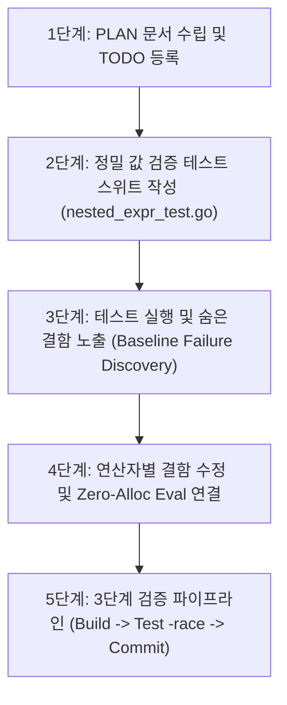

# LionSQL 복합 연산자 표현식 전수 감사 및 정밀 값 검증(Deep Assertion) 강화 플랜 (`notes/COMPLEX_EXPRESSION_AUDIT_AND_DEEP_TEST_PLAN.ko.md`)

> - **최초 작성일**: 2026-10-29
> - **문서 상태**: Completed (`[x]`)
> - **연관 과제 ID**: `AUDIT-EXPR-1`, `TEST-DEEP-EXPR-1`
> - **적용 대상**: `pkg/execution/`, `pkg/engine/`, `pkg/planner/`

---

## 1. 개요 및 배경 (Problem Definition & Root Cause)

Star Schema Benchmark(SSB) Q1.1 및 Q4.1 튜닝 과정에서, `SUM(lo_extendedprice * lo_discount)` 및 `SUM(lo_revenue - lo_supplycost)`와 같은 복합 산술식이 연산자 내부에서 파싱되지 않아 오랫동안 **`revenue: <nil>`, `profit: <nil>`**을 반환하고 있었음에도 기존 테스트 스위트에서 감지되지 않았던 문제가 발견되었습니다.

### 1.1. 3대 근본 원인 (Root Cause Analysis)
1. **얕은 단언(Shallow Assertion) 안티패턴**:
   * SQL 집계 함수(`SUM`, `AVG`, `COUNT` 등)는 내부 표현식 평가가 실패하여 `NULL`을 산출하더라도 에러를 발생시키지 않고 `[{"revenue": nil}]`과 같이 1개의 행을 정상 반환합니다.
   * 기존 테스트 코드가 `if err != nil || len(res.Rows) == 0` 형태로 행의 존재 유무만 검증하여 셀 내부의 실제 계산 값(`res.Rows[0]["revenue"] == 107502`) 누락을 감지하지 못했습니다.
2. **단일 컬럼명 중심의 테스트 편향 (Single Column Bias)**:
   * 기존 단위/통합 테스트가 `SUM(amount)`, `COUNT(*)`, `AVG(salary)` 등 단순 컬럼명 위주로만 작성되어, `SUM(colA * colB)`나 `ORDER BY (colA + colB)`처럼 연산자 내부에 복합 산술식이 중첩된 케이스(Nested Arithmetic Expression)의 전용 테스트가 누락되어 있었습니다.
3. **2-Tier 아키텍처 상의 검증 성숙도 편차**:
   * 1계층 VDBE VM은 TPC-C 및 단건 OLTP 트랜잭션으로 수만 번의 정밀 값 검증을 거쳤으나, 2계층 Volcano CBO 실행기는 연산자(Scan, Join, Agg) 파이프라인 결합 위주로 검증되어 연산자 간 표현식 평가 경계면(Interface Boundary)의 엣지케이스 검증이 부족했습니다.

---

## 2. 5대 핵심 감사 영역 (Audit Scope & Target Operators)

| 대상 연산자 | 감사 대상 구문 패턴 | 잠재적 결함 가능성 | 검증 기준 (Deep Assertion) |
| :--- | :--- | :---: | :--- |
| **1. Aggregate** | `HAVING SUM(a * b) > 100`, `GROUP BY (a + b)` | 산술식 결과와의 HAVING 대소 비교 실패 | 필터링된 그룹 수 및 집계 셀 실제 값 검증 |
| **2. Sort** | `ORDER BY (price * discount) DESC` | 튜플 내 수식 미평가로 기본 순서 유지 | 정렬된 행들의 실제 수식 계산값 단조감소/단조증가 검증 |
| **3. Window** | `SUM(a * b) OVER (PARTITION BY c ORDER BY d)` | 윈도우 프레임 누적 시 수식 미평가 | 각 행의 윈도우 누적치 정확 일치 검증 |
| **4. Filter** | `WHERE (a * b) + (c * d) > 100` | 복합 다항식 또는 복합 논리식 단언 실패 | 필터링된 실제 행 집합의 값 정확 일치 검증 |
| **5. HashJoin** | `ON (a.id + 1) = b.id`, 다중 복합 조건 | 조인 키 추출 시 수식 미지원 | 조인 결과 행의 모든 속성 값 결합 검증 |

---

## 3. 정밀 값 검증(Deep Assertion) 원칙

향후 모든 쿼리 테스트 및 회귀 테스트 작성 시 아래 원칙을 **절대 불변 규칙**으로 강제합니다:

1. **`len(Rows) > 0` 단독 단언 엄격 금지**:
   - 단순히 결과 행 수가 0이 아님만 확인하는 단언은 불완전 테스트로 간주합니다.
2. **실제 셀 값 100% 매칭 검증**:
   - `Rows[i][col]`의 원시 값, 타입, NULL 여부를 기대하는 수학적 정답(`expected`)과 엄격히 비교합니다.
3. **경계값 및 타입 강제 변환 검증**:
   - 정수, 실수, DECIMAL, NULL 연산 간의 타입 승격(Type Promotion) 및 NULL 전파(Null Propagation) 정합성을 검증합니다.

---

## 4. 실행 계획 및 구현 작업 순서

1. **Step 1: 플랜 문서 수립 및 `TODO.md` 등록**:
   - `AUDIT-EXPR-1` 등록 (In Progress).
2. **Step 2: 정밀 검증 테스트 스위트 작성 (`pkg/execution/nested_expr_test.go`)**:
   - `TestNestedExpr_AggregateWithArithmetic`: `SUM(a*b)`, `AVG(a-b)`, `MIN(a*b)`, `MAX(a/b)`
   - `TestNestedExpr_HavingWithArithmetic`: `HAVING SUM(a*b) > threshold`
   - `TestNestedExpr_SortWithArithmetic`: `ORDER BY (price * qty) DESC`
   - `TestNestedExpr_WindowWithArithmetic`: `SUM(a*b) OVER (...)`
   - `TestNestedExpr_FilterWithPolynomial`: `WHERE (a*b) + (c*d) >= 100`
3. **Step 3: 테스트 실행 및 잠재 결함 식별**:
   - 실패하는 엣지 케이스 목록화.
4. **Step 4: 연산자별 결함 수정 및 `EvalTupleExpr` 통합**:
   - `SortIterator`, `WindowIterator`, `AggregateIterator` 등에 누락된 수식 파싱/평가 경로 보강.
5. **Step 5: 3단계 파이프라인 완주 및 커밋**:
   - `go test -v -race ./pkg/execution/...` 100% 통과 확인.
