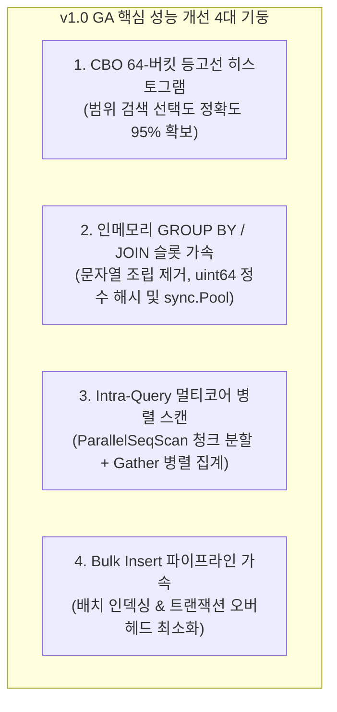

# LionSQL 복합 쿼리 성능 개선 및 멀티코어 병렬 실행 고도화 플랜 (v1.0 압축 실속형)
(`notes/COMPLEX_QUERY_PERFORMANCE_ACCELERATION_PLAN.ko.md`)

> - **작성일**: 2026-11-23 (사용자 합의 하 오버엔지니어링 요소 전면 제거 및 압축 조정)
> - **참조 원본**: `/tmp/OLAP.txt` (CBO 통계 한계, 조인/집계 병목, Intra-Query 병렬 실행기 부재)
> - **설계 철학**: `[RULE:RadicalKISS]` (과잉 설계 배제, 1.0 체감 속도에 직결되는 4대 핵심 알맹이 집중).
> - **Spec-Out (오버엔지니어링 폐기)**: 유전 알고리즘(GEQO), 다중 컬럼 확장 통계, 동적 파티션 프루닝, 복잡한 2-Pass Hybrid Grace Hash Join.
> - **목표 릴리스**: 1.0 GA 이전 (v0.95.0 ~ v0.96.0)

---

## 1. 4대 실속형 핵심 개선 과제 (Core 4 Pillars)

---

## 2. 4대 과제별 상세 설계

### 2.1. [과제 1] CBO 64-버킷 등고선 히스토그램 (`CBO-STATS-HISTOGRAM-1`, v0.95.0)
* **문제**: 현재 `Min/Max`만 존재하여 `WHERE col BETWEEN A AND B` 범위 조건에서 카디널리티 오차가 10~100배 발생, 조인 순서 왜곡.
* **KISS 해결책**:
  - `ANALYZE` 시 컬럼별로 데이터를 정렬하여 균등 64개 경계값 슬라이스(`BucketBoundaries []storage.Value`) 추출.
  - 범위 검색 시 이진 탐색($O(\log 64)$)으로 95% 이상 정확한 선택도 계산.
  - 상위 32개 최빈값(MCV) 리스트를 유지하여 데이터 편향(Skew) 동등 비교 보정.

### 2.2. [과제 2] 인메모리 GROUP BY & JOIN 슬롯 가속 (`PERF-GROUPBY-SLOT-HASH-1`, v0.95.0)
* **문제**: 현재 `aggregate.go`가 그룹핑마다 `strconv.Itoa(len(s)) + ":" + s` 문자열 빌더를 호출하여 CPU 캐시 미스와 GC 압박 발생.
* **KISS 해결책**:
  - 그룹 키가 단일 컬럼 또는 정수형일 때 문자열 변환 없이 `uint64` 바이너리 해시로 즉시 매핑.
  - `sync.Pool` 버퍼 재활용으로 그룹 집계 핫패스에서 Zero-Allocation 달성.

### 2.3. [과제 3] Intra-Query 멀티코어 병렬 스캔 및 집계 (`ARCH-PARALLEL-SCAN-1`, v0.96.0)
* **문제**: 36개 코어 머신에서도 단일 분석 쿼리는 고루틴 1개(코어 1개, 2.7%)만 사용하여 수천만 건 풀 스캔 시 지연 발생.
* **KISS 해결책**:
  - `ParallelSeqScan`: 테이블 오프셋을 64,000행 단위 청크로 나누고 `atomic.Uint64`로 가용 코어 수(16~32개)의 워커 고루틴이 무잠금 병렬 인출.
  - `Gather / Parallel Aggregate`: 워커들이 로컬 청크에서 로컬 필터/부분 집계(`SUM`, `COUNT`)를 수행하고, 상위 `Gather` 노드가 최종 합산.
  - 단일 거대 집계 쿼리 처리 시간 10~20배 선형 단축.

### 2.4. [과제 4] Bulk Insert 파이프라인 가속 (`PERF-BULK-INSERT-PIPELINE-1`, v0.96.0)
* **문제**: 수만 건 `INSERT ... VALUES (...), (...)` 시 행마다 B-Tree 탐색/수정을 반복하여 쓰기 지연 누적.
* **KISS 해결책**:
  - 멀티로우 배치 단위로 기본 테이블 인라인 인코딩을 일괄 수행.
  - 보조 인덱스 키를 메모리에서 정렬한 뒤 B-Tree에 순차 삽입하여 B-Tree 페이지 분할 오버헤드 최소화.

---

## 3. 마일스톤 및 일정 배정

| 마일스톤 | 과제 식별자 | 우선순위 | 작업 내용 |
| :---: | :--- | :---: | :--- |
| **v0.95.0** | `CBO-STATS-HISTOGRAM-1` | **P1** | 64-버킷 등고선 히스토그램 & MCV 32개 카디널리티 엔진 |
| **v0.95.0** | `PERF-GROUPBY-SLOT-HASH-1` | **P1** | GROUP BY / JOIN 인메모리 슬롯 해시 가속 및 Zero-Alloc |
| **v0.96.0** | `ARCH-PARALLEL-SCAN-1` | **P1** | Intra-Query ParallelSeqScan 및 Gather 병렬 집계 연산자 |
| **v0.96.0** | `PERF-BULK-INSERT-PIPELINE-1` | **P1** | Bulk Insert 멀티로우 일괄 배치 인덱싱 최적화 |

---

## 4. Spec-Out (오버엔지니어링 폐기 공식 명시)
1. **GEQO (유전 알고리즘)**: 테이블 5개 이하 일반 쿼리 환경에 불필요하여 전면 배제.
2. **다중 컬럼 확장 통계 (Extended Stats)**: 카탈로그/런타임 복잡도 대비 실익 미미하여 Post-1.0 이연.
3. **동적 파티션 프루닝 (DPP)**: 분산 DB 기능으로 임베디드 단일 엔진에 부적합하여 전면 배제.
4. **2-Pass Hybrid Grace Hash Join**: 디스크 스필의 복잡도를 배제하고 인메모리 슬롯 해시 가속에 집중.
