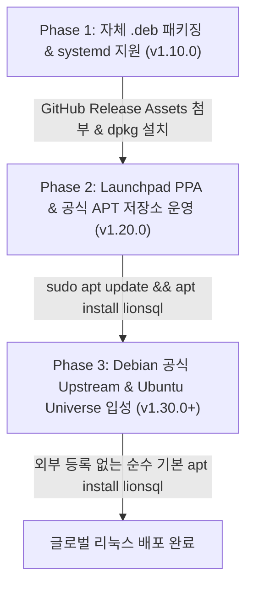

# LionSQL Debian 및 Ubuntu 공식 패키징 및 배포 인프라 구축 계획서 (Plan)
`notes/DEBIAN_UBUNTU_OFFICIAL_PACKAGING_PLAN.ko.md`

> - **최초 작성일**: 2026-11-22
> - **목표 마일스톤**: `v1.10.0` (Phase 1) ➔ `v1.20.0` (Phase 2) ➔ `v1.30.0+` (Phase 3)
> - **문서 목적**: Linux 생태계의 핵심 표준인 Debian 및 Ubuntu 환경에서 LionSQL을 네이티브 패키지(`*.deb`)로 설치하고, `systemd` 서비스로 운영하며, 최종적으로 데비안 공식 아카이브 및 우분투 Universe 저장소에 공식 기본 패키지로 입성하기 위한 단계별 아키텍처 및 이행 계획을 정의합니다.
> - **연계 규칙**: `[RULE:PlanPersistence]`, `[RULE:CleanTeardown]`, `[RULE:PathSecurity]`, `[RULE:StaticBinary]`, `[RULE:HermeticParity]`

---

## 1. 개요 및 추진 배경 (Overview & Objectives)

LionSQL은 외부 데몬(Redis, PgBouncer, Nginx) 의존성이 전혀 없는 **단일 정적 바이너리(Single Standalone Binary)** 아키텍처를 갖추고 있습니다. 그러나 리눅스 프로덕션 서버 환경에서 엔터프라이즈 도입을 가속화하려면 단순 바이너리 다운로드를 넘어, **OS 표준 패키지 관리자(`apt`)를 통한 라이프사이클 관리**가 필수적입니다.

### 1.1 핵심 목표
1. **OS 네이티브 데몬 운영**: `systemd` 서비스 유닛을 통한 자동 기동, 비정상 종료 시 자동 재시작, 리소스 한도(LimitNOFILE) 관리.
2. **표준 파일시스템 계층 준수 (FHS Compliance)**: `/usr/bin`, `/etc/lionsql`, `/var/lib/lionsql`, `/var/log/lionsql` 표준 격리.
3. **권한 격리 및 보안 (`[RULE:PathSecurity]`)**: 전용 시스템 비권한 계정(`lionsql:lionsql`, nologin) 생성 및 `0750` 디렉토리 보안 강제.
4. **원클릭 배포 및 자동 갱신**: 자체 `.deb` 배포부터 PPA, 최종적으로 `sudo apt install lionsql` 공식 입성까지 3단계로 완수.

---

## 2. 3단계 추진 로드맵 (Phased Implementation Strategy)



---

## 3. Phase 1: 자체 `.deb` 패키징 & `systemd` 공식 지원 (`v1.10.0`)

릴리즈 자동화 파이프라인(`scripts/release.sh`)에 `.deb` 패키지 자동 생성 단계를 추가하여, 사용자가 우분투/데비안 서버에 `dpkg -i`로 즉시 설치할 수 있도록 제공합니다.

### 3.1 FHS (Filesystem Hierarchy Standard) 표준 디렉토리 레이아웃

| 설치 경로 | 소유자 / 권한 | 용도 및 설명 |
| :--- | :--- | :--- |
| **`/usr/bin/lionsql`** | `root:root` (`0755`) | 공식 정적 바이너리 (WiredTiger 및 OCC 내장) |
| **`/etc/lionsql/lionsql.json`** | `root:lionsql` (`0640`) | 기본 서버 구성 파일 (`conffiles` 보호 대상) |
| **`/lib/systemd/system/lionsql.service`** | `root:root` (`0644`) | systemd 서비스 데몬 유닛 파일 |
| **`/var/lib/lionsql/`** | `lionsql:lionsql` (`0750`) | 데이터베이스 기본 스토리지 디렉토리 (`-dir`) |
| **`/var/log/lionsql/`** | `lionsql:lionsql` (`0750`) | 서버 시스템 로그 및 슬로우 쿼리 로그 디렉토리 |
| **`/usr/share/man/man1/lionsql.1.gz`** | `root:root` (`0644`) | 표준 터미널 매뉴얼 페이지 (`man lionsql`) |

### 3.2 `systemd` 서비스 유닛 공식 사양 (`packaging/systemd/lionsql.service`)

```ini
[Unit]
Description=LionSQL Autonomous High-Concurrency OLTP Database Engine
Documentation=man:lionsql(1) https://github.com/MaroShim/LionSQL
After=network.target network-online.target local-fs.target time-sync.target
Wants=network-online.target

[Service]
Type=simple
User=lionsql
Group=lionsql
RuntimeDirectory=lionsql
RuntimeDirectoryMode=0755
StateDirectory=lionsql
StateDirectoryMode=0750
LogsDirectory=lionsql
LogsDirectoryMode=0750
ConfigurationDirectory=lionsql
ConfigurationDirectoryMode=0750

ExecStart=/usr/bin/lionsql serve -dir /var/lib/lionsql -config /etc/lionsql/lionsql.json
ExecReload=/bin/kill -HUP $MAINPID
KillMode=mixed
TimeoutStopSec=15
Restart=on-failure
RestartSec=2s

# Resource & Security Sandbox Hardening
LimitNOFILE=65536
LimitNPROC=32768
LimitMEMLOCK=infinity
TasksMax=4096
StandardOutput=journal
StandardError=journal
SyslogIdentifier=lionsql

# Modern systemd Security Profiles
ProtectSystem=full
ProtectHome=true
NoNewPrivileges=true
PrivateTmp=true

[Install]
WantedBy=multi-user.target
```

### 3.3 데비안 패키지 유지보수 스크립트 (Maintainer Scripts)

1. **`packaging/deb/postinst` (설치 후 자동 실행)**:
   - `lionsql` 시스템 계정 및 그룹이 없을 경우 자동 생성:
     `adduser --system --group --no-create-home --home /var/lib/lionsql --shell /usr/sbin/nologin lionsql`
   - `/var/lib/lionsql` 및 `/var/log/lionsql` 소유권 및 `0750` 권한 설정
   - `systemctl daemon-reload` 호출
2. **`packaging/deb/prerm` (삭제 전 자동 실행)**:
   - 패키지 제거/업그레이드 전 `systemctl stop lionsql.service` 안전 정지
3. **`packaging/deb/postrm` (삭제 후 자동 실행)**:
   - `remove` 시: 서비스 유닛 비활성화 (`systemctl disable lionsql.service`)
   - `purge` 시 (완전 삭제): 유저 선택에 따라 시스템 계정 및 기본 로그 정리 (`/var/lib/lionsql` 원본 데이터 보존 확인)
4. **`packaging/deb/conffiles`**:
   - `/etc/lionsql/lionsql.json`을 등록하여 패키지 업그레이드 시 사용자의 커스텀 설정 덮어쓰기 방지

### 3.4 빌드 자동화 스크립트 (`scripts/build_deb.sh`)
- `dpkg-deb --build` 또는 Go 네이티브 패키저 `nfpm`을 사용하여 Linux `amd64` 및 `arm64` 2개 아키텍처에 대해 `lionsql_<version>_linux_amd64.deb`를 자동 생성.
- `scripts/release.sh`의 Step 2 빌드 단계에 통합하여 GitHub Release Asset에 자동 첨부.

---

## 4. Phase 2: Launchpad PPA & 공식 APT 저장소 운영 (`v1.20.0`)

사용자가 웹에서 파일을 일일이 내려받지 않고 `apt update && apt install lionsql`로 최신 버전을 유지할 수 있도록 APT 저장소를 개설합니다.

### 4.1 Ubuntu 공식 Launchpad PPA (`ppa:lionsql/stable`)
- Ubuntu 공식 플랫폼인 Launchpad.net에 `lionsql` 오거나이제이션 생성.
- 소스 패키지(`.dsc`, `.tar.gz`)를 PPA에 업로드(`dput`)하여 Launchpad 빌드 팜에서 Ubuntu 버전별(22.04 LTS, 24.04 LTS, 26.04 LTS) 패키지 자동 빌드.
- **사용자 설치 경험**:
  ```bash
  sudo add-apt-repository ppa:lionsql/stable
  sudo apt update
  sudo apt install lionsql
  ```

### 4.2 Debian 및 통합 Linux용 공개 APT 저장소 (`pkg.lionsql.com`)
- Debian은 PPA가 기본 내장되어 있지 않으므로, GitHub Pages 또는 Cloudsmith 기반의 독립 APT 아카이브 호스팅.
- 모던 데비안 보안 표준인 `/etc/apt/keyrings/` GPG 키 서명 체계 준수.
- **원클릭 설치 스크립트 (`install.sh`)**:
  ```bash
  curl -fsSL https://pkg.lionsql.com/install.sh | sudo bash
  ```

---

## 5. Phase 3: Debian 공식 Upstream 입성 및 Ubuntu Universe 자동 동기화 (`v1.30.0+`)

우분투/데비안을 설치한 전 세계 사용자가 PPA 등록 없이 순수하게 `sudo apt install lionsql`을 칠 수 있는 최종 완성 단계입니다.

### 5.1 데비안 정책 및 지침 준수 (Debian Policy & DFSG Compliance)
- **DFSG (Debian Free Software Guidelines)** 준수: 모든 소스 코드와 임베디드 라이브러리가 오픈소스 라이선스에 부합해야 함.
- **Lintian 무결성 검사 통과**:
  - `lintian -i -I --pedantic lionsql_*.changes`
  - 에러 0개, 경고 0개 달성 (`[RULE:ExplicitError]`).
- **하드코딩 제거 및 빌드 재현성 (Reproducible Builds)**: 타임스탬프와 소스 경로 독립성 보장.

### 5.2 소스 패키징 메타데이터 구축 (`debian/`)
- `debian/control`: 패키지 메타데이터, Build-Depends (`golang-go`, `debhelper-compat (= 13)`), 아키텍처 정의.
- `debian/rules`: `dh $@ --buildsystem=golang` 표준 빌드 규칙.
- `debian/copyright`: Machine-readable 저작권 파일 (DEP-5 형식).
- `debian/changelog`: 데비안 표준 버전 변경 이력.

### 5.3 ITP (Intent to Package) 제출 및 스폰서십
1. Debian BTS(Bug Tracking System)에 `wnpp` 가상 패키지 대상으로 **ITP 티켓 제출** (`reportbug wnpp`).
2. **Debian Go Packaging Team (`pkg-go`)** 참여:
   - 데비안 Go 패키징 팀 메일링 리스트 및 Salsa 저장소(`salsa.debian.org/go-team/packages/lionsql`)에 참여하여 공식 멘토/스폰서 매칭.
3. **Debian NEW Queue 검수 및 승인**:
   - 데비안 FTP 마스터의 NEW Queue 심사를 통과하여 `unstable` (sid) 저장소에 입성.
4. **Ubuntu Universe 자동 수입 (Automatic Debian Sync)**:
   - Ubuntu는 데비안 `testing/unstable`에서 주기적으로 패키지를 자동 수입하므로, 데비안에 정식 등재되면 Ubuntu의 다음 릴리즈(26.04 LTS 등)의 `universe` 저장소에 자동으로 기본 포함됨.

---

## 6. 테스트 및 무결성 검증 기준 (`piuparts` & Lintian)

1. **`lintian` 정적 분석**:
   - 데비안 패키징 규칙 위반(심볼릭 링크 결함, 권한 오류, man 페이지 누락) 전수 검사.
2. **`piuparts` 수명주기 검증**:
   - 클린 데비안 chroot 환경에서 `설치(Install) ➔ 업그레이드(Upgrade) ➔ 제거(Remove) ➔ 완전삭제(Purge)` 순환 테스트.
   - 완전 삭제 후 고아 파일이나 잔여 프로세스가 0개인지 확인 (`[RULE:CleanTeardown]`).
3. **VM 동시성 및 시스템 무중단 검증**:
   - 패키지 설치 즉시 `systemctl status lionsql` 확인 및 psql `:5433` 쿼리 응답 테스트.

---

## 7. 결론 및 마일스톤 배정

- **`v1.10.0`**: Phase 1 완료 (`packaging/` 구성, `.deb` 빌더 및 `systemd` 서비스 유닛 내장, GitHub Releases 첨부)
- **`v1.20.0`**: Phase 2 완료 (Launchpad PPA 개설 및 `pkg.lionsql.com` APT 저장소 배포)
- **`v1.30.0+`**: Phase 3 완료 (Debian ITP 제출 및 공식 업스트림 등재 추진)

본 계획서를 통해 LionSQL은 독립 바이너리 배포의 편리함을 유지하면서도, 엔터프라이즈 리눅스 표준의 완전한 패키징 지원을 확보하게 됩니다.
