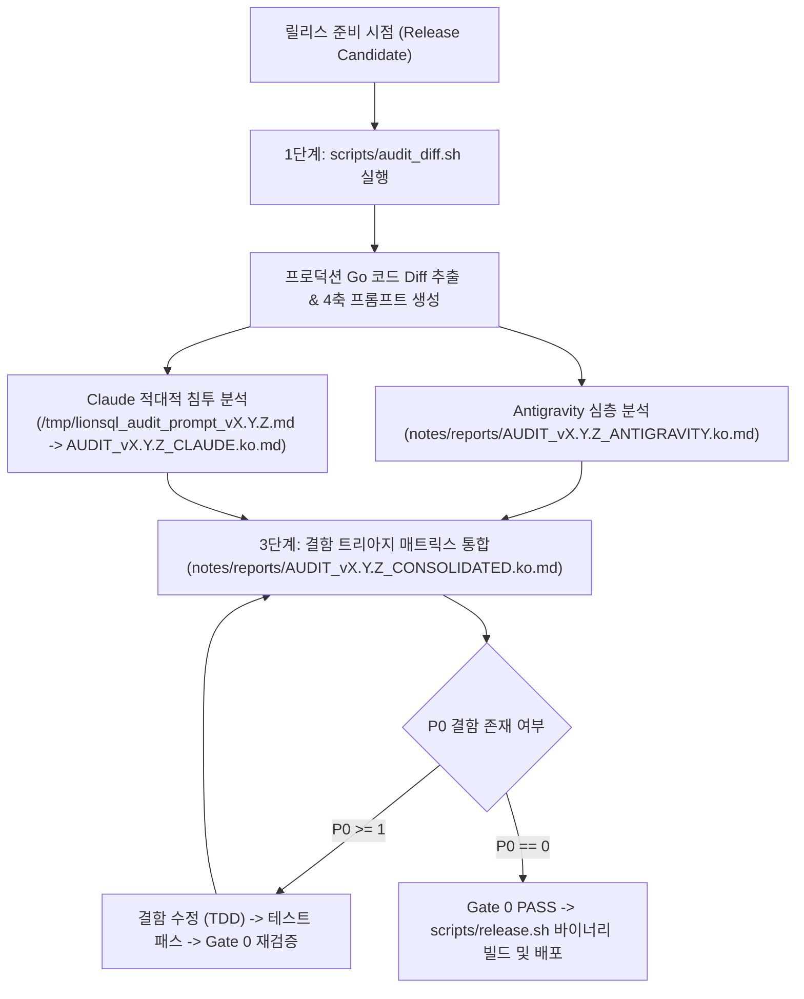

# Dual-AI (Antigravity & Claude) 릴리스 사전 적대적 코드 감사 파이프라인 아키텍처 사양서
(`notes/DUAL_AI_RELEASE_AUDIT_PIPELINE_PLAN.ko.md`)

> - **최초 작성일**: 2026-11-14
> - **최종 갱신일**: 2026-11-14
> - **문서 상태**: 공식 승인 및 스크립트 반영 완료 (Active / Enforced)
> - **관련 태스크**: `FEAT-DUAL-AI-AUDIT-PIPELINE-1`
> - **규칙 준수**: `[RULE:PipelineVerification]`, `[RULE:PlanPersistence]`, `[RULE:ExplicitError]`, `[RULE:ZeroOrphan]`, `[RULE:NonBlockingSink]`, `[RULE:LockHierarchy]`

---

## 1. 배경 및 도입 목적

LionSQL은 단일 정적 바이너리로 구동되는 고성능 OLTP 데이터베이스 엔진으로, 마이크로초 단위의 지연 시간과 극한의 동시성(OCC/MVCC)을 보장해야 합니다. 
새로운 릴리스 태그를 발행하기 전, 직전 릴리스 이후 추가되거나 수정된 Go 프로덕션 코드 전체에 대해 다음 위험을 사전에 완벽히 차단해야 합니다:
1. 고루틴 누수, 채널 블로킹, 타이머 누수 등 백그라운드 자원 고아화 (`[RULE:ZeroOrphan]`, `[RULE:NonBlockingSink]`)
2. 산술 오버플로(`MinInt64 / -1`), NaN/Inf 부동소수점 오염, 슬라이스 경계 미검증 (`[RULE:DefensiveIndexing]`)
3. 에러 삼킴(`_ = err`), 비정상 복구 시 무단 트렁케이트 (`[RULE:ExplicitError]`, GEMINI.md Invariant 9)
4. GEMINI.md 15대 영구 불변식 및 아키텍처 계약 위반

이를 위해 **Antigravity(내부 구조 및 심층 맥락 전문)**와 **Claude(적대적 보안 및 에지 케이스 침투 전문)**의 **Dual-AI 2중 적대적 감사(Adversarial Audit)**를 릴리스 루틴으로 표준화합니다.

---

## 2. 파이프라인 4단계 워크플로우

### 단계 1: Diff 추출 및 4축 감사 프롬프트 자동 생성 (`scripts/audit_diff.sh`)
- **실행**: `./scripts/audit_diff.sh [BASE_TAG] [TARGET_COMMIT] [TARGET_TAG]`
- **대상 범위**: 직전 릴리스 태그부터 `HEAD`까지의 Go 프로덕션 코드 (`pkg/**/*.go`, `cmd/**/*.go`, `*_test.go` 제외).
- **출력물**:
  - 프롬프트 파일: `notes/reports/prompts/AUDIT_PROMPT_${TARGET_TAG}.md`
  - 클립보드/터미널 공유용 복사본: `/tmp/lionsql_audit_prompt_${TARGET_TAG}.md`
  - 통합 보고서 템플릿: `notes/reports/AUDIT_${TARGET_TAG}_CONSOLIDATED.ko.md`

### 단계 2: Dual-AI 독립 감사 실행
1. **Antigravity 내부 감사**:
   - `AUDIT_PROMPT_${TARGET_TAG}.md` 분석.
   - LionSQL 15대 불변식, VDBE VM 스택, OCC/MVCC 세션 경계 적합성 검증.
   - 결과 기록: `notes/reports/AUDIT_${TARGET_TAG}_ANTIGRAVITY.ko.md` (또는 채팅 보고).
2. **Claude 외부 적대적 침투 감사**:
   - `/tmp/lionsql_audit_prompt_${TARGET_TAG}.md`를 Claude에게 전달.
   - 극단적 동시성 경쟁, 정수 경계, 메모리/FD 누수, Fail-Open 취약점 집중 공격.
   - 결과 기록: `notes/reports/AUDIT_${TARGET_TAG}_CLAUDE.ko.md`.

### 단계 3: 결함 트리아지 및 등급화 (Triage Matrix)
양측 AI의 감사 결과를 교차 대조하여 `notes/reports/AUDIT_${TARGET_TAG}_CONSOLIDATED.ko.md`에 통합합니다:
- **P0 (Must Fix Before Release)**: 크래시, 데이터 손실/침묵 손상, 고루틴/FD 누수, 영구 불변식 위반. 릴리스 전 반드시 수정 및 테스트 통과 필수.
- **P1 (Fix Before Release)**: 비표준 에러 코드 반환, 경미한 지연 시간 저하, 누락된 에지 케이스 유효성 검사. 릴리스 전 수정 권장.
- **P2 (Deferred / Spec-Out)**: 마이너 리팩토링 제안, 의도된 아키텍처 스펙-아웃 사항 (문서화 후 보류).

### 단계 4: 릴리스 스크립트 게이트 0 강제 검증 (`scripts/release.sh`)
- `scripts/release.sh` 실행 시 **[Gate 0/6]** 단계에서 다음을 자동 검증:
  1. 프로덕션 Go 코드 변경이 있는 경우 `notes/reports/AUDIT_${TAG}_CONSOLIDATED.ko.md` 존재 확인.
  2. 보고서 내 미해결 `[ ] **P0**` 항목이 0건인지 정규식 검사.
  3. 보고서가 없거나 미해결 P0가 존재하면 빌드를 즉시 중단(Fail-Closed).
  4. 비상 핫픽스 시에만 `--skip-audit` 플래그로 예외 허용.

---

## 3. 4대 감사 점검 축 (Audit Dimensions)

1. **축 1: 자원 및 동시성 누수 (Resource & Concurrency)**
   - `[RULE:ZeroOrphan]`: 고루틴 생성 시 부모 컨텍스트 취소 감지 및 `sync.WaitGroup` 정상 수거.
   - `[RULE:NonBlockingSink]`: 채널 송신 시 `select/default` 백프레셔 또는 버퍼 초과 대응.
   - `[RULE:LockHierarchy]`: 뮤텍스 획득 순서 일관성, 락 보유 상태에서 I/O 배제.
2. **축 2: 비대칭 경계값 및 산술 안정성 (Boundary & Arithmetic)**
   - `[RULE:DefensiveIndexing]`: 슬라이스 인덱스 범위 확인, 정수 오버플로(`MinInt64 / -1`).
   - 부동소수점 0 나눗셈, NaN/Inf 바이너리 직렬화 오염 방지.
3. **축 3: 예외 처리 및 Fail-Closed 원칙 (Failure Propagation)**
   - `[RULE:ExplicitError]`: `_ = err` 무시 방지, 읽기 에러를 크래시 테일로 오인한 무단 트렁케이트 방지 (Invariant 9).
   - 트랜잭션 롤백 누락 및 리소스 정리 누락 방지.
4. **축 4: 15대 영구 불변식 및 인터페이스 정합성 (Invariants & Interface)**
   - Invariant 1 (Dual-Parser), Invariant 7 (Zero-Regex SQL Parsing), Invariant 10 (Zero `transaction_sync`), Invariant 11 (Permanent 'Windows' TDS), Invariant 12 (Zero `strings.*` SQL Parsing), Invariant 13 (V2 Binary Tuple Codec: 4-Byte Aligned Header), Invariant 15 (Canonical Secondary Index B-Tree Key/Value Codec).

---

## 4. 파일 및 디렉토리 구조 표준

모든 릴리스 감사 관련 파일은 표준 경로 체계를 따릅니다:
- **감사 프롬프트**: `notes/reports/prompts/AUDIT_PROMPT_vX.Y.Z.md` (Git 추적 제외)
- **통합 감사 보고서**: `notes/reports/AUDIT_vX.Y.Z_CONSOLIDATED.ko.md` (Git 영구 커밋)
- **개별 AI 감사 결과 (선택)**: `notes/reports/AUDIT_vX.Y.Z_ANTIGRAVITY.ko.md`, `notes/reports/AUDIT_vX.Y.Z_CLAUDE.ko.md`
- **역사적 사후 분석 문서**: 기존 위치 (`notes/`, `notes/plans/`, `notes/reports/`) 불변 유지.
