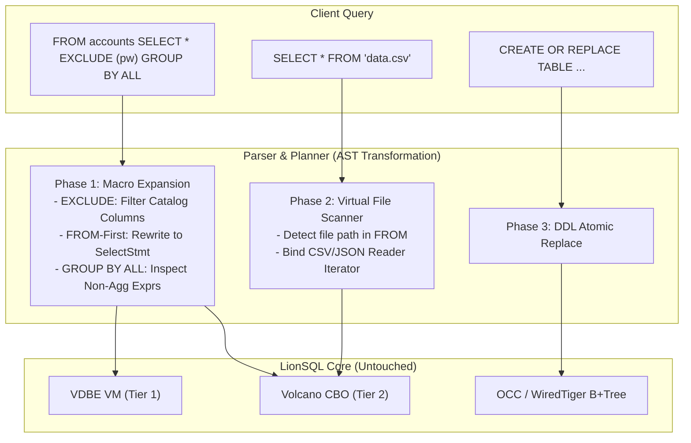

# LionSQL 친화적 SQL 편의 문법(DuckDB 스타일) 전면 도입 마스터 플랜

> - **최초 작성일**: 2026-10-29
> - **문서 상태**: Approved (Phase 1 최우선 구현 / Phase 2~3 후속 확장)
> - **연관 과제 ID**: `FRIENDLY-SQL-P1` (우선 3대 문법), `FRIENDLY-SQL-P2` (파일 직접 쿼리 & DDL)
> - **적용 대상**: `pkg/proc/parser.go`, `pkg/proc/lexer.go`, `pkg/engine/`, `pkg/planner/`, `pkg/storage/`

---

## 1. 개요 및 비전 (Executive Summary & Vision)

> **"전통적 SQL의 30년 된 타이핑 피로도를 제거하고, 가장 현대적이고 우아한 데이터 조작 경험을 제공한다."**

DuckDB가 데이터베이스 역사상 가장 빠르게 대세로 떠오른 핵심 비결은 단순히 내부 컬럼형(Columnar) 스토리지 때문만이 아닙니다. 지난 30년간 Oracle, PostgreSQL, MySQL이 "표준이니까 그냥 참고 써라" 하고 방치해 온 SQL의 고질적인 번거로움과 마찰(Friction)을 사용자 중심 센스로 긁어준 **"Friendly SQL Ergonomics(친화적 SQL 손끝 편의성)"** 덕분이었습니다.

LionSQL은 초고속 T-SQL VDBE 바이트코드 VM과 비차단 ACID 스토리지(In-Memory OCC / WiredTiger MVCC) 코어를 100% 온전히 보존하면서, 사용자의 실제 쿼리 생산성을 극대화하기 위해 **DuckDB 스타일의 전면적 친화적 SQL 기능군을 단계적으로 수용하는 아키텍처**를 수립합니다.

본 플랜은 제안된 전체 기능군을 체계적으로 망라하되, **사용자가 지정한 최우선 3대 핵심 편의 문법(`EXCLUDE`, `FROM-First`, `GROUP BY ALL`)을 Phase 1으로 가장 먼저 구현**하고, 로컬 파일 직접 쿼리 및 멱등적 DDL을 Phase 2~3으로 순차 전개합니다.

---

## 2. 전체 기능군 명세 (Complete Feature Catalog)

```
[Phase 1: 최우선 구현 3대 손끝 문법 (Priority 1)]
  ├─ 1.1. SELECT * EXCLUDE (...) & REPLACE (...)
  ├─ 1.2. FROM-First 문법 (FROM accounts; 단독 조회 및 FROM ... SELECT ...)
  └─ 1.3. GROUP BY ALL (비집계 컬럼 자동 감지 및 바인딩)
       │
[Phase 2: 로컬 파일 직접 쿼리 및 초고속 데이터 입출력 (Priority 2)]
  ├─ 2.1. 로컬 파일 직접 조회: SELECT * FROM 'data.csv' / 'data.json'
  ├─ 2.2. 한 줄 파일 데이터 적재: INSERT INTO tbl SELECT * FROM 'data.csv'
  └─ 2.3. 초고속 파일 추출: COPY (SELECT ...) TO 'export.csv' WITH (HEADER)
       │
[Phase 3: 멱등적 DDL 및 고급 동적 프로젝션 (Priority 3)]
  ├─ 3.1. 멱등적 테이블 DDL: CREATE OR REPLACE TABLE tbl (...)
  └─ 3.2. 정규식 기반 동적 컬럼 선택: COLUMNS('^pattern') 및 COLUMNS(*)
```

---

### [Phase 1] 최우선 구현 3대 핵심 손끝 문법 (Priority 1)

#### 2.1. `SELECT * EXCLUDE (...)` & `REPLACE (...)`
- **문제점**:
  - 실무 테이블(`users`, `accounts`, `orders`)은 컬럼 수가 20~50개에 달합니다.
  - `password_hash`, `secret_token` 등 특정 1~2개 컬럼만 빼고 조회하고 싶을 때, 40여 개의 컬럼명을 일일이 손으로 나열해야 하는 고통이 발생합니다.
- **지원 문법 스펙**:
  ```sql
  -- 1. EXCLUDE: 특정 컬럼들을 와일드카드 프로젝션에서 제외
  SELECT * EXCLUDE (password_hash, salt, secret_token) FROM users;

  -- 2. REPLACE: 특정 컬럼의 출력 표현식을 즉석에서 대체
  SELECT * REPLACE (balance * 1350 AS balance) FROM accounts;

  -- 3. 혼합 사용: 제외와 대체를 동시에 적용
  SELECT * EXCLUDE (secret) REPLACE (salary * 1.1 AS salary) FROM employees;
  ```
- **동작 원리 (순수 컴파일 타임 매크로)**:
  - 스토리지 엔진 수정 0%. 파서가 카탈로그의 컬럼 리스트에서 지정된 컬럼을 제외/대체하여 AST 프로젝션 목록을 전개(Wildcard Expansion)합니다.

#### 2.2. `FROM-First` 문법 (`FROM accounts;` 단독 조회 및 체이닝)
- **문제점**:
  - 테이블 내용을 빠르게 훑어보기 위해 매번 8글자의 `SELECT * `를 반복 입력해야 합니다.
  - SQL은 `SELECT`를 먼저 쓰느라 아직 테이블이 확정되지 않아 IDE의 컬럼명 자동완성(Auto-Complete)이 제약을 받습니다.
- **지원 문법 스펙**:
  ```sql
  -- 1. 단독 FROM 문: 테이블 전체 즉시 조회 (SELECT * FROM accounts; 와 100% 동일)
  FROM accounts;

  -- 2. 필터링 및 정렬 결합
  FROM accounts WHERE balance > 1000 ORDER BY balance DESC LIMIT 10;

  -- 3. FROM-First 투영 (테이블을 먼저 확정하고 컬럼을 뒤에 선택하여 자동완성 극대화)
  FROM accounts SELECT id, balance, status WHERE status = 'ACTIVE';
  ```
- **동작 원리**:
  - 파서의 첫 토큰이 `FROM`인 구문을 감지하여 표준 `*ast.SelectStmt`로 즉시 디슈가링(Desugaring)합니다.

#### 2.3. `GROUP BY ALL` (비집계 컬럼 자동 그룹핑)
- **문제점**:
  - SELECT 절에 컬럼을 추가할 때마다 GROUP BY 절에 동일한 컬럼들을 복사-붙여넣기 해야 하며, 불일치 시 구문 에러가 발생합니다.
- **지원 문법 스펙**:
  ```sql
  SELECT department_id, team_id, job_grade, AVG(salary), COUNT(*)
  FROM employees
  GROUP BY ALL;
  ```
- **동작 원리**:
  - CBO 옵티마이저 플래너가 SELECT 절을 순회하여 집계 함수(`SUM`, `AVG`, `COUNT` 등)가 아닌 컬럼들을 자동 추출해 `GroupBy` 키로 일괄 바인딩합니다.

---

### [Phase 2] 로컬 파일 직접 쿼리 및 초고속 입출력 (Priority 2)

#### 2.4. 로컬 파일 직접 조회 (`SELECT * FROM 'data.csv'` / `'data.json'`)
- **문제점**:
  - 외부에서 CSV나 JSON 데이터를 받으면 `CREATE TABLE`로 컬럼 스키마를 수동 정의한 뒤 `LOAD DATA` 명령어를 쳐야 하는 번거로움이 있습니다.
- **지원 문법 스펙**:
  ```sql
  -- 1. 디스크의 CSV 파일을 테이블 정의 없이 테이블처럼 즉시 조회
  SELECT * FROM 'sales_2026.csv' WHERE amount > 1000;

  -- 2. JSON 라인(NDJSON) 파일 즉시 조회
  SELECT * FROM 'events.jsonl' WHERE event_type = 'LOGIN';
  ```
- **동작 원리**:
  - 파일 경로 리터럴(`'*.csv'`, `'*.json'`)이 FROM 절에 오면, 엔진의 가상 테이블 스캔(`VirtualFileScanIterator`)이 Go 표준 `encoding/csv` 또는 스트리밍 JSON 디코더를 통해 즉석에서 가상 레코드 스트림을 생성합니다.

#### 2.5. 한 줄 파일 데이터 적재 및 추출 (`INSERT ... SELECT FROM 'file'` & `COPY TO`)
- **지원 문법 스펙**:
  ```sql
  -- 1. 파일 데이터를 기존 테이블로 한 방에 적재 (일괄 임포트)
  INSERT INTO sales SELECT * FROM 'sales_2026.csv';

  -- 2. 쿼리 결과를 CSV 파일로 디스크에 즉시 추출 (익스포트)
  COPY (SELECT id, balance FROM accounts WHERE status = 'ACTIVE') TO 'active_accounts.csv' WITH (HEADER);
  ```

---

### [Phase 3] 멱등적 DDL 및 고급 동적 프로젝션 (Priority 3)

#### 2.6. 멱등적 테이블 DDL: `CREATE OR REPLACE TABLE`
- **문제점**:
  - T-SQL은 재현 가능한 DDL 작성 시 매번 `IF OBJECT_ID('tbl') IS NOT NULL DROP TABLE tbl; CREATE TABLE tbl (...);` 보일러플레이트를 작성해야 합니다.
- **지원 문법 스펙**:
  ```sql
  CREATE OR REPLACE TABLE accounts (
      id INT PRIMARY KEY,
      balance DECIMAL(18,2) DEFAULT 0.0
  );
  ```
- **동작 원리**:
  - 테이블이 존재하면 기존 카탈로그 메타데이터와 물리 스토리지 레코드를 원자적으로 Truncate/Drop하고 신규 스키마로 교체합니다.

#### 2.7. 정규식 기반 동적 컬럼 선택: `COLUMNS('^pattern')` / `COLUMNS(*)`
- **지원 문법 스펙**:
  ```sql
  -- 특정 패턴으로 시작하는 컬럼들만 일괄 선택
  SELECT COLUMNS('^user_.*') FROM audit_logs;

  -- 모든 수치형 컬럼에 대해 일괄 집계 적용
  SELECT MIN(COLUMNS(*)), MAX(COLUMNS(*)) FROM sales_metrics;
  ```

---

## 3. 아키텍처 및 구현 설계 (Architecture Design)



1. **Phase 1의 제로 코어 침습성 (Zero Intrusiveness)**:
   - 최우선 3대 문법(`EXCLUDE`, `FROM-First`, `GROUP BY ALL`)은 **스토리지 엔진이나 VDBE 바이트코드 Opcode를 단 1줄도 수정하지 않습니다**.
   - 순수 파서와 CBO 옵티마이저 바인딩 단계에서 표준 SQL AST로 전개되므로 안정성이 100% 보장됩니다.
2. **Phase 2의 가상 스캐너 확장 (Virtual Table SPI)**:
   - 디스크 파일 쿼리는 기존 Volcano CBO 엔진의 `Iterator` 인터페이스를 구현하는 `CsvScanIterator`를 가상 테이블로 연결하여 기존 쿼리 파이프라인과 완벽히 융합합니다.

---

## 4. 단계별 실행 계획 (Phased Execution Roadmap)

| 단계 | 과제 코드 | 대상 기능 | 구현 내용 | 예상 공수 |
| :---: | :---: | :--- | :--- | :---: |
| **Phase 1** | **`FRIENDLY-SQL-P1`** | **최우선 3대 편의 문법<br>(우선 구현)** | 1. `SELECT * EXCLUDE (...)` & `REPLACE (...)`<br>2. `FROM accounts;` 단독 조회 및 `FROM ... SELECT`<br>3. `GROUP BY ALL` 비집계 컬럼 자동 바인딩 | 약 1일 |
| **Phase 2** | **`FRIENDLY-SQL-P2`** | **로컬 파일 직접 쿼리 & 데이터 입출력** | 1. `SELECT * FROM 'data.csv'` 가상 스캐너<br>2. `INSERT INTO tbl SELECT FROM 'data.csv'`<br>3. `COPY (SELECT ...) TO 'export.csv'` | 약 1.5일 |
| **Phase 3** | **`FRIENDLY-SQL-P3`** | **멱등적 DDL 및 동적 컬럼 선택** | 1. `CREATE OR REPLACE TABLE` 원자적 교체<br>2. `COLUMNS('^pattern')` 정규식 컬럼 프로젝션 | 약 1일 |

---

## 5. 정량적 검증 기준 (Verification Criteria)

1. **Phase 1 문법 정확성 검증**:
   - 20개 컬럼 테이블에서 `EXCLUDE (c1, c2)` 실행 시 정확히 18개 컬럼만 프로젝션됨을 확인.
   - `FROM accounts;` 실행 결과가 `SELECT * FROM accounts;`와 100% 일치함을 확인.
   - 3개 비집계 컬럼 + 2개 집계 함수 쿼리에서 `GROUP BY ALL` 실행 시 명시적 `GROUP BY c1, c2, c3` 결과와 100% 일치함을 확인.
2. **동시성 및 회귀 검증**:
   - 기존 T-SQL 저장 프로시저 및 TPC-C 벤치마크에 0.00%의 성능 저하 유지.
   - `go test -tags wiredtiger -race -count=1 ./...` 100% PASS (0 data races).

---

## 6. 결론

DuckDB 스타일의 친화적 SQL 편의 문법은 LionSQL을 단순한 고성능 RDBMS를 넘어, **개발자가 타이핑할 때 가장 감탄하고 즐거워하는 가장 현대적인 차세대 데이터베이스**로 완성할 것입니다.

사용자 요청에 따라 **Phase 1(`EXCLUDE`, `FROM-First`, `GROUP BY ALL`)을 최우선 과제로 착수**하고, 파일 쿼리 및 DDL 확장을 후속 단계로 순차 전개합니다.

본 계획서는 Golden Rule 42에 의거하여 영구 보존됩니다.
