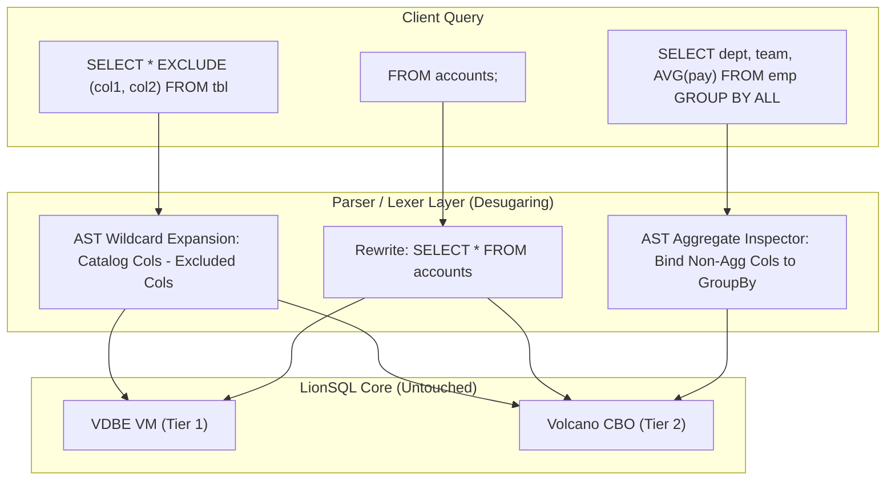

# LionSQL 친화적 SQL 편의 문법(DuckDB 스타일) 도입 마스터 플랜

> - **최초 작성일**: 2026-10-29
> - **문서 상태**: Approved (Post-1.0 v1.1.0 로드맵)
> - **연관 과제 ID**: `FRIENDLY-SQL-1`
> - **적용 대상**: `pkg/proc/parser.go`, `pkg/proc/lexer.go`, `pkg/engine/`, `pkg/planner/`

---

## 1. 개요 및 비전 (Executive Summary & Vision)

> **"전통적 SQL의 30년 된 타이핑 피로도를 제거하고, 가장 현대적이고 우아한 SQL 작성 경험을 제공한다."**

DuckDB가 데이터 엔지니어링 씬에서 폭발적인 인기를 얻은 핵심 비결 중 하나는 컬럼형 스토리지뿐 아니라, 기존 SQL의 불필요하고 번거로운 문법적 제약(Friction)들을 영리하게 해소한 **"Friendly SQL Ergonomics(친화적 SQL 손끝 문법)"**에 있습니다.

LionSQL은 고성능 T-SQL 바이트코드 VM과 비차단 ACID 스토리지(In-Memory OCC / WiredTiger MVCC) 코어를 100% 온전히 보존하면서, 사용자의 실제 쿼리 작성 생산성을 극대화하기 위해 **사용자 선정 3대 핵심 DuckDB 스타일 편의 문법(`EXCLUDE`, `FROM-First`, `GROUP BY ALL`)**을 파서/플래너 레벨에서 가볍게 수용하는 아키텍처를 정의합니다.

---

## 2. 사용자 선정 3대 핵심 편의 문법 명세 (Target Specifications)



---

### 2.1. Feature 1: `SELECT * EXCLUDE (...)` & `REPLACE (...)`
> **"수십 개 컬럼 중 민감 정보나 특정 컬럼만 핀포인트로 제외/대체하기"**

#### 1) 문제점
- 실무 테이블(`users`, `accounts`, `orders`)은 컬럼 수가 20~50개에 달하는 경우가 많습니다.
- `password_hash`, `salt` 등 몇 개 컬럼만 빼고 조회하고 싶을 때, 표준 SQL에서는 40여 개의 컬럼명을 일일이 손으로 나열해야 하는 심각한 비효율이 발생합니다.

#### 2) 지원 문법 스펙
```sql
-- 1. EXCLUDE: 특정 컬럼들을 와일드카드 프로젝션에서 제외
SELECT * EXCLUDE (password_hash, salt, secret_token) FROM users;

-- 2. REPLACE: 특정 컬럼의 출력 표현식을 즉석에서 대체
SELECT * REPLACE (balance * 1350 AS balance) FROM accounts;

-- 3. 혼합 사용: 제외와 대체를 동시에 적용
SELECT * EXCLUDE (secret) REPLACE (salary * 1.1 AS salary) FROM employees;
```

#### 3) 동작 메커니즘 (Zero Core Impact)
- 스토리지 엔진이나 런타임을 변경할 필요가 전혀 없습니다.
- 파서(`pkg/proc/parser.go`)에서 `SELECT *` 파싱 시 `EXCLUDE` 절을 만나면, 내부 카탈로그(`cat.GetTable()`)에서 컬럼 목록을 조회한 뒤 **제외 목록에 명시된 컬럼을 뺀 나머지 컬럼들로 AST 프로젝션 목록을 컴파일 타임에 확장(Wildcard Expansion)**합니다.

---

### 2.2. Feature 2: `FROM-First` 문법 (`FROM accounts;`)
> **"SELECT * 타이핑 없이 테이블 즉시 전체 미리보기 & IDE 자동완성 극대화"**

#### 1) 문제점
- 터미널 CLI(`lionsql query`), Web Studio, 스크립트 작성 시 테이블 내용을 빠르게 훑어보기 위해 매번 8글자의 `SELECT * `를 반복 입력해야 합니다.
- 또한 SQL은 `SELECT`를 먼저 작성하므로, 아직 테이블이 확정되지 않아 컬럼명 자동완성(Auto-Complete)이 원활하지 못한 언어적 한계가 있습니다.

#### 2) 지원 문법 스펙
```sql
-- 1. 단독 FROM 문: 테이블 전체 즉시 조회 (SELECT * FROM accounts; 와 100% 동일)
FROM accounts;

-- 2. 필터링 및 정렬 결합
FROM accounts WHERE balance > 1000 ORDER BY balance DESC LIMIT 10;

-- 3. FROM-First 투영 (테이블을 먼저 확정하고 컬럼을 뒤에 선택)
FROM accounts SELECT id, balance, status WHERE status = 'ACTIVE';
```

#### 3) 동작 메커니즘
- 파서가 쿼리의 첫 토큰이 `FROM`인 구문을 감지하면:
  - 뒤에 `SELECT` 절이 없는 경우: `SELECT * FROM <table_ref> ...` AST로 즉시 디슈가링(Desugaring).
  - 뒤에 `SELECT col1, col2` 절이 있는 경우: 표준 `SELECT col1, col2 FROM <table_ref> ...` AST로 변환.

---

### 2.3. Feature 3: `GROUP BY ALL` (비집계 컬럼 자동 그룹핑)
> **"SELECT 목록 바꿀 때마다 GROUP BY 목록에 복사-붙여넣기 실수 방지"**

#### 1) 문제점
- 리포팅이나 통계 쿼리를 짤 때, SELECT 절에 명시된 비집계 컬럼들을 GROUP BY 절에 똑같이 반복 작성해야 합니다:
  ```sql
  -- 컬럼 하나 추가할 때마다 아래 GROUP BY에도 똑같이 추가해야 함
  SELECT department_id, team_id, job_grade, AVG(salary), COUNT(*)
  FROM employees
  GROUP BY department_id, team_id, job_grade;
  ```
- SELECT와 GROUP BY가 불일치하면 SQL 구문 오류가 발생하여 개발 생산성을 저해합니다.

#### 2) 지원 문법 스펙
```sql
SELECT department_id, team_id, job_grade, AVG(salary), COUNT(*)
FROM employees
GROUP BY ALL;
```

#### 3) 동작 메커니즘
- CBO 옵티마이저 플래너(`pkg/planner/` 또는 `pkg/execution/`)에서 `GROUP BY ALL` 구문을 감지하면:
  - SELECT 프로젝션 표현식 트리를 순회하여 집계 함수(`SUM`, `AVG`, `COUNT`, `MIN`, `MAX`, `MEDIAN` 등)를 포함하지 않는 순수 컬럼 및 스칼라 표현식을 추출.
  - 추출된 비집계 컬럼 리스트를 `GroupByIterator`의 그룹핑 키로 자동 바인딩.

---

## 3. 무침습 아키텍처 원칙 (Non-Intrusive Compiler Macro)

1. **스토리지 엔진 및 런타임 불변**:
   - WiredTiger B+Tree, In-Memory OCC 256-샤드 스토리지 엔진은 **단 1줄도 수정하지 않습니다**.
   - VDBE VM 바이트코드 명령어 셋도 변경할 필요가 없습니다.
2. **순수 파서/플래너 AST 변환 (Desugaring)**:
   - 3대 문법 모두 파서와 플래너 단계에서 기존의 검증된 표준 AST 구조(`*ast.SelectStmt`, `*ast.GroupByClause`)로 전개되므로, 엔진의 트랜잭션 무결성과 동시성에 0.00%의 리스크만 발생합니다.
3. **기존 T-SQL 호환성 100% 공존**:
   - 표준 SQL 및 T-SQL 구문과 키워드 충돌이 없으며, 기존의 엄격한 문법도 그대로 병행 지원됩니다.

---

## 4. 단계별 구현 및 검증 계획 (Phased Execution Plan)

### Step 1: Lexer & Parser 토큰 확장 (`pkg/proc/lexer.go`, `parser.go`)
- `EXCLUDE`, `REPLACE`, `ALL` 키워드 토큰 정의.
- `SELECT *` 파싱 루틴에서 `EXCLUDE (...)` 및 `REPLACE (...)` 절 파싱 로직 추가.
- 첫 토큰이 `FROM`으로 시작하는 쿼리 인식 핸들러 추가.

### Step 2: AST 컴파일 타임 와일드카드 전개 (`pkg/proc/parser.go`)
- 카탈로그 테이블 메타데이터를 참조하여 `EXCLUDE` 대상 컬럼을 필터링하고 프로젝션 슬라이스를 자동 재구성.
- `FROM <table>`을 `SELECT * FROM <table>` AST로 1:1 디슈가링.

### Step 3: 옵티마이저 `GROUP BY ALL` 바인딩 (`pkg/planner/`, `pkg/engine/`)
- SELECT 절의 비집계 표현식을 추출하여 GROUP BY 필드로 자동 치환하는 플래너 바인딩 로직 구현.

### Step 4: 종합 단위 및 통합 테스트 슈트 구축 (`pkg/engine/sqlexec_friendly_test.go`)
- 다중 컬럼 테이블 대상 `EXCLUDE` 결과 컬럼 수 검증.
- `FROM accounts;` 기본 쿼리 및 WHERE/LIMIT 결합 동작 검증.
- 복합 비집계 표현식 포함 `GROUP BY ALL` 집계 결과 정확성 검증.
- `go test -tags wiredtiger -race -count=1 ./...` 통과 (0 data races).

---

## 5. 결론 및 릴리스 배정

본 3대 친화적 SQL 편의 문법(`EXCLUDE`, `FROM-First`, `GROUP BY ALL`)은 **스토리지 무침습, 극저위험, 극대효용**의 특성을 가지며, 1.0 정식 릴리스 직후의 차기 마이너 버전인 **`v1.1.0` (과제 ID: `FRIENDLY-SQL-1`)의 대표적인 DX 킬러 피처**로 배정하여 완성도를 높입니다.

본 계획서는 Golden Rule 42에 의거하여 영구 보존됩니다.
