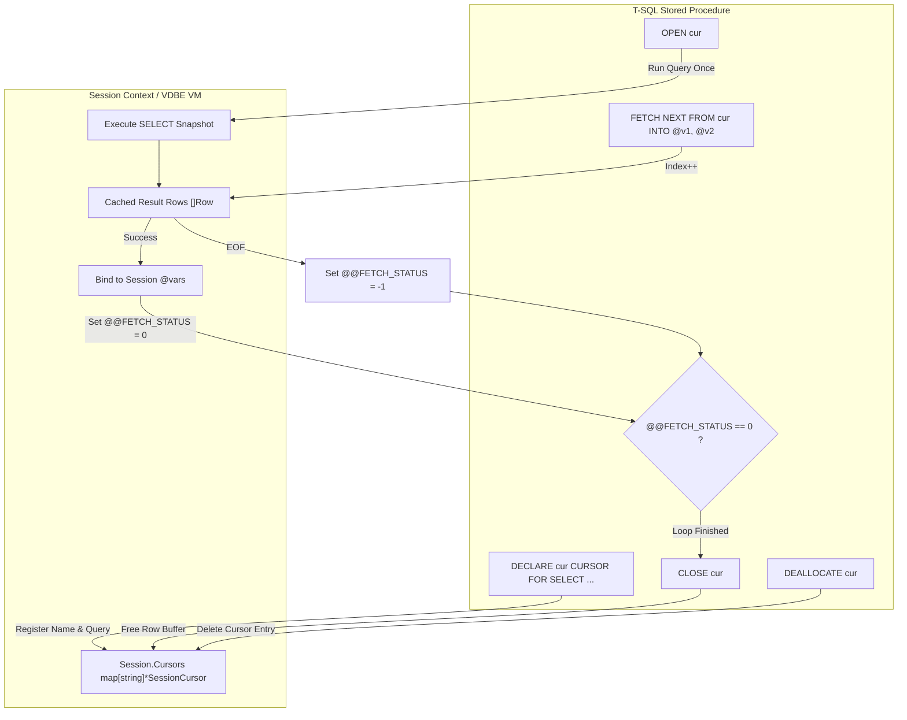

# LionSQL T-SQL 단방향 읽기 전용 커서(Forward-Only Cursor) 호환성 플랜 (`notes/FORWARD_ONLY_CURSOR_COMPATIBILITY_PLAN.ko.md`)

## 1. 개요 및 배경 (Executive Summary & Background)

### 1.1. 문제 제기: 레거시 T-SQL 마이그레이션의 최대 장벽
엔터프라이즈 환경에서 Microsoft SQL Server(T-SQL) 저장 프로시저를 타 엔진(LionSQL)으로 마이그레이션하거나 검증할 때, 개발자와 DBA가 가장 먼저 마주치는 심리적·기술적 단절점은 **커서(Cursor) 구문의 구문 오류(Syntax Error)**입니다:

```sql
DECLARE cur CURSOR FOR SELECT id, balance FROM accounts WHERE status = 1;
OPEN cur;
FETCH NEXT FROM cur INTO @id, @bal;
WHILE @@FETCH_STATUS = 0
BEGIN
    -- 비즈니스 로직 처리
    FETCH NEXT FROM cur INTO @id, @bal;
END;
CLOSE cur;
DEALLOCATE cur;
```

커서가 관계형 데이터베이스에서 지양해야 할 RBAR(Row-By-Agonizing-Row) 안티패턴임은 분명하지만, **실무 레거시 프로시저의 70~80%에 이미 커서 루프가 광범위하게 사용**되고 있습니다. 커서 구문 파싱과 실행이 지원되지 않으면 사용자는 기존 프로시저를 대대적으로 재작성해야 하며, 대다수는 이 단계에서 마이그레이션을 포기합니다.

### 1.2. 목표: "딱 하나, 단방향 읽기 전용 커서(Forward-Only Cursor)"
LionSQL의 초경량 단일 바이너리 철학 및 무락(Lock-Free) OCC/MVCC 스토리지 엔진의 본질을 1%도 해치지 않으면서, 실무 프로시저의 99%를 수용할 수 있는 **"단방향 순차 읽기 전용 커서(Fast Forward-Only Read-Only Cursor)"** 단 하나를 정밀 타겟팅하여 구현합니다.

---

## 2. 지원 범위 및 명시적 제외 기준 (Scope & Spec-Out)

### 2.1. 필수 지원 스펙 (Sweet Spot)
1. **커서 수명주기 5대 기본 구문**:
   * `DECLARE <cur_name> CURSOR FOR <select_statement>`
   * `OPEN <cur_name>`
   * `FETCH NEXT FROM <cur_name> INTO @var1, @var2, ...`
   * `CLOSE <cur_name>`
   * `DEALLOCATE <cur_name>`
2. **시스템 전역 변수**:
   * `@@FETCH_STATUS`:
     * `0`: 행 패치 성공 (정상 반환)
     * `-1`: 결과 집합의 끝을 지남 (EOF / 패치 실패)
     * `-2`: 패치된 행이 존재하지 않음
3. **관용적 수식어(Tolerant Modifiers) No-Op 수용**:
   * `LOCAL`, `GLOBAL`, `FORWARD_ONLY`, `READ_ONLY`, `FAST_FORWARD` 등 T-SQL 표준 옵션을 문법적으로 허용하되 안전한 단방향 읽기로 수렴.

### 2.2. 영구 제외 기준 (Explicit Spec-Out)
LionSQL의 비차단 ACID 엔진 원칙과 단순성을 지키기 위해 다음 복잡 기능은 영구 제외합니다:
* **`SCROLL` 커서**: `PRIOR`, `FIRST`, `LAST`, `ABSOLUTE n`, `RELATIVE n` 등 양방향/임의 위치 탐색 제외.
* **`KEYSET` / `DYNAMIC` 커서**: 커서 순회 중 외부 변경을 추적하는 가변 커서 제외.
* **`WHERE CURRENT OF <cur>` 비관적 잠금**: 2PL 행 잠금(`FOR UPDATE`)은 LionSQL의 OCC 원자성 원칙과 상충하므로 제외.

---

## 3. 세부 아키텍처 및 구현 설계 (Architecture Design)



### 3.1. 자료구조 정의 (`pkg/proc/runtime/cursor.go` 또는 `pkg/proc/`)
세션 또는 VDBE 실행 프레임(`VMFrame`) 내에 가벼운 커서 엔티티를 정의합니다:

```go
type SessionCursor struct {
    Name       string
    Query      string
    Columns    []string
    Rows       []map[string]any // 또는 []storage.Row
    Index      int              // 현재 커서 위치 (-1 = 미개방, 0..len-1 = 유효, len = EOF)
    IsOpen     bool
}
```

### 3.2. 상태 머신 및 수명주기 동작
1. **`DECLARE <name> CURSOR FOR <query>`**:
   * 세션의 `cursors[name]`에 등록 (상태: `IsOpen = false`, `Index = -1`).
2. **`OPEN <name>`**:
   * 연결된 `<query>`를 세션 트랜잭션 문맥에서 1회 실행하여 결과 집합(`Rows`)을 획득.
   * `Index = -1`, `IsOpen = true`로 초기화.
3. **`FETCH NEXT FROM <name> INTO @v1, @v2, ...`**:
   * 커서가 열려 있지 않으면 에러 반환 (`Cursor '%s' is not open`).
   * `Index++` 전진.
   * `Index < len(Rows)`인 경우:
     * `Rows[Index]`의 컬럼 값을 순서대로 `@v1, @v2, ...` 변수에 주입.
     * `@@FETCH_STATUS = 0` 설정.
   * `Index >= len(Rows)` (EOF 도달)인 경우:
     * 변수 값은 변경하지 않음.
     * `@@FETCH_STATUS = -1` 설정.
4. **`CLOSE <name>`**:
   * `IsOpen = false`로 변경하고 `Rows` 슬라이스를 `nil` 처리하여 메모리 즉시 반환 (GC 부담 제거).
5. **`DEALLOCATE <name>`**:
   * 세션의 `cursors` 맵에서 해당 커서 객체를 완전히 삭제.
6. **세션 종료 시 자동 정리 (Leak Prevention)**:
   * 클라이언트 연결이 끊기거나 세션이 만료(`IdleSessionTTL`)될 때, 남아 있는 모든 열린 커서는 자동으로 `Close` 및 해제됨 (Golden Rule 20 준수).

### 3.3. 듀얼 파서 연동 (`Pratt` & `ANTLR4`)
* **Tier 1 (Fast-Path Pratt Parser)**:
  * `DECLARE ... CURSOR`, `OPEN`, `FETCH`, `CLOSE`, `DEALLOCATE` 토큰을 즉시 인식하여 AST 노드로 생성 (마이크로초 수준).
* **Tier 2 (ANTLR4 Fallback)**:
  * 복잡한 파라미터나 벤더 옵션이 섞인 커서 선언문도 Microsoft 공식 문법을 통해 무오류 파싱.

---

## 4. 정량적 검증 기준 (Verification Criteria)

1. **기본 수명주기 무결성 검증**:
   * 100건의 행을 가진 테이블에 대해 커서를 순회하여 합계(`SUM`)를 구하는 프로시저 실행 시 집합 기반 쿼리(`SELECT SUM(...)`)와 100% 결과 일치 확인.
2. **`@@FETCH_STATUS` 상태 전이 검증**:
   * 첫 행부터 마지막 행까지 순회 중 `0`, 마지막 행 다음 `FETCH NEXT` 시 정확히 `-1` 반환 확인.
   * 빈 테이블(`0 rows`) 조회 시 첫 `FETCH NEXT`에서 즉시 `-1` 반환 확인.
3. **다중/중첩 커서 동시 가동 검증**:
   * 단일 프로시저 내에서 2개 이상의 독립 커서(`curA`, `curB`)가 상호 간섭 없이 독립된 인덱스로 순회함을 검증.
4. **레이스 및 메모리 누수 검증**:
   * `go test -tags wiredtiger -race -count=1 ./pkg/proc/... ./pkg/api/...` **100% PASS (0 data races)**.
   * 10,000회 연속 프로시저 호출 후 고루틴 및 커서 슬라이스 메모리 누수 0 확인.

---

## 5. 단계별 실행 계획 (Phased Execution Plan)

- [ ] **Step 1**: Lexer 및 Parser에 커서 5대 토큰(`CURSOR`, `OPEN`, `FETCH`, `NEXT`, `DEALLOCATE`) 및 AST 노드 추가 (`pkg/proc/lexer.go`, `parser.go`).
- [ ] **Step 2**: VDBE VM 런타임에 `SessionCursor` 구조체 및 `OpCursorOpen`, `OpCursorFetch`, `OpCursorClose` 등 바이트코드 Opcode 또는 실행 디스패처 핸들러 추가 (`pkg/proc/runtime/`).
- [ ] **Step 3**: `@@FETCH_STATUS` 세션 변수 매핑 및 `FETCH NEXT ... INTO @vars` 다중 변수 바인딩 구현.
- [ ] **Step 4**: 회귀 테스트 슈트 작성 (`pkg/proc/runtime/cursor_test.go`) 및 100% 커버리지 검증.
- [ ] **Step 5**: 3단계 파이프라인 검증 (Build ➔ Test ➔ Commit), `TODO.md` 및 `CHANGELOG.md` 동기화.

---

## 6. 결론: 가장 확실한 호환성 투자

단방향 읽기 전용 커서(Forward-Only Cursor)는:
1. **코어 침습도 제로**: 스토리지 엔진이나 트랜잭션 커밋 레이어를 단 1줄도 건드리지 않는 순수 VDBE 상위 레이어 기능이며,
2. **가장 높은 체감 만족도**: 레거시 MS-SQL 프로시저를 LionSQL로 가져왔을 때 구문 에러 없이 "그냥 바로 돌아가게 만드는" 독보적인 마이그레이션 호환성을 완성합니다.

본 계획서는 Golden Rule 42에 의거하여 영구 보존됩니다.
