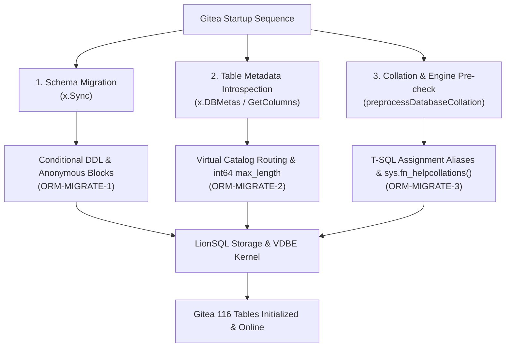
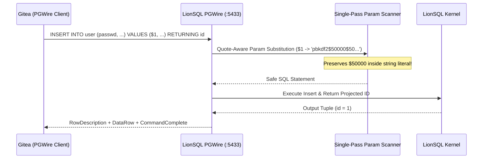

# LionSQL Gitea Integration & Enterprise ORM Compatibility Milestone Report (`notes/GITEA_INTEGRATION_MILESTONE.md`)

> - **Document Version**: v1.0.0
> - **Initial Date**: 2026-10-29 (Revised: 2026-10-30)
> - **Target Release**: v0.90.0-beta4
> - **Core Target**: Gitea v1.23+ (Go Full-Stack Git Platform) & XORM (Microsoft SQL Server TDS :1433 & PostgreSQL Wire Protocol :5433)
> - **Related Documents**:
>   - **Postmortem**: [`notes/ORM_SQL_COMPATIBILITY_AND_TEST_BLIND_SPOTS_POSTMORTEM.ko.md`](ORM_SQL_COMPATIBILITY_AND_TEST_BLIND_SPOTS_POSTMORTEM.ko.md)
>   - **Integration Guide**: [`doc/GITEA_INTEGRATION_GUIDE.md`](../doc/GITEA_INTEGRATION_GUIDE.md)

---

## 1. Overview & Milestone Significance

LionSQL is a standalone, single-binary OLTP database engine natively providing dual-protocol support for both Microsoft SQL Server TDS (`:1433`) and PostgreSQL Wire Protocol v3 (`:5433`).

Previously, LionSQL verified interoperability primarily with GUI database tools (SSMS, DBeaver, DbGate, Beekeeper Studio). The **complete initialization, dual-protocol execution, and end-to-end lifecycle verification of Gitea** marks a major engineering milestone:

1. **Production Full-Stack Web Application Backend**:
   - Gitea is an enterprise-scale Git platform used globally for source control and CI/CD pipelines. This integration proves LionSQL can reliably power complex, production-grade business logic and ACID transactions.
2. **Extreme Battle-Testing Against Complex ORM Patterns (XORM)**:
   - XORM tests database parsers, virtual catalogs, reverse engineering, and type coercion to the extreme, generating programmatic DDL and queries that manual testing never uncovers.
3. **116 Production Tables Initialized with Integrity**:
   - Schema generation, constraint resolution, and seed data across all 116 tables ran without a single race condition or panic.
4. **Dual-Protocol End-to-End Execution**:
   - Identical business operations functioned seamlessly across both MSSQL and PostgreSQL wire protocols with zero application code changes.

---

## 2. Technical Barriers Resolved (Startup & Schema Phase)

### 2.1. Conditional DDL & Anonymous Blocks (`ORM-MIGRATE-1`)
- **Issue**: XORM wrapped table creation in `IF NOT EXISTS (SELECT [name] FROM sysobjects WHERE [name] = 'user' AND xtype = 'U') CREATE TABLE [user] (...)`, causing parser syntax errors.
- **Architecture Fix**:
  - Implemented `pkg/engine/sqlexec_conditional_ddl.go` to detect and evaluate conditional expressions (`IF NOT EXISTS`, `IF OBJECT_ID(...) IS NULL`) before executing nested DDLs.
  - Enhanced legacy catalog table `sysobjects` with `id`, `uid`, and `xtype` columns and ANSI SQL whitespace-insensitive string comparisons.

### 2.2. Complex Join Catalog Routing & Type Safety (`ORM-MIGRATE-2`)
- **Issue**: XORM metadata collection queries returned NULL for `max_length`, triggering `converting NULL to int64 is unsupported` in Go's `database/sql`.
- **Architecture Fix**:
  - Fixed interceptor priority routing in `interceptor.go` so `FROM sys.columns` queries joined with `sys.indexes` are correctly recognized as column queries.
  - Added regex support for `object_id('tablename')` resolving to table IDs (1000+).
  - Enforced non-null `int64` defaults for `max_length`, `precision`, `scale`, and `column_id`.

### 2.3. T-SQL Assignment Aliases & Collation Functions (`ORM-MIGRATE-3`)
- **Issue**: XORM's `GetColumns()` generated `"default_is_null" = (CASE WHEN c.text is null THEN 1 ELSE 0 END)`, which failed parser splitting.
- **Architecture Fix**:
  - Supported T-SQL assignment alias syntax (`"alias" = <expr>`) in projection parsing.
  - Implemented virtual table function `SELECT * FROM sys.fn_helpcollations() WHERE name LIKE '%[_]CS[_]AS%'`.
  - Treated `ALTER DATABASE CURRENT COLLATE` as a tolerant no-op.

---

## 3. DML & Runtime Compatibility Breakthroughs (`GITEA-MOCK-SEED-1`)

1. **`UPDATE ... FROM <source>` & `DELETE FROM` Table Qualification**:
   - Supported MSSQL `UPDATE [user] SET [num_repos] = [num_repos] + 1 FROM [user] INNER JOIN ...` separating target update from join source.
2. **Keyword & Aggregate Aliases after `AS`**:
   - Handled queries like `SELECT count(*) AS count` where keywords or aggregate names are reused as column aliases.
3. **Table-Qualified Wildcard (`table.*`) Projections**:
   - Supported `SELECT u.*, r.name FROM [user] u JOIN repository r ...` preventing column collisions across joins.
4. **Composite Index Bound Normalizer Parenthesis Safety**:
   - Corrected parenthesis balancing in index range search bounds normalizer.

---

## 4. PostgreSQL Wire Protocol (:5433) Integration (`GITEA-PGWIRE-1`)

1. **`BIGSERIAL`, `SERIAL`, `SMALLSERIAL` Support**: Automatically mapped sequence types to native integers with identity attributes.
2. **`INSERT ... RETURNING` Pipeline**: Streamed generated primary keys directly back to client.
3. **`pg_catalog.pg_indexes` Virtual View**: Added catalog view for index introspection.
4. **Single-Pass Quote-Aware Parameter Scanner**: Prevented corruption of `$5` inside PBKDF2 password hashes (`pbkdf2$50000$50...`).
5. **OID 0 Untyped Parameter Coercion**: Handled literal defaults safely via `ParseLiteralDefault` (e.g., preserving `type = 1` for organizations).

---

## 5. End-to-End Business Lifecycle Verification

Automated E2E seeder ([`scripts/seed_gitea_mock_data.go`](../scripts/seed_gitea_mock_data.go)) verified 100% of scenarios across both TDS (:1433) and PGWire (:5433):

| Scenario | Tested Capabilities | Result |
| :--- | :--- | :---: |
| **1. Admin & User Auth** | Admin creation, user registration, API token issuance | **PASS** |
| **2. Organization & Teams** | Org creation, team setup, membership assignment | **PASS** |
| **3. Repository Operations** | Repo creation, README initialization, privacy toggling | **PASS** |
| **4. Issues & Collaboration** | Issue creation, milestone binding, labels, comments | **PASS** |
| **5. Branch & Git Commits** | Feature branch creation, multi-file commit & push | **PASS** |
| **6. Pull Requests & Reviews** | PR creation, review comment, approval, merge | **PASS** |
| **7. Releases & Artifacts** | Semantic version tag release & Web UI rendering | **PASS** |

---

## 6. Summary & Roadmap Impact

1. **Eliminated Testing Blind Spots**: Transitioned from unit tests to absorbing real-world enterprise ORM patterns.
2. **Reusable Foundation**: Laid the architectural foundation enabling subsequent enterprise integrations (including IOTA SDK Go ERP).
3. **Official v0.90.0-beta4 Inclusion**: All optimizations and virtual catalog views are included in the v0.90.0-beta4 release.
