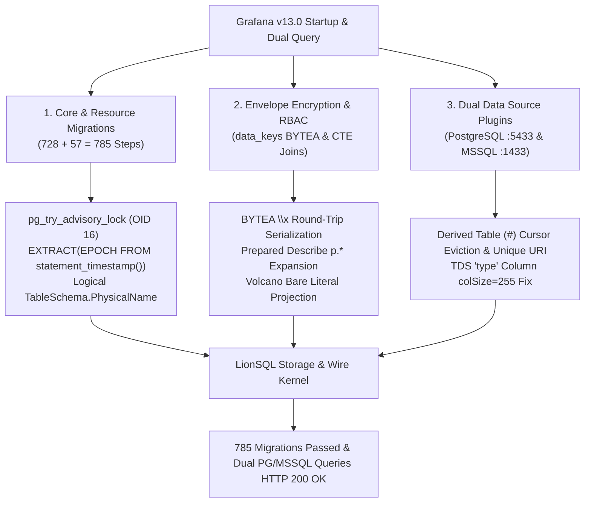

# LionSQL Grafana Dual-Protocol Integration & Observability Platform Milestone Report (`notes/GRAFANA_INTEGRATION_MILESTONE.md`)

> - **Document Version**: v1.0.0
> - **Created**: 2026-10-31
> - **Task ID**: `GRAFANA-INTEGRATION-1`
> - **Target Release**: v0.90.0-beta4+
> - **Target Platform**: Grafana v13.0+ (Open-Source Observability & Visualization Platform)
>   - Channel 1 (Internal Metadata DB): `github.com/lib/pq` + XORM (`PostgreSQL Wire Protocol v3 :5433`)
>   - Channel 2 (Dual Query Data Sources): `grafana-postgresql-datasource` (`:5433`) & `mssql` (`Microsoft SQL Server TDS :1433`)
> - **Related Documents**:
>   - **Official Integration Guide (English)**: [`doc/GRAFANA_INTEGRATION_GUIDE.md`](../doc/GRAFANA_INTEGRATION_GUIDE.md)
>   - **Official Integration Guide (Korean)**: [`doc/GRAFANA_INTEGRATION_GUIDE.ko.md`](../doc/GRAFANA_INTEGRATION_GUIDE.ko.md)
>   - **Korean Milestone Report**: [`notes/GRAFANA_INTEGRATION_MILESTONE.ko.md`](GRAFANA_INTEGRATION_MILESTONE.ko.md)

---

## 1. Overview & Milestone Significance

LionSQL is a self-contained, single-binary OLTP database engine that natively speaks both Microsoft SQL Server TDS (`:1433`) and PostgreSQL Wire Protocol v3 (`:5433`).

Following the successful integration of **Gitea (`GITEA-PGWIRE-1`)** and **IOTA-SDK Go ERP (`IOTA-ERP-1`)**, the **Grafana Dual-Protocol Integration (`GRAFANA-INTEGRATION-1`)** establishes four major engineering milestones:

1. **100% Completion of 785 Enterprise Schema Migrations**:
   - Unmodified Grafana executes **728 core database migrations** (`migration_log`) and **57 unified storage resource migrations** (`resource_migration_log`)—**785 migrations in total**—against LionSQL with zero errors.
2. **Simultaneous Dual-Channel Operation (Internal Backend + Dual External Data Sources)**:
   - A single LionSQL instance simultaneously serves as Grafana's internal metadata catalog over PGWire (`:5433`) while answering live dashboard panel queries from both the official **PostgreSQL Data Source plugin (`:5433`)** and **Microsoft SQL Server Data Source plugin (`:1433`)**.
3. **Complex CTE / Derived Table (`WITH ... UNION ALL`) & RBAC Permission Engine Compatibility**:
   - Resolves multi-branch derived table isolation, bare literal projection evaluation, and Prepared Statement `Describe` wildcard (`p.*`) column alignment required by Grafana's RBAC access control engine.
4. **Envelope Encryption (`BYTEA` `data_keys`) & PostgreSQL Advisory Locks**:
   - Implements full round-trip `\x<hex>` serialization for `BYTEA` columns used by Grafana's secret encryption service along with PostgreSQL advisory lock functions (`pg_try_advisory_lock`).

---

## 2. Key Technical Barriers Resolved & Kernel Enhancements

### 2.1. PostgreSQL Advisory Locks (`pg_try_advisory_lock`) & OID 16 Metadata
- **Issue**: Grafana's resource migrator acquires schema locks via `SELECT pg_try_advisory_lock($1)` and `SELECT pg_advisory_unlock($1)`, expecting a boolean result (`OID 16`).
- **Resolution**:
  - Implemented `pg_try_advisory_lock`, `pg_try_advisory_xact_lock`, `pg_advisory_unlock`, `pg_advisory_unlock_all`, `pg_advisory_lock`, and `pg_advisory_xact_lock` in `pkg/proc/builtins_sys.go` and `pkg/engine/sqlexec_select.go`, returning native `bool(true)` with PGWire OID 16.

### 2.2. Logical Table Rename Decoupling (`PhysicalName`) to Prevent WiredTiger `EBUSY`
- **Issue**: During table rebuild migrations (create temp table ➔ copy rows ➔ drop old table ➔ `ALTER TABLE ... RENAME TO ...`), invoking `WT_SESSION.rename` while active cursors existed triggered `Device or resource busy (16)`.
- **Resolution**:
  - Added `PhysicalName` and `TableURI()` to `storage.TableSchema` (`pkg/storage/engine.go`).
  - `RenameTable` updates the logical catalog name atomically while retaining the underlying WiredTiger `PhysicalName`, completely eliminating physical file rename contention during active transactions.

### 2.3. Derived Table (`#__dt_...`) Cursor Eviction & Unique Physical URIs
- **Issue**: Dropping temporary derived tables (`#__dt_2_all_role`) created during CTE and subquery execution left cached WiredTiger cursors open, causing `WT_SESSION.drop` to fail with `EBUSY` and subsequent queries to fail with `key already exists`.
- **Resolution**:
  - Updated `DropTable` in `pkg/storage/wiredtiger/wt_engine.go` to call `e.evictAllCursors(tbl.Name)` before `WT_SESSION.drop`.
  - Assigned unique nanosecond-suffixed `PhysicalName` values to `#` temporary tables in `CreateTable` and bypassed redundant `saveCatalog()` disk writes for temporary tables.

### 2.4. `EXTRACT(EPOCH FROM statement_timestamp())` & Tolerant `LOCK TABLE`
- **Issue**: Grafana's resource migrator executes `SELECT (EXTRACT(EPOCH FROM statement_timestamp()) * 1000000)::BIGINT` and `LOCK TABLE resource IN EXCLUSIVE MODE`.
- **Resolution**:
  - Added SQL-standard `EXTRACT(field FROM source)` parsing in `pkg/proc/parser_expr.go`, `epoch` support in `pkg/proc/builtins_date.go` returning Unix seconds (`float64`), and `STATEMENT_TIMESTAMP` / `CLOCK_TIMESTAMP` / `TIMEOFDAY` built-ins.
  - Added tolerant `LOCK TABLE ...` no-op handling in `pkg/engine/sqlexec.go` and `pkg/wire/server.go`.

### 2.5. `BYTEA` `\x<hex>` Round-Trip Serialization & Prepared Statement Transaction Context
- **Issue**: Grafana's envelope encryption stores binary DEKs in `data_keys` (`BYTEA`) and reads them back within active transactions. Mismatched `BYTEA` formatting or executing prepared statements outside the active session transaction caused key lookup and decryption failures.
- **Resolution**:
  - Implemented full PostgreSQL `\x<hex>` decoding in `BinaryValueFromAny` (`pkg/storage/types_extended.go`) and `\x<hex>` encoding in PGWire text responses (`pkg/wire/server.go`).
  - Routed PGWire `handleExecute` prepared statements through `s.coordinator.ExecuteSessionSQL(ctx, cs.SessionID, ...)` so prepared statements share the session's active transaction (`cs.Tx`).

### 2.6. PGWire `handleDescribe` Wildcard (`p.*`) Expansion & Volcano Literal Projections
- **Issue**: Grafana's RBAC permission query (`SELECT p.*, 0 AS team_id, '' AS team, ur.user_id AS user_id, false AS is_service_account FROM (...) AS ar INNER JOIN permission AS p ...`) failed with `arg team_id as int: strconv.ParseInt: parsing "2026-10-31 ...": invalid syntax`.
- **Root Cause**:
  1. `handleDescribe` returned `"p.*"` as a single column in `RowDescription` while `Execute` expanded `p.*` into 10 columns in `DataRow`, shifting all subsequent column names by 9 positions.
  2. `NewProjectionIterator` (`pkg/execution/project.go`) skipped AST parsing for bare literals (`0`, `''`, `false`), evaluating them to `nil`.
- **Resolution**:
  - Expanded `*` and `alias.*` projections in `handleDescribe` (`pkg/wire/server.go`) using the target table schemas so `RowDescription` matches `DataRow` column-for-column.
  - Removed the restrictive operator-character guard in `NewProjectionIterator` (`pkg/execution/project.go`) so bare literals parse into `LiteralExpr` nodes.

### 2.7. TDS `inferColumnInfos` `type` Column `colSize` Fix
- **Issue**: Querying `SELECT id, name, type, url FROM data_source` via the Grafana MSSQL plugin (`go-mssqldb`) panicked with `slice bounds out of range [:8] with capacity 2`.
- **Root Cause**: `inferColumnInfos` in `pkg/wire/tds/server.go` hardcoded `colSize = 2` whenever `lowerCol == "type"`, causing `go-mssqldb` to allocate a 2-byte buffer that overflowed on `"postgres"` (8 bytes).
- **Resolution**:
  - Updated `inferColumnInfos` to set `colSize = 255` (or `len(val)` if larger) for `type` columns.

---

## 3. Verification Summary

| Verification Stage | Target | Status | Details |
| :--- | :--- | :---: | :--- |
| **Core Schema Migrations** | Grafana Core Migrator (`:5433`) | **100% PASS** | 728/728 migrations applied (`migration_log`) |
| **Resource Migrations** | Grafana Resource Migrator (`:5433`) | **100% PASS** | 57/57 migrations applied (`resource_migration_log`) |
| **Web UI & Admin Auth** | `http://localhost:3100` (`admin`) | **100% PASS** | RBAC seeding and session login verified |
| **PG Data Source Plugin** | `grafana-postgresql-datasource` (`:5433`) | **100% PASS** | Health Check `OK` & `/api/ds/query` `HTTP 200` |
| **MSSQL Data Source Plugin** | `mssql` data source plugin (`:1433`) | **100% PASS** | Health Check `OK` & `/api/ds/query` `HTTP 200` |
| **Simultaneous Dual Query** | Single `/api/ds/query` across PG + MSSQL | **100% PASS** | Identical data frames returned from both protocols |
| **Race Detector Suite** | `go test -tags wiredtiger -race ./...` | **100% PASS** | 100% pass across all packages, 0 data races |
