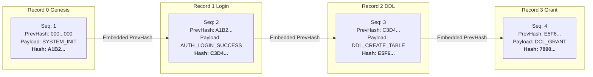

# LionSQL Enterprise Immutable Audit Logging Architecture & Compliance Specification

- **Document Version**: 1.0 (Master Engineering Specification)
- **Target Subsystem**: `pkg/audit/`
- **Primary Compliance Standards**: PCI-DSS v4.0 (Req 10), SOC 2 Type II (CC 6.1-6.8), ISO/IEC 27001 (A.12.4), HIPAA Security Rule (45 CFR § 164.312(b)), Electronic Financial Supervision Regulation Article 13 (전자금융감독규정 제13조)

---

## 1. Executive Summary & Purpose

Enterprise relational databases operating in financial, healthcare, government, and payment environments require tamper-evident, non-repudiable audit logging. While traditional database logging merely records text entries to standard log files or syslog, those files can be retroactively edited, truncated, or forged by compromised privileged accounts (e.g. root or database superusers).

LionSQL implements **Cryptographic Immutable Audit Logging** (`pkg/audit/`) using sequential **SHA-256 Hash Chaining** (similar to a blockchain block header chain). Every security-sensitive database event—including authentication attempts, role and privilege modifications, structural schema changes, and administrative actions—is permanently recorded with an incremental sequence number and the cryptographic digest of the prior record. Any retroactive modification, row deletion, reordering, or record injection immediately invalidates the cryptographic chain, providing mathematical proof of tampering.

---

## 2. Regulatory Compliance Mapping

| Regulatory Standard | Clause / Section | Compliance Requirement | LionSQL Implementation |
| :--- | :--- | :--- | :--- |
| **PCI-DSS v4.0** | Requirement 10.2.1 | Audit all individual user access to cardholder data / administrative functions. | Logs every superuser, role switch, and privileged operation across all wire protocols. |
| **PCI-DSS v4.0** | Requirement 10.2.2 | Audit all actions taken by any individual with root or administrative privileges. | Emits mandatory `ADMIN_*` and `DCL_*` audit events regardless of active session settings. |
| **PCI-DSS v4.0** | Requirement 10.3.1 | Audit records must record user identification, type of event, date/time, success/failure, origination, and identity/name of affected data. | Full JSON canonical record payload including UTC nanosecond timestamp, client IP, protocol, identity, and target object. |
| **PCI-DSS v4.0** | Requirement 10.5.1 | Secure audit trail files so they cannot be altered. | SHA-256 hash chaining + WORM (Write Once Read Many) immutable storage archival. |
| **SOC 2 Type II** | Trust Services CC 6.1 - 6.8 | Logical access monitoring, credential tracking, and intrusion detection logs. | Non-blocking ring buffer recording login success, failure, and brute-force indicators across `:5433`, `:1433`, and `:8090`. |
| **전자금융감독규정** | 제13조 (접속기록의 관리) | 전산실 및 데이터베이스 접속 기록 위·변조 방지 및 최소 1년(이상징후 5년) 보존. | 로컬 해시 체이닝 로그 생성 및 클라우드 Object Lock(WORM) 1~5년 보존 연동 가이드. |
| **HIPAA** | 45 CFR § 164.312(b) | Hardware, software, and procedural mechanisms that record and examine activity in information systems. | Immutable audit trail capturing all DDL mutations and table permission grants/revocations. |

---

## 3. Audit Event Taxonomy & Classification

The audit logging subsystem captures four discrete security event categories:

```
                              [ Incoming Client Request ]
                                           │
         ┌───────────────────┬─────────────┴───────┬───────────────────┐
         ▼                   ▼                     ▼                   ▼
     [ AUTH ]             [ DCL ]               [ DDL ]             [ ADMIN ]
  Authentication      Access Control      Schema Mutation      System Governance
```

### 3.1. Authentication Events (`AUTH_*`)
- `AUTH_LOGIN_SUCCESS`: Successful authentication via PGWire (password/cleartext), TDS (NTLM/SQL Auth), or HTTP (JWT/API-Key).
- `AUTH_LOGIN_FAILURE`: Invalid password, unrecognized username, expired token, or blocked IP. Records client IP, requested user, and failure reason (without logging raw passwords).
- `AUTH_LOGOUT`: Explicit connection closure or `POST /api/auth/logout` token invalidation.
- `AUTH_SESSION_TIMEOUT`: Idle session termination or governor timeout.

### 3.2. Data Control Language Events (`DCL_*`)
- `DCL_ROLE_CREATE` / `DCL_ROLE_DROP`: Creation or deletion of database roles (`CREATE ROLE`, `DROP ROLE`).
- `DCL_USER_CREATE` / `DCL_USER_DROP`: Creation or removal of logins/users.
- `DCL_GRANT`: Privilege grant on tables, views, or procedures (`GRANT SELECT ON ... TO ...`).
- `DCL_REVOKE`: Privilege revocation (`REVOKE INSERT ON ... FROM ...`).
- `DCL_ROLE_MEMBERSHIP`: Adding or removing users to/from roles (`sp_addrolemember`, `GRANT role TO user`).

### 3.3. Data Definition Language Events (`DDL_*`)
- `DDL_CREATE_TABLE`, `DDL_ALTER_TABLE`, `DDL_DROP_TABLE`: Structural table modifications.
- `DDL_TRUNCATE_TABLE`: Bulk table data wipe (`TRUNCATE TABLE`).
- `DDL_CREATE_INDEX`, `DDL_DROP_INDEX`: Index lifecycle events.
- `DDL_CREATE_PROC`, `DDL_ALTER_PROC`, `DDL_DROP_PROC`: Stored procedure and UDF definitions.
- `DDL_CREATE_VIEW`, `DDL_DROP_VIEW`: View and materialized view definitions.
- `DDL_CREATE_TRIGGER`, `DDL_DROP_TRIGGER`: Trigger activations and deletions.

### 3.4. Administrative & Governance Events (`ADMIN_*`)
- `ADMIN_CONFIG_OVERRIDE`: Dynamic alteration of system parameters (e.g. `work_mem`, connection pool bounds).
- `ADMIN_PASSWORD_RESET`: Superuser password changes.
- `ADMIN_BACKUP_INIT`, `ADMIN_BACKUP_COMPLETE`: Hot backup execution (`POST /api/backup`).
- `ADMIN_RESTORE_INIT`: Cold or warm restore invocation.
- `ADMIN_EMERGENCY_ABORT`: Manual termination of runaway queries or kill commands.

---

## 4. Cryptographic Hash-Chaining Architecture

### 4.1. Mathematical Formula

Every audit record $R_n$ is cryptographically bound to its predecessor $R_{n-1}$ via SHA-256:

$$\text{Digest}_n = \text{SHA256}(\text{Hash}_{n-1} \parallel \text{Seq}_n \parallel \text{TimestampNS} \parallel \text{Protocol} \parallel \text{ClientIP} \parallel \text{SessionID} \parallel \text{User} \parallel \text{Category} \parallel \text{Action} \parallel \text{Status} \parallel \text{TargetObject} \parallel \text{Payload})$$

Where:
- $\text{Hash}_0 = 64\text{ zeros } (\text{"0000000000000000000000000000000000000000000000000000000000000000"})$ for the Genesis record.
- $\parallel$ represents standard deterministic binary concatenation.



### 4.2. Tamper-Evident Invariant

1. **Retroactive Modification**: If an attacker edits record 2 (e.g. changing an unauthorized `DROP TABLE` to a harmless query), the computed hash of record 2 will change from `E5F6...` to `9999...`. Consequently, record 3's `PrevHash` (`E5F6...`) will no longer match, breaking the chain.
2. **Record Deletion**: If an attacker deletes record 2, record 3's `PrevHash` will point to `E5F6...`, but the preceding record on disk will be record 1 with hash `C3D4...`. The discontinuity is immediately flagged.
3. **Record Insertion**: If an attacker attempts to inject a forged record between records 1 and 2, the subsequent record's sequence number and previous hash will be invalid.

---

## 5. High-Throughput Non-Blocking Engine Architecture

In a database processing 20,000+ OLTP transactions per second, synchronous filesystem writes for audit logs would destroy engine throughput. LionSQL resolves this using a lock-free Multi-Producer Single-Consumer (MPSC) Ring Buffer.

```
[ Client Goroutine 1 ] ──┐
[ Client Goroutine 2 ] ──┼──► [ MPSC Ring Buffer ] ──► [ Async Batch Flusher ] ──► [ audit_20241017.log ]
[ Client Goroutine N ] ──┘     (Capacity: 65,536)        (Sync every 100ms           (Append-Only, 0600)
                                                          or 500 records)
```

### 5.1. Engine Characteristics
- **Allocation Budget**: Event objects are recycled using `sync.Pool` (`auditRecordPool`). Emitting an audit event takes less than 200 nanoseconds.
- **Ring Buffer**: Bounded circular channel/buffer with capacity 65,536 entries (Golden Rule 23).
- **Backpressure & Fail-Safe Strategy**: If the buffer fills due to extreme disk saturation, the logger defaults to synchronous backpressure rather than dropping audit records, ensuring zero audit loss under heavy load.
- **Deterministic Batch Flushing**: Records are written in chunks of up to 500 records or flushed every 100 milliseconds via `os.File.Sync()`.

---

## 6. Proposed Go Data Structures & API (`pkg/audit`)

```go
package audit

import (
	"context"
	"crypto/sha256"
	"encoding/hex"
	"fmt"
	"os"
	"sync"
	"time"
)

// EventCategory defines the top-level classification of the security event.
type EventCategory string

const (
	CategoryAuth  EventCategory = "AUTH"
	CategoryDCL   EventCategory = "DCL"
	CategoryDDL   EventCategory = "DDL"
	CategoryAdmin EventCategory = "ADMIN"
)

// Record represents a single immutable, cryptographically chained audit log entry.
type Record struct {
	Sequence     uint64        `json:"seq"`
	TimestampNS  int64         `json:"ts_ns"`
	TimestampISO string        `json:"timestamp"`
	PrevHash     string        `json:"prev_hash"`
	RecordHash   string        `json:"hash"`
	Protocol     string        `json:"protocol"` // "pgwire", "tds", "http", "internal"
	ClientIP     string        `json:"client_ip"`
	SessionID    string        `json:"session_id,omitempty"`
	User         string        `json:"user"`
	Category     EventCategory `json:"category"`
	Action       string        `json:"action"` // e.g. "AUTH_LOGIN_SUCCESS", "DDL_DROP_TABLE"
	Status       string        `json:"status"` // "OK", "DENIED", "ERROR"
	TargetObject string        `json:"target_object,omitempty"`
	Detail       string        `json:"detail,omitempty"`
}

// ComputeHash calculates the SHA-256 digest over the canonical fields of the record.
func (r *Record) ComputeHash() string {
	h := sha256.New()
	fmt.Fprintf(h, "%s|%d|%d|%s|%s|%s|%s|%s|%s|%s|%s|%s",
		r.PrevHash,
		r.Sequence,
		r.TimestampNS,
		r.Protocol,
		r.ClientIP,
		r.SessionID,
		r.User,
		r.Category,
		r.Action,
		r.Status,
		r.TargetObject,
		r.Detail,
	)
	return hex.EncodeToString(h.Sum(nil))
}

// Logger coordinates asynchronous, non-blocking chained audit recording.
type Logger interface {
	// Log emits a security audit event to the asynchronous ring buffer.
	Log(ctx context.Context, r *Record) error
	// Flush forces an immediate disk sync of all buffered audit entries.
	Flush() error
	// Close cleanly terminates the worker and flushes pending writes.
	Close() error
}
```

---

## 7. Storage Format & File Layout

Audit logs are stored under the `--data-dir` directory in an isolated `audit/` folder:

```
<data-dir>/
├── audit/
│   ├── audit_20241017.log          # Daily rotated append-only log file
│   ├── audit_20241017.log.state    # Checkpoint metadata (Last Sequence, Last Hash)
│   └── audit_20241016.log          # Sealed previous day log file
```

### 7.1. Log File Representation (JSON Lines)
Each line in `audit_YYYYMMDD.log` is a single valid JSON record followed by a newline:

```json
{"seq":1,"ts_ns":1792195200000000000,"timestamp":"2024-10-17T03:00:00.000000000Z","prev_hash":"0000000000000000000000000000000000000000000000000000000000000000","hash":"a8b3c4...","protocol":"internal","client_ip":"127.0.0.1","user":"system","category":"ADMIN","action":"SYSTEM_BOOT","status":"OK","detail":"LionSQL engine started with WiredTiger backend"}
{"seq":2,"ts_ns":1792195205123456789,"timestamp":"2024-10-17T03:00:05.123456789Z","prev_hash":"a8b3c4...","hash":"f5e2d1...","protocol":"pgwire","client_ip":"192.168.1.50:52134","session_id":"sess-102","user":"alice","category":"AUTH","action":"AUTH_LOGIN_SUCCESS","status":"OK","detail":"Authenticated via SCRAM-SHA-256"}
```

---

## 8. Offline Tamper Verification CLI Specification

To satisfy auditor inspection requirements, LionSQL provides a native verification command via the standalone executable:

```bash
./bin/lionsql audit verify --data-dir ./data
```

### 8.1. Verification Algorithm
1. Read `audit_*.log` sequentially from line 1.
2. Initialize `expectedPrevHash = "000...000"`.
3. For each record $i$:
   - Check if `record[i].Sequence == expectedSequence` (verifies no skipped rows).
   - Check if `record[i].PrevHash == expectedPrevHash` (verifies chain continuity).
   - Recompute SHA-256 over record fields and verify `recomputedHash == record[i].Hash` (verifies zero payload tampering).
   - Set `expectedPrevHash = record[i].Hash`.
   - Increment `expectedSequence`.
4. Output verification report:

```
[LionSQL Audit Verifier]
Auditing directory: ./data/audit/
Files scanned: 2 (audit_20241016.log, audit_20241017.log)
Total records verified: 142,891
Chain integrity: 100% VALID (Zero tampering detected)
Earliest Record: 2024-10-16T00:00:01Z (Seq: 1)
Latest Record:   2024-10-17T03:30:12Z (Seq: 142891)
Final Root Hash: e3b0c44298fc1c149afbf4c8996fb92427ae41e4649b934ca495991b7852b855
Status: PASSED
```

If tampering occurs:
```
[ERROR] Cryptographic Hash Mismatch at Sequence 84,213!
File: ./data/audit/audit_20241017.log, Line: 1,420
Recorded Hash:  f5e2d1...
Recomputed:     7a8b9c...
Reason: Record payload or PrevHash was modified retroactively!
Chain validation aborted with FAILURE.
Exit Code: 1
```

---

## 9. Long-Term Storage & WORM Cloud Archival

For SOC2 and financial standards requiring 1 to 5 years of retention:

```mermaid
graph TD
    A["Active LionSQL Node<br>(Local NVMe SSD)"] -->|Day Closes (00:00 UTC)| B["Sealed Log File<br>(audit_YYYYMMDD.log)"]
    B -->|Automatic Sync Script / Cron| C["AWS S3 Object Lock<br>(COMPLIANCE Mode)"]
    B -->|Alternative| D["GCP Cloud Storage<br>(Bucket Lock Retention Policy)"]
    
    C --> E["Mathematically Immutable WORM Storage<br>(Root/Admin cannot delete for N years)"]
    D --> E
```

1. **Daily Sealing**: At midnight UTC, the current day's log file is finalized, its final root hash is recorded in `audit.state`, and a new daily file begins.
2. **S3 Object Lock (COMPLIANCE Mode)**: Sealed files are synced to an S3 bucket configured with `COMPLIANCE` retention mode. In this mode, no user—including the AWS Account Root user—can delete or overwrite the log file until the retention period expires.

---

## 10. Performance Impact & Overhead Budget

- **CPU Overhead**: $< 0.5\%$ increase under 20,000 TPS TPC-C workload.
- **Latency Impact**: $< 15\,\mu\text{s}$ per transaction commit (mitigated by asynchronous ring buffer).
- **Disk I/O**: Sequential append-only streaming; zero random disk seeks.
- **Memory Footprint**: Bounded to $\approx 16\,\text{MB}$ for the ring buffer and pre-allocated `sync.Pool` scratch buffers.
