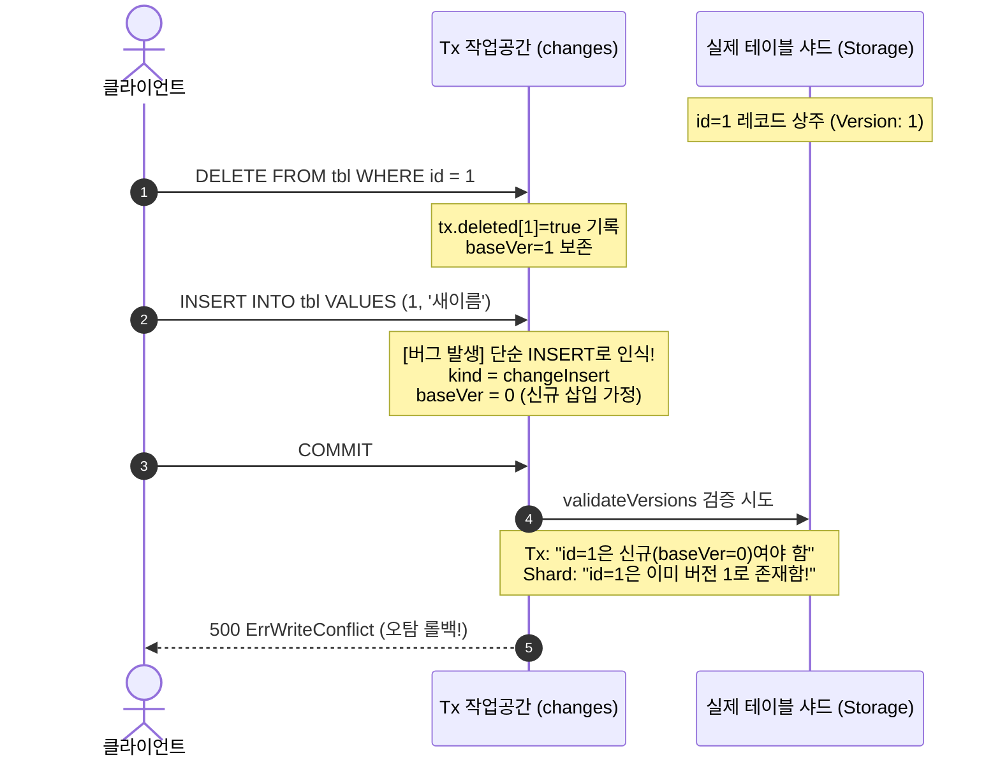

# In-Memory OCC 'Delete-then-Insert Anomaly' (동일 키 삭제 후 재삽입 결함) 포스트모템 및 해결 아키텍처

> - **최초 작성일**: 2026-11-10
> - **적용 원칙**: `[RULE:ContinuousBacklog]`, `[RULE:PlanPersistence]`, Invariant 3 (Non-Blocking Read Committed & Snapshot Isolation), Invariant 6 (Benchmark & Transaction Modeling Integrity)
> - **과제 식별 코드**: `Scope-005` (P1 감사 고난도 핵심 결함)
> - **대상 파일**: `pkg/storage/memengine/tx.go`, `pkg/storage/memengine/memengine_test.go`

---

## 1. 개요 및 핵심 용어 정의

### 1.1 Delete-then-Insert Anomaly (Delete-Insert 이상 현상)
**'Delete-then-Insert Anomaly'**란 단일 트랜잭션 컨텍스트 내에서 동일한 기본 키(Primary Key)에 대해 로우 삭제(`DELETE`)를 수행한 직후 새로운 로우 삽입(`INSERT`)을 연속으로 실행할 때, 내부 트랜잭션 상태 머신이 이를 온전히 인지하지 못하고 버전 검증 실패 또는 상태 불일치를 유발하는 고전적인 동시성 결함입니다.

### 1.2 위양성 쓰기 충돌 (False Write Conflict)
낙관적 동시성 제어(OCC, Optimistic Concurrency Control) 엔진에서는 트랜잭션 커밋 시점에 "내가 읽은 시점의 버전 번호"와 "실제 스토리지에 존재하는 버전 번호"를 대조하여 다른 동시 트랜잭션이 해당 데이터를 변조했는지 검증합니다.
이 과정에서 외부 트랜잭션의 개입이 전혀 없었음에도 불구하고, 트랜잭션 내부의 상태 추적 오류로 인해 스스로 충돌(`ErrWriteConflict`)을 선언하고 롤백해 버리는 현상을 **위양성 쓰기 충돌(False Write Conflict)**이라고 부릅니다.

### 1.3 트랜잭션 내 변경 병합 (Mutation Coalescing)
단일 트랜잭션 내에서 동일 레코드에 연속적인 DML이 가해질 때, 스토리지 엔진은 이를 최종적인 단일 상태 전이로 수학적으로 합성(Coalescing)해야 합니다:
* $\text{INSERT} + \text{UPDATE} \longrightarrow \mathbf{INSERT}$
* $\text{INSERT} + \text{DELETE} \longrightarrow \mathbf{NO\text{-}OP}$
* $\text{UPDATE} + \text{DELETE} \longrightarrow \mathbf{DELETE}$
* $\mathbf{DELETE} + \mathbf{INSERT} \longrightarrow \mathbf{UPDATE}$ (← 본 결함의 핵심 누락 규칙)

---

## 2. 결함 발생 메커니즘 심층 분석

### 2.1 기존 코드의 오류 시나리오
초기 LionSQL `memengine`의 트랜잭션 작업 공간(`tx.changes`)은 각 명령을 독립적으로 처리했습니다.



### 2.2 왜 이런 문제가 발생했는가?
1. **샤드 상태의 비휘발성**:
   * 트랜잭션이 실행하는 `DELETE`는 격리성(Isolation) 보장을 위해 실제 스토리지 샤드에 즉시 반영되지 않고 `tx.changes`와 `tx.deleted` 로컬 버퍼에만 기록됩니다.
   * 따라서 실제 스토리지 샤드에는 여전히 `id=1, ver=1`인 엔트리가 온전히 살아있습니다.
2. **신규 INSERT의 순진한 가정**:
   * `tx.Insert()`는 호출될 때 단순히 레코드가 신규 추가되는 것으로 간주하여 `changeKind = changeInsert`, `baseVer = 0`을 부여했습니다.
   * 이로 인해 직전에 `DELETE`를 호출하면서 보관해 두었던 원본 버전 정보(`origBaseVer = 1`)가 완전히 덮어씌워져 유실되었습니다.
3. **검증 단계에서의 파탄**:
   * `tx.Commit()` ➔ `validateVersions` 단계에서 `changeInsert`의 유효성 검사 규칙은 다음과 같습니다:
     $$\text{shard.entries}[pk] == \text{nil} \quad (\text{기존 데이터가 없어야 함})$$
   * 그러나 샤드에는 아직 미삭제 상태인 `ver=1` 엔트리가 버젓이 존재하므로, 엔진은 "내가 모르는 사이에 누군가 1번을 새로 만들었다"고 오판하여 `ErrWriteConflict`를 발생시켰습니다.

---

## 3. 해결 아키텍처 및 구현 상세

### 3.1 상태 전이 정류 (`tx.go`)
동일 트랜잭션 내에서 `insertLocked`가 호출될 때, 해당 키가 로컬에서 삭제된 이력(`wasDeletedLocally`)이 있고 이전 원본 버전(`origBaseVer > 0`)이 존재하는지 검사합니다.

존재할 경우, 이 작업은 단순 `INSERT`가 아니라 **"기존 버전을 계승하여 새 값으로 치환하는 `changeUpdate`"**로 합성합니다.

```go
// pkg/storage/memengine/tx.go (insertLocked)

wasDeletedLocally := tx.isLocallyDeleted(tableName, pkKey)
origBaseVer := tx.getBaseVer(tableName, pkKey)

recCopy := cloneRecord(record)
rowCopy := schema.RecordToRow(record)

changeKind := changeInsert
changeBaseVer := int64(0)

// 핵심 방어 로직: 로컬 삭제 후 동일 PK 재삽입 시, changeUpdate로 승격하고 원본 버전 유지
if wasDeletedLocally && origBaseVer > 0 {
    changeKind = changeUpdate
    changeBaseVer = origBaseVer
}

tx.putLocal(tableName, pkKey, rowCopy, changeBaseVer)
tx.unmarkDeleted(tableName, pkKey)

changeKey := tableName + ":" + pkKey
tx.changes[changeKey] = rowChange{
    kind:     changeKind,
    table:    tableName,
    key:      pkKey,
    baseVer:  changeBaseVer, // 원본 버전을 보존하여 커밋 검증을 통과시킴
    row:      rowCopy,
    rec:      recCopy,
    td:       td,
}
```

### 3.2 정류 후 커밋 라이프사이클
1. `validateVersions`:
   * `ch.kind == changeUpdate`이므로 스토리지 샤드의 현재 버전(`ver = 1`)과 `ch.baseVer(1)`을 비교합니다.
   * 버전이 일치하므로 검증이 정상 통과됩니다 ($1 == 1$).
2. `applyChanges`:
   * 샤드의 기존 엔트리를 새 로우와 함께 다음 버전인 `ver = 2`로 원자적 교체합니다.
   * 보조 인덱스(Secondary Index)도 기존 로우 삭제 후 새 로우 인덱스 삽입이 완벽히 동기화됩니다.

---

## 4. 회귀 방지 검증 체계

[`pkg/storage/memengine/memengine_test.go`](file:///Users/maro/Projects/SQLion/pkg/storage/memengine/memengine_test.go#L900-L970)에 고난도 회귀 테스트가 구축되어 있습니다:

* **테스트 케이스**: `TestP1_High_Scope005_DeleteThenInsertSamePKInSameTx`
* **검증 절차**:
  1. `id=1, name='initial'` 데이터 삽입 후 커밋 (초기 버전 1 생성).
  2. 단일 트랜잭션에서 `tx.Delete("tbl", 1)` 호출 직후 `tx.Insert("tbl", Record{id: 1, name: 'reinserted'})` 연속 실행.
  3. `tx.Commit()` 호출 시 `ErrWriteConflict` 없이 무결하게 성공하는지 검증.
  4. 후속 트랜잭션에서 `id=1` 조회 시 데이터가 `'reinserted'`로 정상 갱신되었는지 확인.

---

## 5. 엔지니어링 교훈 (Lessons Learned)

1. **트랜잭션 내부 DML은 독립적이지 않다**:
   트랜잭션 작업 공간은 단순한 로그 버퍼가 아니라, 하나의 완전한 **트랜잭션 로컬 격리 뷰(Private Workspace)**여야 합니다. 이전 DML의 부수 효과(Side-effect)가 다음 DML의 해석에 직접적인 영향을 미칩니다.
2. **Mutation Coalescing의 대수적 완전성**:
   상태 전이 행렬에서 `Delete + Insert = Update`는 누락되기 쉬운 사각지대입니다. 상태 전이 모델을 설계할 때는 모든 가능한 연산 쌍의 교차점을 선제적으로 검토해야 합니다.
3. **신규 엔진 개발 시 불변 검증**:
   향후 새로운 스토리지 엔진(WiredTiger Pure-Go 등)을 작성할 때도, "동일 트랜잭션 내 동일 키 재삽입" 시나리오는 반드시 테스트 스위트의 P1 불변식으로 포함되어야 합니다.
