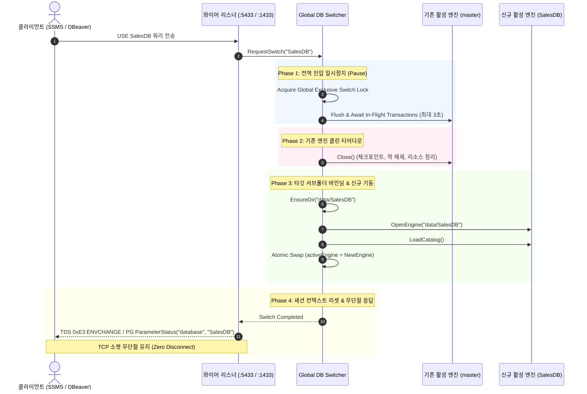

# LionSQL In-Process Graceful Reboot 기반 물리 서브폴더 `USE <dbname>` 전환 아키텍처 설계 초안 (`notes/IN_PROCESS_REBOOT_MULTI_DATABASE_PLAN.ko.md`)

> - **최초 작성일**: 2026-11-07
> - **문서 성격**: 1.0 이후(Post-1.0) 차기 아키텍처 연구 및 아이디어 인큐베이션 설계 초안 (Research & Draft Architecture)
> - **과제 식별 코드**: `RESEARCH-INPROCESS-REBOOT-USE`
> - **핵심 철학**: `[RULE:RadicalKISS]`, `[RULE:CleanTeardown]`, Invariant 2 (Single-Catalog per Process Primacy)

---

## 1. 배경 및 문제의식 (Context & Motivation)

### 1.1 현행 1.0의 한계: Tolerant No-Op `USE <dbname>`
- LionSQL 1.0에서는 프로세스당 단 1개의 데이터 디렉터리(`--data-dir`)만 관리하는 **"인스턴스 기반 데이터베이스 격리 (Invariant 2)"**를 채택하고 있습니다.
- SSMS, DBeaver, 마이그레이션 도구와의 호환성을 위해 `USE <dbname>` 구문은 문법 오류 없이 통과하는 **관용적 가상 No-Op (Tolerant Virtual No-Op)**으로 처리되며, 실제 물리 스토리지가 전환되지는 않습니다.
- **아쉬운 점**: 클라이언트가 실제로 여러 개의 데이터베이스(예: `SalesDB`, `InventoryDB`)를 생성하고 전환하며 사용하는 전통적인 T-SQL 워크플로를 온전히 체감하기 어렵고, DB마다 프로세스를 별도로 띄워야 하는 운영 부담이 있습니다.

### 1.2 배제된 대안: 동시 멀티 엔진 멀티테넌시(Multi-Engine Multi-Tenancy)의 문제점
- 프로세스 내부에서 여러 DB 엔진 인스턴스를 동시에 상시 기동하고 세션별로 매핑하는 전통적 멀티테넌시 방식은:
  - WiredTiger 캐시 메모리 $N$배 낭비
  - 파일 디스크립터 및 백그라운드 워커 스레드 폭증
  - 복잡한 크로스 DB 잠금 경합 및 자원 간섭(Noisy Neighbor) 유발
- 이는 단일 바이너리 극강의 단순성과 100만 tpmC 초격차 OLTP 성능을 추구하는 LionSQL의 핵심 철학과 정면 배치됩니다.

---

## 2. 제안 아키텍처: In-Process Graceful Reboot & 서브폴더 물리 격리

> **"프로세스는 언제나 단 1개의 활성 DB만 서비스하되, `USE <dbname>` 명령 수신 시 프로세스 전체가 안전하게 해당 서브폴더로 리부팅(In-Process Graceful Reboot)하여 물리 스토리지를 스위칭한다."**

### 2.1 물리 디렉터리 구조 (Subdirectory Layout)
루트 데이터 디렉터리(`--dir` 또는 `LIONSQL_DATA_DIR`) 하위에 데이터베이스 이름별 서브폴더를 자동으로 구성합니다:

```
data/ (루트 데이터 디렉터리)
├── master/             <-- 기본 부팅 활성 DB (Default)
│   ├── wt_data/        (WiredTiger B+Tree & MVCC)
│   ├── wal/            (AOF/WAL 커밋 로그)
│   └── snapshot.rdb    (인메모리 OCC 스냅샷)
├── SalesDB/            <-- USE SalesDB 실행 시 스위칭
│   ├── wt_data/
│   └── wal/
└── AnalyticsDB/        <-- USE AnalyticsDB 실행 시 스위칭
    ├── wt_data/
    └── wal/
```

### 2.2 In-Process Reboot 동작 시퀀스



---

## 3. 핵심 설계 장점

1. **메모리 폭증 완전 제로 (Zero Memory Bloat)**:
   - 물리 DB가 100개 존재하더라도, 메모리에는 **오직 현재 활성화된 단 1개 DB의 캐시와 카탈로그만 상주**합니다.
2. **완벽한 물리적 격리 (True Physical Isolation)**:
   - 파일이 물리적으로 서로 다른 서브폴더에 저장되므로, 특정 DB를 통째로 백업하거나 tar 압축, 마운트 이동, 삭제하는 작업이 디렉터리 수준에서 극도로 깔끔합니다.
3. **TCP 소켓 무단절 (Zero Disconnect)**:
   - OS 프로세스 자체를 죽이고 다시 띄우는 것이 아니라 메모리 내부에서 스토리지 엔진만 리로드하므로, SSMS/DBeaver의 연결이 끊어지지 않고 T-SQL 표준 경험을 완벽히 제공합니다.

---

## 4. 미해결 과제 및 추가 연구/인큐베이션 포인트 (Future Research Questions)

본 설계는 Post-1.0 초안이므로, 실무 구현 전 아래의 심층 엣지 케이스와 동작 정책에 대한 아이디어 발전이 필요합니다:

### 과제 1: 동시 다중 세션 환경에서의 스위칭 충돌 정책
- **문제**: 세션 1이 `USE SalesDB`를 수행할 때, 다른 세션들이 서버에 연결되어 있는 경우의 처리 정책.
- **연구 및 결정 옵션**:
  - **옵션 D (Strict Single-Active-Session Guard - 채택 권장 표준)**:
    - 서버에 요청 세션 외에 **다른 활성 세션이 단 하나라도 존재(`ActiveSessions > 1`)하면 즉각 에러(`SQLSTATE 55006: object_in_use`)를 반환**하며 전환을 명시적으로 거부.
    - 에러 메시지: `Cannot switch database context: %d other active sessions exist. Disconnect other sessions to switch database.`
    - **장점**: 타인의 발밑에서 스토리지가 바뀌는 사일런트 데이터 오염 및 깜짝 동작을 원천 차단하며, 타임아웃이나 세션 강제 축출 같은 취약한 비동기 복잡도가 전혀 없음 (`[RULE:RadicalKISS]`, `[RULE:ExplicitError]`).
  - **옵션 A (Graceful Wait & Timeout)**: 타임아웃 $T$초 대기 (복잡도 증가로 비권장).
  - **옵션 B (Force Abort & Session Reset)**: 다른 세션 강제 축출 (데이터 유실 위험으로 비권장).

### 과제 2: 카탈로그 캐시 및 프리페어드 스테이트먼트(Prepared Statement) 정리
- DB가 스위칭되면 이전 DB의 스키마에 맞춰 컴파일된 VDBE 바이트코드 캐시 및 PGWire Prepared Statement 캐시를 안전하게 원자적으로 무효화(`InvalidateAllPreparedStatements`)하는 메커니즘 정립 필요.

### 과제 3: `CREATE DATABASE` / `DROP DATABASE` DDL과의 물리 연동
- `CREATE DATABASE Foo` 실행 시 단순히 카탈로그 레코드를 추가하는 것이 아니라, `data/Foo/` 디렉터리를 생성하고 기본 시스템 카탈로그 템플릿을 프로비저닝하는 물리 DDL과의 일관성 확보.

---

## 5. 결론 및 향후 추진 로드맵

- 본 과제는 1.0 출시 이후(Post-1.0), 상기 연구 과제들이 완벽하게 검증된 후 정식 구현 마일스톤으로 편입합니다.
- 1.0 프로덕션 릴리스에서는 현행 **Tolerant Virtual No-Op**으로 안정성을 100% 수호하며, P0 결함 완치에 모든 엔지니어링 역량을 집중합니다.
