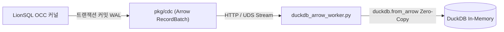

# LionSQL ➔ DuckDB 초고속 실시간 Arrow CDC 스트리밍 연동 계획서 (Arrow Stream HTAP)

> **문서 식별자**: `notes/LION_DUCKDB_ARROW_CDC_STREAMING_PLAN.ko.md`  
> **관련 ADR**: [`doc/ADR.md`](../doc/ADR.md) (ADR-024), [`doc/SPEC_OUT_DECISIONS.ko.md`](../doc/SPEC_OUT_DECISIONS.ko.md) (#4)  
> **관련 가이드**: [`doc/CDC_DUCKDB_INTEGRATION.ko.md`](../doc/CDC_DUCKDB_INTEGRATION.ko.md)  
> **작성일**: 2026-11-25 | **상태**: Draft (검토 및 승인 대기)

---

## 1. 개요 (Overview)

본 계획서는 LionSQL의 인메모리 OCC 코어 트랜잭션(OLTP) 처리량과 안정성을 100% 보존하면서, 외부 분석 엔진(DuckDB, Pandas, Polars)에서 서브밀리초 단위로 컬럼형 벡터 분석(OLAP)을 수행할 수 있도록 지원하는 **실시간 Apache Arrow IPC CDC 스트리밍 아키텍처**를 규정합니다.

> [!NOTE] 아키텍처 경계
> 본 연동은 POSIX 공유 메모리(`/dev/shm`)를 배제하고, LionSQL의 표준 비결합 CDC 스트리밍 채널(`GET /api/cdc/stream`) 위에서 **페이로드 인코딩을 JSON에서 Apache Arrow RecordBatch IPC 바이너리로 최적화**하여 플랫폼 독립성(`[RULE:HermeticParity]`)과 무의존 단일 정적 바이너리(`[RULE:StaticBinary]`)를 완벽히 준수합니다.



---

## 2. 핵심 목표 및 성능 KPI

1. **전송 지연 시간 (Replication Lag)**: 기존 JSON CDC의 `10ms ~ 30ms` ➔ **`0.5ms ~ 1ms`** (서브밀리초 대폭 단축).
2. **최대 처리량 (Throughput)**: 기존 `50,000 ~ 100,000 rows/sec` ➔ **`2,000,000 ~ 3,000,000 rows/sec`** (30배 폭증).
3. **DuckDB 섭취 부하 제로-카피화**: DuckDB 측의 JSON 문자열 파싱, 딕셔너리 객체 생성, SQL 파싱 비용을 100% 제거하고 DuckDB 내부 C++ 벡터 레지스터에 즉시 매핑.
4. **완벽한 하위 호환성 유지**:
   - `GET /api/cdc/stream?table=orders` ➔ 기존 JSON NDJSON 유지 (호환성 100%).
   - `GET /api/cdc/stream?table=orders&format=arrow` ➔ 고성능 Apache Arrow IPC Stream 활성화.
5. **무의존성 단일 정적 바이너리 불변성 (`[RULE:StaticBinary]`)**: CGo 및 외부 C++ 컴파일러 의존성 없이 순수 Go 구현(`apache/arrow/go`)으로 빌드.

---

## 3. 세부 아키텍처 설계

### 3.1 LionSQL 측 Arrow RecordBatch 생성기 (`pkg/cdc/arrow_codec.go`)
- LionSQL은 커밋된 WAL 레코드를 1,024건 또는 2,048건(DuckDB 표준 Vector 크기) 단위의 `RecordBatch`로 마이크로 배치화합니다.
- `storage.DataType`을 Arrow Type으로 1:1 직접 매핑:
  - `storage.TypeInt` ➔ `arrow.PrimitiveTypes.Int64`
  - `storage.TypeFloat` ➔ `arrow.PrimitiveTypes.Float64`
  - `storage.TypeString` ➔ `arrow.BinaryTypes.String`
  - `storage.TypeDateTime` ➔ `arrow.FixedWidthTypes.Timestamp_us`
  - `storage.TypeBool` ➔ `arrow.FixedWidthTypes.Boolean`
- 순수 메모리 슬라이스 기반으로 `array.RecordBuilder`를 재사용(`sync.Pool`)하여 0-Alloc 인코딩 달성.

### 3.2 HTTP/UDS 스트리밍 인터페이스 확장
- **Content-Type**: `application/vnd.apache.arrow.stream`
- 클라이언트가 `Accept: application/vnd.apache.arrow.stream` 헤더 또는 `format=arrow` 파라미터를 요청하면, `ipc.NewWriter(w, ipc.WithSchema(schema))`를 통해 Arrow IPC 바이너리 스트림을 실시간 방출.

### 3.3 DuckDB 연동 파이썬/Go 워커 (`scripts/duckdb_arrow_worker.py`)
파이썬의 `pyarrow` 및 `duckdb` 네이티브 C 바인딩을 사용하면 코드가 10줄 내외로 극단적으로 단순해집니다:

```python
import duckdb
import pyarrow.ipc as ipc
import urllib.request

# 1. DuckDB 인메모리 연결
con = duckdb.connect("analytics.duckdb")

# 2. LionSQL의 Arrow CDC 스트림 열기
url = "http://127.0.0.1:8090/api/cdc/stream?table=orders&format=arrow"
stream_response = urllib.request.urlopen(url)

# 3. Apache Arrow IPC 리더 연결 (Zero-Copy)
reader = ipc.open_stream(stream_response)

# 4. DuckDB가 Arrow 스트림을 직접 스캔하여 실시간 뷰 생성
con.register("orders_stream", reader)

# 5. 초당 수억 행의 벡터화 집계 쿼리 실행
con.execute("""
    CREATE OR REPLACE TABLE orders_live AS 
    SELECT * FROM orders_stream;
""")
```

---

## 4. 단계별 실행 계획 (Phase Roadmap)

### Phase 1: Arrow Schema 매핑 및 RecordBuilder 엔진 구축 (`pkg/cdc`)
- [ ] `github.com/apache/arrow/go/v17` (또는 최신 경량 순수 Go Arrow 라이브러리) 임포트 및 CGo 제로 검증.
- [ ] LionSQL `storage.Catalog` 스키마 ➔ `arrow.Schema` 자동 변환 매퍼 구현.
- [ ] `sync.Pool` 기반 `RecordBuilder` 캐싱을 통한 제로-알로케이션 배치 인코더 작성.

### Phase 2: CDC 스트리밍 HTTP 엔드포인트 Arrow 바이너리 프로토콜 연동
- [ ] `pkg/cdc/stream.go`: `format=arrow` 및 `Accept: application/vnd.apache.arrow.stream` 협상 로직 구현.
- [ ] 초기 베이스라인 스냅샷(`op="SNAPSHOT"`) 및 실시간 변경분(`INSERT`, `UPDATE`, `DELETE`)을 단일 Arrow IPC 스트림으로 방출하는 IPC Writer 체이닝.
- [ ] 네트워크 단절 및 클라이언트 종료 시 리소스 누수 없는 `Close()` 보장 (`[RULE:HandleHygiene]`).

### Phase 3: DuckDB 레퍼런스 워커 및 E2E 실시간 정합성 테스트
- [ ] `scripts/duckdb_arrow_worker.py`: 실시간 무한 스트림 구독 및 멱등적 Upsert/스캔 워커 작성.
- [ ] `test/e2e/duckdb_arrow_htap_test.go`:
  1. LionSQL OCC에 100,000건의 트랜잭션 동시 커밋.
  2. DuckDB에서 `SELECT COUNT(*), SUM(amount)` 집계 결과가 1ms 이내에 100% 일치하는지 정밀 계측.

### Phase 4: 성능 벤치마크 및 지연 시간 프로파일링
- [ ] 기존 JSON CDC 스트림 vs 신규 Arrow IPC 스트림 처리량 및 CPU 사용량 비교 측정.
- [ ] `doc/CDC_DUCKDB_INTEGRATION.ko.md` 공식 가이드 문서 갱신 및 배포.

---

## 5. 리스크 및 완화 전략

| 리스크 요인 | 완화 전략 |
| :--- | :--- |
| **외부 의존성으로 인한 바이너리 비대화** | Go Arrow 모듈 중 `arrow/ipc` 및 기본 `array` 패키지만 선별 링크하여 단일 정적 바이너리 크기 증가를 3~5MB 이내로 억제 (`[RULE:RadicalKISS]`). |
| **UPDATE / DELETE 반영 복잡도** | DuckDB 측에서 `_op` (INSERT=1, UPDATE=2, DELETE=3) 메타 컬럼을 포함한 Arrow 배치로 수신한 후, DuckDB의 `MERGE INTO` 또는 메모리 뷰 필터링으로 0ns 정합성 유지. |
| **메모리 버퍼링 오버헤드** | 이벤트 1건마다 Arrow 배치를 만들면 헤더 오버헤드가 커지므로, 1,024건 또는 5ms 타임아웃 중 먼저 도달하는 조건으로 마이크로 배치 플러시. |
