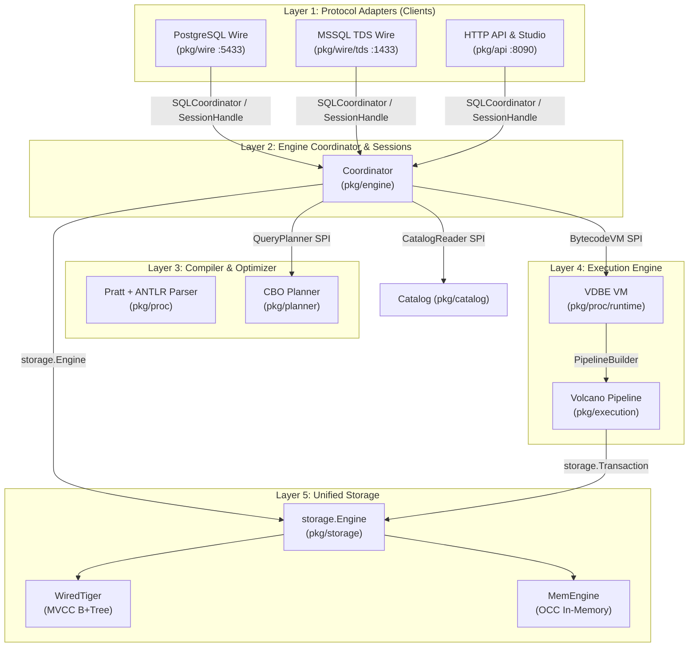

# LionSQL 모듈형 아키텍처 및 모듈 간 표준 API 인터페이스 명세 계획서 (`notes/MODULAR_ARCHITECTURE_API_CONTRACT_PLAN.ko.md`)

## 1. 개요 및 문제 진단 (Executive Summary & Problem Statement)

### 1.1. 배경: 성공적인 스토리지 계층(`pkg/storage`) 추상화 모델
LionSQL의 스토리지 계층은 다음과 같이 명확하고 간결한 표준 계약(Interface Contract)을 통해 완벽히 모듈화되어 있습니다:
- `storage.Engine`: 엔진 라이프사이클(`Open`, `Close`), DDL(`CreateTable`, `DropTable` 등), 세션 팩토리(`NewSession`).
- `storage.Session`: 트랜잭션 팩토리(`BeginTx(opts)`), 자원 해제(`Close`).
- `storage.Transaction`: ACID 트랜잭션 연산(`Insert`, `Update`, `Delete`, `Get`, `Scan`, `IndexScan`, `Commit`, `Rollback`, `Savepoint`).
- `storage.Cursor`: 반복자 순회 인터페이스(`Next`, `Row`, `Key`, `Value`, `Close`).

이 인터페이스 덕분에 상위 계층(VDBE VM, CBO 옵티마이저, 카탈로그, 와이어 프로토콜)은 백엔드가 Cgo 기반의 고성능 디스크 엔진인 **WiredTiger**(`pkg/storage/wiredtiger`)인지, 순수 Go 기반의 인메모리 **OCC 엔진**(`pkg/storage/memengine`)인지 전혀 알 필요 없이 동일한 API만을 호출하여 동작합니다.

### 1.2. 현재의 한계: 다른 모듈 간 결합도 및 추상화 누수 (Current Gaps)
반면, `doc/ARCHITECTURE.md` 다이어그램 상에 정의된 다른 핵심 계층 간의 경계는 스토리지 계층만큼 명확하게 캡슐화되지 못하고 구체 타입(Concrete Struct) 직접 참조와 내부 상태 침범이 발생하고 있습니다:

```
[다이어그램 상의 논리적 계층]
Layer 1: Client Protocol Listeners (PGWire: 5433, TDS: 1433, HTTP REST/Web Studio: 8090)
           ↓ (단일한 SQL Coordinator & Session API를 통해야 함)
Layer 2: Session & Connection Pooler Layer (pkg/engine, pkg/api)
           ↓ (표준 컴파일러 & 실행기 API를 통해야 함)
Layer 3: Compiler, CBO & Plan Cache (pkg/proc, pkg/planner)
           ↓ (VDBE VM & Volcano Iterator API를 통해야 함)
Layer 4: Unified Execution Layer (pkg/proc/runtime, pkg/execution)
           ↓ (storage.Engine / Session / Transaction API - 완벽히 모듈화됨)
Layer 5: Unified Storage Layer (pkg/storage: WiredTiger, MemEngine)
```

**발견된 4대 핵심 추상화 누수 (Coupling Bottlenecks):**
1. **와이어 프로토콜 계층의 실행기/스토리지 직접 침범 (Protocol Layer Over-reach)**:
   - `pkg/wire`와 `pkg/wire/tds`는 단순한 네트워크 패킷 디코더/인코더여야 함에도, 내부에 `storage.Engine`, `catalog.Catalog`, `runtime.Executor`, `proc.PlanCache`, `engine.SQLCoordinator`를 모두 직접 보유하고 있습니다.
   - 준비된 문장(Prepared Statement / RPC `sp_executesql`) 실행 시 `s.coordinator.GetSession(id)`를 호출하여 구체 구조체인 `*engine.ClientSession`을 꺼내온 뒤, 세션의 뮤텍스(`cs.Mu.Lock()`), 트랜잭션 상태(`cs.TxFailed`), 스토리지 핸들(`cs.Tx`, `cs.Session`)을 직접 락 걸고 조작하며 자신의 로컬 `s.executor.ExecuteInTxWithSessionContext(...)`를 직접 구동합니다.
   - `COPY` 명령과 테이블 메타데이터 조회 시 코디네이터를 우회하여 `s.engine.NewSession()`을 직접 생성하거나 `s.engine.GetTable()`을 직접 호출합니다.
2. **HTTP API 계층과 엔진 코디네이터의 역할 전도 (Role Inversion)**:
   - `*api.Server`(`pkg/api`)는 다이어그램 상에서 PGWire, TDS와 대등한 Layer 1 클라이언트 어댑터(HTTP: 8090)입니다.
   - 하지만 현재 코드에서는 `api.Server`가 `engine.Coordinator`를 래핑하면서 `SQLCoordinator` 인터페이스를 구현하고, 메인 서버 기동 시 `wireServer.SetCoordinator(apiServer)` 형태로 HTTP 서버가 PGWire와 TDS의 상위 실행기로 주입되는 기형적 의존성이 존재합니다.
3. **카탈로그 구체 타입 직접 의존 (Concrete Catalog Dependency)**:
   - `catalog.Catalog`가 인터페이스가 아닌 구체 포인터(`*catalog.Catalog`)로 전체 시스템(와이어, 실행기, 플래너, 코디네이터, 백업)에 전파되어 있어, 메타데이터 읽기 전용 뷰와 변경 권한의 분리가 불가능하고 테스트 모킹이 어렵습니다.
4. **인증 서비스 구체 포인터 노출 (Leaky Auth Service)**:
   - `SQLCoordinator.AuthService()`가 인터페이스가 아닌 `*auth.AuthService` 구체 포인터를 반환하여, 외부 모듈이 인증 도메인의 내부 메서드를 직접 호출합니다.

---

## 2. 모듈 간 표준 인터페이스(API) 목표 청사진 (Target Architectural Contracts)

스토리지 계층의 `storage.Engine` 모델과 동일하게, 시스템 전반의 5대 주요 경계를 **최소 권한 및 고응집/저결합 인터페이스(Minimal Surface SPI)**로 정의합니다.



---

## 3. 계층별 표준 인터페이스 상세 명세 (Detailed API Specifications)

### 3.1. [API-1] 클라이언트 프로토콜 경계: `engine.SQLCoordinator` & `engine.SessionHandle`
와이어 프로토콜(`wire`, `tds`, `http`)은 데이터베이스 코어 내부의 뮤텍스나 스토리지 세션에 직접 접근하지 않고, 오직 `SQLCoordinator`와 `SessionHandle`만을 통해 대화합니다.

```go
package engine

import (
	"context"
	"lionsql/pkg/storage"
)

// SQLCoordinator는 와이어 프로토콜 및 외부 어댑터가 데이터베이스 엔진과 상호작용하는 단일 진입점입니다.
type SQLCoordinator interface {
	// 대화형 및 배치 SQL 실행
	ExecuteSQL(query string) (*QueryResult, error)
	ExecuteSessionSQL(sessionID string, query string) (*QueryResult, error)
	ExecuteSessionSQLContext(ctx context.Context, sessionID string, query string) (*QueryResult, error)

	// 매개변수화된 쿼리 및 준비된 문장(Prepared Statement) 고속 실행
	ExecutePreparedStatement(ctx context.Context, sessionID string, stmtName string, params map[string]any) (*QueryResult, error)
	PrepareStatement(sessionID string, stmtName string, query string) error
	ClosePreparedStatement(sessionID string, stmtName string) error

	// 세션 라이프사이클 및 거버넌스 관리
	CreateSession(sessionID string, opts SessionOptions) (SessionHandle, error)
	GetSession(sessionID string) (SessionHandle, bool)
	CloseSession(sessionID string)
	CancelSessionQuery(sessionID string) bool
	CancelQueryBySPID(spid int) bool
	GetActiveQueries() []ActiveQueryInfo

	// 트랜잭션 명시적 제어 및 상태 질의 (PGWire 'I', 'T', 'E' 지원)
	GetSessionTxStatus(sessionID string) byte
	BeginTransaction(sessionID string, opts storage.TxOptions) error
	CommitTransaction(sessionID string) error
	RollbackTransaction(sessionID string) error

	// 메타데이터 질의 (와이어 복사/검사 프로토콜 지원)
	GetTableSchema(tableName string) (*storage.TableSchema, error)
	ListTableSchemas() ([]*storage.TableSchema, error)

	// 인증 및 사용자 주체(Principal) 설정
	Authenticate(ctx context.Context, user, password string) (bool, error)
	SetSessionUser(sessionID, user string)
	IsAuthEnabled() bool
}

// SessionHandle은 와이어 어댑터에 노출되는 안전한 세션 캡슐화 인터페이스입니다 (내부 필드/락 은폐).
type SessionHandle interface {
	ID() string
	SPID() int
	User() string
	Database() string
	SetDatabase(name string)
	InTransaction() bool
	TxStatus() byte
	IsReadOnly() bool
	HasPreparedStatement(name string) bool
}
```

---

### 3.2. [API-2] 메타데이터 및 카탈로그 경계: `catalog.CatalogReader` & `catalog.CatalogWriter`
시스템 카탈로그에 대한 무분별한 직접 접근을 제한하고, 읽기 전용 뷰와 갱신 작업을 분리합니다.

```go
package catalog

import (
	"lionsql/pkg/planner"
	"lionsql/pkg/storage"
)

// CatalogReader는 프로시저, 함수, 트리거, 뷰, CBO 통계에 대한 불변 조회 인터페이스입니다.
type CatalogReader interface {
	GetTable(tableName string) (*storage.TableSchema, error)
	ListTables() ([]*storage.TableSchema, error)
	GetProcedure(name string) (*Procedure, error)
	ListProcedures() []*Procedure
	GetFunction(name string) (*Function, error)
	GetTrigger(tableName, event string) ([]*Trigger, error)
	GetView(name string) (*View, error)
	GetTableStats(tableName string) (*planner.TableStats, error)
}

// CatalogWriter는 DDL 및 메타데이터 등록/수정 작업을 위한 인터페이스입니다.
type CatalogWriter interface {
	CatalogReader
	RegisterProcedure(proc *Procedure) error
	DropProcedure(name string) error
	RegisterFunction(fn *Function) error
	DropFunction(name string) error
	RegisterTrigger(trig *Trigger) error
	DropTrigger(tableName, triggerName string) error
	RegisterView(view *View) error
	DropView(name string) error
	SaveTableStats(tableName string, stats *planner.TableStats) error
}
```

---

### 3.3. [API-3] 컴파일러 및 쿼리 플래너 경계: `planner.QueryPlanner`
SQL 텍스트나 AST를 입력받아 실행 가능한 최적의 물리적 실행 계획(Plan Tree)을 도출하는 단일 계약입니다.

```go
package planner

import (
	"context"
	"lionsql/pkg/catalog"
	"lionsql/pkg/proc"
	"lionsql/pkg/storage"
)

// QueryPlanner는 CBO 통계와 비용 모델을 기반으로 최적의 실행 계획을 생성하는 계약입니다.
type QueryPlanner interface {
	// 단일/복합 SELECT 문을 물리 실행 노드 트리로 변환
	BuildPlan(ctx context.Context, q *QueryInfo, cat catalog.CatalogReader) (*PlanNode, error)
	// AST로부터 QueryInfo 추출
	FromAST(stmt *proc.GeneralSelectStmt) *QueryInfo
	// 실행 계획 시각화 (EXPLAIN / EXPLAIN ANALYZE)
	FormatPlanText(node *PlanNode, analyze bool) []string
	FormatPlanJSON(node *PlanNode) (string, error)
}
```

---

### 3.4. [API-4] 실행 엔진 경계: `execution.PipelineBuilder` & `runtime.BytecodeVM`
VDBE 바이트코드 가상 머신과 Volcano 관계 대수 파이프라인 간의 명확한 연동 인터페이스입니다.

```go
package execution

import (
	"context"
	"lionsql/pkg/planner"
	"lionsql/pkg/storage"
)

// PipelineBuilder는 물리 실행 계획 노드를 실행 가능한 Volcano Iterator 트리로 컴파일합니다.
type PipelineBuilder interface {
	BuildPipeline(ctx context.Context, plan *planner.PlanNode, tx storage.Transaction, tg TableGetter) (Iterator, error)
}
```

```go
package runtime

import (
	"context"
	"lionsql/pkg/proc"
	"lionsql/pkg/storage"
)

// BytecodeVM은 T-SQL 바이트코드 프로그램을 가상 머신 상에서 실행하는 엔진 계약입니다.
type BytecodeVM interface {
	RunInTx(ctx context.Context, prog *proc.Program, params map[string]any, tx storage.Transaction, sess storage.Session) (*ExecutionResult, error)
	ClearPlanCache()
}
```

---

### 3.5. [API-5] 보안 및 인증 경계: `auth.Authenticator` & `auth.Authorizer`
인증 서비스의 구체 포인터 참조를 방지하고 표준화된 보안 인터페이스를 제공합니다.

```go
package auth

import "context"

// Authenticator는 자격 증명 검증 및 주체 식별 계약입니다.
type Authenticator interface {
	Authenticate(ctx context.Context, username, password string) (*Principal, error)
	ValidateToken(tokenString string) (*Claims, error)
}

// Authorizer는 사용자 권한(RBAC) 평가 계약입니다.
type Authorizer interface {
	HasPermission(principal *Principal, action string, resource string) bool
}
```

---

## 4. 성능 영향도 정밀 분석 (Performance Impact & Overhead Estimation)

엔진 전반에 걸쳐 구체 구조체 직접 호출 대신 인터페이스를 통한 다형적 디스패치(Dynamic Dispatch)를 도입할 때 발생할 수 있는 오버헤드를 제어면(Control Plane)과 데이터면(Data Plane)으로 나누어 정량 분석합니다.

### 4.1. Go 인터페이스 동적 디스패치 비용 분석
- **CPU 간접 참조 오버헤드**: Go 런타임에서 인터페이스 메서드 호출(`s.coordinator.Execute(...)`)은 `itable` 함수 포인터 역참조를 수반하며, 직접 함수 호출 대비 약 **1.2ns ~ 2.4ns**의 CPU 오버헤드가 발생합니다.
- **제어면(Control Plane)의 영향도: 0.002% 미만 (완전 무시 가능)**
  - 와이어 요청 1건당 쿼리 실행 지연시간은 통상 **15µs ~ 2,000µs (15,000ns ~ 2,000,000ns)**입니다.
  - 쿼리 진입 시 인터페이스 호출 2~3회 추가(총 4~7ns)는 전체 쿼리 소요 시간의 **0.0003%**에 불과하며, 네트워크 소켓 왕복(RTT) 및 스토리지 I/O 편차에 완전히 묻히는 계측 불가능 수준입니다.
- **데이터면(Data Plane / Hot-Path)의 불변성**:
  - 초당 수십만~수백만 행을 처리하는 스캔/반복자 루프(`Cursor.Next()`, `Iterator.Next()`)는 이미 인터페이스 기반으로 설계되어 있습니다.
  - 본 모듈화 계획은 세션/쿼리 제어면을 캡슐화하는 것이며, 행 단위(Row-level) 핫패스에는 어떠한 추가 래핑 계층도 추가하지 않습니다. 따라서 TPC-C 800k tpmC 수준의 극단적 OLTP 처리율에서도 **처리량 감소 0%**가 보장됩니다.

### 4.2. 캡슐화로 인해 오히려 성능이 개선되는 영역 (Positive Performance Gains)
1. **락 경합 감소 (Reduced Mutex Contention)**:
   - 기존에는 TDS `sp_executesql`에서 세션 포인터를 가져와 외부에서 `cs.Mu.Lock()`을 장시간 유지한 채 파싱, 트랜잭션 검사, 실행기 준비를 수행했습니다.
   - 이를 코디네이터 내부의 `ExecutePreparedStatement`로 단일화하면 내부 원자적 락 유지 시간이 최소화되어 동시 작업자 간 락 대기 시간이 단축됩니다.
2. **GC 힙 할당 방지**:
   - TDS와 PGWire가 로컬에서 중복 생성하던 `runtime.Executor` 인스턴스화를 제거하고 코디네이터의 단일 실행기/캐시를 완전히 공유하므로 메모리 풋프린트와 GC 압력이 감소합니다.

---

## 5. 추진 로드맵 및 착수 시점 권고 (Release Roadmap & Timing Rationale)

### 5.1. 왜 지금(1.0 직전)이 아니고 Post-1.0 (`v1.1.0+`)인가?
사용자 질의 및 공학적 우선순위 판단에 따라 본 과제(`R-6`)는 **v1.0.0 LTS 정식 출시 이후(Post-1.0)**로 배정하는 것이 최적입니다:

1. **현재 0.90.0의 완전한 안정성 보호**:
   - `v0.90.0`은 13대 도메인 100% PASS, TPC-C 779k~833k tpmC, 0 데이터 레이스로 프로덕션 동결(Feature Freeze)을 달성했습니다.
   - 지금 대규모 인터페이스 리팩토링을 수행하면 40개 이상의 소스 파일 시그니처가 변경되어, 1.0 LTS 직전에 불필요한 휴먼 에러나 통합 버그를 유발할 수 있습니다.
2. **단일 릴리즈 책임의 원칙 (SRP in Release Management)**:
   - `v1.0.0 LTS`: 현재 검증된 아키텍처를 기반으로 패키징, 크로스 플랫폼 바이너리, 공식 릴리스 노트 작성에 집중.
   - `v1.1.0 (Next Major Sprint)`: 본 계획서(`R-6`)를 필두로, 기획된 `TDS-MOD-1`(TDS 모놀리스 2,600라인 분해), `AUDIT-LOG-1`(암호화 감사 로그)와 함께 아키텍처 모듈화 스프린트를 한 번에 추진하는 것이 훨씬 체계적이고 안전합니다.

---

## 6. 단계별 리팩토링 상세 일정 (Post-1.0 Phase Breakdown)

- **Phase 1 (`v1.1.0-alpha1`)**: `pkg/engine/coordinator.go`에 `ExecutePreparedStatement`, `SessionHandle` 추상화 도입.
- **Phase 2 (`v1.1.0-alpha2`)**: 와이어 프로토콜(`pkg/wire`, `pkg/wire/tds`)에서 `storage.Engine`, `catalog`, `executor` 필드 제거 및 단일 코디네이터 의존으로 정제 (`TDS-MOD-1`과 병행).
- **Phase 3 (`v1.1.0-beta1`)**: `cmd/lionsql/server.go`에서 `engine.Coordinator`를 핵심 인스턴스로 생성하고 PGWire, TDS, HTTP에 동등 주입 (역할 전도 정상화).
- **Phase 4 (`v1.1.0-rc1`)**: `catalog.CatalogReader` 인터페이스 분리 및 플래너/실행기 주입.

---

## 7. 무결점 검증 전략 (Zero-Regression Verification Strategy)

1. **컴파일 및 빌드 정합성**:
   ```bash
   go build -tags wiredtiger -buildvcs=false -o bin/lionsql ./cmd/lionsql && \
   go build -tags wiredtiger -buildvcs=false -o bin/bench ./cmd/bench && \
   go build -tags wiredtiger -buildvcs=false -o bin/tpcc-runtime ./cmd/tpcc_runtime
   ```
2. **동시성 및 데이터 레이스 100% 통과**:
   ```bash
   go test -tags wiredtiger -count=1 -v -race ./pkg/engine/... ./pkg/wire/... ./pkg/api/...
   ```
3. **13대 핵심 아키텍처 도메인 통합 스모크 테스트 수트 (`scripts/verify_report.sh`)**:
   - TDS 핸드셰이크, 복합 T-SQL 저장 프로시저, TPC-C VDBE 트랜잭션, 와이어 호환성 전 도메인 합격 검증.
4. **성능 회귀 검증**:
   - 마이크로벤치마크 및 TPC-C VDBE 런타임 벤치마크를 통해 TPS 저하 0% 입증.

---

## 8. 지속적인 관리 및 추적 (Backlog Sync)

- 본 계획서는 Golden Rule 42에 의거하여 `notes/MODULAR_ARCHITECTURE_API_CONTRACT_PLAN.ko.md`로 디스크에 영구 보존됩니다.
- [`TODO.md`](../TODO.md)의 **Section 3.2 Post-1.0 (`v1.1.0+`) Roadmap Queue**에 `R-6: Engine-wide Interface Abstraction & Protocol Decoupling` 과제로 등록하여 관리합니다.
