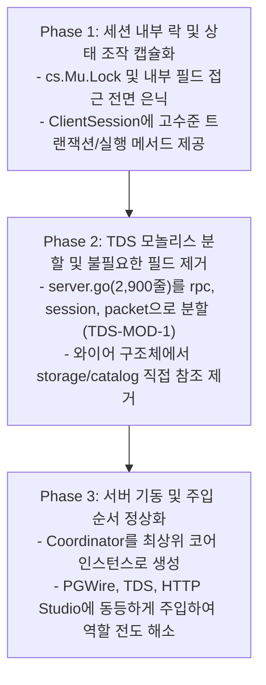

# LionSQL 모듈형 아키텍처 및 세션 캡슐화 린(Lean) 리팩토링 계획서 (`notes/MODULAR_ARCHITECTURE_API_CONTRACT_PLAN.ko.md`)

> - **최초 작성일**: 2026-10-25
> - **개정일**: 2026-10-31 (과도한 인터페이스 전면 제거 및 린 3단계 계획으로 현실화 개정)
> - **작업 식별자**: `R-6` (세션 캡슐화 및 의존성 디커플링), `TDS-MOD-1` (TDS 모놀리스 분할)
> - **기본 철학**: Golden Rule 15 (Radical KISS, DRY & Deletion-First / YAGNI 준수)

---

## 1. 개요 및 문제 진단 (Problem Statement)

### 1.1. 배경: 성공적인 스토리지 계층(`pkg/storage`) 추상화 모델
LionSQL의 스토리지 계층은 명확하고 간결한 표준 계약(Interface Contract)을 통해 모듈화되어 있습니다:
- `storage.Engine`: 엔진 라이프사이클(`Open`, `Close`), DDL, 세션 팩토리.
- `storage.Session` & `storage.Transaction`: ACID 트랜잭션 연산(`Insert`, `Update`, `Delete`, `Get`, `Scan`, `Commit`, `Rollback`).

이 추상화 덕분에 상위 계층은 백엔드가 Cgo 기반 디스크 엔진인 **WiredTiger**(`pkg/storage/wiredtiger`)인지, 순수 Go 인메모리 **OCC 엔진**(`pkg/storage/memengine`)인지 알 필요 없이 동일한 API로 동작합니다.

### 1.2. 해결해야 할 실질적인 결합도 문제 (The Real Problems)
반면, 네트워크 와이어 프로토콜과 엔진 코어 간에는 심각한 추상화 누수와 역할 전도가 존재합니다:

1. **와이어 프로토콜의 세션 내부 락 및 필드 직접 조작 (가장 심각한 문제)**:
   - `pkg/wire/server.go`와 `pkg/wire/tds/server.go`가 단순 네트워크 패킷 디코더여야 함에도, `ClientSession` 구조체의 내부 뮤텍스(`cs.Mu.Lock()`)를 직접 걸고 내부 필드(`cs.TxFailed`, `cs.Tx`, `cs.Session`)를 날것으로 조작합니다.
   - 준비된 문장(Prepared Statement)이나 트랜잭션 실행 시 와이어 계층이 직접 VDBE VM 실행기(`s.executor.ExecuteInTxWithSessionContext`)를 구동하고 에러 시 롤백을 제어하는 등, 세션 상태 관리가 코어에 캡슐화되지 않아 프로토콜마다 중복/불일치 코드가 산재합니다.
2. **와이어 프로토콜의 코어 객체 무분별 직접 참조 (TDS 모놀리스 비대화)**:
   - 와이어 계층이 `storage.Engine`, `catalog.Catalog`, `runtime.Executor`, `proc.PlanCache`를 전부 구조체 필드로 직접 들고 있어, `pkg/wire/tds/server.go`가 2,900라인을 초과하는 거대 모놀리스가 되었습니다.
3. **HTTP API 계층과 엔진 코디네이터의 역할 전도 (Role Inversion)**:
   - `api.Server`(`pkg/api`)는 PGWire, TDS와 대등한 Layer 1 클라이언트 어댑터(HTTP: 8090)임에도, 현재 코드에서는 `api.Server`가 `engine.Coordinator`를 래핑하여 PGWire와 TDS에 주입되는 기형적 의존성을 가집니다.

---

## 2. 과도한 추상화 배제 (Explicit Spec-Out / YAGNI)

본 리팩토링에서는 **구현체가 하나뿐인 불필요한 인터페이스 분리를 전면 배제(Spec-Out)**합니다:

| 항목 | 기각 사유 (YAGNI / Radical KISS) |
| :--- | :--- |
| **`CatalogReader` / `CatalogWriter` 인터페이스** | 구현체가 오직 `*catalog.Catalog` 하나뿐이며, 인터페이스 분리는 수십 개 파일의 불필요한 보일러플레이트만 유발합니다. |
| **`QueryPlanner` 인터페이스** | CBO 옵티마이저 구현체가 복수로 존재할 이유가 없으므로 구조체 직접 호출을 유지합니다. |
| **`PipelineBuilder` & `BytecodeVM` 인터페이스** | LionSQL은 2-Tier 쿼리 엔진(Tier 1 VDBE, Tier 2 Volcano)으로 영구 고정되어 있으므로 VM 플러그인 인터페이스는 불필요합니다. |
| **`Authenticator` / `Authorizer` 인터페이스** | 현재 `pkg/auth`는 단일 패키지로 간결하게 동작 중이므로 추가 인터페이스는 사족입니다. |

---

## 3. 린(Lean) 3단계 실천 계획 (Execution Roadmap)



### Phase 1. 세션 내부 락 및 상태 조작 캡슐화 (`R-6-P1`)
- **목표**: 와이어 계층(`pkg/wire`, `pkg/wire/tds`)에서 `cs.Mu.Lock()` 및 내부 트랜잭션/스토리지 필드 직접 접근을 100% 제거.
- **핵심 작업**:
  1. `ClientSession` 구조체에 고수준 캡슐화 메서드 정의:
     - `ExecutePreparedStatement(ctx, stmtName, params) (*QueryResult, error)`: 세션 내부에서 락을 잡고 준비된 문장 바이트코드 실행 및 트랜잭션 바인딩을 일원화 처리.
     - `BeginTx(opts)`, `CommitTx()`, `RollbackTx()`: 트랜잭션 상태 전환 및 `TxFailed` 플래그 관리를 세션 내부로 완전히 은닉.
     - `TxStatus() byte`: 트랜잭션 상태 질의(PostgreSQL 'I', 'T', 'E' 토큰 생성용).
  2. 와이어 프로토콜의 Prepared Statement 및 트랜잭션 경로를 세션 메서드 호출로 일원화.
- **효과**: 와이어 계층의 위험한 날것의 동시성 락 제어 제거, 프로토콜 간 트랜잭션 동작 일관성 보장.

### Phase 2. TDS 모놀리스 분할 및 와이어 의존성 정돈 (`TDS-MOD-1`)
- **목표**: `pkg/wire/tds/server.go` (2,900라인) 해체 및 불필요한 코어 구조체 참조 제거.
- **핵심 작업**:
  1. 와이어 서버 구조체에서 불필요하게 직접 들고 있던 `storage.Engine`, `catalog.Catalog`, `runtime.Executor`, `PlanCache` 필드 제거 ➔ `engine.SQLCoordinator` 단일 의존으로 통합.
  2. `server.go` 단일 파일을 4개의 명확한 역할별 파일로 분할:
     - `server.go`: 네트워크 리스너, 연결 수락, 메인 이벤트 루프
     - `session.go`: TDS 로그인 패킷 처리, 세션 라이프사이클 및 환경 변경(ENVCHANGE)
     - `rpc.go`: `sp_executesql`, `sp_prepare` 등 RPC 패킷 파싱 및 디스패치
     - `token_writer.go`: TDS 결과셋/행/컬럼 메타데이터 토큰 인코딩
- **효과**: 단일 파일 복잡도 극적 해소, 네트워크 계층과 DB 코어 계층의 명확한 경계 확립.

### Phase 3. 서버 기동 및 의존성 주입 정상화 (`R-6-P3`)
- **목표**: `api.Server`(HTTP)가 `Coordinator`를 감싸서 PGWire에 주입되던 기형적 의존성 제거.
- **핵심 작업**:
  1. `cmd/lionsql/server.go`에서 `engine.Coordinator`를 최상위 코어 인스턴스로 생성.
  2. 생성된 단일 코디네이터 인스턴스를 3대 어댑터에 대등하게 주입:
     - `pgServer.SetCoordinator(coordinator)`
     - `tdsServer.SetCoordinator(coordinator)`
     - `httpServer.SetCoordinator(coordinator)`
- **효과**: 아키텍처 다이어그램(`Layer 1 Protocol Adapters ➔ Layer 2 Coordinator`)과 실제 소스코드의 100% 일치.

---

## 4. 검증 및 안전망 전략 (Verification Strategy)

모든 단계의 리팩토링은 다음 파이프라인을 통과해야 합니다:
1. **컴파일 및 타입 무결성**:
   ```bash
   go build -tags wiredtiger -buildvcs=false -o bin/lionsql ./cmd/lionsql && \
   go build -tags wiredtiger -buildvcs=false -o bin/bench ./cmd/bench
   ```
2. **동시성 및 무경쟁(Race-Free) 검증**:
   ```bash
   go test -tags wiredtiger -count=1 -v -race ./pkg/engine/... ./pkg/wire/...
   ```
3. **프로토콜 호환성 회귀 검증**:
   - TDS 회귀 테스트 (`pkg/wire/tds/regression_test.go`)
   - PGWire 트랜잭션 테스트 (`pkg/wire/prep_tx_test.go`)
   - TPC-C 1:1 dual-protocol 벤치마크 처리율 유지 확인 (성능 저하 0%)
