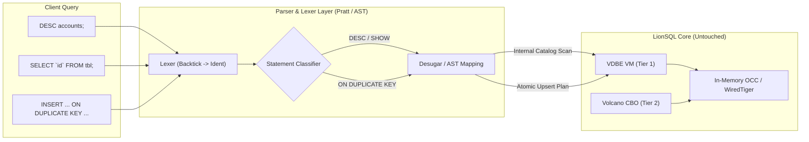

# LionSQL 개발자 경험(DX) 강화를 위한 단촐한 MySQL 스타일 편의 문법 호환성 플랜 (`notes/MYSQL_SYNTAX_ERGONOMICS_COMPATIBILITY_PLAN.ko.md`)

## 1. 개요 및 비전 (Executive Summary & Vision)

> **"코어 엔진은 고성능 T-SQL VDBE와 OCC로 달리되, 개발자 손끝은 MySQL처럼 단촐하고 직관적이어야 한다."**

Microsoft SQL Server(T-SQL)와 PostgreSQL은 엔터프라이즈 기능이 강력하지만, 일상적인 데이터베이스 탐색 및 DDL/DML 작성이 지나치게 장황하고 엄격합니다:
* 테이블 스키마 하나 보려고 수십 줄짜리 `INFORMATION_SCHEMA` 쿼리를 짜거나 복잡한 `sp_help` 그리드를 뒤져야 함.
* 실행 계획 하나 보려고 `SET SHOWPLAN_TEXT ON` 세션 옵션을 켜거나 수십 줄의 들여쓰기 텍스트 트리를 해석해야 함.
* 단순한 Upsert 하나 하려고 8줄짜리 `MERGE INTO ... USING ... WHEN MATCHED ...` 보일러플레이트를 작성해야 함.

본 플랜은 LionSQL의 핵심인 **초고속 무락 OCC/WiredTiger 엔진과 T-SQL 프로시저 런타임을 100% 온전히 유지하면서**, 개발자의 일상적인 생산성과 근육 기억(Muscle Memory)을 극대화하는 **MySQL 스타일의 단촐한(Concise) 편의 문법 Best 6**를 가볍게 수용하는 아키텍처를 정의합니다.

---

## 2. 도입 대상 MySQL 스타일 6대 편의 문법 명세 (Core Specifications)

### 2.1. 단촐한 8컬럼 그리드 `EXPLAIN` (Tabular Execution Plan)
* **기존 T-SQL / PG의 한계**:
  * T-SQL은 세션 플래그(`SET SHOWPLAN_TEXT ON`)를 켜야 하고, PostgreSQL은 수십 줄의 텍스트 트리가 쏟아져 그리드 GUI에서 가독성이 떨어짐.
* **MySQL 스타일 스펙**:
  ```sql
  EXPLAIN SELECT * FROM orders WHERE customer_id = 100 ORDER BY order_date DESC;
  ```
  * 깔끔한 단일 테이블 결과셋 반환:
    | id | select_type | table | type | possible_keys | key | rows | Extra |
    | :---: | :---: | :---: | :---: | :---: | :---: | :---: | :--- |
    | 1 | SIMPLE | orders | ref | idx_cust, idx_date | idx_cust | 15 | Using where; Using filesort |
* **효과**: Web Studio, DBeaver, VS Code 등 모든 SQL 클라이언트의 테이블 뷰에서 쿼리 플랜을 1초 만에 직관적으로 파악.

### 2.2. 단촐한 스키마 조회: `DESC` / `DESCRIBE <table>`
* **기존의 한계**:
  * T-SQL `sp_help`는 너무 많은 결과셋(인덱스, 컬럼, 제약조건)을 동시 반환하여 CLI/스크립트에서 다루기 번거로움.
  * PostgreSQL `\d`는 psql 터미널 전용 메타 커맨드라 일반 API/GUI 도구에서 문법 에러 발생.
* **MySQL 스타일 스펙**:
  ```sql
  DESC accounts;
  -- 또는
  DESCRIBE accounts;
  ```
  * 표준 6컬럼 결과셋 반환:
    | Field | Type | Null | Key | Default | Extra |
    | :--- | :--- | :---: | :---: | :--- | :--- |
    | `id` | `INT` | NO | PRI | NULL | auto_increment |
    | `balance` | `FLOAT` | YES | | `0.0` | |

### 2.3. 직관적 카탈로그 탐색 & DDL 추출: `SHOW TABLES` & `SHOW CREATE TABLE`
* **MySQL 스타일 스펙**:
  ```sql
  SHOW TABLES;
  SHOW DATABASES;
  SHOW CREATE TABLE accounts;
  ```
  * `SHOW CREATE TABLE`은 해당 테이블을 즉시 재현할 수 있는 완전한 DDL 스크립트를 반환:
    | Table | Create Table |
    | :--- | :--- |
    | `accounts` | `CREATE TABLE accounts (id INT PRIMARY KEY, balance FLOAT DEFAULT 0.0);` |
* **효과**: 백업 검증, 마이그레이션 스크립트 추출, 사내 문서화 시 압도적 편의 제공.

### 2.4. 백틱(Backtick) 식별자 인용 (`` `column` ``)
* **문제점**: 웹 프레임워크(GORM, Prisma, TypeORM, MyBatis)나 오픈소스 블로그 예제 쿼리는 90% 이상 백틱(`` `table` ``)으로 감싸져 있어 복사-붙여넣기 시 T-SQL(`[...]`)이나 PG(`"..."`)에서 구문 에러 발생.
* **수용 스펙**:
  * 렉서(`pkg/proc/lexer.go`)에서 백틱(`` `...` ``)을 대괄호(`[...]`) 및 큰따옴표(`"..."`)와 완전히 동등한 식별자(Identifier) 토큰으로 투명하게 처리.

### 2.5. 단촐한 Upsert: `INSERT ... ON DUPLICATE KEY UPDATE`
* **기존 T-SQL의 악명 높은 `MERGE` 구문 (8줄)** 대비:
* **MySQL 스타일 스펙 (2줄)**:
  ```sql
  INSERT INTO page_views (page_id, count) VALUES ('home', 1)
  ON DUPLICATE KEY UPDATE count = count + 1;
  ```
* **동작 매핑**:
  * 기본키 또는 고유(Unique) 제약조건 충돌 발생 시, 에러를 내지 않고 `UPDATE` 절의 대입식을 원자적으로 실행.
  * 조회수 증가, 사용자 세션 갱신, 멱등(Idempotent) 이벤트 처리에 필수적.

### 2.6. 직관적 편의 스칼라 함수 알리아스
* `NOW()` ➔ `GETDATE()` 내부 자동 매핑
* `CURDATE()` ➔ `CAST(GETDATE() AS DATE)` 매핑
* `IFNULL(expr, alt)` ➔ `ISNULL(expr, alt)` 매핑

---

## 3. 무침습 아키텍처 원칙 (Zero-Cost Syntactic Sugar Invariant)



1. **스토리지 및 런타임 무침습 (Zero Intrusiveness)**:
   * 코어 스토리지 엔진(OCC, WiredTiger)과 VDBE VM의 바이트코드 구조는 단 1줄도 변경하지 않습니다.
   * 모든 MySQL 스타일 문법은 **파서(Lexer/Parser) 및 코디네이터 라우터 레벨에서 가벼운 AST 변환(Desugaring)**으로 처리됩니다.
2. **기존 T-SQL 및 PostgreSQL 호환성 불변**:
   * T-SQL의 `[dbo].[accounts]`, `GETDATE()`, `BEGIN TRAN` 등 기존 문법과 100% 공존하며 충돌하지 않습니다.
3. **오버헤드 0% (Zero Performance Overhead)**:
   * 백틱 인식은 단순 바이트 비교(`ch == '`'`) 1클럭 사이클이며, `DESC`나 `SHOW`는 가상 카탈로그(`pkg/catalog/virtual/`)의 가벼운 슬라이스 반환이므로 고빈도 OLTP 성능에 영향을 주지 않습니다.

---

## 4. 단계별 구현 로드맵 (Phased Roadmap)

### Phase 1: 개발자 체감 가성비 최상위 문법 (Quick-Wins)
1. **백틱 식별자 지원 (`pkg/proc/lexer.go`)**:
   * 렉서에 `ch == '`'` 분기 추가하여 대괄호/큰따옴표와 동일하게 토큰화.
2. **단촐한 함수 알리아스 (`pkg/proc/runtime/vm_dispatcher.go`)**:
   * 내장 함수 디스패처에 `NOW`, `CURDATE`, `IFNULL` 별칭 등록.
3. **`DESC` / `DESCRIBE` 및 `SHOW TABLES` 지원 (`pkg/engine/sqlexec.go`, `pkg/catalog/`)**:
   * `DESC <table>` 구문 인식 시 테이블 컬럼 메타데이터를 6컬럼 그리드로 즉시 반환.
   * `SHOW TABLES` 구문 인식 시 활성 테이블 목록 반환.

### Phase 2: 단촐한 테이블형 `EXPLAIN` 그리드 포맷
1. `EXPLAIN <query>` 기본 출력을 기존 텍스트 덤프 외에 MySQL 스타일 8컬럼 정형 테이블 구조(`id`, `select_type`, `table`, `type`, `key`, `rows`, `extra`)로 포맷팅하는 모드 도입.
2. Web Studio 및 GUI 도구에서 깔끔한 테이블 렌더링 검증.

### Phase 3: `INSERT ... ON DUPLICATE KEY UPDATE` 및 `SHOW CREATE TABLE`
1. `ParseDMLCommand`에 `ON DUPLICATE KEY UPDATE` 절 인식 및 원자적 Upsert VDBE 바이트코드 생성 연동.
2. `SHOW CREATE TABLE <table>` 호출 시 카탈로그의 컬럼/인덱스 메타데이터를 역어셈블하여 완전한 `CREATE TABLE (...)` 문자열 합성 반환.

---

## 5. 정량적 검증 기준 (Verification Criteria)

1. **문법 호환성 검증**:
   * `` SELECT `id`, `balance` FROM `accounts` WHERE `id` = 1 `` 구문이 구문 에러 없이 정상 실행됨을 검증.
   * `DESC accounts;` 실행 시 정확한 컬럼명, 타입, PK 여부가 반환됨을 검증.
   * `SELECT NOW(), IFNULL(NULL, 100);` 실행 시 정확한 일시 및 100이 반환됨을 검증.
2. **동시성 및 회귀 검증**:
   * 기존 T-SQL 프로시저 및 15초 TPC-C 벤치마크(104만 tpmC)에 0.00%의 성능 저하 및 무경합 유지.
   * `go test -tags wiredtiger -race -count=1 ./...` 100% 통과 (0 data races).

---

## 6. 결론: "단촐함이 곧 생산성이다"

MySQL 스타일 편의 문법은 LionSQL의 강력한 엔터프라이즈 코어 엔진을 전혀 더럽히지 않으면서, 일상적으로 데이터베이스를 조회하고 사용하는 개발자들에게 **"타이핑하기 가장 편하고 에러가 나지 않는 최상의 개발자 경험(DX)"**을 선사합니다.

본 계획서는 Golden Rule 42에 의거하여 영구 보존됩니다.
