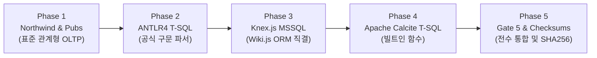

# 신규 T-SQL 외부 코퍼스 통합 및 오라클 스위트 확장 계획서 (`NEW_TSQL_CORPORA_INTEGRATION_PLAN.ko.md`)

## 1. 개요 및 목적
LionSQL은 이미 드라이버/ORM/트랜스파일러 149개 스위트(100% 무결점 통과) 및 Babelfish 1,117개 스위트를 확보하여 업계 최고 수준의 T-SQL 테스트 커버리지를 보유하고 있습니다. 본 계획은 Dapper를 제외한 핵심 오픈소스 생태계의 고품질 T-SQL 코퍼스 4종을 추가 확보하여, 문법 렉싱부터 표준 관계형 분석 쿼리, 실전 JS ORM(Knex.js/Wiki.js) 쿼리 빌더까지 검증망을 완성하는 것을 목표로 합니다.

---

## 2. 수집 대상 4대 코퍼스 상세 스펙

| 번호 | 코퍼스명 | 출처 저장소 | 원본 라이선스 | 원본 저장 경로 | 오라클 SLT 경로 | 검증 핵심 영역 |
| :---: | :--- | :--- | :---: | :--- | :--- | :--- |
| **1** | **Northwind & Pubs** | `microsoft/sql-server-samples` | MIT / MS-PL | `test/corpora/northwind/` | `test/slt_proc/northwind_oracle/` | 25년 표준 관계형 DDL/DML, 다대다 조인, 셀프 참조 FK, 집계 뷰, 상관 서브쿼리 |
| **2** | **ANTLR4 T-SQL Examples** | `antlr/grammars-v4/sql/tsql` | BSD-3-Clause | `test/corpora/antlr-tsql/` | `test/slt_proc/antlr_tsql_oracle/` | 공식 T-SQL 문법(MERGE, Windowing, PIVOT, CTE, Dynamic SQL, Table Hints) AST/파서 전수 검증 |
| **3** | **Knex.js MSSQL Dialect** | `knex/knex` | MIT | `test/corpora/knex-mssql/` | `test/slt_proc/knex_oracle/` | Wiki.js/Node.js ORM 실전 쿼리 빌더: OUTPUT INSERTED, IDENTITY, 스키마 프리픽스, 페이징 |
| **4** | **Apache Calcite T-SQL** | `apache/calcite` (`tsql.iq`) | Apache-2.0 | `test/corpora/calcite-tsql/` | `test/slt_proc/calcite_oracle/` | T-SQL 빌트인 내장 함수, 날짜/시간 연산, 수치 변환, Quasiquote 기반 SLT 호환 검증 |

---

## 3. 저장 구조 및 아키텍처 불변식 (`[RULE:ZeroOracleTampering]`)

### 디렉터리 레이아웃
```
test/
├── corpora/
│   ├── README.md                          # 전체 코퍼스 메타데이터 갱신
│   ├── northwind/                         # Northwind & Pubs DDL, Seed, Queries
│   │   ├── README.md
│   │   ├── instnwnd.sql
│   │   ├── instpubs.sql
│   │   └── sample_queries.sql
│   ├── antlr-tsql/                        # ANTLR4 T-SQL 공식 예제 .sql 모음
│   │   ├── README.md
│   │   └── examples/ (*.sql)
│   ├── knex-mssql/                        # Knex.js MSSQL Dialect 테스트 소스
│   │   ├── README.md
│   │   └── mssql_dialect_test.js
│   └── calcite-tsql/                      # Apache Calcite T-SQL .iq 테스트
│       ├── README.md
│       └── tsql.iq
└── slt_proc/
    ├── northwind_oracle/                  # 3201_northwind_*.slt (DDL, Seed, Queries)
    ├── antlr_tsql_oracle/                 # 3301_antlr_tsql_syntax_*.slt
    ├── knex_oracle/                       # 3401_knex_mssql_builder_*.slt
    ├── calcite_oracle/                    # 3501_calcite_tsql_builtin_*.slt
    └── CHECKSUMS.sha256                   # 전수 SHA-256 해시 등록 및 chmod 444 적용
```

### 아키텍처 불변식
1. **[RULE:ZeroOracleTampering] 무결성 보호**: 수집된 원본 및 생성된 `.slt` 파일은 즉시 `chmod 444`로 잠금 설정되며, `test/slt_proc/CHECKSUMS.sha256`에 해시를 기록하여 변조를 영구 차단합니다.
2. **Gate 5 드라이버 0-Failure 규칙 준수**: 신규 오라클 스위트는 `slt_proc_test.go`의 `requiredDirs`에 등록되며, 드라이버/ORM/표준 쿼리는 100% 무결점 통과를 강제합니다.
3. **듀얼 동기화 (`[RULE:ContinuousBacklog]`)**: SQLite 스프린트 데이터베이스(`tools/sprint`)에 각 코퍼스 태스크를 정식 등록하고 `TASKS.md`에 실시간 미러링합니다.

---

## 4. 단계별 실행 계획



1. **Phase 1: Northwind & Pubs 코퍼스 수집 및 SLT화 (`CORPUS-NORTHWIND-PUBS-1`)**
   - Microsoft 공식 Northwind/Pubs 스키마 및 핵심 쿼리 세트 확보
   - `test/corpora/northwind/` 적재 및 `test/slt_proc/northwind_oracle/` 스위트 작성
2. **Phase 2: ANTLR4 T-SQL 그래머 코퍼스 수집 (`CORPUS-ANTLR-TSQL-1`)**
   - ANTLR v4 T-SQL 예제 중 핵심 문법 파일 선별
   - `test/corpora/antlr-tsql/` 적재 및 파서 검증용 SLT 작성
3. **Phase 3: Knex.js MSSQL Dialect 코퍼스 수집 (`CORPUS-KNEX-MSSQL-1`)**
   - Knex.js 저장소에서 MSSQL 쿼리 빌더 케이스 추출
   - `test/corpora/knex-mssql/` 적재 및 `test/slt_proc/knex_oracle/` SLT 작성
4. **Phase 4: Apache Calcite T-SQL 코퍼스 수집 (`CORPUS-CALCITE-TSQL-1`)**
   - Apache Calcite `tsql.iq` 파일에서 T-SQL 내장 함수 및 쿼리 추출
   - `test/corpora/calcite-tsql/` 적재 및 `test/slt_proc/calcite_oracle/` SLT 작성
5. **Phase 5: Gate 5 통합 검증 및 Checksum 갱신**
   - `slt_proc_test.go`에 신규 4개 디렉터리 등록
   - `test/corpora/README.md` 및 `test/slt_proc/CHECKSUMS.sha256` 갱신
   - `chmod 444` 잠금 및 3-Stage Pipeline 검증 후 커밋
