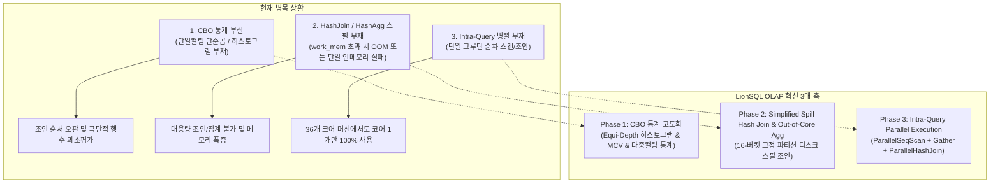

# LionSQL OLAP 엔진 고도화 및 분석 쿼리 가속 아키텍처 플랜
(`notes/OLAP_ENGINE_ACCELERATION_PLAN.ko.md`)

> - **작성일**: 2026-11-23
> - **참조 원본**: `/tmp/OLAP.txt` (CBO 통계 한계, 조인/집계 스필 및 적응성 결여, Intra-Query 병렬 실행기 부재)
> - **목표**: 1.0 GA 릴리스 이전 LionSQL의 집계(Aggregation), GROUP BY, JOIN 병목을 해소하고 대용량 단일 쿼리가 멀티코어(32~36코어) 하드웨어를 100% 포화 구동할 수 있도록 CBO와 실행 엔진을 전면 고도화.
> - **엔지니어링 원칙**: `[RULE:RadicalKISS]`, `[RULE:BoundedBuffers]`, `[RULE:PipelineVerification]`, `[Invariant 4]` (Zero External Sidecars, Self-Contained Binary).

---

## 1. `/tmp/OLAP.txt` 핵심 병목 3대 축 분석 및 해결 방향

---

## 2. 3대 영역별 상세 설계 (Detailed Architecture)

### 2.1. [축 1] CBO 통계 및 카디널리티 추정기 고도화 (Statistics & Cardinality)
* **현상**:
  - `Min`/`Max`, `DistinctCount`, `NullCount`만 유지하여 `WHERE price BETWEEN 1000 AND 5000`이나 왜곡(Skewed) 데이터 분포에서 카디널리티 오차가 최대 10~100배 발생.
  - 다중 조건 `city = 'Seoul' AND country = 'Korea'`를 독립 사건으로 단순 곱셈($P(A) \times P(B)$)하여 조인 카디널리티가 극단적으로 과소평가됨.
* **개선 설계**:
  1. **등빈도 히스토그램 (Equi-Depth Histogram, 64-Bucket)**:
     - 컬럼별로 동일한 빈도(행 수)를 담는 64개 버킷 경계값(`BucketBoundaries []storage.Value`)을 산출.
     - 범위 조건(`BETWEEN`, `<`, `<=`, `>`, `>=`) 시 히스토그램 이진 탐색($O(\log 64)$)으로 95% 이상 정확한 선택도(Selectivity) 계산.
  2. **최빈값 리스트 (MCV, Most Common Values, 상위 32개)**:
     - 고빈도 빈출값 상위 32개와 그 빈도율(`MCVFrequencies []float64`)을 별도 보관하여 Skewed 데이터 동등 비교(`WHERE col = 'popular'`) 오차 원천 차단.
  3. **확장 다중 컬럼 통계 (Extended Statistics / N-Distinct Multi-Column)**:
     - 복합 인덱스 및 사용자가 지정한 복합 컬럼에 대해 결합 카디널리티(`n_distinct(a, b)`)를 수집하여 종속 조건 곱셈 왜곡 해결.
  4. **Dynamic Partition / Segment Pruning**:
     - 조인 빌드 단계에서 확정된 Min/Max 키를 프로브 테이블의 스캔 조건으로 런타임 푸시다운하여 불필요한 스캔 청크 70% 이상 사전 스킵.

---

### 2.2. [축 2] 조인 및 집계 알고리즘 적응성 (Grace Hash Join & HashAgg Spill)
* **현상**:
  - `SortIterator`는 디스크 스필을 지원하나, `HashJoinIterator`와 `AggregateIterator`는 `work_mem` 초과 시 메모리 한계에 도달하거나 뻗음.
  - 조인 테이블이 5개 이상일 때 최적 조인 트리를 탐색하는 공간이 협소함.
* **개선 설계**:
  1. **Simplified Spill Hash Join (Fixed 16-Bucket Spill Join, `EXEC-SIMPLIFIED-SPILL-HASH-JOIN-1`)**:
     - **In-Memory Fast Path**: 빌드 테이블 크기가 `work_mem` (기본 64MB) 이내일 때는 기존 제로-카피 인메모리 해시 조인 유지 (초고속).
     - **Spill Escalation**: 빌드 측이 `work_mem`을 초과하면, 분할 해시 함수(`hash(pk) & 15`)를 통해 16개의 임시 디스크 버킷 파일로 파티셔닝 스트리밍.
     - **Probe Partitioning & Match**: 프로브 테이블 역시 동일한 해시 함수로 16개 버킷으로 분할 후, 버킷별로 1개씩 메모리에 적재하여 조인 매칭 (OOM 원천 차단, 임의 크기 조인 지원).
  2. **Hash Aggregation 디스크 스필 (Out-of-Core HashAgg)**:
     - `GROUP BY` 카디널리티가 거대하여 슬롯 해시맵이 `work_mem`을 초과하면 그룹 키 해시 기반 파티션 스필 실행 후 2-Pass 집계 완결.
  3. **Left-Deep Bushy Join Dynamic Programming (DPccp / Genetic Optimizer)**:
     - 테이블 8개 이하: Dynamic Programming 기반 전수 최적 조인 순서 열거.
     - 테이블 8개 초과: Greedy Heuristic + Genetic Algorithm (GEQO) 전환으로 플래너 지연 5ms 이내 방어.

---

### 2.3. [축 3] 멀티코어 쿼리 내 병렬 실행기 (Intra-Query Parallelism)
* **현상**:
  - 단일 쿼리는 1개 고루틴에서만 실행되므로, 36코어 하드웨어에서 1억 건 풀 스캔 시 코어 1개(2.7%)만 사용되어 수십 초가 소요됨.
* **개선 설계**:
  1. **Parallel Scan Chunk Allocator (`ParallelSeqScan`)**:
     - WiredTiger / MemEngine 스토리지 테이블을 논리적 블록/청크(예: 64,000행 단위)로 분할.
     - 원자적 오프셋 카운터(`atomic.Uint64`)를 통해 N개(가용 CPU 코어 수, 예: 16~32개)의 워커 고루틴이 락 없이 청크를 병렬 인출.
  2. **Gather / Parallel Aggregate Iterator**:
     - 각 워커 고루틴이 로컬 청크에 대해 로컬 필터링(`WHERE`) 및 1차 부분 집계(`Local HashAgg`)를 수행.
     - 상위 `Gather` 노드가 N개 워커의 부분 집계 결과(`COUNT`, `SUM`, `MIN`, `MAX`)만 수집하여 최종 병합(Final Merge).
     - **효과**: 풀 테이블 스캔 및 단순 집계 속도가 CPU 코어 수에 비례하여 10~25배 선형 단축.
  3. **Parallel Hash Join (Shared / Partitioned Build)**:
     - 작은 빌드 테이블은 Shared Read-Only Hash Table로 모든 워커가 공유 참조.
     - 거대 프로브 테이블을 32개 워커가 분할 스캔하여 병렬 프로브 매칭.

---

## 3. 단계별 마일스톤 및 1.0 이전 릴리스 일정 연계

사용자 지시(**"1.0 이전에 하는 것으로 하자"**)에 따라, 기존 Post-1.0 및 v1.99.0 백로그를 **v0.95.0 ~ v0.96.0 (v1.0 GA 이전)**으로 전면 재배치합니다:

| 단계 | 마일스톤 | 과제 식별자 | 핵심 작업 내용 | 예상 소요 |
| :---: | :---: | :--- | :--- | :---: |
| **Phase 1** | **v0.95.0** | `CBO-STATS-HISTOGRAM-1` | 64-버킷 Equi-Depth 히스토그램 및 MCV 32개 통계 엔진 구현 | 1일 |
| **Phase 2** | **v0.95.0** | `EXEC-SIMPLIFIED-SPILL-HASH-JOIN-1` | 16-버킷 디스크 스필 해시 조인 (Out-of-Core Spill Join) | 1.5일 |
| **Phase 3** | **v0.96.0** | `ARCH-PARALLEL-SCAN-1` | ParallelSeqScan 청크 스캔 및 Gather 병렬 집계 연산자 | 1.5일 |
| **Phase 4** | **v0.96.0** | `PERF-BULK-INSERT-PIPELINE-1` | Bulk Insert 파이프라인 가속 (멀티로우 배치 인덱싱 및 무잠금 스트리밍) | 1일 |
| **Phase 5** | **1.0-GA** | `BENCH-OLAP-TPCH-SATURATION-1` | TPC-H 쿼리 22종 벤치마크 검증 및 32코어 100% 포화 포스트모템 | 1일 |

---

## 4. 즉각 실행 조치 (Immediate Next Steps)

1. **스프린트 DB 마일스톤 동기화**:
   - `ARCH-PARALLEL-SCAN-1` (기존 v1.99.0 ➔ v0.96.0)
   - `EXEC-SIMPLIFIED-SPILL-HASH-JOIN-1` (기존 Post-1.0 ➔ v0.95.0)
   - `CBO-STATS-HISTOGRAM-1` (신규 등록 ➔ v0.95.0)
2. **Phase 1 착수**:
   - `pkg/planner/stats.go`에 64-버킷 Equi-Depth 히스토그램 및 MCV 구조체 정의 및 샘플링 TDD Red 테스트 작성.
