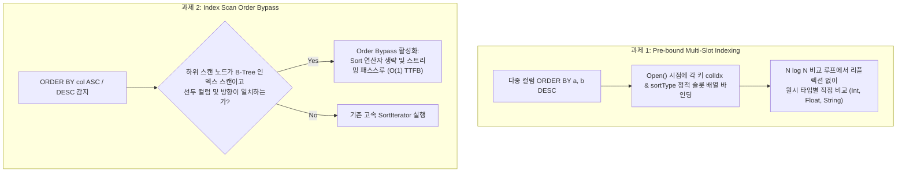

# ORDER BY 성능 가속 및 정렬 생략(Order Bypass) 아키텍처 설계서 (`notes/ORDER_BY_ACCELERATION_AND_BYPASS_PLAN.ko.md`)

> **문서 상태**: Approved  
> **관련 마일스톤**: `v0.96.0` (Performance Acceleration)  
> **관련 태스크**:  
> - `PERF-ORDER-BY-PREBOUND-MULTI-SLOT-1`  
> - `PERF-ORDER-BY-INDEX-SCAN-BYPASS-1`  
> **불변식 원칙**: `[RULE:PlanPersistence]`, `[RULE:ContinuousBacklog]`, `[RULE:RadicalKISS]`, `[RULE:ZeroAllocation]`, `[RULE:LatencyBudget]`

---

## 1. 개요 및 배경

LionSQL의 10-1 최적화(`PERF-SORT-PREBOUND-COMPARATOR-1`)를 통해 단일 정수형 컬럼(`ORDER BY int_col`)에 대한 사전 슬롯 바인딩과 원시 정수형 비교 Fast-Path가 성공적으로 안착되었다.

그러나 복합 정렬 쿼리 및 인덱스 활용 쿼리 관점에서 두 가지 중대한 추가 성능 개선 기회가 존재한다:
1. **다중 컬럼 복합 정렬(`ORDER BY col1, col2 DESC, col3`)의 리플렉션 오버헤드**:
   - 단일 정수 컬럼이 아닌 다중 컬럼 정렬이나 부동소수점, 문자열 컬럼의 경우, 여전히 `CompareValues(vA, vB)`의 동적 타입 리플렉션과 인터페이스 박싱 오버헤드가 $O(N \log N)$ 비교 루프마다 발생한다.
   - 각 정렬 키 슬롯의 물리 인덱스(`colIdx`)와 타입 태그(`sortType: TypeInt, TypeFloat, TypeVarChar`)를 배열로 사전 바인딩하여 무반사(reflection-free) 원시 디스패치를 수행해야 한다.
2. **인덱스 스캔 정렬 생략 (Order Bypass)**:
   - 쿼리에 `ORDER BY col ASC` 또는 `ORDER BY col DESC`가 포함되어 있을 때, 하위 스캔 노드가 B-Tree 인덱스 스캔(`IndexScan` / `IndexScanDesc`)으로 이미 동일한 순서의 행을 방출하고 있다면, 수만 건의 튜플을 메모리에 버퍼링하고 퀵소트하는 것은 100% 낭비이다.
   - 플래너/실행기 단에서 인덱스 순서와 정렬 순서의 일치성을 검증하여 `SortIterator`를 완전히 생략(Order Bypass)하면 정렬 비용이 $O(N \log N) \to 0$이 되며, 첫 번째 행 반환 시간(TTFB)이 서브-마이크로초 수준으로 단축된다.

---

## 2. 2대 과제 세부 아키텍처 설계



---

### 2.1 [과제 1] ORDER BY 다중 컬럼 정적 슬롯 인덱싱 및 원시 타입 직결 비교기 (`PERF-ORDER-BY-PREBOUND-MULTI-SLOT-1`)

#### 1) 문제 분석
- `pkg/execution/sort.go`의 다중 정렬 비교 루프:
  ```go
  for i := range s.items {
      item := &s.items[i]
      ...
      cmp := CompareValues(vA, vB) // runtime type switch 및 dynamic reflection
      if cmp != 0 {
          if item.descending { return -cmp }
          return cmp
      }
  }
  ```
- 단일 정수 컬럼이 아닌 복합 정렬(`ORDER BY a, b`)이나 `float64`, `string` 정렬 시 매 비교마다 `CompareValues`를 호출하여 수십만 번의 인터페이스 언박싱과 분기가 일어남.

#### 2) 아키텍처 개선
- `sortItem`에 원시 타입 분류기 도입:
  ```go
  type sortType uint8
  const (
      sortTypeUnknown sortType = iota
      sortTypeInt
      sortTypeFloat
      sortTypeString
  )
  ```
- `Open()` 시점 첫 튜플 샘플링 또는 스키마 메타데이터로부터 각 슬롯의 `sortType`을 결정.
- `compareTuples` 루프 내에서 인라인 고속 비교:
  ```go
  switch item.sType {
  case sortTypeInt:
      // int64 직접 비교
  case sortTypeFloat:
      // float64 직접 비교
  case sortTypeString:
      // string 직접 비교
  default:
      cmp = CompareValues(vA, vB)
  }
  ```
- $O(N \log N)$ 다중 컬럼 정렬 시 리플렉션 호출 횟수 0회 달성.

---

### 2.2 [과제 2] B-Tree Index Scan 정렬 순서 일치 시 Sort 연산자 완전 생략 / Order Bypass (`PERF-ORDER-BY-INDEX-SCAN-BYPASS-1`)

#### 1) 문제 분석
- LionSQL의 B-Tree 엔진(`pkg/storage/memengine`, `pkg/storage/wiredtiger`)은 인덱스 키 순서대로 단조 증가(`IndexScan`) 또는 단조 감소(`IndexScanDesc`) 순서로 행을 스트리밍한다.
- 그러나 현재 플래너(`pkg/planner/planner.go`)는 `q.OrderBy`가 존재하면 하위 노드가 해당 인덱스 스캔인지 여부와 관계없이 항상 무조건 `NodeSort`를 상위에 추가한다.
- 10만 건의 인덱스 검색 결과가 이미 오름차순으로 정렬되어 있어도, 전체를 다시 배열에 모아 퀵소트하는 불필요한 지연이 발생함.

#### 2) 아키텍처 개선
- **플래너 및 빌더 최적화 (`pkg/planner/planner.go`, `builder.go`)**:
  - `PlanQuery` 시 `q.OrderBy`의 선두 정렬 키 및 방향(ASC/DESC)을 추출.
  - 하위 노드가 `NodeIndexScan` 또는 `NodeIndexOnlyScan`이고, 인덱스의 선두 컬럼과 `q.OrderBy`의 선두 컬럼이 일치하며 정렬 방향이 스캔 방향과 일치하는 경우:
    - `NodeSort` 노드 생성을 생략하고 `currentNode`를 그대로 유지(Order Bypass).
    - 만약 `q.LimitCount > 0`이 존재하면, `NodeSort + NodeLimit` 대신 `NodeLimit`만 상위에 씌워 상위 $K$개만 즉시 스트리밍 종료(Early Exit).
- **실행기 안정성 검증**:
  - `SortIterator`에서도 `child`가 이미 정렬된 상태임을 명시적으로 통지받은 경우(`s.bypass = true`), `sortSlice` 및 버퍼링 없이 즉시 `child.NextChunk`로 패스스루 스트리밍.

---

## 3. 백로그 태스크 매핑

| 순서 | 태스크 ID | 도메인 | 마일스톤 | 우선순위 | 작업 내용 |
| :---: | :--- | :---: | :---: | :---: | :--- |
| 1 | **`PERF-ORDER-BY-PREBOUND-MULTI-SLOT-1`** | Execution | `v0.96.0` | P1 | Order By 다중 컬럼 정적 슬롯 인덱싱 및 원시 타입(Int, Float, String) 직결 비교기 구현 |
| 2 | **`PERF-ORDER-BY-INDEX-SCAN-BYPASS-1`** | Planner | `v0.96.0` | P1 | B-Tree Index Scan 정렬 순서 일치 시 Sort 연산자 완전 생략 / Order Bypass 구현 |

---

## 4. 완료 판정 기준 (Definition of Done)

1. **다중 정렬 벤치마크**:
   - `ORDER BY int_col, str_col` 실행 시 `CompareValues` 리플렉션 오버헤드 제거 및 정렬 레이턴시 30% 이상 개선.
2. **Order Bypass 벤치마크**:
   - 인덱스가 존재하는 컬럼에 대해 `ORDER BY index_col ASC LIMIT 10` 실행 시, 전체 테이블을 퀵소트하지 않고 인덱스 스캔에서 최초 10개만 읽고 즉시 완료 ($O(N \log N) \to O(1)$).
3. **3단계 파이프라인 무결성 검증 (`[RULE:PipelineVerification]`)**:
   - `go build -buildvcs=false -ldflags="-s -w" -o bin/lionsql ./cmd/lionsql` 빌드 통과.
   - `go test -v -race ./pkg/execution ./pkg/planner` 100% PASS (0 data race).
   - SQL 오라클 코퍼스 무변조 검증 통과.
