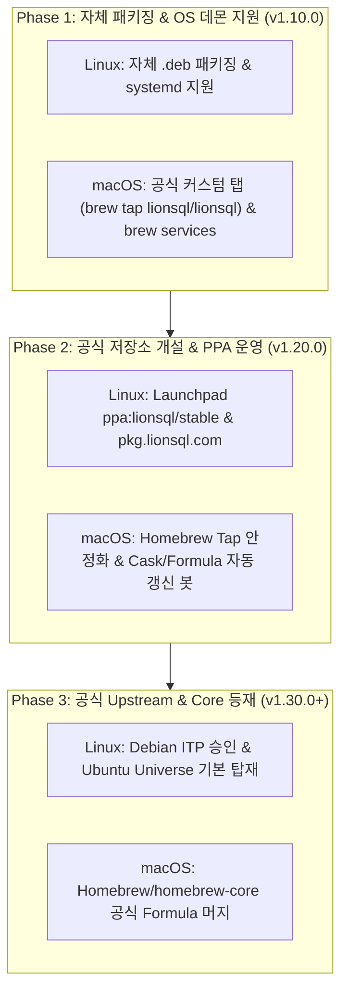
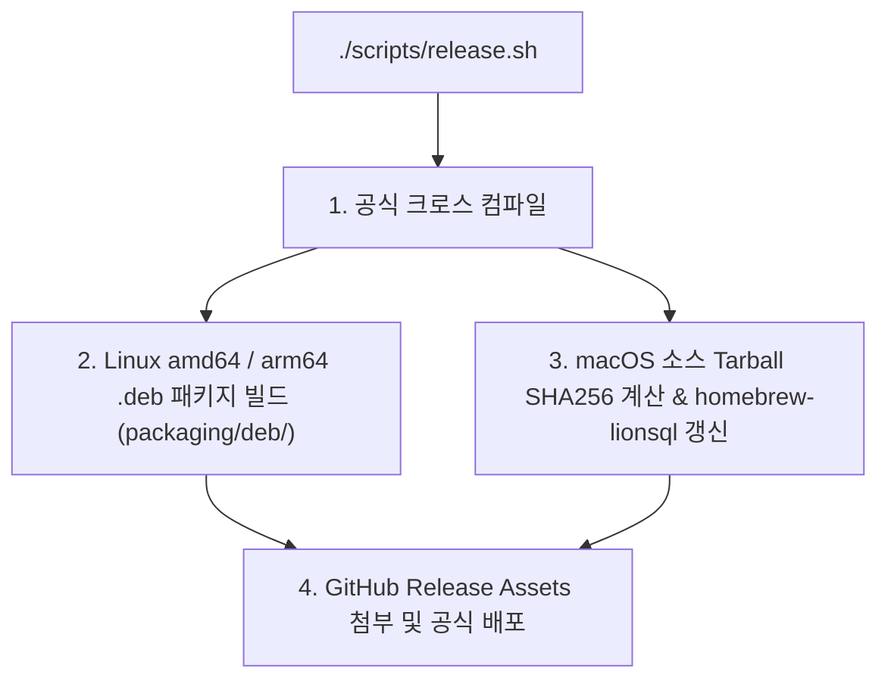

# LionSQL OS 네이티브 공식 패키징 및 배포 인프라 구축 계획서 (Plan)
(Debian, Ubuntu `.deb` & macOS Homebrew Formula)
`notes/OS_NATIVE_PACKAGING_AND_DISTRIBUTION_PLAN.ko.md`

> - **최초 작성일**: 2026-11-22
> - **목표 마일스톤**: `v1.10.0` (Phase 1) ➔ `v1.20.0` (Phase 2) ➔ `v1.30.0+` (Phase 3)
> - **문서 목적**: Linux(Debian/Ubuntu)와 macOS 생태계에서 LionSQL을 OS 표준 패키지 관리자(`apt`, `brew`)로 원클릭 설치하고, 백그라운드 상시 데몬(`systemd`, `launchd / brew services`)으로 안전하게 운영하며, 궁극적으로 데비안 공식 아카이브 및 Homebrew Core에 공식 등재하기 위한 통합 아키텍처 및 이행 계획을 정의합니다.
> - **연계 규칙**: `[RULE:PlanPersistence]`, `[RULE:CleanTeardown]`, `[RULE:PathSecurity]`, `[RULE:StaticBinary]`, `[RULE:HermeticParity]`

---

## 1. 개요 및 추진 배경 (Overview & Objectives)

LionSQL은 외부 데몬(Redis, PgBouncer, Nginx) 의존성이 전혀 없는 **단일 정적 바이너리(Single Standalone Binary)** 아키텍처를 갖추고 있습니다. 그러나 리눅스 서버와 맥북 개발 환경에서 엔터프라이즈 도입을 가속화하려면 단순 바이너리 다운로드를 넘어, **각 운영체제의 표준 패키지 관리자(`apt`, `brew`)와 시스템 데몬 관리자(`systemd`, `launchd`)에 완벽히 네이티브로 통합**되어야 합니다.

### 1.1 핵심 양대 축 (Two Distribution Pillars)
1. **Linux Pillar (Debian & Ubuntu)**:
   - FHS 표준 디렉토리 레이아웃 및 `systemd` 서비스 유닛을 포함한 공식 `.deb` 패키지 구축.
   - Ubuntu 공식 PPA 및 Debian 전용 APT 저장소 운영 ➔ 최종적으로 Debian Upstream ITP 통과 및 Ubuntu Universe 자동 동기화.
2. **macOS Pillar (Homebrew & launchd)**:
   - 공식 Custom Tap (`brew tap lionsql/lionsql`) 및 `brew services` 백그라운드 데몬 구동.
   - 인지도 요건 충족 후 `Homebrew/homebrew-core` 공식 Formula 등재로 `brew install lionsql` 단 한 줄 설치 지원.

---

## 2. 3단계 통합 추진 로드맵 (Phased Implementation Strategy)



---

## 3. Linux 상세 계획: Debian 및 Ubuntu (`.deb` & `systemd`)

### 3.1 FHS (Filesystem Hierarchy Standard) 표준 디렉토리 레이아웃

| 설치 경로 | 소유자 / 권한 | 용도 및 설명 |
| :--- | :--- | :--- |
| **`/usr/bin/lionsql`** | `root:root` (`0755`) | 공식 정적 바이너리 (WiredTiger 및 OCC 내장) |
| **`/etc/lionsql/lionsql.json`** | `root:lionsql` (`0640`) | 기본 서버 구성 파일 (`conffiles` 보호 대상) |
| **`/lib/systemd/system/lionsql.service`** | `root:root` (`0644`) | systemd 서비스 데몬 유닛 파일 |
| **`/var/lib/lionsql/`** | `lionsql:lionsql` (`0750`) | 데이터베이스 기본 스토리지 디렉토리 (`-dir`) |
| **`/var/log/lionsql/`** | `lionsql:lionsql` (`0750`) | 서버 시스템 로그 및 슬로우 쿼리 로그 디렉토리 |
| **`/usr/share/man/man1/lionsql.1.gz`** | `root:root` (`0644`) | 표준 터미널 매뉴얼 페이지 (`man lionsql`) |

### 3.2 `systemd` 서비스 유닛 공식 사양 (`packaging/systemd/lionsql.service`)

```ini
[Unit]
Description=LionSQL Autonomous High-Concurrency OLTP Database Engine
Documentation=man:lionsql(1) https://github.com/MaroShim/LionSQL
After=network.target network-online.target local-fs.target time-sync.target
Wants=network-online.target

[Service]
Type=simple
User=lionsql
Group=lionsql
RuntimeDirectory=lionsql
RuntimeDirectoryMode=0755
StateDirectory=lionsql
StateDirectoryMode=0750
LogsDirectory=lionsql
LogsDirectoryMode=0750
ConfigurationDirectory=lionsql
ConfigurationDirectoryMode=0750

ExecStart=/usr/bin/lionsql serve -dir /var/lib/lionsql -config /etc/lionsql/lionsql.json
ExecReload=/bin/kill -HUP $MAINPID
KillMode=mixed
TimeoutStopSec=15
Restart=on-failure
RestartSec=2s

# Resource & Security Sandbox Hardening
LimitNOFILE=65536
LimitNPROC=32768
LimitMEMLOCK=infinity
TasksMax=4096
StandardOutput=journal
StandardError=journal
SyslogIdentifier=lionsql

# Modern systemd Security Profiles
ProtectSystem=full
ProtectHome=true
NoNewPrivileges=true
PrivateTmp=true

[Install]
WantedBy=multi-user.target
```

### 3.3 데비안 패키징 유지보수 스크립트 (Maintainer Scripts)
- **`postinst`**: `lionsql` 시스템 비권한 계정 자동 생성(`adduser --system --group --no-create-home lionsql`), 디렉토리 권한 `0750` 설정, `systemctl daemon-reload` 호출.
- **`prerm`**: 패키지 제거/업그레이드 전 `systemctl stop lionsql.service` 안전 종료.
- **`postrm`**: `remove` 시 유닛 비활성화, `purge` 시 계정 및 기본 로그 정리(원본 데이터 디렉토리 보존 확인).
- **`conffiles`**: `/etc/lionsql/lionsql.json` 보존으로 사용자 설정 덮어쓰기 방지.

---

## 4. macOS 상세 계획: Homebrew Formula & `launchd / brew services`

macOS 개발자 환경의 사실상 표준(De Facto Standard)인 Homebrew 생태계에 완벽히 통합하여, 맥북 환경에서 원클릭 설치 및 상시 백그라운드 데이터베이스 서비스를 제공합니다.

### 4.1 Stage 1: 공식 Custom Tap (`brew tap lionsql/lionsql`)
- **저장소 위치**: GitHub `lionsql/homebrew-lionsql`
- **사용자 설치 및 실행 경험**:
  ```bash
  # 1. 공식 LionSQL 탭 등록 및 설치
  brew tap lionsql/lionsql
  brew install lionsql

  # 2. macOS 네이티브 백그라운드 서비스(launchd) 기동
  brew services start lionsql

  # 3. 상태 확인 및 즉시 psql/SSMS 접속
  brew services info lionsql
  psql -h 127.0.0.1 -p 5433 -U admin -d lionsql
  ```

### 4.2 Homebrew 공식 Formula 명세 (`Formula/lionsql.rb`)

```ruby
class Lionsql < Formula
  desc "Autonomous High-Concurrency Embedded OLTP Database Engine (T-SQL & PGWire)"
  homepage "https://github.com/MaroShim/LionSQL"
  url "https://github.com/MaroShim/LionSQL/archive/refs/tags/v1.10.0.tar.gz"
  sha256 "calculated_release_tarball_sha256_checksum"
  license "GPL-3.0-or-later"
  head "https://github.com/MaroShim/LionSQL.git", branch: "main"

  depends_on "go" => :build
  depends_on "wiredtiger"

  def install
    ldflags = %W[
      -s -w
      -X lionsql/pkg/config.Version=#{version}
      -X lionsql/pkg/config.BuildDate=#{time.iso8601}
      -X lionsql/pkg/config.GitCommit=Homebrew
    ]
    system "go", "build", "-tags", "wiredtiger", *std_go_args(ldflags: ldflags), "./cmd/lionsql"

    # 기본 설정 파일 및 디렉토리 스캐폴딩
    etc.install "packaging/conf/lionsql.json" => "lionsql/lionsql.json"
    (var/"lionsql").mkpath
    (var/"log/lionsql").mkpath
  end

  def post_install
    (var/"lionsql").mkpath
    (var/"log/lionsql").mkpath
  end

  # macOS 네이티브 launchd 백그라운드 데몬 서비스 블록
  service do
    run [opt_bin/"lionsql", "serve", "-dir", var/"lionsql", "-config", etc/"lionsql/lionsql.json"]
    keep_alive true
    working_dir var/"lionsql"
    log_path var/"log/lionsql/lionsql.log"
    error_log_path var/"log/lionsql/lionsql.err.log"
  end

  test do
    assert_match "LionSQL", shell_output("#{bin}/lionsql version")
    port = free_port
    pid = fork do
      exec "#{bin}/lionsql", "serve", "-dir", testpath/"data", "-http", ":#{port}", "-no-studio"
    end
    sleep 2
    begin
      output = shell_output("curl -s http://127.0.0.1:#{port}/api/health")
      assert_match "ok", output
    ensure
      Process.kill("TERM", pid)
      Process.wait(pid)
    end
  end
end
```

### 4.3 Stage 2: `Homebrew/homebrew-core` 공식 Formula 등재
- **심사 기준 요건 (Inclusion Policy)**:
  - **공공 인지도 및 활성도**: GitHub Star 75개 이상, 30개 이상 포크 또는 활발한 글로벌 릴리즈 이력 달성 시 PR 제출.
  - **소스 빌드 무결성**: 이미 컴파일된 바이너리가 아닌, Homebrew 샌드박스 내부에서 `go build`로 직접 컴파일 통과.
  - **테스트 블록 검증**: `test do` 블록에서 실제 기동 및 헬스체크 정상 통과.
- **최종 사용자 경험**: 별도 tap 등록 없이 `brew install lionsql` 단 한 줄로 설치 완성.

---

## 5. 데비안 패키징 리뷰 심사 기준 및 현 상태 실사 진단 (Debian Review Gap Analysis)

데비안 공식 아카이브(NEW Queue)의 FTP Master 및 Debian Go Packaging Team(`pkg-go`) 심사관의 관점에서 현재 코드베이스를 실사한 결과, **아키텍처 및 라이선스는 매우 우수하나 제출 전 반드시 사전에 보완해야 할 4가지 필수 기술 과제**가 존재합니다.

### 5.1 현 상태 기준의 강점 (통과에 매우 유리한 요소)
1. **DFSG 100% 부합 라이선스 (GNU GPL v3.0)**:
   - 메인 라이선스가 GPL-3.0이며, 모든 연계 소스가 데비안 자유 소프트웨어 가이드라인(DFSG)에 완벽히 부합합니다.
2. **클린한 Web Studio 소스 (`pkg/ui/dashboard.html`)**:
   - 데비안은 난독화/압축된 자바스크립트(Minified JS)를 '소스 미공개(Sourceless binary blob)'로 간주해 엄격히 탈락시킵니다.
   - LionSQL의 Web Studio는 웹팩 번들이 아니라 **사람이 직접 읽고 수정할 수 있는 단일 바닐라 HTML/CSS/JS 소스**이므로 데비안 심사를 무난히 통과합니다.
3. **리눅스 네이티브 WiredTiger 동적 링크 설계 (`pkg/storage/wiredtiger/wt_engine.go`)**:
   - 리눅스 환경에서 Cgo 플래그가 시스템 라이브러리(`-lwiredtiger`, `/usr/include`, `/usr/lib`)를 동적으로 링크하도록 이미 설계되어 있습니다.
   - 데비안 공식 아카이브에 이미 `libwiredtiger-dev` 및 `libwiredtiger0` 패키지가 정식 등재되어 있으므로, 빌드 의존성 매핑이 매우 자연스럽습니다.

### 5.2 NEW Queue 탈락(REJECT) 방지를 위한 4대 필수 보완 과제
1. **소스 타르볼 내 "프리컴파일 바이너리 블롭(Binary Blob)" 배제 [최우선]**:
   - **현상**: `pkg/storage/wiredtiger/lib/windows_amd64/` 내에 `wiredtiger.dll`, `libwiredtiger.a`, `wiredtiger.lib`가 존재하며, 로컬 빌드 결과물 `bin/*`이 git에 잔존할 수 있습니다.
   - **데비안 기준**: 데비안은 소스 패키지(`orig.tar.gz`) 내에 단 하나의 기컴파일 바이너리(`.dll`, `.a`, `.so`, `.exe`)도 허용하지 않습니다 (NEW Queue 리젝 사유: `contains prebuilt binary blob without source`).
   - **보완책**: `debian/copyright` 파일에 `Files-Excluded:` 필드를 명시하여, 데비안 소스 타르볼 생성 시 윈도우용 DLL/정적 아카이브 및 `bin/` 디렉토리가 원천 제외되도록 구성합니다.
2. **공식 `debian/` 패키징 메타데이터 구축 (현재 미보유)**:
   - `debian/control`, `debian/rules`, `debian/copyright`(DEP-5), `debian/changelog` 표준 구성.
3. **필수 터미널 매뉴얼 페이지 (`man 1 lionsql`) 작성**:
   - Debian Policy §12.1 준수를 위해 `packaging/man/lionsql.1` 작성 및 번들링.
4. **외부 의존성(Go Modules) 오프라인 빌드 격리 정합성**:
   - 데비안 공식 빌드 팜(`sbuild`)의 완전 오프라인 빌드 정책에 맞춰 데비안 시스템 Go 라이브러리(`golang-github-...-dev`) 매핑 또는 `vendor/` 모드 패키징 확립.

---

## 6. 통합 릴리즈 자동화 파이프라인 연동 (`scripts/release.sh`)

LionSQL 버전 릴리즈 시, 단 한 번의 명령어로 Linux와 macOS의 패키지 아티팩트가 원자적으로 동기화됩니다:



---

## 7. 결론 및 마일스톤 배정

| 마일스톤 | Linux (Debian / Ubuntu) | macOS (Homebrew) |
| :--- | :--- | :--- |
| **`v1.10.0`** (Phase 1) | 자체 `*.deb` 패키지 빌드 및 `systemd` 서비스 유닛 공식 번들링 | 공식 커스텀 탭 (`brew tap lionsql/lionsql`) 및 `brew services` 런칭 |
| **`v1.20.0`** (Phase 2) | Launchpad `ppa:lionsql/stable` 개설 및 `pkg.lionsql.com` APT 저장소 배포 | Homebrew Formula 자동 갱신 봇 구축 및 커뮤니티 활성화 |
| **`v1.30.0+`** (Phase 3) | 데비안 ITP 제출, DFSG 심사 통과 및 Ubuntu Universe 공식 입성 | `Homebrew/homebrew-core` 공식 등재 (`brew install lionsql` 단 한 줄) |

본 통합 계획을 통해 LionSQL은 개발자의 로컬 Mac 노트북부터 대규모 리눅스 클라우드 서버까지, 전 세계 어디서나 OS 네이티브 명령으로 즉시 설치되고 안정적으로 상시 구동되는 엔터프라이즈 데이터베이스로 도약합니다.
