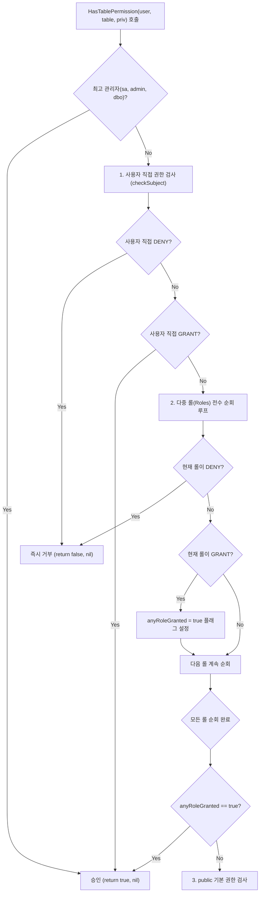

# LionSQL P0-06, P0-07, P0-09 RBAC 보안 거버넌스 및 메타데이터 원자적 영속화 사후 설계서 (`notes/P0_06_07_09_RBAC_SECURITY_AND_PERSISTENCE_PLAN.ko.md`)

> - **최초 작성일**: 2026-11-08
> - **과제 식별 코드**: `P0-06`, `P0-07`, `P0-09` (Security & RBAC 거버넌스 하위)
> - **참조 원천 SSOT**: [`notes/PRE_RELEASE_AUDIT_TRIAGE.ko.md`](PRE_RELEASE_AUDIT_TRIAGE.ko.md)
> - **핵심 적용 규칙**: `[RULE:AtomicSaves]`, `[RULE:SafeDefaults]`, `[RULE:ExplicitError]`, `[RULE:RadicalKISS]`
> - **관련 커밋**:
>   - `df23626` `fix(auth): eliminate anonymous user admin bypass backdoor (P0-06)`
>   - `39a6b7e` `fix(auth): ensure explicit role DENY takes absolute precedence over GRANT (P0-07)`
>   - `f10602f` `feat(auth): persist logins, users, and grants to auth.json atomically across restarts (P0-09)`

---

## 1. 아키텍처 배경 및 문제 정의

LionSQL은 엔터프라이즈 멀티 테넌트 환경 및 클라우드 네이티브 BaaS(Backend-as-a-Service)로 동작하기 위해 SQL 레벨의 로그인(`Login`), 데이터베이스 사용자(`User`), 롤(`Role`), 테이블 권한(`Grant/Deny`), 그리고 외부 HTTP API Key를 총괄하는 통합 보안 인증 서브시스템(`pkg/auth`)을 내장하고 있습니다.

그러나 1.0 사전 전수 감사에서 보안 원칙을 근본적으로 무력화하는 3건의 치명적 P0 결함이 발견되었습니다.

```
+---------------------------------------------------------------------------------------+
| P0-06: 빈 사용자명("") 최고 관리자 우회 백도어 (Anonymous Admin Bypass)                  |
| normUser == "" 체크로 인해 미인증 세션이나 익명 접속자가 최고 관리자(sa) 권한을 획득함.    |
+---------------------------------------------------------------------------------------+
| P0-07: 다중 롤 검사 시 첫 번째 GRANT로 후속 DENY 무시 (Deny Precedence Violation)        |
| 롤 순회 루프에서 GRANT를 만나면 즉시 승인(true)을 반환하여 뒤따라오는 명시적 DENY를 무력화함. |
+---------------------------------------------------------------------------------------+
| P0-09: 보안 계정/권한 메타데이터 인메모리 방치 재부팅 시 전량 증발 (Credential Evaporation)|
| logins, dbUsers, grants, apiKeys가 디스크에 영속화되지 않아 데몬 재시작 시 전량 증발함.     |
+---------------------------------------------------------------------------------------+
```

---

## 2. 결함 1: P0-06 익명 세션 관리자 권한 우회 백도어 제거

### 2.1 결함 메커니즘
`pkg/auth/rbac.go`의 `HasTablePermission` 함수 최상단에 다음과 같은 레거시 관리자 바이패스 검사가 존재했습니다:
```go
// 구 결함 코드 (rbac.go)
if normUser == "" || normUser == "sa" || normUser == "admin" || normUser == "dbo" {
    return true, nil
}
```
초기 개발 단계에서 유저가 지정되지 않은 내부 시스템 쿼리를 허용하기 위해 임시로 삽입되었던 `normUser == ""` 조건이 방치되어, 인증 토큰이 누락된 클라이언트나 익명 HTTP 요청이 DB 내의 모든 테이블에 대해 `DROP TABLE`, `DELETE`, `SELECT`를 무제한 수행할 수 있는 재앙적 취약점이 되었습니다.

### 2.2 해결 아키텍처: 익명 세션 관리자 바이패스 완전 박멸
`normUser == ""` 조건을 영구 제거하고, 인증되지 않은 사용자는 반드시 최하위 기본 권한(`public`)만을 거쳐 인가되도록 단일화했습니다.
```go
// 신규 보안 강화 코드 (rbac.go)
if normUser == "sa" || normUser == "admin" || normUser == "dbo" {
    return true, nil
}
```

---

## 3. 결함 2: P0-07 다중 롤 평가 시 명시적 `DENY` 절대 우선권 확립

### 3.1 결함 메커니즘
엔터프라이즈 RBAC 및 Microsoft SQL Server 보안 표준에서 **`DENY`는 어떤 `GRANT`보다도 우선**해야 합니다. 즉, 사용자가 `analyst`(급여 테이블 SELECT 허용)와 `restricted_finance`(급여 테이블 SELECT 금지) 롤을 동시에 가질 경우, 반드시 접근이 거부되어야 합니다.

종전 루프 구현은 다음과 같이 작성되어 있었습니다:
```go
// 구 결함 루프 (rbac.go)
for _, r := range u.Roles {
    roleGranted, roleDenied := checkSubject(r)
    if roleGranted {
        return true, nil // 치명적 버그: GRANT를 먼저 만나면 뒤의 DENY를 보지도 않고 즉시 승인!
    }
}
```
슬라이스 순서상 `analyst`가 먼저 오면 승인되고, `restricted_finance`가 먼저 오면 거부되는 등 **역할 평가 순서에 따라 보안이 뚫리는 비결정적 취약점**이 존재했습니다.

### 3.2 해결 아키텍처: 2단계 스캔 및 Fail-Closed `DENY` 조기 차단
LionSQL은 롤 순회 시 단 하나의 롤이라도 `roleDenied`가 발견되면 **즉시 `return false, nil`로 직행(Short-Circuit Fail-Closed)**하고, 모든 롤을 전수 검사하여 단 1건의 DENY도 없을 때만 `anyRoleGranted` 승인을 반환하도록 개편했습니다.



#### 핵심 구현 코드 (`pkg/auth/rbac.go`)
```go
// 2. Check user's assigned custom roles (u.Roles)
if u != nil && len(u.Roles) > 0 {
    anyRoleGranted := false
    for _, r := range u.Roles {
        normRole := strings.ToLower(strings.TrimSpace(r))
        roleGranted, roleDenied := checkSubject(normRole)
        if roleDenied {
            return false, nil // Explicit DENY in any assigned role strictly overrides all grants!
        }
        if roleGranted {
            anyRoleGranted = true
        }
    }
    if anyRoleGranted {
        return true, nil
    }
}
```

---

## 4. 결함 3: P0-09 `auth.json` 원자적 디스크 영속화 아키텍처

### 4.1 결함 메커니즘
`AuthService` 내부의 `logins`, `dbUsers`, `grants`, `apiKeys` 맵이 메모리에만 유지되어, 관리자가 프로덕션에서 생성한 신규 계정, 권한 설정, API 키가 서버 재부팅 시 100% 증발하고 기본 관리자 계정만 남는 결함이었습니다.

### 4.2 해결 아키텍처: `auth.json` 원자적 스왑 (`[RULE:AtomicSaves]`)
LionSQL은 계정/권한 변경 시 임시 파일(`auth.json.tmp.*`)에 JSON 스냅샷을 플러시하고 `os.Rename`으로 덮어쓰는 원자적 세이브 파이프라인(`pkg/auth/persistence.go`)을 구축했습니다.

```
[원자적 영속화 생명주기]
1. NewAuthService(cfg):
   - cfg.DataDir/auth.json 존재 시 loadLocked()를 통해 직렬화된 스냅샷 100% 복원
   - sa, admin, dbo 등 필수 시스템 계정이 누락되었을 경우에만 기본 보충
2. DDL/API 호출 (CreateLogin, GrantTable, DenyTable, CreateAPIKey 등):
   - 인메모리 맵 갱신 즉시 s.saveLocked() 호출
   - auth.json.tmp 쓰기 -> fsync -> os.Rename 원자적 교체
```

#### 스냅샷 데이터 구조 (`pkg/auth/persistence.go`)
```go
type authSnapshot struct {
	Version   int                                           `json:"version"`
	Users     map[string]*Superuser                         `json:"users"`
	Logins    map[string]*Login                             `json:"logins"`
	DBUsers   map[string]*User                              `json:"db_users"`
	Grants    map[string]map[string]map[Privilege]GrantType `json:"grants"`
	APIKeys   map[string]*APIKey                            `json:"api_keys"`
	UpdatedAt time.Time                                     `json:"updated_at"`
}
```

---

## 5. TDD 회귀 검증 매트릭스

1. **`TestRBAC_Regression_P0_06_AnonymousUserMustBeDenied`**:
   - `normUser = ""`로 임의의 테이블 SELECT/INSERT 요청 시 접근 거부(`allowed == false`) 검증.
2. **`TestRBAC_Regression_P0_07_MultipleRolesDenyPrecedence`**:
   - `Roles = ["analyst", "restricted_finance"]` (GRANT 먼저) 및 `Roles = ["restricted_finance", "analyst"]` (DENY 먼저) 양방향 모두에서 접근이 100% 차단됨을 검증.
3. **`TestRBAC_Regression_P0_09_MetadataPersistenceAcrossRestart`**:
   - Phase 1: 커스텀 로그인 `alice`, DB 사용자, `orders` 테이블 권한, API Key 생성.
   - Phase 2: 첫 번째 서비스를 셧다운하고 동일 디렉토리에서 새 `AuthService` 기동 후 `alice` 비밀번호 인증, 테이블 권한, API Key 유효성이 100% 보존됨을 검증.

---

## 6. 결론 및 보안 거버넌스 불변성

1. **DENY 불변성**: 어떠한 경우에도 상속되거나 결합된 롤 집합 중 1개 이상의 `DENY`가 존재하면 접근 승인(`GRANT`)이 될 수 없습니다.
2. **무인증 차단 불변성**: 빈 사용자명(`""`)이나 미식별 세션은 최고 관리자 권한을 가질 수 없으며 최하위 `public` 규칙에 따라 격리됩니다.
3. **자격증명 영속화 보장**: 프로덕션의 모든 자격증명 및 인가 변경은 `auth.json` 원자적 세이브를 거쳐 디스크에 안전하게 보존됩니다.
