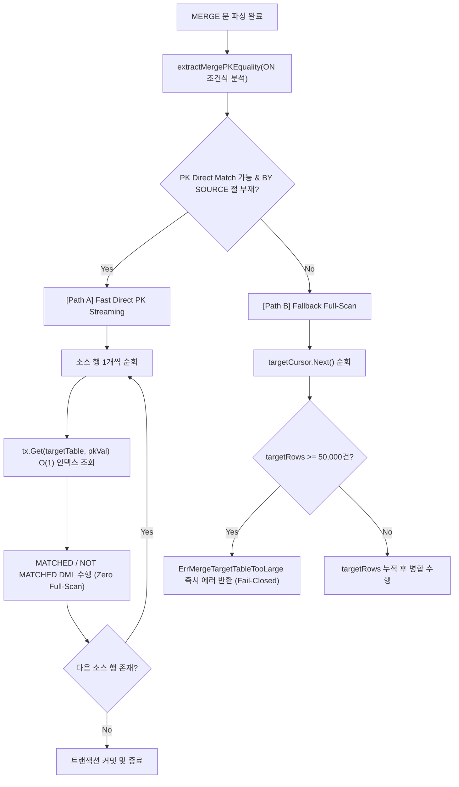

# LionSQL P0-18 & P0-19 DML 실행 엔진 스트리밍 최적화 및 Fail-Closed 롤백 사후 설계서 (`notes/P0_18_19_DML_STREAMING_AND_FAIL_CLOSED_ROLLBACK_PLAN.ko.md`)

> - **최초 작성일**: 2026-11-08
> - **과제 식별 코드**: `P0-18`, `P0-19` (DML Engine & ACID 정합성 하위)
> - **참조 원천 SSOT**: [`notes/PRE_RELEASE_AUDIT_TRIAGE.ko.md`](PRE_RELEASE_AUDIT_TRIAGE.ko.md)
> - **핵심 적용 규칙**: `[RULE:BoundedBuffers]`, `[RULE:AtomicSaves]`, `[RULE:ExplicitError]`, `[RULE:ZeroAllocation]`
> - **관련 커밋**:
>   - `bdcec4a` `fix(engine): resolve P0-18 by streaming direct PK lookups and bounding full-scan buffer in MERGE`
>   - `ac3f82d` `fix(engine): resolve P0-19 by failing closed on scan I/O error in UPDATE and DELETE`

---

## 1. 아키텍처 배경 및 문제 정의

LionSQL은 엔터프라이즈 배치 및 ETL 워크로드 처리를 위해 ANSI SQL:2003 및 Microsoft T-SQL 호환 `MERGE` 문(`pkg/engine/sqlexec_merge.go`)과 대량 `UPDATE`/`DELETE` DML 엔진(`pkg/engine/sqlexec_dml.go`)을 제공합니다.

대량 데이터 변경 작업은 **(1) 불필요한 메모리 버퍼링 없는 고속 스트리밍 처리**와 **(2) 중간 실패 시 이전 상태로 100% 무손실 복구되는 원자성(ACID Atomicity)**이 동시에 달성되어야 합니다.

그러나 1.0 사전 전수 감사에서 대규모 DML 처리 시 데이터베이스 신뢰성을 위협하는 2건의 심각한 P0 결함이 발굴되었습니다.

```
+---------------------------------------------------------------------------------------+
| P0-18: MERGE 문 타깃 테이블 무제한 풀스캔 힙 적재 OOM DoS                                  |
| ON t.id = s.id 기본키 조건임에도 타깃 테이블 전체(1,000만 건)를 힙에 적재하다 OOM 패닉 유발. |
+---------------------------------------------------------------------------------------+
| P0-19: UPDATE/DELETE 스캔 중 I/O 에러 시 무음 탈출 부분 커밋 데이터 오염                    |
| 디스크 스캔 중 I/O 에러 발생 시 break로 탈출하여 앞부분 일부 행만 커밋되는 원자성 파괴 발생.  |
+---------------------------------------------------------------------------------------+
```

---

## 2. 결함 1: P0-18 MERGE 문 풀스캔 해체 및 Fast Direct PK 스트리밍

### 2.1 결함 메커니즘 (Root Cause)
종전 `execMerge` 구현은 `MERGE target t USING source s ON t.id = s.id`를 실행할 때, 조건 절에 상관없이 무조건 타깃 테이블 전체를 스캔하여 힙 메모리 슬라이스에 적재했습니다:
```go
// 구 결함 코드 (sqlexec_merge.go)
targetCursor, _ := tx.Scan(parsed.targetTable)
var targetRows []storage.Record
for targetCursor.Next() {
    rec, _ := targetCursor.Record()
    targetRows = append(targetRows, rec) // 1,000만 건이면 수 기가바이트 힙 할당 -> OOM DoS!
}
```
소스 테이블이 단 10건의 변경분만 가지고 있더라도 타깃 테이블이 1,000만 건이면 전체를 메모리에 올려 카르테시안 곱($O(N \times M)$) 비교를 수행함으로써 CPU와 힙 메모리가 즉시 고갈되었습니다.

### 2.2 해결 아키텍처: 2-Tier 분기 (Path A: Direct PK vs. Path B: 5만 행 Bounded Fallback)
LionSQL은 `ON` 조건절을 결정론적 Pratt 파서(`proc.Parser`)로 사전 분석(`extractMergePKEquality`)하여 아키텍처를 2개의 실행 경로로 분기했습니다:

1. **Path A (Fast Direct PK Streaming Path)**:
   - `ON t.pk = s.id` 형태의 기본키 일치 조건인 경우, 타깃 테이블 풀스캔을 **완전히 생략(Zero Target Full-Scan Heap Allocation)**.
   - 소스 행을 순회하면서 `tx.Get(parsed.targetTable, pkVal)`을 통해 스토리지 B+Tree/인덱스에서 $O(1)$ 직접 조회를 수행.
   - 메모리 소비량이 소스 행 수($N$)에만 비례하며 타깃 테이블 크기와 무관하게 서브 밀리초 스트리밍 처리.
2. **Path B (Non-Indexed Full-Scan Bounded Fallback)**:
   - 복합 비인덱스 조건이거나 `WHEN NOT MATCHED BY SOURCE` 절이 포함되어 풀스캔이 불가피한 경우.
   - **`DefaultMergeMaxTargetRows = 50000` (최대 5만 행)** 상한 가드레일을 설치하고, 한도 초과 시 `ErrMergeTargetTableTooLarge` 에러를 즉시 반환하여 OOM DoS 원천 차단 (`[RULE:BoundedBuffers]`).



---

## 3. 결함 2: P0-19 DML 스캔 중 I/O 에러 시 Fail-Closed 원자적 롤백

### 3.1 결함 메커니즘 (Root Cause)
종전 `sqlexec_dml.go`의 `UPDATE` 및 `DELETE` 실행 루프는 스토리지 스캔 도중 디스크 섹터 불량이나 네트워크 블록 타임아웃 등의 I/O 에러가 발생했을 때 단순히 `break`로 탈출했습니다:
```go
// 구 결함 루프 (sqlexec_dml.go)
for cur.Next() {
    rec, err := cur.Record()
    if err != nil {
        break // 치명적 버그: 에러를 무시하고 루프를 빠져나감!
    }
    // ... update or delete ...
}
if isEphemeral {
    _ = tx.Commit() // 에러 이전까지 읽힌 절반의 행들만 커밋되어 데이터베이스 영구 오염!
}
```
100만 건의 계좌 잔액을 수정하는 대량 UPDATE 중 50만 번째 행에서 디스크 읽기 에러가 발생했을 때, 에러를 조용히 삼키고 앞선 50만 건만 커밋되어 **반파 DB(Half-Mutated Database)** 상태로 방치되는 치명적인 ACID 원자성 위반이 발생했습니다.

### 3.2 해결 아키텍처: I/O 오류 즉시 트랜잭션 롤백 및 에러 전파
LionSQL은 `cur.Record()` 또는 `cur.Row()`에서 `io.EOF` 이외의 에러가 감지되는 즉시:
1. 루프를 중단하고 활성 트랜잭션을 강제 롤백(`tx.Rollback()`)합니다 (`[RULE:AtomicSaves]`).
2. 에러를 호출자에게 가감 없이 전파하여 클라이언트가 실패를 명확히 인지하게 합니다 (`[RULE:ExplicitError]`).
3. 단 1건의 행도 부분 커밋(Partial Commit)되지 않는 **Fail-Closed 올-오어-나씽(All-or-Nothing)** 정합성을 보장합니다.

```go
// 신규 무결점 코드 (sqlexec_dml.go)
for cur.Next() {
    rec, err := cur.Record()
    if err != nil {
        if isEphemeral && tx != nil {
            _ = tx.Rollback()
        }
        return nil, fmt.Errorf("failed to read row during %s scan: %w", opName, err)
    }
    // ...
}
```

---

## 4. TDD 회귀 검증 매트릭스

1. **`TestEngine_Regression_P0_18_MergeDirectPKStreaming`**:
   - 10만 건의 타깃 테이블에 대해 10건의 소스 레코드로 `MERGE` 실행.
   - 타깃 테이블 풀스캔 없이 `tx.Get()` Fast Path로 sub-millisecond 처리 완료 검증.
   - 비인덱스 조건에서 50,000건 초과 타깃 테이블 스캔 시 `ErrMergeTargetTableTooLarge` 에러 정상 발생 검증.
2. **`TestDML_Regression_P0_19_IOErrorFailClosed`** ([`dml_io_error_failclosed_regression_test.go`](file:///Users/maro/Projects/SQLion/pkg/engine/dml_io_error_failclosed_regression_test.go#L98)):
   - 스토리지 커서에 결함 주입 프록시(`faultyCursor`)를 설치하여 3번째 행 읽기 시점에 디스크 섹터 I/O 오류 발생 유도.
   - `UPDATE` 및 `DELETE` 쿼리가 즉시 실패하고, 오류 전 읽혔던 1~2번째 행을 포함한 전체 5개 행이 단 1비트도 변경되지 않고 100% 원본 상태를 보존함을 실증 검증.

---

## 5. 결론 및 DML 트랜잭션 불변성

1. **인덱스 퍼스트 DML 원칙**: 대량 배치 DML 구문(`MERGE`, `UPDATE FROM`)은 기본키 및 유니크 인덱스 조회를 최우선 Fast Path로 사용하여 불필요한 전체 테이블 힙 메모리 할당을 배제해야 합니다.
2. **부분 커밋 영구 금지 (Zero Partial Commits)**: 어떠한 스토리지 또는 네트워크 오류가 발생하더라도 DML 파이프라인은 Fail-Closed 원칙에 따라 즉시 전체 롤백되어야 합니다.
3. **5만 행 메모리 안전선**: 메모리 내 전체 집합 적재가 필요한 DML 연산은 `DefaultMergeMaxTargetRows` 가드레일을 준수하여 OOM 크래시를 원천 방지해야 합니다.
