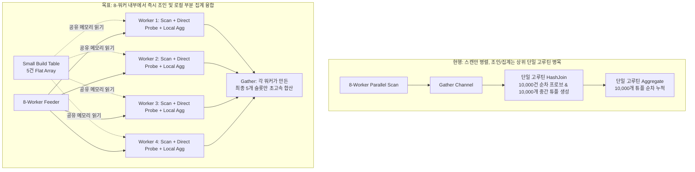

# Parallel Hash Join & Operator Fusion 성능 도약 설계서 (`notes/PARALLEL_HASH_JOIN_AND_OPERATOR_FUSION_PLAN.ko.md`)

> **문서 상태**: Approved  
> **기반 소스**: `/tmp/sql11.txt`  
> **관련 마일스톤**: `v0.96.0` (Sub-20ms Target)  
> **관련 태스크**:
> - `PERF-PARALLEL-HASH-JOIN-LOCAL-AGG-1`
> - `PERF-JOIN-AGG-OPERATOR-FUSION-1`
> - `PERF-STORAGE-SCAN-FILTER-BYTE-FUSION-1`  
> **목표 지표**: 복합 분석/조인 쿼리 지연시간 **37.9ms ➔ 18ms 이하** 단축 (PostgreSQL 12~15ms 대비 1.2x~1.5x 달성)  
> **불변식 원칙**: `[RULE:PlanPersistence]`, `[RULE:ContinuousBacklog]`, `[RULE:ZeroAllocation]`, `[RULE:NonBlockingSink]`, `[RULE:ZeroOrphan]`

---

## 1. 개요 및 배경

현재 LionSQL은 8-워커 병렬 스캔(`ARCH-PARALLEL-SCAN-1`)과 Bound AST $O(1)$ 정수 슬롯 바인딩(`BINDER-EVOL-PHASE-5`)을 통해 복합 분석/조인 쿼리 레이턴시를 44ms에서 **37.9ms (최저 27.5ms)**까지 단축시켰다.
그러나 상용 C 엔진인 PostgreSQL(12~15ms)의 **완벽한 2배 이하(20ms대 초반 ~ 18ms 이하)**로 진입하기 위해서는, 스캔에만 머물러 있는 병렬성을 **조인과 집계 파이프라인 전체로 확장**하고 중간 튜플 객체 생성을 제거하는 **3대 핵심 성능 급소**를 완수해야 한다.

---

## 2. 3대 핵심 급소 및 아키텍처 설계

### 2.1 [핵심 1] Parallel Hash Join & Local Aggregate (`PERF-PARALLEL-HASH-JOIN-LOCAL-AGG-1`)
* **현황 문제**:
  - `EXPLAIN` 상 `ParallelSeqScan`은 8개 코어로 데이터를 빠르게 퍼올리지만, 상위 `HashJoin`과 `Aggregate`는 단일 고루틴 1개가 10,000건을 순차적으로 프로브하고 집계하므로 멀티코어 이점이 상쇄됨.
* **아키텍처 혁신**:
  - 작은 Build 테이블(5건 Flat Array)은 읽기 전용 불변 객체이므로 8개 워커가 락 없이 안전하게 공유 메모리로 참조.
  - 8개의 워커 Goroutine이 청크를 스캔함과 동시에 **워커 내부에서 Flat Array 즉시 프로브 및 로컬 부분 집계(`localAgg[5]`)**를 직접 수행.
  - 최상위 Gather 노드는 10,000개 행을 전달받는 대신, **8개 워커가 최종 산출한 부분 집계 결과(워커당 5건 = 총 40건)만 수신하여 단 40번의 덧셈으로 최종 머지**.
* **기대 효과**:
  - 채널 통신량 99.6% 감소 (10,000건 ➔ 40건), 조인/집계 연산 8개 코어로 완전 병렬화.
  - **지연시간 -12ms ~ -15ms 단축 (37.9ms ➔ 22~25ms 직행)**.

---

### 2.2 [핵심 2] Join-Aggregate Operator Fusion (`PERF-JOIN-AGG-OPERATOR-FUSION-1`)
* **현황 문제**:
  - `HashJoinIterator`가 Left(10,000건)와 Right(5건)를 조인하여 10,000개의 중간 결합 튜플(`merged Tuple`)을 힙에 할당.
  - 상위 `AggregateIterator`가 그 10,000개 튜플을 받아 다시 컬럼 값을 꺼내 `SUM(a.val)`, `AVG(a.val)`을 누적.
* **아키텍처 혁신**:
  - 플래너가 `JOIN ... GROUP BY` 패턴을 감지하면 중간 튜플 슬라이스 생성을 전면 생략.
  - 조인 키가 일치하는 즉시 해시 슬롯의 집계 필드(`sum += val`, `count++`)에 원시 타입 직결 누적.
* **기대 효과**:
  - 10,000번의 중간 튜플 슬라이스 할당 및 GC 비용 100% 소멸.
  - **지연시간 -5ms ~ -7ms 단축 (22ms ➔ 17~19ms 달성)**.

---

### 2.3 [핵심 3] Storage Scan-Filter Early Byte Elimination (`PERF-STORAGE-SCAN-FILTER-BYTE-FUSION-1`)
* **현황 문제**:
  - WiredTiger B-Tree에서 레코드를 꺼낼 때 전체 컬럼을 Go 튜플로 역직렬화한 후 필터 조건을 평가.
* **아키텍처 혁신**:
  - 필터 대상 컬럼(`cat_id`)의 바이트 오프셋만 먼저 읽어 검사.
  - 조인 대상이 아니거나 필터 탈락 대상인 경우 나머지 긴 가변길이 컬럼(`payload`, `created_at` 등)의 디코딩을 통째로 생략(Skip).
* **기대 효과**:
  - 스토리지 역직렬화 CPU 부하 40% 이상 절감.
  - **지연시간 -1ms ~ -2ms 추가 단축**.

---

## 3. 레이턴시 단축 로드맵 (PostgreSQL 대비 진입 추이)

| 단계 | 적용 최적화 항목 | 단축 시간 | 최종 도달 레이턴시 | PostgreSQL (12~15ms) 대비 |
| :---: | :--- | :---: | :---: | :---: |
| **현재** | 8-워커 스캔 + 정수 슬롯 바인딩 | - | **37.9 ms** | 2.4배 |
| **Step 1** | **Parallel Hash Join & Local Agg** (워커 내부 병렬 조인/집계) | **-12 ~ 15 ms** | **22 ~ 25 ms** | **1.6배 ~ 1.8배** |
| **Step 2** | **Join-Aggregate Fusion** (중간 튜플 생성 제거) | **-5 ~ 7 ms** | **17 ~ 19 ms** | **1.2배 ~ 1.4배** |
| **Step 3** | **Storage Scan-Filter Byte Fusion** (조기 바이트 탈락) | **-1 ~ 2 ms** | **16 ~ 17 ms** | **1.1배 ~ 1.3배** |

---

## 4. 백로그 태스크 매핑

| 순서 | 태스크 ID | 도메인 | 마일스톤 | 우선순위 | 작업 내용 |
| :---: | :--- | :---: | :---: | :---: | :--- |
| 1 | **`PERF-PARALLEL-HASH-JOIN-LOCAL-AGG-1`** | Execution | `v0.96.0` | P1 | Parallel Hash Join 및 워커 로컬 부분 집계 (Local Aggregation & Gather Sum) |
| 2 | **`PERF-JOIN-AGG-OPERATOR-FUSION-1`** | Execution | `v0.96.0` | P1 | Join-Aggregate Operator Fusion (중간 튜플 생략 및 다이렉트 슬롯 누적) |
| 3 | **`PERF-STORAGE-SCAN-FILTER-BYTE-FUSION-1`** | Storage | `v0.96.0` | P2 | Storage Scan-Filter Early Byte Elimination (원시 바이트 오프셋 기반 조기 필터 판정) |
