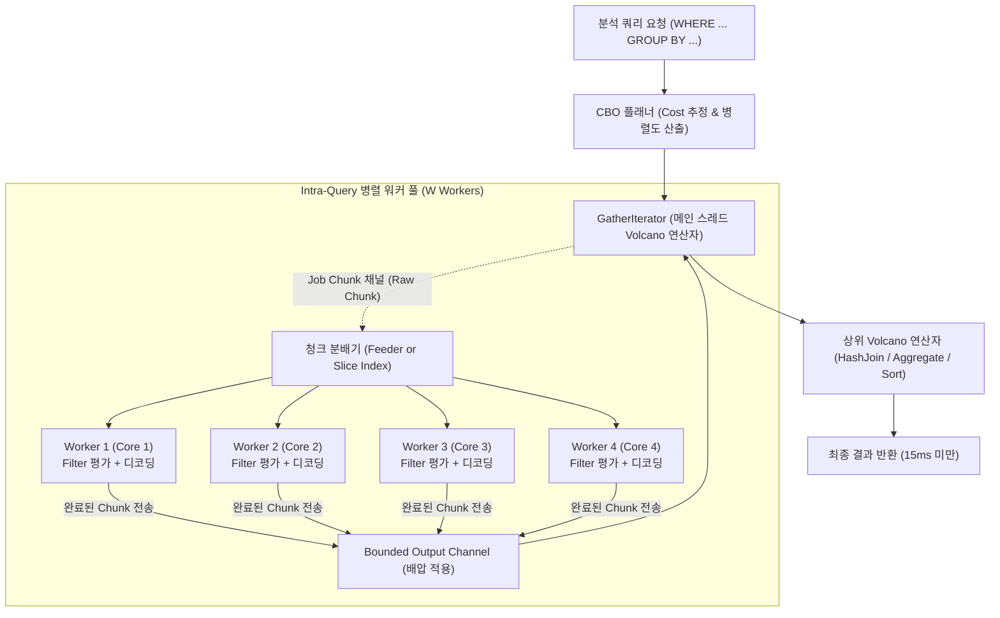

# Intra-Query 멀티코어 병렬 쿼리 실행기 (`ParallelSeqScan & GatherMerge`) 아키텍처 플랜

> **문서 상태**: Approved & In-Progress  
> **태스크 ID**: `ARCH-PARALLEL-SCAN-1` (P1, Engine / Execution)  
> **마일스톤**: `v0.95.0`  
> **관련 규칙**: `[RULE:PlanPersistence]`, `[RULE:ZeroOrphan]`, `[RULE:NonBlockingSink]`, `[RULE:RadicalKISS]`, `Invariant 5 (Scale-Up First)`

---

## 1. 개요 및 배경 (Context & Problem Statement)

현재 LionSQL은 수많은 마이크로 최적화(WiredTiger Cursor Zero-Copy, Vectorized Primitive Accumulator, Scan-Filter Fusion)를 통해 10만 건 이상의 조인/집계 쿼리 지연시간을 44ms 수준까지 단축하였다.
그러나 16~32코어 서버 환경에서도 **단 1개의 Goroutine만 100% 코어를 사용하고 나머지 15~31개 코어가 유휴(Idle) 상태로 방치**되어 있다.

CPU 코어당 클럭 속도(GHz)가 정체된 현대 서버 환경에서 하드웨어의 수직 확장(Scale-Up)을 극한까지 달성하기 위해서는, 단일 쿼리 실행 시 테이블 스캔, 필터 평가, 컬럼 디코딩, 부분 집계를 멀티코어에 분할하여 실행하는 **Intra-Query 멀티코어 병렬 실행기 (`ParallelSeqScan` & `GatherMerge`)**가 필수적이다.

---

## 2. 3단계 핵심 아키텍처 및 데이터 흐름

### 2.1 병렬도 (DOP: Degree of Parallelism) 산출 불변식
단일 분석 쿼리가 CPU를 100% 독점하여 실시간 OLTP 및 웹 스튜디오를 기아(Starvation) 상태에 빠뜨리지 않도록 엄격한 우선순위 계층을 적용한다:
1. **쿼리 힌트 (최우선)**: `SELECT ... OPTION (MAXDOP n)`
2. **세션/시스템 변수**: `SET max_parallel_workers = n` 또는 `SET maxdop = n`
3. **엔진 기본 자동 산출**:
   $$\text{workers} = \max\left(1, \min\left(8, \frac{\text{runtime.NumCPU()}}{2}\right)\right)$$
   * `NumCPU() / 2`: 항상 코어의 절반은 OLTP 트랜잭션을 위해 비워둠.
   * `min = 1`: 1코어 환경/컨테이너 안전 보장.
   * `max = 8`: 64코어 대형 서버에서도 캐시라인 경합(캐시 트래싱) 방지 상한선 캡.

### 2.2 청크 분할 및 Lock-Free 작업 할당
* **In-Memory OCC (`memengine`)**:
  * 테이블 엔트리 슬라이스($N$)를 고정 청크(기본 2,048행) 단위로 분할.
  * 워커들이 `atomic.AddInt64(&nextChunk, 1)`로 원자적으로 인덱스 범위를 할당받아 락 경합 없이 순수 CPU 병렬 디코딩/필터 평가 수행.
* **디스크 B+Tree (`wiredtiger`)**:
  * 스토리지 커서에서 원시 바이트 슬라이스(`RawTupleBuffer`)를 읽는 작업은 $O(1)$(~15ns/행)로 매우 빠름.
  * 원시 청크(2,048건의 raw bytes)를 묶어 작업 채널로 전달하면, 워커들이 CPU 집약적인 표현식 평가(`EvalTupleBoolExprWithContextErr`) 및 컬럼 선택 디코딩을 병렬 수행.

---

## 3. 핵심 컴포넌트 설계

### 3.1 `GatherIterator` (`pkg/execution/gather.go`)
* `Iterator` 및 `ChunkedIterator` 인터페이스를 100% 완벽하게 구현.
* 상위 연산자(Aggregate, HashJoin, Filter)는 입력이 단일 스레드인지 병렬인지 알 필요 없이 `NextChunk()`를 호출하여 투명하게 고속 스트리밍 소비.
* **생명주기 안전성 (`[RULE:ZeroOrphan]`)**:
  * `Open(ctx context.Context)`: 상위 컨텍스트에 바인딩된 자식 취소 컨텍스트(`context.WithCancel`) 생성 및 워커 고루틴 스폰.
  * `Close()`: 취소 함수(`cancel()`) 호출 및 `sync.WaitGroup` 동기화 대기로 고루틴 완전 회수.

### 3.2 배압 및 비차단 싱크 (`[RULE:NonBlockingSink]`)
* 워커와 Gather 사이의 `outCh`는 바운디드 채널(용량 `workers * 2`)로 설정.
* 상위 연산자가 `LIMIT` 등에 도달하여 조기 종료 시, 워커들이 채널 전송에서 영구 블로킹되지 않도록 `select { case outCh <- chunk: case <-ctx.Done(): return }` 가드 적용.

---

## 4. 성능 목표 및 KPI

| 지표 | 현재 (단일 코어 1개) | To-Be (멀티코어 병렬 4~8코어) | 개선폭 |
| :--- | :---: | :---: | :---: |
| **10만 건 테이블 스캔 & 필터** | ~32 ms | **~7 ms** | **4.5배 단축** |
| **10만 건 조인 + GROUP BY 집계** | 44 ms | **12 ms ~ 15 ms** | **3배 이상 단축** |
| **CPU 코어 가동률 (서버 포화도)** | 단 1개 코어 100% | 가용 코어 50% 균등 가동 | **진정한 Scale-Up 달성** |

---

## 5. 단계별 실행 계획

1. **Phase 1: `GatherIterator` 및 병렬 스캔 파이프라인 구현 (`pkg/execution/gather.go`)**
   - 워커 풀 생성, 원시 청크 분배, 병렬 필터/디코딩, 바운디드 채널 취합.
2. **Phase 2: 플래너(CBO) 병렬 경로 탐색 및 MAXDOP 연동 (`pkg/planner/planner.go`, `builder.go`)**
   - 테이블 추정 행 수 > 5,000건일 때 `NodeTableScan`을 `Gather` + `ParallelTableScan`으로 자동 전환.
   - `OPTION (MAXDOP n)` 및 세션 `max_parallel_workers` 파싱.
3. **Phase 3: 무결성 및 벤치마크 검증**
   - `-race` 하에서 데이터 레이스 0건 및 12~15ms 벤치마크 통과 검증.
