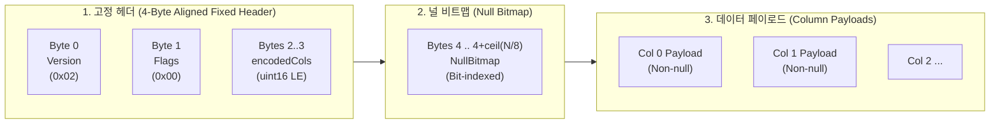
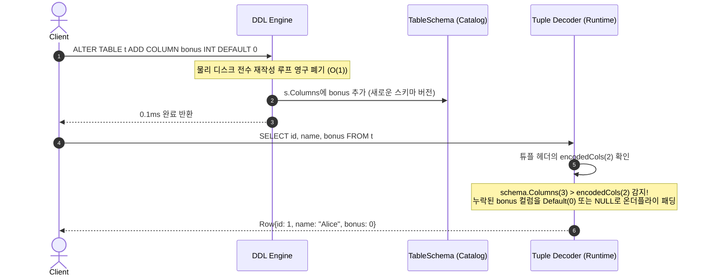

# LionSQL 물리 테이블 및 바이너리 튜플(Tuple V2) 포맷 규격서
(`notes/PHYSICAL_TABLE_FORMAT.ko.md`)

> - **최초 작성일**: 2026-11-14
> - **최종 갱신일**: 2026-11-14
> - **문서 상태**: 공식 물리 스토리지 규격서 (Physical Storage Specification SSOT)
> - **연계 불변식**: `GEMINI.md` [Invariant 13: Single Canonical V2 Binary Tuple Codec], `notes/ENGINEERING_CONTEXT.ko.md` [불변식 ㉚: 스키마 진화, 단일 V2 바이너리 튜플 코덱 및 Instant Tail DDL 불변식]
> - **보조 인덱스 규격 연계**: [`SECONDARY_INDEX_FORMAT.ko.md`](SECONDARY_INDEX_FORMAT.ko.md) (LionSQL 보조 인덱스 물리 바이너리 포맷 규격서)
> - **참조 소스 코드**: [`pkg/storage/tuple.go`](../pkg/storage/tuple.go), [`pkg/storage/memengine/flat_record.go`](../pkg/storage/memengine/flat_record.go)

---

## 1. 개요 및 설계 목적 (Overview & Objectives)

LionSQL은 단일 독립 실행 파일(Standalone Executable) 내에서 초고속 인메모리 OCC 스토리지 엔진(`memengine`)과 영속성 디스크 MVCC 스토리지 엔진(`wiredtiger`)을 동시에 운용합니다.
물리 테이블(Physical Table)은 데이터베이스 스키마에 정의된 행(Row) 데이터를 영속화하거나 인메모리 공간에 밀집 배치하는 핵심 스토리지 단위입니다.

과거 레거시 버전(V1)의 가변 디코딩 휴리스틱과 스키마 변경 시의 전수 재작성(Full Table Rewrite) 병목을 영구 제거하고, 현대 메이저 RDBMS(PostgreSQL `HeapTupleHeaderData`, MySQL 8.0 InnoDB `info_bits`/`n_fields`)와 대등한 **자기완비적(Self-Describing) 4바이트 32비트 정렬 고정 헤더를 갖춘 단일 표준 V2 바이너리 튜플 코덱(`0x02`)**을 확립하였습니다 (`ADR-031`, `PERF-WT-INSTANT-ADD-COL-1`).

본 문서는 LionSQL 물리 테이블의 영속화 포맷, V2 바이너리 튜플 메모리 레이아웃, 데이터 타입별 직렬화 규칙, $O(1)$ Instant Tail DDL 메커니즘을 공식 규격으로 정의합니다.

---

## 2. 물리 저장 구조 및 네임스페이스 규약 (Physical Table URI & Engine Schema)

### 2.1 WiredTiger 기본 테이블 네임스페이스
LionSQL의 각 물리 테이블은 WiredTiger 엔진 내에서 다음 네임스페이스를 갖는 독립된 B-Tree 테이블로 생성됩니다.
```
URI: table:<PhysicalTableName>
config: "key_format=S,value_format=u"
```
- **Key (`key_format=S`, String)**:
  - 메인 테이블의 기본 키(Primary Key) 문자열을 저장합니다 (`row.Values[pkColIdx].String()`).
  - 단일 정수 PK, 복합 PK, 또는 시스템 자동 생성 PK가 사전순으로 정렬됩니다.
- **Value (`value_format=u`, Raw Binary Items `WT_ITEM`)**:
  - 행(Row) 전체를 나타내는 단일의 V2 바이너리 튜플 바이트 스트림을 무손실 저장합니다.
- **보조 인덱스 분리**:
  - 기본 키 외의 추가 검색/고유성 제약을 위한 보조 인덱스는 [`SECONDARY_INDEX_FORMAT.ko.md`](SECONDARY_INDEX_FORMAT.ko.md) 규격에 따라 `table:_idx_<PhysicalTableName>_<IndexName>` 물리 B-Tree로 완전 분리 격리됩니다.

### 2.2 In-Memory OCC 플랫 레코드 (`memengine`)
In-Memory OCC 엔진은 포인터 추적(Pointer Chasing)으로 인한 CPU 캐시 미스와 Go GC 스캔 오버헤드를 원천 차단하기 위해 무압축 고정 오프셋 기반의 **포인터리스 플랫 레코드(Pointer-Free Flat Record)** 레이아웃을 사용하며 (`Invariant 14 Spec-Out`), 디스크 동기화(AOF/Snapshot) 시에는 본 V2 바이너리 튜플 코덱으로 상호 직렬화됩니다.

---

## 3. V2 바이너리 튜플 물리 레이아웃 (V2 Binary Tuple Layout)



### 3.1 4바이트 32비트 고정 헤더 (Header Specification)
모든 튜플의 선두 4바이트는 32비트 정렬 규격을 준수합니다.

| 바이트 오프셋 | 필드명 | 데이터 타입 | 설명 및 불변식 |
| :--- | :--- | :--- | :--- |
| **Byte 0** | `Version` | `uint8` (`0x02`) | **TupleCodecV2 고정 매직 바이트**. `0x02`가 아닌 버퍼는 즉시 `ErrInvalidTupleHeader`로 Fail-Fast 차단. |
| **Byte 1** | `Flags` | `uint8` (`0x00`) | 미래 확장성 선할당 플래그 비트 필드 (하단 참조). |
| **Bytes 2..3** | `encodedCols` | `uint16` (LE) | 해당 튜플에 실제 인코딩된 컬럼의 총 개수 ($0 \sim 65,535$). Instant DDL의 핵심 지표. |

#### 헤더 플래그 비트 정의 (Byte 1)
| 비트 마스크 | 식별자 | 설명 |
| :--- | :--- | :--- |
| `0x01` | `TupleFlagNoNulls` | 예약됨: 행 내에 NULL 컬럼이 전무하여 널 비트맵을 생략한 압축 모드 |
| `0x02` | `TupleFlagCompressed` | 예약됨: 행 페이로드가 LZ4/Snappy 등으로 인라인 압축됨 |
| `0x04` | `TupleFlagToast` | 예약됨: 거대 LOB/바이너리 데이터가 외부 TOAST B-Tree 포인터로 격리됨 |
| `0x08` | `TupleFlagExtended` | 예약됨: 확장 헤더 메타데이터가 존재함 |

### 3.2 널 비트맵 (Null Bitmap)
- **크기**: `nullBitmapLen = (encodedCols + 7) / 8` 바이트
- **위치**: 바이트 오프셋 `4`부터 시작하여 `4 + nullBitmapLen`까지 위치.
- **인덱싱 규약**: $i$번째 컬럼이 `NULL`인 경우, `buf[4 + (i/8)] |= 1 << (i % 8)` 비트가 `1`로 세팅됩니다.
- **최적화**: `NULL`로 표시된 컬럼은 페이로드 영역에 **0바이트**를 차지하며, 어떠한 바이트도 추가 할당되지 않습니다.

---

## 4. 데이터 타입별 페이로드 인코딩 규약 (Column Value Encodings)

NULL이 아닌 컬럼 값들은 스키마에 정의된 순서대로 널 비트맵 바로 뒤부터 빈틈없이 밀집 직렬화됩니다.

| 데이터 타입 (`storage.DataType`) | 직렬화 포맷 | 바이트 크기 | 설명 |
| :--- | :--- | :--- | :--- |
| **`TypeInt`** | ZigZag 변형 `binary.PutVarint` | $1 \sim 10$ 바이트 | 부호 있는 정수(int64). 작은 값은 1~2바이트로 밀집 저장. |
| **`TypeFloat`** | `binary.LittleEndian.PutUint64` | 8 바이트 고정 | IEEE 754 float64 비트 스트림 저장. |
| **`TypeBool`** | `uint8` (`0` 또는 `1`) | 1 바이트 고정 | `true`는 `1`, `false`는 `0`. |
| **`TypeDateTime`** | `binary.LittleEndian.PutUint64` | 8 바이트 고정 | UTC 기준 `UnixNano()` (나노초 정밀도 64비트 정수). |
| **`TypeDate`** | `binary.LittleEndian.PutUint64` | 8 바이트 고정 | UTC 기준 `Unix()` (초 정밀도 64비트 정수). |
| **`TypeTime`** | Uvarint 길이 + UTF-8 바이트 | 가변 길이 | `HH:MM:SS` 문자열 바이트. |
| **`TypeUUID`** | Uvarint 길이 + UTF-8 바이트 | $1 + 36$ 바이트 | 36자리 정규화된 하이픈 소문자 UUID. |
| **`TypeVarChar` / `TypeJSON`** | Uvarint 길이 + UTF-8 바이트 | 가변 길이 | `len(str)`을 `binary.PutUvarint`로 기록 후 원본 바이트 배열 직렬화. |
| **`TypeDecimal`** | Uvarint 길이 + ASCII 바이트 | 가변 길이 | 정밀 십진수 부동소수점 문자열 직렬화. |
| **`TypeBinary`** | Uvarint 길이 + Raw 바이트 | 가변 길이 | 임의의 원시 바이너리 블록 직렬화. |

---

## 5. Instant Tail DDL 및 스키마 진화 불변식 (Schema Evolution Invariants)

LionSQL은 디스크에 저장된 튜플을 물리적으로 전수 재작성(Full Table Rewrite)하지 않고 메타데이터만 즉시 변경하는 **$O(1)$ Instant DDL**을 표준으로 채택합니다 (`PERF-WT-INSTANT-ADD-COL-1`, `GEMINI.md` [Invariant 13]).



### 5.1 컬럼 추가 (`ALTER TABLE ADD COLUMN`)
1. **$O(1)$ 메타데이터 갱신**: 신규 컬럼은 항상 스키마의 맨 끝(Tail)에 배치되며, 디스크 상의 기존 행들을 전혀 건드리지 않고 스키마 메타데이터만 갱신 후 즉각 반환합니다.
2. **온더플라이 디코더 패딩 (`DecodeTupleToRowWithArena`)**:
   - 디스크에서 읽은 구버전 튜플은 `encodedCols < len(schema.Columns)` 관계를 가집니다.
   - 디코더는 스키마보다 부족한 뒷단 컬럼들에 대해 컬럼 기본값(`col.Default`) 또는 `NULL`(`NullValue(col.Type)`)을 메모리 상에서 즉시 패딩하여 반환합니다. 버퍼 오버플로우나 슬라이스 인덱스 패닉이 원천 방지됩니다 (`[RULE:DefensiveIndexing]`).

### 5.2 컬럼 삭제 (`ALTER TABLE DROP COLUMN`) 및 중간 컬럼 Fail-Closed 불변식
1. **Tail 컬럼 삭제 ($O(1)$ Instant Safe)**:
   - 맨 끝(Tail) 컬럼 삭제 시 `encodedCols > len(schema.Columns)`가 되며, 디코더는 스키마에 정의된 컬럼 수만큼만 디코딩하고 뒤따라오는 잔여 바이트를 안전하게 무시합니다.
2. **중간 컬럼 삭제 금지 (Fail-Closed & Operational Anti-Pattern)**:
   - 데이터가 존재하는 테이블에서 중간 컬럼(Non-Terminal / Middle Column)을 `DROP COLUMN`하려는 요청은 즉시 **`ErrDropColumnNotTail` 에러와 함께 Fail-Closed로 거부**됩니다.
   - **사유**:
     1. **운영 안티패턴 방어**: 가동 중인 OLTP 환경에서 런타임 중간 컬럼 삭제는 심각한 락 경합 및 ORM 직렬화 불일치 장애를 초래합니다.
     2. **0.5ns 디코딩 핫패스 보존**: 스키마 툼스톤(Tombstone)이나 논리 컬럼 인디렉션 맵을 도입하면 극단적인 코드 복잡도가 발생하고, LionSQL의 핵심 경쟁력인 0.5ns 초고속 튜플 디코딩 경로가 영구 훼손됩니다.
     3. **공식 표준 대안 (Copy-and-Switch)**: 중간 컬럼 제거 및 테이블 재구조화는 업계 표준인 **Copy-and-Switch** (`CREATE TABLE new_t AS SELECT ...` 후 트랜잭션 내 원자적 `RENAME`)를 공식 해법으로 규정합니다.

---

## 6. 제로 알로케이션 단일 컬럼 추출 (`ExtractColumnFromTuple`)

전체 행을 디코딩하지 않고 단일 컬럼의 값만 조건 평가(`WHERE`)나 프로젝션에 필요한 경우, `pkg/storage/tuple.go`의 `ExtractColumnFromTuple` 함수를 통해 메모리 할당 없이 $O(1)$로 값을 즉시 추출합니다.

- **성능**: 0 allocs/op, 25.8ns (전체 행 디코딩 223ns 대비 8.6배 가속).
- **알고리즘**:
  1. 헤더 검증 (`0x02`) 및 `encodedCols` 확인.
  2. 요청 컬럼 인덱스가 `encodedCols` 이상이면 Default/Null 즉시 반환.
  3. 널 비트맵에서 대상 컬럼 비트 검사 ➔ 1이면 `NullValue` 즉시 반환.
  4. 대상 컬럼 이전의 Non-Null 컬럼들만 `SkipTupleColumn`으로 바이트 오프셋 점프.
  5. 대상 컬럼의 바이트만 `DecodeTupleValue`로 읽어 반환.

---

## 7. 관련 문서 및 교차 참조 (Cross References)

- **보조 인덱스 물리 포맷 규격서**: [`SECONDARY_INDEX_FORMAT.ko.md`](SECONDARY_INDEX_FORMAT.ko.md)
- **핵심 불변식 정의**: `GEMINI.md` [Invariant 13: Single Canonical V2 Binary Tuple Codec], [Invariant 15: Canonical Secondary Index Key/Value Codec]
- **엔지니어링 컨텍스트**: `notes/ENGINEERING_CONTEXT.ko.md` [불변식 ㉚: 스키마 진화 및 V2 튜플 코덱], [불변식 ㉜: 보조 인덱스 정렬 보존 바이너리 코덱]
- **스토리지 튜플 구현체**: [`pkg/storage/tuple.go`](../pkg/storage/tuple.go)
- **인메모리 플랫 레코드 구현체**: [`pkg/storage/memengine/flat_record.go`](../pkg/storage/memengine/flat_record.go)
