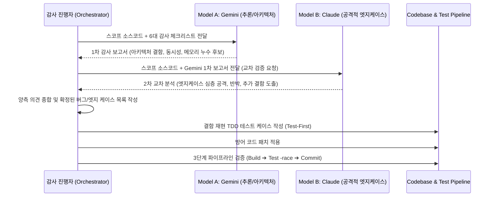

# LionSQL 1.0 릴리스 대비 전 소스코드 100단계 듀얼 AI (Gemini × Claude) 정밀 코드 리뷰 및 엣지 케이스 감사 계획서 (`notes/PRE_RELEASE_100_STEP_DUAL_CODE_REVIEW_PLAN.ko.md`)

> - **최초 작성일**: 2026-11-06
> - **문서 성격**: 1.0 릴리스 신뢰성 검증 게이트(kill -9 크래시 복구, 72h 소크, SQLLogicTest) 진입 이전, Lionsql 엔진 본체 199개 순수 Go 소스코드 전 구역을 100개 마이크로 스코프로 세분화하여 Gemini와 Claude의 교차 검증으로 숨은 버그, 동시성 레이스, 데드락, 엣지 케이스를 선제 발굴·완치하기 위한 전수 감사 마스터 플랜
> - **과제 식별 코드**: `AUDIT-100-DUAL-REVIEW`
> - **상태**: [ ] In Planning (계획 수립 완료 및 실행 대기)
> - **핵심 불변식**:
>   - `[RULE:ExplicitError]` (Never silently swallow errors, No `_ = err`)
>   - `[RULE:LockHierarchy]` (Strict Lock Hierarchy, Deadlock Prevention)
>   - `[RULE:DefensiveIndexing]` (Defensive Indexing & Integer Wrapping Guard)
>   - `[RULE:Invariant 7]` (Zero-Regex SQL Parsing in Production Paths)
>   - `[RULE:PipelineVerification]` (Build ➔ Test `-race` ➔ Commit 3단계 검증 파이프라인)

---

## 1. 아키텍처 배경 및 목적 (Why 100-Step Dual-Model Review?)

### 1.1 배경: 무작위 장기 부하 테스트의 한계
장기 소크 테스트(72h Soak)나 `kill -9` 반복 크래시 복구 테스트는 시스템 전체의 거시적 안정성을 확인하는 데 필수적이지만, 다음과 같은 **희귀한 엣지 케이스(Rare Edge Cases)**는 수십 시간의 부하 테스트에서도 발견되지 않고 프로덕션 배포 후에야 치명적 데이터 오염이나 패닉으로 폭발할 수 있습니다:
1. **타이밍 의존적 동시성 결함**: 특정 나노초 타이밍에만 발생하는 Lock 획득 역전(Deadlock) 또는 채널 닫힘 패닉(`panic: send on closed channel`).
2. **침묵하는 에러 무시(`_ = err`)**: 에러 발생 시 로그 없이 기본값을 취하여 쿼리 결과가 침묵 속에서 왜곡되는 논리적 결함.
3. **경계값 및 슬라이스 오프셋 래핑**: UTF-8 다중바이트 문자열 슬라이싱 패닉, 정수 오버플로우/언더플로우, 빈 슬라이스 인덱싱.
4. **트랜잭션 롤백 잔류 누수**: 복합 DDL/DML 실패 시 사설 워크스페이스나 가상 카탈로그 임시 상태가 100% 원복되지 않고 메모리에 남아 다음 트랜잭션을 오염시키는 현상.

### 1.2 방법론: Gemini × Claude 듀얼 모델 교차 정밀 감사 (Dual-Model Cross Audit)
단일 AI 모델은 특정 편향(Blind Spot)을 가질 수 있으므로, 서로 다른 강점을 가진 두 최고 수준의 추론 모델을 상호 교차시켜 코드베이스를 전수 정밀 해부합니다:

```
+---------------------------------------------------------------------------------------+
|                       Dual-Model Cross Audit Pipeline (1 Scope)                       |
|                                                                                       |
|  [ Target Scope (1~2 Files) ]                                                         |
|             │                                                                         |
|             ├──> [ Model 1: Gemini (Deep Thought / Architectural Verifier) ]          |
|             │    - 시스템 전체 아키텍처 불변식 준수 여부 정밀 추론                     |
|             │    - Go 런타임/표준 라이브러리 프리미티브 적합성 분석                   |
|             │    - 메모리 할당(GC), 인터페이스 계약, 스토리지/트랜잭션 정합성         |
|             │                                                                         |
|             └──> [ Model 2: Claude (Adversarial Edge Case / Static Analysis Hunter) ] |
|                  - 악의적 입력 및 극단적 코너케이스 공격자 시각 검토                  |
|                  - 경계값(Boundary), 타입 변환, 락 순서 역전(Deadlock) 탐색           |
|                  - 침묵하는 에러 처리 및 패닉 유발 지점 전수 스캔                     |
|                                                                                       |
|                                     │                                                 |
|                                     ▼                                                 |
|               [ 교차 검증 & 합의된 엣지 케이스 도출 (Consensus) ]                     |
|                                     │                                                 |
|                                     ▼                                                 |
|               [ TDD 재현 테스트 작성 ➔ 무결성 패치 ➔ 3단계 검증 ]                     |
+---------------------------------------------------------------------------------------+
```

---

## 2. 듀얼 코드 리뷰 표준 프로토콜 및 감사 체크리스트

모든 스코프(Scope)는 아래 6대 핵심 차원의 체크리스트를 기반으로 표준화된 질의 프롬프트를 통해 감사를 진행합니다:

### 2.1 6대 핵심 감사 차원 (Core Audit Dimensions)
1. **Concurrency & Deadlock Safety (`[RULE:LockHierarchy]`, `[RULE:ConcurrencySafety]`)**:
   - `sync.Mutex`, `sync.RWMutex` 획득 순서가 일관적인가? 락을 쥔 상태에서 콜백이나 채널 전송을 호출하지 않는가?
   - 고루틴 라이프사이클이 상위 컨텍스트에 바인딩되어 누수되지 않는가 (`[RULE:ZeroOrphan]`)?
2. **Defensive Indexing & Memory Safety (`[RULE:DefensiveIndexing]`, `[RULE:ZeroAllocation]`)**:
   - 슬라이스 인덱싱 전 `0 <= idx < len` 방어 코드가 존재하는가?
   - UTF-8 다중바이트 문자열 슬라이싱 시 바이트 오프셋과 룬(Rune) 인덱스를 혼동하여 패닉을 유발하지 않는가?
   - 핫패스에서 과도한 힙 할당을 유발하는 정규식 컴파일이나 무분별한 `fmt.Sprintf`가 없는가?
3. **Explicit Error Visibility (`[RULE:ExplicitError]`)**:
   - `_ = err` 형태로 무시되는 에러가 존재하는가?
   - 에러 발생 시 상태가 부분 변경된 채 방치되지 않고 명시적으로 롤백/클린업되는가?
4. **Transactional ACID Durability (`[RULE:Invariant 3]`, `[RULE:Invariant 6]`)**:
   - OCC/MVCC 트랜잭션 도중 에러 발생 시 사설 워크스페이스가 완전히 폐기되는가?
   - DDL 롤백 시 카탈로그 심볼 테이블이 이전 스냅샷으로 완벽히 복원되는가?
5. **Security & Input Sanitization (`[RULE:PathSecurity]`, `[RULE:ExecveSafety]`, `[RULE:Invariant 7]`)**:
   - Path Traversal(`../`), 숨김 파일(`.env`) 유출 가능성이 원천 차단되었는가?
   - 쿼리 파싱 경로에 정규식이 절대 남아있지 않는가?
6. **Platform & Resource Hygiene (`[RULE:PlatformPrimitives]`, `[RULE:HandleHygiene]`)**:
   - `os.File`, `net.Conn`, `io.ReadCloser` 등이 `defer Close()`로 안전하게 회수되는가?
   - 더블 클로즈(`double close`) 패닉 방어가 되어 있는가 (`[RULE:DoubleCloseSafety]`)?

---

## 3. 전 소스코드 100단계 마이크로 스코프 분할 매트릭스 (100 Micro-Scopes Matrix)

LionSQL 본체 순수 Go 소스코드 199개 파일(테스트 및 자동생성 ANTLR 제외)을 10대 도메인, 총 100개 마이크로 스코프로 완벽히 분할하였습니다.

> **실시간 진행 상태(Status) 추적 및 세션 보존 규격**:
> 작업을 언제든 중단하거나 새로운 세션에서 재개하더라도 아래 표의 상태를 통해 정확한 지점을 추적합니다:
> - `PENDING`: 감사 대기 상태
> - `[G]`: Gemini 1차 심층 분석 완료
> - `[G+C]`: Claude 2차 교차 검증 완료 (합의 결함 도출)
> - `[x] PASS`: 듀얼 검증 결과 결함 없음 확인 (무결성 통과)
> - `[x] FIXED (<hash>)`: 엣지 케이스 발견 ➔ TDD 재현 테스트 작성 ➔ 패치 커밋 완료

### 도메인 1: 스토리지 엔진 - In-Memory OCC Core (Scopes 1 ~ 12)
| Scope | 대상 소스 파일 | 핵심 역할 | 중점 엣지 케이스 감사 포인트 | 상태 |
| :--- | :--- | :--- | :--- | :---: |
| **001** | `pkg/storage/memengine/memengine.go` (1/2) | OCC 엔진 수명주기 및 테이블 카탈로그 맵 | 엔진 초기화, 동시 테이블 생성/삭제 맵 경쟁, Close 시 리소스 정리 | PENDING |
| **002** | `pkg/storage/memengine/memengine.go` (2/2) | 읽기/쓰기 트랜잭션 시작 및 락 프리 읽기 스냅샷 | 스냅샷 생성 시 글로벌 버전 읽기 경쟁, 비정상 격리 누수 | PENDING |
| **003** | `pkg/storage/memengine/table_data.go` (1/2) | 테이블 데이터 파티션 및 튜플 메모리 레이아웃 | 동시 행 삽입 시 메모리 정렬, 고밀도 행 추가 시 레이아웃 갱신 | PENDING |
| **004** | `pkg/storage/memengine/table_data.go` (2/2) | 행 가시성(Visibility) 및 버전 체인 점검 | OCC 충돌 판정, 삭제된 행의 스냅샷 가시성 판단 오류 | PENDING |
| **005** | `pkg/storage/memengine/tx.go` (1/3) | 트랜잭션 구조체 및 사설 워크스페이스 버퍼링 | 미커밋 상태 격리, 동시 다중 쓰기 버퍼 오버플로우 | PENDING |
| **006** | `pkg/storage/memengine/tx.go` (2/3) | OCC 유효성 검증(Validation) 및 원자적 커밋 | Write-Write 충돌 고속 감지(`ErrWriteConflict`), 버전 증가 원자성 | PENDING |
| **007** | `pkg/storage/memengine/tx.go` (3/3) | 롤백 처리 및 워크스페이스 폐기/재활용 | 롤백 시 잔류 포인터 정리, sync.Pool 재활용 시 상태 오염 | PENDING |
| **008** | `pkg/storage/memengine/skiplist.go` | 락 프리 SkipList 인덱스 구현 | 동시 분기/합병 시 포인터 레이스, 범위 스캔(Range Scan) 경계값 | PENDING |
| **009** | `pkg/storage/memengine/flat_record.go` (1/2) | Pointer-Free Flat Record 인코딩/디코딩 레이아웃 | 고정 길이/가변 길이 오프셋 계산 정합성, 버퍼 오버런 방어 | PENDING |
| **010** | `pkg/storage/memengine/flat_record.go` (2/2) | Flat Record 제로-할당 슬라이스 추출기 | 슬라이스 재사용 동시성 안전성, NULL 비트맵 경계값 검증 | PENDING |
| **011** | `pkg/storage/memengine/wal.go` | WAL 레코드 직렬화 및 동기화 루프 | 고동시성 fsync 그룹 커밋 경합, 디스크 풀(ENOSPC) 처리 | PENDING |
| **012** | `pkg/storage/memengine/persistence.go`, `ddl.go` | AOF 로그 리플레이, 체크포인트 및 DDL 반영 | 복구 도중 부분 손상 레코드 처리, DDL 변경 시 인덱스 동기 재구축 | PENDING |

---

### 도메인 2: 스토리지 엔진 - WiredTiger MVCC Core & 공통 스토리지 (Scopes 13 ~ 24)
| Scope | 대상 소스 파일 | 핵심 역할 | 중점 엣지 케이스 감사 포인트 | 상태 |
| :--- | :--- | :--- | :--- | :---: |
| **013** | `pkg/storage/wiredtiger/wt_engine.go` (1/3) | CGo 수명주기, WT_CONNECTION 및 세션 풀러 | 세션 고갈 시 대기 타임아웃, CGo 포인터 누수 및 패닉 복구 | PENDING |
| **014** | `pkg/storage/wiredtiger/wt_engine.go` (2/3) | WT 트랜잭션 바인딩 및 MVCC 충돌 제어 | `WT_ROLLBACK` 에러 변환, 타임스탬프 스냅샷 일관성 | PENDING |
| **015** | `pkg/storage/wiredtiger/wt_engine.go` (3/3) | WT_CURSOR 순회 및 B+Tree 스키마 매핑 | 커서 재활용 시 초기화 누락, 다중 컬럼 복합 키 인코딩 | PENDING |
| **016** | `pkg/storage/wiredtiger/wt_stub.go` | 비-CGo 환경 스텁(Stub) 구현체 | 순수 Go 빌드 시 컴파일 및 런타임 에러 전파 정합성 | PENDING |
| **017** | `pkg/storage/engine.go` | Storage Engine 인터페이스 및 트랜잭션 명세 | 두 엔진 간 계약 불일치, 인터페이스 침묵 에러 | PENDING |
| **018** | `pkg/storage/record.go`, `tuple.go` | 공통 튜플 및 레코드 추상화 | 컬럼 타입 불일치 시 패닉 방어, 튜플 슬라이스 복사 누락 | PENDING |
| **019** | `pkg/storage/decimal.go` | 고정소수점 Decimal 연산 및 직렬화 | 64비트 정수 오버플로우, 반올림/버림 정밀도 유실 | PENDING |
| **020** | `pkg/storage/value_codec.go`, `codec.go` | 바이너리 값 직렬화 및 정렬 보존 인코딩 | 바이트 역전, 음수/NaN 정렬 순서 뒤바뀜 결함 | PENDING |
| **021** | `pkg/storage/coerce.go`, `types_extended.go` | 타입 강제 변환 및 확장 SQL 타입 시스템 | 비호환 타입 강제 변환 시 런타임 패닉 방어 | PENDING |
| **022** | `pkg/storage/json.go` | JSONB 바이너리 표현 및 경로 탐색기 | 불완전한 JSON 파싱 시 스택 고갈, 깊은 중첩 탐색 루프 | PENDING |
| **023** | `pkg/storage/arena.go`, `slice_cursor.go` | 메모리 아레나 할당기 및 인메모리 커서 | 아레나 오프셋 재설정 누락, 댕글링 포인터 참조 | PENDING |
| **024** | `pkg/storage/synthetic_pk.go`, `benchdir.go`, `literal.go` | 인조 기본키 생성기 및 리터럴 유틸리티 | 동시 기본키 생성 시 중복 충돌, 벤치 디렉터리 경로 보안 | PENDING |

---

### 도메인 3: 카탈로그 & 가상 시스템 메타데이터 (Scopes 25 ~ 34)
| Scope | 대상 소스 파일 | 핵심 역할 | 중점 엣지 케이스 감사 포인트 | 상태 |
| :--- | :--- | :--- | :--- | :---: |
| **025** | `pkg/catalog/catalog.go` (1/2) | 테이블/인덱스/프로시저 스키마 카탈로그 맵 | 대소문자 구분(Collation) 정합성, 스키마 락 계층 | PENDING |
| **026** | `pkg/catalog/catalog.go` (2/2) | 컬럼 메타데이터, 제약조건(PK/FK/Check) 관리 | 복합 외래키 캐스케이드 사이클 검출, 중복 인덱스 방어 | PENDING |
| **027** | `pkg/catalog/virtual/interceptor.go` (1/2) | 가상 카탈로그 라우팅 디스패처 (Table-Driven) | 순서 종속성 배제, 라우트 미매칭 시 폴백 정합성 | PENDING |
| **028** | `pkg/catalog/virtual/interceptor.go` (2/2) | 세션 환경변수 및 가상 쿼리 변환 | TDS/PGWire 세션 변수(`@@SPID`, `DB_NAME()`) 격리 | PENDING |
| **029** | `pkg/catalog/virtual/mssql.go` (1/2) | `sys.tables`, `sys.columns`, `sys.indexes` 뷰 | DBeaver/SSMS 메타데이터 조회 시 누락/잘림 결함 | PENDING |
| **030** | `pkg/catalog/virtual/mssql.go` (2/2) | `sys.procedures`, `sys.types`, `sys.objects` 뷰 | 프로시저 파라미터 매핑 및 SQL Server 고유 타입 ID 일치 | PENDING |
| **031** | `pkg/catalog/virtual/pg.go` (1/2) | `pg_catalog.pg_class`, `pg_attribute`, `pg_namespace` | PostgreSQL GUI(DBeaver, Beekeeper) OID 매핑 정합성 | PENDING |
| **032** | `pkg/catalog/virtual/pg.go` (2/2) | `pg_type`, `pg_database`, `information_schema` 뷰 | 드라이버 연결 시 초기 핸드셰이크 쿼리 응답 완결성 | PENDING |
| **033** | `pkg/catalog/virtual/result.go` | 가상 카탈로그 결과셋 빌더 및 조건 필터 | T-SQL 와일드카드 대괄호(`[_]`, `[%]`) 및 POSIX `~` 매칭 | PENDING |
| **034** | `pkg/catalog/virtual/schema.go`, `system_views.go` | 가상 스키마 정의 및 시스템 내장 테이블 | 정적 스키마 불변성, 널 세이프티(Null-Safety) | PENDING |

---

### 도메인 4: 통합 쿼리 코디네이터 & DDL/DML 실행기 (Scopes 35 ~ 50)
| Scope | 대상 소스 파일 | 핵심 역할 | 중점 엣지 케이스 감사 포인트 | 상태 |
| :--- | :--- | :--- | :--- | :---: |
| **035** | `pkg/engine/coordinator.go` (1/3) | 글로벌 쿼리 코디네이터 및 세션 수명주기 | 세션 풀러 반환 누락, 비정상 클라이언트 단선 감지 | PENDING |
| **036** | `pkg/engine/coordinator.go` (2/3) | 2-Tier 라우팅 엔진 (VDBE vs CBO 선택) | 쿼리 특성 판별 오류, 트랜잭션 핸들 누락 전달 | PENDING |
| **037** | `pkg/engine/coordinator.go` (3/3) | 타임아웃 거버너, SPID 쿼리 취소 (`KILL`) | 협력적 취소 컨텍스트 전파, 취소 시 고루틴 잔류 방어 | PENDING |
| **038** | `pkg/engine/sqlexec.go` (1/2) | 통합 SQL 실행 진입로 및 트랜잭션 래퍼 | 오토커밋과 명시적 `BEGIN TRAN` 경계 불일치 | PENDING |
| **039** | `pkg/engine/sqlexec.go` (2/2) | 다중 쿼리 배치(Batch) 분해 및 세미콜론 분리 | 문자열 리터럴/주석 내부 세미콜론 오분할 방지 | PENDING |
| **040** | `pkg/engine/sqlexec_ddl.go` (1/3) | `CREATE TABLE`, `DROP TABLE`, `TRUNCATE` | 식별자 정규화, 실패 시 원자적 롤백 및 테이블 잠금 | PENDING |
| **041** | `pkg/engine/sqlexec_ddl.go` (2/3) | `ALTER TABLE` (컬럼 추가/수정/삭제, 제약조건) | 기존 데이터와 새 제약조건 불일치 검증, 타입 변경 롤백 | PENDING |
| **042** | `pkg/engine/sqlexec_ddl.go` (3/3) | `CREATE INDEX`, `DROP INDEX`, 관용 DDL 모드 | 인덱스 빌드 도중 크래시 방어, `tolerant_ddl` 상태 전이 | PENDING |
| **043** | `pkg/engine/sqlexec_dml.go` (1/2) | `INSERT INTO`, `SELECT INTO` 실행기 | 기본값(DEFAULT), IDENTITY/AUTO_INCREMENT 증가 원자성 | PENDING |
| **044** | `pkg/engine/sqlexec_dml.go` (2/2) | `UPDATE`, `DELETE`, `MERGE` 실행기 | 자기 참조(Self-referencing) 갱신 시 무한 루프, 외래키 검증 | PENDING |
| **045** | `pkg/engine/sqlexec_select.go` (1/2) | 최상위 `SELECT` 절 실행 및 프로젝션 평가 | `SELECT *` 확장 시 컬럼 순서 보존, 별칭(Alias) 충돌 | PENDING |
| **046** | `pkg/engine/sqlexec_select.go` (2/2) | T-SQL 페이징(`TOP`, `OFFSET FETCH`) 및 Bare IN | 중첩 서브쿼리 페이징 오변환 방어, 0-행 결과셋 처리 | PENDING |
| **047** | `pkg/engine/sqlexec_procs.go` | `CREATE PROCEDURE`, `EXEC` 프로시저 실행기 | 프로시저 재컴파일 플래그, 파라미터 방향(IN/OUT) 매핑 | PENDING |
| **048** | `pkg/engine/sqlexec_eval.go` | 행 단위 조건식 평가 및 서브쿼리 계산 | NULL 3치 논리(True/False/Unknown), 단락 평가(Short-circuit) | PENDING |
| **049** | `pkg/engine/sqlexec_pivot.go`, `sqlexec_explain.go` | `PIVOT`, `UNPIVOT` 및 `EXPLAIN` 쿼리 플랜 서술 | 동적 피벗 컬럼 타입 불일치, 순환 참조 플랜 트리 직렬화 | PENDING |
| **050** | `pkg/engine/sqlexec_jdbc_metadata.go` | DBeaver/JDBC 메타데이터 배치 변환기 | 임시 테이블 생성 및 즉시 `SELECT` 실행 시 스코프 누수 | PENDING |

---

### 도메인 5: T-SQL 파서 (Tier 1 Pratt Parser) & 바이트코드 컴파일러 (Scopes 51 ~ 60)
| Scope | 대상 소스 파일 | 핵심 역할 | 중점 엣지 케이스 감사 포인트 | 상태 |
| :--- | :--- | :--- | :--- | :---: |
| **051** | `pkg/proc/lexer.go` | 제로-할당 T-SQL 고속 토크나이저 | 주석 미닫힘, 특수 유니코드, 대괄호 식별자(`[dbo].[t]`) 처리 | PENDING |
| **052** | `pkg/proc/parser.go` (1/2) | DDL 및 제어문(`IF`, `WHILE`, `TRY...CATCH`) 파서 | 제어 블록 중첩 깊이 초과(`[RULE:BoundedRecursion]`), 에러 전파 | PENDING |
| **053** | `pkg/proc/parser.go` (2/2) | 트랜잭션문(`BEGIN`, `COMMIT`, `ROLLBACK`) 파서 | 세이브포인트(Savepoint) 파싱 누락, 중첩 트랜잭션 문법 | PENDING |
| **054** | `pkg/proc/parser_dml.go` (1/2) | `SELECT`, `FROM`, `JOIN` 구문 파서 | 서브쿼리 괄호 불일치, 복합 테이블 조인 파싱 모호성 | PENDING |
| **055** | `pkg/proc/parser_dml.go` (2/2) | `INSERT`, `UPDATE`, `DELETE`, `MERGE` 파서 | `OUTPUT` 절 파싱, 복합 `SET` 표현식 분해 | PENDING |
| **056** | `pkg/proc/parser_expr.go` | 연산자 우선순위(Pratt) 표현식 파서 | 복합 수식 우선순위 역전, 단항 연산자(`+`, `-`, `NOT`) 중복 | PENDING |
| **057** | `pkg/proc/ast.go` | AST 노드 구조체 정의 및 인터페이스 | AST 노드 딥카피 시 포인터 공유 결함, Nil 인터페이스 패닉 | PENDING |
| **058** | `pkg/proc/eval.go` | AST 표현식 인터프리터 (상수 폴딩 및 기본식) | 0으로 나누기(`DivideByZero`), 오버플로우, LIKE 평가 | PENDING |
| **059** | `pkg/proc/compiler.go` (1/2) | T-SQL AST ➔ VDBE 바이트코드 변환기 | 분기 점프 레이블 오프셋 계산 착오, 스택 불일치 | PENDING |
| **060** | `pkg/proc/compiler.go` (2/2), `cache.go` | 바이트코드 최적화 및 플랜 캐시 | 캐시 키 충돌, 파라미터화된 쿼리 플랜 오염 방어 | PENDING |

---

### 도메인 6: T-SQL VDBE 런타임 가상머신 (Scopes 61 ~ 70)
| Scope | 대상 소스 파일 | 핵심 역할 | 중점 엣지 케이스 감사 포인트 | 상태 |
| :--- | :--- | :--- | :--- | :---: |
| **061** | `pkg/proc/runtime/vm.go` (1/3) | VDBE VM 메인 실행 루프 및 레지스터 뱅크 | 레지스터 인덱스 경계 초과, 스택 프레임 메모리 누수 | PENDING |
| **062** | `pkg/proc/runtime/vm.go` (2/3) | 산술, 논리, 비교 및 점프 Opcode 실행 | 알 수 없는 Opcode 처리, 무한 루프 탈출 타임아웃 | PENDING |
| **063** | `pkg/proc/runtime/vm.go` (3/3) | 관계형 쿼리 실행 직결 및 바인딩 치환 | 파라미터 치환 시 단어 경계(`\b`) 오탐, 트랜잭션 전파 | PENDING |
| **064** | `pkg/proc/runtime/vm_dispatcher.go` | Opcode 디스패치 테이블 및 고속 루프 | 함수 포인터 디스패치 유효성, 상태 머신 전이 무결성 | PENDING |
| **065** | `pkg/proc/runtime/frame.go` | VM 콜스택 프레임 및 변수 스코프 관리 | 중첩 프로시저 호출 시 변수 섀도잉(Shadowing) 누락 | PENDING |
| **066** | `pkg/proc/runtime/opcodes.go` | 바이트코드 Opcode 정의 및 역어셈블러 | Opcode 열거형 불일치, 디버그 트레이스 포맷 안전성 | PENDING |
| **067** | `pkg/proc/runtime/cursor.go` | VDBE 내부 커서(FORWARD_ONLY 등) 제어 | 커서 닫힘 후 읽기 시도, 버퍼링 커서 메모리 초과 | PENDING |
| **068** | `pkg/proc/runtime/context.go` | VM 실행 컨텍스트 및 취소 시그널링 | 실행 중단 시그널 수신 시 즉시 탈출 여부 | PENDING |
| **069** | `pkg/proc/builtins_string.go` | 문자열 내장 함수 (`SUBSTRING`, `PATINDEX` 등) | 인덱스 1-based 변환 오류, 음수 길이 입력 방어 | PENDING |
| **070** | `pkg/proc/builtins_math.go`, `builtins_date.go` | 수학 및 날짜/시간 내장 함수 | 윤년 계산, 시간대 변환 오차, 부동소수점 비정상값(NaN) | PENDING |

---

### 도메인 7: Volcano Cost-Based Optimizer (CBO) 플래너 (Scopes 71 ~ 78)
| Scope | 대상 소스 파일 | 핵심 역할 | 중점 엣지 케이스 감사 포인트 | 상태 |
| :--- | :--- | :--- | :--- | :---: |
| **071** | `pkg/planner/planner.go` (1/3) | 논리 플랜(Logical Plan) 생성 및 절 분해 | 복합 JOIN/WHERE 절 분해 시 조건 누락 방어 | PENDING |
| **072** | `pkg/planner/planner.go` (2/3) | 물리 플랜(Physical Plan) 변환 및 인덱스 선택 | 잘못된 인덱스 선택으로 인한 전체 스캔 전락 방어 | PENDING |
| **073** | `pkg/planner/planner.go` (3/3) | 대규모 조인(10+ Tables) 루트 선정 및 동적 가지치기 | 공집합 조기 탈락(Empty-set early prune) 로직 무결성 | PENDING |
| **074** | `pkg/planner/cbo.go` | 비용 모델(Cost Model) 계산기 | 0 나누기 방어, 부동소수점 언더플로우로 인한 비용 역전 | PENDING |
| **075** | `pkg/planner/stats.go` | 통계 정보 수집기 및 카디널리티 추정기 | 통계 부재 시 기본값 감쇄 계수, 히스토그램 버킷 경계값 | PENDING |
| **076** | `pkg/planner/memo.go` | Volcano Memo 구조 및 동등 그룹(Equivalence) | 동일 표현식 중복 탐색 방지, Memo 메모리 상한선 | PENDING |
| **077** | `pkg/planner/rules.go` | 변환 규칙(Transformation Rules) 엔진 | 규칙 적용 무한 루프, 조건 밀어내기(Predicate Pushdown) 유효성 | PENDING |
| **078** | `pkg/planner/explain.go` | 텍스트/JSON 실행 계획 포맷터 | 계층 트리 순회 시 스택 오버플로우 방어 | PENDING |

---

### 도메인 8: Volcano 실행 반복자 (Execution Engine) & 메모리 거버너 (Scopes 79 ~ 86)
| Scope | 대상 소스 파일 | 핵심 역할 | 중점 엣지 케이스 감사 포인트 | 상태 |
| :--- | :--- | :--- | :--- | :---: |
| **079** | `pkg/execution/filter.go` | 행 순회 필터 반복자 (Scan + Predicate) | 0-할당 `MatchLike` 연동 무결성, NULL 술어 필터링 | PENDING |
| **080** | `pkg/execution/join.go`, `hash_join.go` | Nested Loop Join 및 Hash Join 반복자 | 해시 충돌(Hash collision) 시 키 비교, 빌드 테이블 널 처리 | PENDING |
| **081** | `pkg/execution/merge_join.go` | Sort-Merge Join 반복자 | 중복 키(Duplicates) 처리 시 롤백 커서 포인터 정합성 | PENDING |
| **082** | `pkg/execution/aggregate.go` | `COUNT`, `SUM`, `AVG`, `GROUP BY` 반복자 | 빈 테이블 집계 시 NULL 반환(COUNT 제외), 그룹 키 해시 누수 | PENDING |
| **083** | `pkg/execution/sort.go` | 인메모리 정렬 및 External Merge Sort | 정렬 메모리 초과 시 디스크 스필(Spill) 파일 누수 방어 | PENDING |
| **084** | `pkg/execution/limit.go`, `window.go` | `LIMIT/OFFSET` 및 윈도우 함수 반복자 | 음수 오프셋, `ROW_NUMBER() OVER(PARTITION BY...)` 경계 | PENDING |
| **085** | `pkg/execution/memory.go` | 글로벌 메모리 예산 거버너 (`work_mem`) | 연산자 메모리 초과 감지 시 강제 중단 및 복구 | PENDING |
| **086** | `pkg/execution/tuning.go` | Go 런타임 GOMEMLIMIT, GOGC 동적 튜닝 | 비정상 환경변수 파싱 시 기본값 복귀 안전성 | PENDING |

---

### 도메인 9: 네트워크 와이어 프로토콜 - PGWire & TDS (Scopes 87 ~ 94)
| Scope | 대상 소스 파일 | 핵심 역할 | 중점 엣지 케이스 감사 포인트 | 상태 |
| :--- | :--- | :--- | :--- | :---: |
| **087** | `pkg/wire/server.go` (1/2) | PGWire v3 TCP 리스너 및 연결 핸들러 | 악의적 대용량 패킷 OOM 방어, 연결 급작 단선 처리 | PENDING |
| **088** | `pkg/wire/server.go` (2/2) | PGWire 확장 쿼리(`Parse`, `Bind`, `Execute`) | `$1` 파라미터 변환 상태머신(`sqlutil.ReplacePgParams`) 무결성 | PENDING |
| **089** | `pkg/wire/protocol.go`, `auth.go` | PGWire 메시지 인코딩/디코딩 및 MD5/Cleartext 인증 | 버퍼 오버런, 잘못된 패킷 길이 필드로 인한 패닉 방어 | PENDING |
| **090** | `pkg/wire/tds/server.go` (1/2) | Microsoft TDS 7.x/8.0 TCP 리스너 | Prelogin 핸드셰이크 협상, TLS 업그레이드 누락 방어 | PENDING |
| **091** | `pkg/wire/tds/server.go` (2/2) | TDS SQL Batch 및 RPC 실행기 | SSMS 특수 쿼리 파싱, TDS 토큰 스트림 직렬화 정합성 | PENDING |
| **092** | `pkg/wire/tds/token.go` | TDS 토큰 인코더 (`COLMETADATA`, `ROW`, `DONE`) | 컬럼 정밀도/스케일 바이트 오버플로우, Nullability 비트 | PENDING |
| **093** | `pkg/wire/tds/login.go`, `crypto.go` | TDS 로그인 패킷 디코딩 및 패스워드 암호화 | XOR 4비트 암호 해독 바운드 체크, 로그인 거부 토큰 | PENDING |
| **094** | `pkg/wire/tds/rpc.go` | `sp_executesql`, `sp_prepare` 파라미터 RPC 파서 | RPC 데이터 타입 ID 매핑 오류, OUT 파라미터 반환 누락 | PENDING |

---

### 도메인 10: 서버 인프라, HA 복제, 백업/PITR, CDC & 웹 서버 (Scopes 95 ~ 100)
| Scope | 대상 소스 파일 | 핵심 역할 | 중점 엣지 케이스 감사 포인트 | 상태 |
| :--- | :--- | :--- | :--- | :---: |
| **095** | `pkg/replication/manager.go`, `stream.go` | 1-Writer Multi-Reader WAL 복제 엔진 | LSN 시퀀스 역전, 레플리카 지연 감지 및 재연결 루프 | PENDING |
| **096** | `pkg/replication/failover.go` | Always On 자동 장애조치 및 쿼럼 선거 | 스플릿 브레인(Split-Brain) 방어, 투표 데드락 방지 | PENDING |
| **097** | `pkg/backup/backup.go`, `restore.go`, `pitr.go` | 스냅샷 백업, 복원 및 시점 복구(PITR) | 아카이브 파일 체크섬 검증, 복원 도중 비정상 종료 정합성 | PENDING |
| **098** | `pkg/cdc/dispatcher.go`, `streamer.go` | Transactional Outbox 및 실시간 CDC 스트리머 | Outbox 큐 언바운디드 성장 방어, 느린 컨슈머 백프레셔 | PENDING |
| **099** | `pkg/api/spa.go`, `pkg/api/server.go` | 단일 바이너리 SPA 웹서버 & REST API | Flat Directory Invariant 위반 차단, History Fallback 충돌 | PENDING |
| **100** | `cmd/lionsql/server.go`, `daemon.go`, `timer.go` | 메인 서버 부트스트랩, 데몬 라이프사이클, 1ms 타이머 | 클린 테어다운(`SIGTERM` ➔ `SIGKILL`), Windows 1ms 고해상도 타이머 | PENDING |

---

## 4. 듀얼 감사 실행 워크플로우 (Per-Scope Execution Loop)

각 스코프(1~100)는 다음의 4단계 라이프사이클을 엄격히 준수하여 순차적으로 진행합니다:



---

## 5. 실행 템플릿 및 자동화 프롬프트 규격

### 5.1 [Model A: Gemini] 1차 감사 프롬프트 규격
```markdown
[ROLE: Principal Database Engine Architect & Concurrency Specialist]
LionSQL 1.0 릴리스 대비 전수 정밀 감사를 진행합니다.
- 대상 스코프: Scope <ID> (<File Paths>)
- 코드 라인 수: <N> 라인

다음 6대 차원에서 소스코드를 깊이 있게 추론(Deep Thought)하고 잠재적 결함을 분석하십시오:
1. Concurrency: Lock 순서, Deadlock, Race Condition, 채널 송수신 데드락
2. Memory: Goroutine 누수, 언바운디드 컬렉션, 포인터 잔류, 슬라이스 재할당
3. Error: `_ = err` 침묵 무시, 불완전 롤백, 에러 전파 단절
4. Bounds: 슬라이스 인덱스 범위 초과, UTF-8 바이트 슬라이싱 패닉, 정수 래핑
5. ACID: 트랜잭션 도중 실패 시 사설 워크스페이스 정리 무결성
6. Invariants: Zero-Regex 준수, Path Traversal 방어

발견된 모든 결함에 대해 [심각도: Critical / High / Medium / Low], [발생 시나리오], [구체적 수정 코드 제안]을 작성하십시오.
```

### 5.2 [Model B: Claude] 2차 교차 감사 프롬프트 규격
```markdown
[ROLE: Adversarial Security Auditor & Edge-Case Specialist]
Scope <ID> 소스코드와 Model A(Gemini)의 1차 감사 결과를 교차 검증합니다.
- 대상 스코프: Scope <ID> (<File Paths>)
- Gemini 1차 분석 결과 첨부

다음 임무를 완수하십시오:
1. Gemini가 제기한 지적 중 오탐(False Positive)이 있는지 비판적으로 검토하십시오.
2. Gemini가 놓친 극단적인 엣지 케이스(Adversarial Edge Cases), 비정상 클라이언트 입력, DoS 유발 지점, 타이밍 레이스를 집요하게 찾아내십시오.
3. 최종적으로 반드시 수정해야 할 [확정 결함 리스트]와 [재현 단위 테스트 시나리오]를 제시하십시오.
```

---

## 6. 결론 및 신뢰성 검증 게이트(Release Gates)와의 연계

본 100단계 듀얼 AI 정밀 코드 리뷰 계획은 LionSQL 1.0의 품질을 궁극의 엔터프라이즈 레벨로 끌어올리는 사전 정지 작업입니다:
1. **사전 결함 0화**: 100개 스코프를 완주함으로써 알려지지 않은 런타임 패닉, 데이터 레이스, 데드락 지점을 사전에 박멸합니다.
2. **신뢰성 게이트 가속**: 코어 코드베이스의 논리 무결성이 사전에 입증되므로, 이후 진행될 `DURA-KILL-1`(kill -9 1,000라운드), `DURA-SOAK-1`(72h 장기 소크), `DURA-SLT-2`(SQLLogicTest 듀얼 엔진) 검증이 불필요한 디버깅 지연 없이 원패스(One-Pass)로 완주할 수 있는 확고한 토대가 마련됩니다.

본 계획서는 `[RULE:PlanPersistence]`에 의거하여 영구 보존됩니다.
