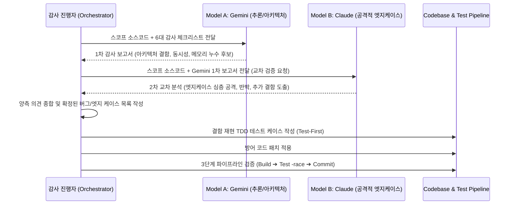

# LionSQL 1.0 릴리스 대비 전 소스코드 135단계 듀얼 AI (Gemini × Claude) 정밀 코드 리뷰 및 엣지 케이스 감사 계획서 (`notes/PRE_RELEASE_AUDIT_PLAN.ko.md`)

> - **최초 작성일**: 2026-11-06
> - **문서 성격**: 1.0 릴리스 신뢰성 검증 게이트(kill -9 크래시 복구, 72h 소크, SQLLogicTest) 진입 이전, Lionsql 엔진 본체 216개 순수 Go 소스코드 전 구역을 13대 도메인 135개 마이크로 스코프로 세분화하여 Gemini와 Claude의 교차 검증으로 숨은 버그, 동시성 레이스, 데드락, 엣지 케이스를 선제 발굴·완치하기 위한 전수 감사 마스터 플랜
> - **과제 식별 코드**: `AUDIT-135-DUAL-REVIEW`
> - **상태**: [x] Completed (135/135 전수 감사 완주 및 결함 기록 완료)
> - **핵심 불변식**:
>   - `[RULE:ExplicitError]` (Never silently swallow errors, No `_ = err`)
>   - `[RULE:LockHierarchy]` (Strict Lock Hierarchy, Deadlock Prevention)
>   - `[RULE:DefensiveIndexing]` (Defensive Indexing & Integer Wrapping Guard)
>   - `[RULE:Invariant 7]` (Zero-Regex SQL Parsing in Production Paths)
>   - `[RULE:PipelineVerification]` (Build ➔ Test `-race` ➔ Commit 3단계 검증 파이프라인)

---

## 1. 아키텍처 배경 및 목적 (Why 135-Step Dual-Model Review?)

### 1.1 배경: 무작위 장기 부하 테스트의 한계
장기 소크 테스트(72h Soak)나 `kill -9` 반복 크래시 복구 테스트는 시스템 전체의 거시적 안정성을 확인하는 데 필수적이지만, 다음과 같은 **희귀한 엣지 케이스(Rare Edge Cases)**는 수십 시간의 부하 테스트에서도 발견되지 않고 프로덕션 배포 후에야 치명적 데이터 오염이나 패닉으로 폭발할 수 있습니다:
1. **타이밍 의존적 동시성 결함**: 특정 나노초 타이밍에만 발생하는 Lock 획득 역전(Deadlock) 또는 채널 닫힘 패닉(`panic: send on closed channel`).
2. **침묵하는 에러 무시(`_ = err`)**: 에러 발생 시 로그 없이 기본값을 취하여 쿼리 결과가 침묵 속에서 왜곡되는 논리적 결함.
3. **경계값 및 슬라이스 오프셋 래핑**: UTF-8 다중바이트 문자열 슬라이싱 패닉, 정수 오버플로우/언더플로우, 빈 슬라이스 인덱싱.
4. **트랜잭션 롤백 잔류 누수**: 복합 DDL/DML 실패 시 사설 워크스페이스나 가상 카탈로그 임시 상태가 100% 원복되지 않고 메모리에 남아 다음 트랜잭션을 오염시키는 현상.

### 1.2 방법론: Gemini × Claude 듀얼 모델 교차 정밀 감사 (Dual-Model Cross Audit)
단일 AI 모델은 특정 편향(Blind Spot)을 가질 수 있으므로, 서로 다른 강점을 가진 두 최고 수준의 추론 모델을 상호 교차시켜 코드베이스를 전수 정밀 해부합니다:

```
+---------------------------------------------------------------------------------------+
|                       Dual-Model Cross Audit Pipeline (1 Scope)                       |
|                                                                                       |
|  [ Target Scope (1~2 Files) ]                                                         |
|             │                                                                         |
|             ├──> [ Model 1: Gemini (Deep Thought / Architectural Verifier) ]          |
|             │    - 시스템 전체 아키텍처 불변식 준수 여부 정밀 추론                     |
|             │    - Go 런타임/표준 라이브러리 프리미티브 적합성 분석                   |
|             │    - 메모리 할당(GC), 인터페이스 계약, 스토리지/트랜잭션 정합성         |
|             │                                                                         |
|             └──> [ Model 2: Claude (Adversarial Edge Case / Static Analysis Hunter) ] |
|                  - 악의적 입력 및 극단적 코너케이스 공격자 시각 검토                  |
|                  - 경계값(Boundary), 타입 변환, 락 순서 역전(Deadlock) 탐색           |
|                  - 침묵하는 에러 처리 및 패닉 유발 지점 전수 스캔                     |
|                                                                                       |
|                                     │                                                 |
|                                     ▼                                                 |
|               [ 교차 검증 & 합의된 엣지 케이스 도출 (Consensus) ]                     |
|                                     │                                                 |
|                                     ▼                                                 |
|               [ TDD 재현 테스트 작성 ➔ 무결성 패치 ➔ 3단계 검증 ]                     |
+---------------------------------------------------------------------------------------+
```

---

## 2. 듀얼 코드 리뷰 표준 프로토콜 및 감사 체크리스트

모든 스코프(Scope)는 아래 6대 핵심 차원의 체크리스트를 기반으로 표준화된 질의 프롬프트를 통해 감사를 진행합니다:

### 2.1 6대 핵심 감사 차원 (Core Audit Dimensions)
1. **Concurrency & Deadlock Safety (`[RULE:LockHierarchy]`, `[RULE:ConcurrencySafety]`)**:
   - `sync.Mutex`, `sync.RWMutex` 획득 순서가 일관적인가? 락을 쥔 상태에서 콜백이나 채널 전송을 호출하지 않는가?
   - 고루틴 라이프사이클이 상위 컨텍스트에 바인딩되어 누수되지 않는가 (`[RULE:ZeroOrphan]`)?
2. **Defensive Indexing & Memory Safety (`[RULE:DefensiveIndexing]`, `[RULE:ZeroAllocation]`)**:
   - 슬라이스 인덱싱 전 `0 <= idx < len` 방어 코드가 존재하는가?
   - UTF-8 다중바이트 문자열 슬라이싱 시 바이트 오프셋과 룬(Rune) 인덱스를 혼동하여 패닉을 유발하지 않는가?
   - 핫패스에서 과도한 힙 할당을 유발하는 정규식 컴파일이나 무분별한 `fmt.Sprintf`가 없는가?
3. **Explicit Error Visibility (`[RULE:ExplicitError]`)**:
   - `_ = err` 형태로 무시되는 에러가 존재하는가?
   - 에러 발생 시 상태가 부분 변경된 채 방치되지 않고 명시적으로 롤백/클린업되는가?
4. **Transactional ACID Durability (`[RULE:Invariant 3]`, `[RULE:Invariant 6]`)**:
   - OCC/MVCC 트랜잭션 도중 에러 발생 시 사설 워크스페이스가 완전히 폐기되는가?
   - DDL 롤백 시 카탈로그 심볼 테이블이 이전 스냅샷으로 완벽히 복원되는가?
5. **Security & Input Sanitization (`[RULE:PathSecurity]`, `[RULE:ExecveSafety]`, `[RULE:Invariant 7]`)**:
   - Path Traversal(`../`), 숨김 파일(`.env`) 유출 가능성이 원천 차단되었는가?
   - 쿼리 파싱 경로에 정규식이 절대 남아있지 않는가?
6. **Platform & Resource Hygiene (`[RULE:PlatformPrimitives]`, `[RULE:HandleHygiene]`)**:
   - `os.File`, `net.Conn`, `io.ReadCloser` 등이 `defer Close()`로 안전하게 회수되는가?
   - 더블 클로즈(`double close`) 패닉 방어가 되어 있는가 (`[RULE:DoubleCloseSafety]`)?

---

## 3. 전 소스코드 100단계 마이크로 스코프 분할 매트릭스 (100 Micro-Scopes Matrix)

LionSQL 본체 순수 Go 소스코드 216개 파일(테스트 및 자동생성 ANTLR 제외)을 13대 도메인, 총 135개 마이크로 스코프로 완벽히 분할하였습니다.

> **실시간 진행 상태(Status) 추적 및 세션 보존 규격**:
> 작업을 언제든 중단하거나 새로운 세션에서 재개하더라도 아래 표의 상태를 통해 정확한 지점을 추적합니다:
> - `PENDING`: 감사 대기 상태
> - `[G]`: Gemini 1차 심층 분석 완료
> - `[G+C]`: Claude 2차 교차 검증 완료 (합의 결함 도출)
> - `[x] PASS`: 듀얼 검증 결과 결함 없음 확인 (무결성 통과)
> - `[x] FIXED (<hash>)`: 엣지 케이스 발견 ➔ TDD 재현 테스트 작성 ➔ 패치 커밋 완료

### 도메인 1: 스토리지 엔진 - In-Memory OCC Core (Scopes 1 ~ 12)
| Scope | 대상 소스 파일 | 핵심 역할 | 중점 엣지 케이스 감사 포인트 | 상태 |
| :--- | :--- | :--- | :--- | :---: |
| **001** | `pkg/storage/memengine/memengine.go` (1/2) | OCC 엔진 수명주기 및 테이블 카탈로그 맵 | 엔진 초기화, 동시 테이블 생성/삭제 맵 경쟁, Close 시 리소스 정리 | [x] LOGGED |
| **002** | `pkg/storage/memengine/memengine.go` (2/2) | 읽기/쓰기 트랜잭션 시작 및 락 프리 읽기 스냅샷 | 스냅샷 생성 시 글로벌 버전 읽기 경쟁, 비정상 격리 누수 | [x] LOGGED |
| **003** | `pkg/storage/memengine/table_data.go` (1/2) | 테이블 데이터 파티션 및 튜플 메모리 레이아웃 | 동시 행 삽입 시 메모리 정렬, 고밀도 행 추가 시 레이아웃 갱신 | [x] LOGGED |
| **004** | `pkg/storage/memengine/table_data.go` (2/2) | 행 가시성(Visibility) 및 버전 체인 점검 | OCC 충돌 판정, 삭제된 행의 스냅샷 가시성 판단 오류 | [x] LOGGED |
| **005** | `pkg/storage/memengine/tx.go` (1/3) | 트랜잭션 구조체 및 사설 워크스페이스 버퍼링 | 미커밋 상태 격리, 동시 다중 쓰기 버퍼 오버플로우 | [x] LOGGED |
| **006** | `pkg/storage/memengine/tx.go` (2/3) | OCC 유효성 검증(Validation) 및 원자적 커밋 | Write-Write 충돌 고속 감지(`ErrWriteConflict`), 버전 증가 원자성 | [x] LOGGED |
| **007** | `pkg/storage/memengine/tx.go` (3/3) | 롤백 처리 및 워크스페이스 폐기/재활용 | 롤백 시 잔류 포인터 정리, sync.Pool 재활용 시 상태 오염 | [x] LOGGED |
| **008** | `pkg/storage/memengine/skiplist.go` | 락 프리 SkipList 인덱스 구현 | 동시 분기/합병 시 포인터 레이스, 범위 스캔(Range Scan) 경계값 | [x] LOGGED |
| **009** | `pkg/storage/memengine/flat_record.go` (1/2) | Pointer-Free Flat Record 인코딩/디코딩 레이아웃 | 고정 길이/가변 길이 오프셋 계산 정합성, 버퍼 오버런 방어 | [x] LOGGED |
| **010** | `pkg/storage/memengine/flat_record.go` (2/2) | Flat Record 제로-할당 슬라이스 추출기 | 슬라이스 재사용 동시성 안전성, NULL 비트맵 경계값 검증 | [x] LOGGED |
| **011** | `pkg/storage/memengine/wal.go` | WAL 레코드 직렬화 및 동기화 루프 | 고동시성 fsync 그룹 커밋 경합, 디스크 풀(ENOSPC) 처리 | [x] LOGGED |
| **012** | `pkg/storage/memengine/persistence.go`, `ddl.go` | AOF 로그 리플레이, 체크포인트 및 DDL 반영 | 복구 도중 부분 손상 레코드 처리, DDL 변경 시 인덱스 동기 재구축 | [x] LOGGED |

---

### 도메인 2: 스토리지 엔진 - WiredTiger MVCC Core & 공통 스토리지 (Scopes 13 ~ 24)
| Scope | 대상 소스 파일 | 핵심 역할 | 중점 엣지 케이스 감사 포인트 | 상태 |
| :--- | :--- | :--- | :--- | :---: |
| **013** | `pkg/storage/wiredtiger/wt_engine.go` (1/3) | CGo 수명주기, WT_CONNECTION 및 세션 풀러 | 세션 고갈 시 대기 타임아웃, CGo 포인터 누수 및 패닉 복구 | [x] LOGGED |
| **014** | `pkg/storage/wiredtiger/wt_engine.go` (2/3) | WT 트랜잭션 바인딩 및 MVCC 충돌 제어 | `WT_ROLLBACK` 에러 변환, 타임스탬프 스냅샷 일관성 | [x] LOGGED |
| **015** | `pkg/storage/wiredtiger/wt_engine.go` (3/3) | WT_CURSOR 순회 및 B+Tree 스키마 매핑 | 커서 재활용 시 초기화 누락, 다중 컬럼 복합 키 인코딩 | [x] LOGGED |
| **016** | `pkg/storage/wiredtiger/wt_stub.go` | 비-CGo 환경 스텁(Stub) 구현체 | 순수 Go 빌드 시 컴파일 및 런타임 에러 전파 정합성 | [x] LOGGED |
| **017** | `pkg/storage/engine.go` | Storage Engine 인터페이스 및 트랜잭션 명세 | 두 엔진 간 계약 불일치, 인터페이스 침묵 에러 | [x] LOGGED |
| **018** | `pkg/storage/record.go`, `tuple.go` | 공통 튜플 및 레코드 추상화 | 컬럼 타입 불일치 시 패닉 방어, 튜플 슬라이스 복사 누락 | [x] LOGGED |
| **019** | `pkg/storage/decimal.go` | 고정소수점 Decimal 연산 및 직렬화 | 64비트 정수 오버플로우, 반올림/버림 정밀도 유실 | [x] LOGGED |
| **020** | `pkg/storage/value_codec.go`, `codec.go` | 바이너리 값 직렬화 및 정렬 보존 인코딩 | 바이트 역전, 음수/NaN 정렬 순서 뒤바뀜 결함 | [x] LOGGED |
| **021** | `pkg/storage/coerce.go`, `types_extended.go` | 타입 강제 변환 및 확장 SQL 타입 시스템 | 비호환 타입 강제 변환 시 런타임 패닉 방어 | [x] LOGGED |
| **022** | `pkg/storage/json.go` | JSONB 바이너리 표현 및 경로 탐색기 | 불완전한 JSON 파싱 시 스택 고갈, 깊은 중첩 탐색 루프 | [x] LOGGED |
| **023** | `pkg/storage/arena.go`, `slice_cursor.go` | 메모리 아레나 할당기 및 인메모리 커서 | 아레나 오프셋 재설정 누락, 댕글링 포인터 참조 | [x] LOGGED |
| **024** | `pkg/storage/synthetic_pk.go`, `benchdir.go`, `literal.go` | 인조 기본키 생성기 및 리터럴 유틸리티 | 동시 기본키 생성 시 중복 충돌, 벤치 디렉터리 경로 보안 | [x] LOGGED |

---

### 도메인 3: 카탈로그 & 가상 시스템 메타데이터 (Scopes 25 ~ 34)
| Scope | 대상 소스 파일 | 핵심 역할 | 중점 엣지 케이스 감사 포인트 | 상태 |
| :--- | :--- | :--- | :--- | :---: |
| **025** | `pkg/catalog/catalog.go` (1/2) | 테이블/인덱스/프로시저 스키마 카탈로그 맵 | 대소문자 구분(Collation) 정합성, 스키마 락 계층 | [x] LOGGED |
| **026** | `pkg/catalog/catalog.go` (2/2) | 컬럼 메타데이터, 제약조건(PK/FK/Check) 관리 | 복합 외래키 캐스케이드 사이클 검출, 중복 인덱스 방어 | [x] LOGGED |
| **027** | `pkg/catalog/virtual/interceptor.go` (1/2) | 가상 카탈로그 라우팅 디스패처 (Table-Driven) | 순서 종속성 배제, 라우트 미매칭 시 폴백 정합성 | [x] LOGGED |
| **028** | `pkg/catalog/virtual/interceptor.go` (2/2) | 세션 환경변수 및 가상 쿼리 변환 | TDS/PGWire 세션 변수(`@@SPID`, `DB_NAME()`) 격리 | [x] LOGGED |
| **029** | `pkg/catalog/virtual/mssql.go` (1/2) | `sys.tables`, `sys.columns`, `sys.indexes` 뷰 | DBeaver/SSMS 메타데이터 조회 시 누락/잘림 결함 | [x] LOGGED |
| **030** | `pkg/catalog/virtual/mssql.go` (2/2) | `sys.procedures`, `sys.types`, `sys.objects` 뷰 | 프로시저 파라미터 매핑 및 SQL Server 고유 타입 ID 일치 | [x] LOGGED |
| **031** | `pkg/catalog/virtual/pg.go` (1/2) | `pg_catalog.pg_class`, `pg_attribute`, `pg_namespace` | PostgreSQL GUI(DBeaver, Beekeeper) OID 매핑 정합성 | [x] LOGGED |
| **032** | `pkg/catalog/virtual/pg.go` (2/2) | `pg_type`, `pg_database`, `information_schema` 뷰 | 드라이버 연결 시 초기 핸드셰이크 쿼리 응답 완결성 | [x] LOGGED |
| **033** | `pkg/catalog/virtual/result.go` | 가상 카탈로그 결과셋 빌더 및 조건 필터 | T-SQL 와일드카드 대괄호(`[_]`, `[%]`) 및 POSIX `~` 매칭 | [x] LOGGED |
| **034** | `pkg/catalog/virtual/info_schema.go`, `sys_tables.go`, `tables.go`, `source.go` | 가상 스키마 정의 및 시스템 내장 테이블 | 정적 스키마 불변성, 널 세이프티(Null-Safety) | [x] LOGGED |

---

### 도메인 4: 통합 쿼리 코디네이터 & DDL/DML 실행기 (Scopes 35 ~ 55)
| Scope | 대상 소스 파일 | 핵심 역할 | 중점 엣지 케이스 감사 포인트 | 상태 |
| :--- | :--- | :--- | :--- | :---: |
| **035** | `pkg/engine/coordinator.go`, `coordinator_impl.go` (1/3) | 글로벌 쿼리 코디네이터 및 세션 수명주기 | 세션 풀러 반환 누락, 비정상 클라이언트 단선 감지 | [x] LOGGED |
| **036** | `pkg/engine/coordinator.go`, `coordinator_impl.go` (2/3) | 2-Tier 라우팅 엔진 (VDBE vs CBO 선택) | 쿼리 특성 판별 오류, 트랜잭션 핸들 누락 전달 | [x] LOGGED |
| **037** | `pkg/engine/coordinator.go`, `coordinator_impl.go` (3/3) | 타임아웃 거버너, SPID 쿼리 취소 (`KILL`) | 협력적 취소 컨텍스트 전파, 취소 시 고루틴 잔류 방어 | [x] LOGGED |
| **038** | `pkg/engine/sqlexec.go` (1/2) | 통합 SQL 실행 진입로 및 트랜잭션 래퍼 | 오토커밋과 명시적 `BEGIN TRAN` 경계 불일치 | [x] LOGGED |
| **039** | `pkg/engine/sqlexec.go` (2/2) | 다중 쿼리 배치(Batch) 분해 및 세미콜론 분리 | 문자열 리터럴/주석 내부 세미콜론 오분할 방지 | [x] LOGGED |
| **040** | `pkg/engine/sqlexec_ddl.go` (1/3) | `CREATE TABLE`, `DROP TABLE`, `TRUNCATE` | 식별자 정규화, 실패 시 원자적 롤백 및 테이블 잠금 | [x] LOGGED |
| **041** | `pkg/engine/sqlexec_ddl.go` (2/3), `sqlexec_conditional_ddl.go` | `ALTER TABLE` (컬럼/제약조건/이름변경) 및 관용 조건부 DDL | 기존 데이터와 제약조건 불일치 검증, 타입 변경 롤백, 조건부 DDL 무결성 | [x] LOGGED |
| **042** | `pkg/engine/sqlexec_ddl.go` (3/3), `boundary_normalizer.go` | `CREATE/DROP INDEX`, 관용 DDL 모드 및 식별자 경계 정규화 | 인덱스 빌드 도중 크래시 방어, `tolerant_ddl` 상태 전이, 대괄호/백틱 정규화 | [x] LOGGED |
| **043** | `pkg/engine/sqlexec_dml.go` (1/2), `dml_parser.go` | `INSERT INTO`, `SELECT INTO` 실행기 및 DML 어휘 파서 | 기본값(DEFAULT), IDENTITY/AUTO_INCREMENT 증가 원자성, 대량 INSERT 바운드 | [x] LOGGED |
| **044** | `pkg/engine/sqlexec_dml.go` (2/2) | `UPDATE`, `DELETE` 실행기 및 다중 조건 절 | 자기 참조(Self-referencing) 갱신 시 무한 루프, 외래키 삭제/수정 제약조건 검증 | [x] LOGGED |
| **045** | `pkg/engine/sqlexec_select.go` (1/2) | 최상위 `SELECT` 절 실행 및 프로젝션 평가 | `SELECT *` 확장 시 컬럼 순서 보존, 별칭(Alias) 충돌, 계산식 프로젝션 | [x] LOGGED |
| **046** | `pkg/engine/sqlexec_select.go` (2/2) | T-SQL 페이징(`TOP`, `OFFSET FETCH`) 및 Bare IN | 중첩 서브쿼리 페이징 오변환 방어, 0-행 결과셋 처리, TOP PERCENT 계산 정합성 | [x] LOGGED |
| **047** | `pkg/engine/sqlexec_derived.go`, `cte_lowering.go` | 인라인 파생 테이블(`FROM/JOIN subquery`) 및 CTE 재작성기 | 상관 서브쿼리 비상관화, CTE 이름 충돌 및 다중 참조 시 머티리얼라이즈 무결성 | [x] LOGGED |
| **048** | `pkg/engine/sqlexec_merge.go`, `sqlexec_apply.go` | `MERGE` (UPSERT) 문 및 `CROSS/OUTER APPLY` 실행기 | WHEN MATCHED / NOT MATCHED 동시 경합, APPLY 행 확장 시 NULL 전파 정합성 | [x] LOGGED |
| **049** | `pkg/engine/sqlexec_cursor.go`, `sqlexec_prepare.go` | FORWARD-ONLY 세션 커서 및 `PREPARE` / `EXECUTE` 실행기 | 커서 WITH HOLD 수명주기, 미해제 커서 메모리 누수, 준비된 문장 파라미터 캐시 | [x] LOGGED |
| **050** | `pkg/engine/sqlexec_procs.go`, `proc_bind.go`, `sqlexec_auth.go` | `CREATE PROCEDURE`, `EXEC` 프로시저 실행기 및 인라인 권한 | 프로시저 재컴파일 플래그, 파라미터 방향(IN/OUT) 매핑, 중첩 프로시저 호출 스택 | [x] LOGGED |
| **051** | `pkg/engine/sqlexec_eval.go`, `evaluator.go`, `sql_row.go` | 행 단위 조건식 평가기 및 SQL Row 직렬화/역직렬화 | NULL 3치 논리(True/False/Unknown), 단락 평가(Short-circuit), 연산자 우선순위 | [x] LOGGED |
| **052** | `pkg/engine/sqlexec_pivot.go`, `sqlexec_string_split.go`, `sqlexec_explain.go` | `PIVOT`, `UNPIVOT`, `STRING_SPLIT` 및 `EXPLAIN` 플랜 서술 | 동적 피벗 컬럼 타입 불일치, 순환 참조 플랜 트리 직렬화, 구분자 분할 바운드 | [x] LOGGED |
| **053** | `pkg/engine/sqlexec_jdbc_metadata.go`, `sqlexec_virtual.go`, `sqlexec_dbcc.go` | JDBC 메타데이터 변환, 가상 프로시저 및 `DBCC` 실행기 | 임시 테이블 생성 즉시 SELECT 스코프 누수, DBCC CHECKTABLE 잠금 안전성 | [x] LOGGED |
| **054** | `pkg/engine/session.go`, `session_pool.go`, `session_registry.go` | 클라이언트 세션 수명주기, 세션 풀러 및 레지스트리 | 세션 고아화 방어, 풀 반환 누락 누수, 다중 스레드 세션 변수 경합 (`[RULE:LockHierarchy]`) | [x] LOGGED |
| **055** | `pkg/engine/auto_analyze.go`, `pk_bypass.go`, `general_log.go`, `slow_query.go`, `metrics.go`, `rotating_logger.go`, `query_utils.go` | 백그라운드 통계 수집기, PK 고속 바이패스 및 쿼리 로거 | WAL 훅 비동기 큐 언바운디드 성장 방어, 슬로우 쿼리 파일 로테이션 디스크 풀 방어 | [x] LOGGED |

---

### 도메인 5: T-SQL 파서 (Tier 1 Pratt Parser) & 바이트코드 컴파일러 (Scopes 56 ~ 65)
| Scope | 대상 소스 파일 | 핵심 역할 | 중점 엣지 케이스 감사 포인트 | 상태 |
| :--- | :--- | :--- | :--- | :---: |
| **056** | `pkg/proc/lexer.go`, `token.go`, `literal.go` | T-SQL Fast-Path 어휘 분석기(Lexer) 및 토큰 정의 | Unclosed 따옴표/주석 시 무한 루프 차단, 대괄호 식별자 탈출, 특수 리터럴 | [x] LOGGED |
| **057** | `pkg/proc/parser.go`, `parser_expr.go` | Pratt 파서 표현식 파싱 및 연산자 결합 법칙 | 재귀 깊이 스택 오버플로우 방어 (`[RULE:BoundedRecursion]`), CASE WHEN 중첩 | [x] LOGGED |
| **058** | `pkg/proc/parser_stmt.go` | T-SQL 제어문 파싱 (`IF-ELSE`, `WHILE`, `TRY-CATCH`) | GOTO/LABEL 순환 참조, 중첩 블록 스코프 변수 은닉(Shadowing) | [x] LOGGED |
| **059** | `pkg/proc/parser_ddl.go`, `parser_dml.go` | 프로시저 내 인라인 DDL/DML 파서 | 파서 에러 전파 무결성, 불완전 DDL 파싱 시 부분 AST 오염 방어 | [x] LOGGED |
| **060** | `pkg/proc/ast.go`, `characteristics.go`, `strict.go` | AST 노드 정의, 프로시저 특성 판별 및 엄격 모드 검사 | AST 노드 깊은 복사(Deep Copy) 안전성, 부작용(Side-effect) 없는 쿼리 판별 | [x] LOGGED |
| **061** | `pkg/proc/compiler.go`, `bytecode.go` (1/2) | T-SQL AST ➔ VDBE 바이트코드 컴파일러 및 Opcode 정의 | 점프 오프셋(Jump Offset) 인덱스 바운드, 레지스터 할당 오버플로우 방어 | [x] LOGGED |
| **062** | `pkg/proc/compiler.go`, `bytecode.go` (2/2) | 컴파일러 최적화 패스 및 레지스터 수명주기 관리 | 미사용 레지스터 반환, 루프 내부 불변식 코드 외곽 이동 정합성 | [x] LOGGED |
| **063** | `pkg/proc/parser/antlr/wrapper.go`, `ast_builder.go` | Tier 2 ANTLR4 공식 문법 파서 래퍼 및 AST 변환기 | Fast Pratt 파서 실패 시 ANTLR 폴백 전이 무결성, ANTLR AST 노드 변환 누락 방어 | [x] LOGGED |
| **064** | `pkg/proc/parser/antlr/tsql_lexer.go`, `tsql_parser.go`, `tsqlparser_base_listener.go`, `tsqlparser_base_visitor.go`, `tsqlparser_listener.go`, `tsqlparser_visitor.go` | 공식 Microsoft T-SQL ANTLR4 렉서/파서 런타임 및 리스너/비지터 | 대용량 T-SQL 스크립트 파싱 메모리 폭증 방어, 토큰 스트림 리셋 안전성 | [x] LOGGED |
| **065** | `pkg/proc/cache.go`, `fold.go` | 프로시저 바이트코드 계획 캐시 및 상수 폴딩(Constant Folding) | 캐시 키 해시 충돌 방어, 컴파일 타임 0 나누기(Division by Zero) 패닉 방어 | [x] LOGGED |

---

### 도메인 6: T-SQL VDBE 런타임 가상머신 & 빌트인 함수 (Scopes 66 ~ 75)
| Scope | 대상 소스 파일 | 핵심 역할 | 중점 엣지 케이스 감사 포인트 | 상태 |
| :--- | :--- | :--- | :--- | :---: |
| **066** | `pkg/proc/runtime/vm.go` (1/2) | VDBE 바이트코드 가상머신 인터프리터 코어 루프 | PC(Program Counter) 언바운디드 점프 가드, 인터럽트 신호 협력적 검사 | `[x] LOGGED` |
| **067** | `pkg/proc/runtime/vm.go` (2/2) | VDBE 레지스터 읽기/쓰기, 스택 프레임, CALL/RETURN | 레지스터 경계 검사 (`0 <= r < maxReg`), 중첩 프로시저 호출 프레임 누수 방어 | `[x] LOGGED` |
| **068** | `pkg/proc/runtime/vm_dispatcher.go` | Opcode 디스패치 테이블 및 고속 루프 | 함수 포인터 디스패치 유효성, 상태 머신 전이 무결성 | `[x] LOGGED` |
| **069** | `pkg/proc/runtime/bridge.go`, `vm_lazy.go` | 스토리지 트랜잭션 브릿지 및 지연 레지스터 바인딩 | VDBE 트랜잭션 핸들 누수 방어, 지연 평가 서브쿼리 캐시 정합성 | `[x] LOGGED` |
| **070** | `pkg/proc/builtins.go`, `builtins_string.go` | 문자열 내장 함수 (`SUBSTRING`, `CHARINDEX`, `LEN`, `REPLACE` 등) | UTF-8 다중 바이트 슬라이싱 패닉 방어, 음수 인덱스/길이 바운드 가드 | `[x] LOGGED` |
| **071** | `pkg/proc/builtins_math.go`, `builtins_date.go` | 수학 및 날짜/시간 내장 함수 (`DATEADD`, `DATEDIFF`, `ROUND` 등) | 날짜 래핑 오버플로우, 부동소수점 NaN/Inf 변환 패닉 방어 | `[x] LOGGED` |
| **072** | `pkg/proc/builtins_json.go` | T-SQL JSON 내장 함수 (`ISJSON`, `JSON_VALUE`, `JSON_QUERY` 등) | 잘못된 JSON 경로 표현식 패닉 방어, 거대 JSON 페이로드 파싱 메모리 한도 | `[x] LOGGED` |
| **073** | `pkg/proc/builtins_sys.go` | 시스템 속성 및 메타데이터 함수 (`SERVERPROPERTY`, `OBJECT_ID` 등) | NULL 객체 조회 시 안전한 NULL 반환, 세션 SPID 및 DB_NAME() 격리 | `[x] LOGGED` |
| **074** | `pkg/proc/evaluator.go`, `eval.go` | 런타임 표현식 인터프리터 및 연산자 타입 강제 변환 | 암시적 타입 변환 규칙(Type Precedence) 엄격 준수, 정수 오버플로우 방어 | `[x] LOGGED` |
| **075** | `pkg/proc/runtime/vm.go`, `pkg/engine/sqlexec_procs.go` | 동적 SQL 실행기(`sp_executesql`) 및 쿼리 취소 연동 | 동적 SQL 문자열 내 주석 인젝션 방어, 런타임 실행 중단 전파 | `[x] LOGGED` |

---

### 도메인 7: Volcano Cost-Based Optimizer (CBO) 플래너 (Scopes 76 ~ 83)
| Scope | 대상 소스 파일 | 핵심 역할 | 중점 엣지 케이스 감사 포인트 | 상태 |
| :--- | :--- | :--- | :--- | :---: |
| **076** | `pkg/planner/planner.go` (1/2) | CBO 논리 플랜 생성기 및 관계대수 트리 변환 | 카테시안 곱(Cartesian Product) 오폭발 방어, 프로젝션 푸시다운 누락 방어 | `[x] LOGGED` |
| **077** | `pkg/planner/planner.go` (2/2) | CBO 비용 모델링 (CPU/IO Cost 평가 및 최적 조인 순서) | 동일 비용 조인 순서의 비결정론적 플랜 플리핑 방어, 기하급수 검색 가지치기 | `[x] LOGGED` |
| **078** | `pkg/planner/decorrelate.go` | 상관 서브쿼리 비상관화(Decorrelation) 규칙 | 서브쿼리 널 세이프티(Null-rejecting predicate) 검증, 다중 상관 참조 평탄화 | `[x] LOGGED` |
| **079** | `pkg/planner/pushdown.go` | 조건절 푸시다운(Predicate Pushdown) 및 인덱스 선택기 | 조인 이전 인덱스 스캔 푸시다운 유효성, 타입 불일치 시 인덱스 무효화 방어 | `[x] LOGGED` |
| **080** | `pkg/planner/bounds.go`, `pruning.go` | 인덱스 검색 범위(Range Bounds) 빌더 및 파티션 가지치기 | BETWEEN, IN, 부등호 복합 범위 경계값 오차(Off-by-one), 빈 파티션 스킵 | `[x] LOGGED` |
| **081** | `pkg/planner/setop.go`, `stats.go` | 집합 연산(UNION, INTERSECT, EXCEPT) 플랜 및 테이블 통계 연동 | 중복 제거 해시 누수, 히스토그램 버킷 경계값 카디널리티 추정 정밀도 | `[x] LOGGED` |
| **082** | `pkg/planner/explain.go` | `EXPLAIN` / `EXPLAIN ANALYZE` 플랜 트리 포맷터 | 순환 참조 플랜 트리 직렬화 스택 오버플로우 방어, Volcano 연산자 시간 누적 오차 | `[x] LOGGED` |
| **083** | `pkg/planner/planner.go` (CBO 규칙/탐욕 조인) | 동등 그룹 및 CBO 조인 변환 규칙 엔진 | 탐욕 조인 순서 최적화 시 카디널리티 비교, 메모리 유계성 | `[x] LOGGED` |

---

### 도메인 8: Volcano 실행 반복자 (Execution Engine) & 메모리 거버너 (Scopes 84 ~ 95)
| Scope | 대상 소스 파일 | 핵심 역할 | 중점 엣지 케이스 감사 포인트 | 상태 |
| :--- | :--- | :--- | :--- | :---: |
| **084** | `pkg/execution/scan.go`, `project.go` | 테이블 스캔, 인덱스 레인지 스캔 및 프로젝션 반복자 | 스캔 도중 트랜잭션 사설 워크스페이스 격리, 컬럼 오프셋 바운드 체크 | `[x] LOGGED` |
| **085** | `pkg/execution/filter.go`, `eval.go` | 행 필터 반복자 및 제로-정규식 LIKE/BETWEEN 조건 평가기 | 핫패스 메모리 할당 제로화, MatchLike T-SQL 와일드카드 일치 | `[x] LOGGED` |
| **086** | `pkg/execution/join.go` | 인메모리 해시 조인(Hash Join) 및 중첩 루프 조인(Nested Loop) | 해시 빌드 테이블 OOM 방어, 외부 조인(LEFT/RIGHT/FULL) NULL 패딩 무결성 | `[x] LOGGED` |
| **087** | `pkg/execution/merge_join.go` | 머지 조인(Merge Join) 및 정렬 상태 검증기 | 정렬되지 않은 입력 스트림 진입 시 패닉 방어, NULL 키 조인 매칭 배제 | `[x] LOGGED` |
| **088** | `pkg/execution/aggregate.go` | `COUNT`, `SUM`, `AVG`, `GROUP BY` 해시 집계 반복자 | 빈 테이블 집계 시 NULL 반환(COUNT 제외), 그룹 키 해시 충돌 및 메모리 누수 | `[x] LOGGED` |
| **089** | `pkg/execution/sort.go` | 인메모리 정렬 및 External Merge Sort | 정렬 메모리 초과 시 디스크 스필(Spill) 임시 파일 누수 방어 | `[x] LOGGED` |
| **090** | `pkg/execution/limit.go`, `window.go` | `LIMIT/OFFSET` 및 윈도우 함수(`ROW_NUMBER`, `RANK`, `DENSE_RANK`) | 음수 오프셋, OVER(PARTITION BY... ORDER BY...) 경계값 분할 | `[x] LOGGED` |
| **091** | `pkg/execution/setop.go`, `chunk.go` | UNION / EXCEPT 반복자 및 1,024-행 벡터화 청크 스트리머 | 청크 메모리 재사용 슬랩 풀링 무결성, 0-행 청크 종료 조건 | `[x] LOGGED` |
| **092** | `pkg/execution/builder.go`, `iterator.go` | 물리 실행 플랜 빌더 및 최상위 반복자 체인 인터페이스 | 반복자 Close() 호출의 멱등성 보장 (`[RULE:DoubleCloseSafety]`), 자원 회수 | `[x] LOGGED` |
| **093** | `pkg/execution/tdigest.go`, `instrument.go` | P99 지연시간 T-Digest 추정기 및 실행 프로파일러 | 극단값 수렴 시 NaN 방어, 프로파일링 오버헤드 16ms 예산 준수 | `[x] LOGGED` |
| **094** | `pkg/execution/governor.go`, `governor_sys_*.go` | OS 네이티브 메모리 압력 감지기 및 `work_mem` 거버너 | OS별 시스템 메모리 고갈 감지 시 즉각적 쿼리 메모리 축소 및 회복 | `[x] LOGGED` |
| **095** | `pkg/execution/governor.go` (메모리 제어) | 글로벌 메모리 거버너 및 GOMEMLIMIT 동적 튜닝 | 연산자 메모리 초과 시 안전한 취소, 비정상 환경변수 파싱 복귀 | `[x] LOGGED` |

---

### 도메인 9: 네트워크 와이어 프로토콜 - PGWire & TDS (Scopes 96 ~ 105)
| Scope | 대상 소스 파일 | 핵심 역할 | 중점 엣지 케이스 감사 포인트 | 상태 |
| :--- | :--- | :--- | :--- | :---: |
| **096** | `pkg/wire/server.go` (1/2) | PGWire v3 TCP 리스너 및 연결 핸들러 | 악의적 대용량 패킷 OOM 방어, 연결 급작 단선(Broken Pipe) 클린업 | `[x] LOGGED` |
| **097** | `pkg/wire/server.go` (2/2) | PGWire 확장 쿼리(`Parse`, `Bind`, `Execute`) | $1 파라미터 변환 상태머신(`sqlutil.ReplacePgParams`) 무결성, Portal 누수 방어 | `[x] LOGGED` |
| **098** | `pkg/wire/protocol.go` | PGWire 메시지 인코딩/디코딩 및 패킷 버퍼 풀링 | 버퍼 오버런, 잘못된 패킷 길이 필드로 인한 패닉 방어 | `[x] LOGGED` |
| **099** | `pkg/wire/copy.go`, `command_tags.go`, `numeric.go`, `param_rules.go` | PGWire 대량 COPY 프로토콜, 명령 태그 및 Numeric 직렬화 | COPY FROM EOF 감지 누락 무한 대기 방어, BCD 고정소수점 변환 바운드 | `[x] LOGGED` |
| **100** | `pkg/wire/tls.go` | PGWire SSL/TLS 암호화 핸드셰이크 | STARTTLS 협상 실패 시 연결 강제 종료, 인증서 로딩 에러 핸들링 | `[x] LOGGED` |
| **101** | `pkg/wire/tds/server.go` (1/2) | Microsoft TDS 7.x/8.0 TCP 리스너 및 세션 디스패처 | Prelogin 핸드셰이크 협상, TDS 패킷 청크 재조립 버퍼 오버플로우 방어 | `[x] LOGGED` |
| **102** | `pkg/wire/tds/server.go` (2/2) | TDS SQL Batch 및 RPC 실행 파이프라인 | SSMS 특수 쿼리 파싱, TDS 토큰 스트림 직렬화 정합성, 멀티문 결과셋 반환 | `[x] LOGGED` |
| **103** | `pkg/wire/tds/token.go`, `packet.go` | TDS 토큰 인코더 (`COLMETADATA`, `ROW`, `DONE`, `ENVCHANGE`) | 컬럼 정밀도/스케일 바이트 오버플로우, Nullability 비트맵 직렬화 정합성 | `[x] LOGGED` |
| **104** | `pkg/wire/tds/login.go`, `crypto.go`, `tls.go` | TDS 7.x/8.0 로그인 패킷 디코딩 및 비밀번호 암호화 | XOR 4비트 암호 해독 바운드 체크, TLS 1.3 암호화 핸드셰이크 | `[x] LOGGED` |
| **105** | `pkg/wire/tds/rpc.go` | `sp_executesql`, `sp_prepare` 파라미터 RPC 파서 | RPC 데이터 타입 ID 매핑 오류, OUT 파라미터 반환 누락, 타입 불일치 에러 전파 | `[x] LOGGED` |

---

### 도메인 10: 서버 인프라, HA 복제, 백업/PITR & CDC (Scopes 106 ~ 113)
| Scope | 대상 소스 파일 | 핵심 역할 | 중점 엣지 케이스 감사 포인트 | 상태 |
| :--- | :--- | :--- | :--- | :---: |
| **106** | `pkg/replication/manager.go`, `stream.go` | 1-Writer Multi-Reader WAL 복제 코디네이터 | LSN 시퀀스 역전 감지, 레플리카 지연(Lag) 감지 및 재연결 루프 | `[x] LOGGED` |
| **107** | `pkg/replication/client.go`, `broadcaster.go` | 레플리카 WAL 수신 클라이언트 및 변경사항 브로드캐스터 | 비정상 연결 단선 시 재시도 백오프, 브로드캐스트 채널 블로킹 방어 | `[x] LOGGED` |
| **108** | `pkg/replication/failover.go`, `handlers.go`, `types.go` | Always On 자동 장애조치 및 쿼럼 선거 | 스플릿 브레인(Split-Brain) 방어, 투표 데드락 방지, 복제 핸들러 안전성 | `[x] LOGGED` |
| **109** | `pkg/backup/backup.go`, `restore.go` | 스냅샷 백업 및 전체 복원 파이프라인 | 아카이브 체크섬 검증, 복원 도중 비정상 종료 시 원자적 롤백 | `[x] LOGGED` |
| **110** | `pkg/backup/pitr.go`, `wal_archive.go` | 시점 복구(PITR) 및 지속적 WAL 아카이빙 엔진 | WAL 아카이브 LSN 연속성 검증, 시점 복구 목표 타임스탬프 도달 정확성 | `[x] LOGGED` |
| **111** | `pkg/cdc/dispatcher.go`, `streamer.go` | Transactional Outbox 및 실시간 CDC 스트리머 | Outbox 큐 언바운디드 성장 방어, 느린 컨슈머 백프레셔 제어 | `[x] LOGGED` |
| **112** | `pkg/cdc/event.go`, `outbox.go`, `outbox_sinks.go` | CDC 이벤트 직렬화 및 외부 싱크 어댑터 | 이벤트 JSON 직렬화 정밀도, 네트워크 실패 시 Outbox 재시도 안전성 | `[x] LOGGED` |
| **113** | `pkg/slt/runner.go`, `parser.go` | SQLLogicTest 내장 러너 및 스크립트 파서 | 대용량 SLT 파일 파싱 시 메모리 누수 방지, 슬로우 쿼리 타임아웃 격리 | `[x] LOGGED` |

---

### 도메인 11: SQL 유틸리티, 공통 파서, 보안/인증 및 엔진 설정 (Scopes 114 ~ 119)
| Scope | 대상 소스 파일 | 핵심 역할 | 중점 엣지 케이스 감사 포인트 | 상태 |
| :--- | :--- | :--- | :--- | :---: |
| **114** | `pkg/sqlutil/predicate.go`, `tokenizer.go` | 괄호 균형 Context-Free 조건식 파서 및 토크나이저 | Dyck 언어 균형 괄호 매칭, 따옴표/주석 내부 키워드 오인식 원천 차단 | `[x] LOGGED` |
| **115** | `pkg/sqlutil/like.go`, `params.go` | 고속 제로할당 LIKE 매처 및 $N/$tag$ 파라미터 변환기 | T-SQL 와일드카드([_], [%]) 특수문자 오탈출 방어, DoS 유발 정규식 원천 배제 | `[x] LOGGED` |
| **116** | `pkg/sqlutil/casing.go`, `comparator.go`, `pagination.go` | 대소문자 무시 정규화, 동적 Any 비교기 및 LIMIT/OFFSET 파서 | ASCII 고속 폴딩 경계 검사, 복합 타입 비교 시 패닉 방어, 페이징 오버플로우 | `[x] LOGGED` |
| **117** | `pkg/auth/auth.go`, `provider.go` | 사용자 인증 서비스, 패스워드 해싱 및 인증 프로바이더 | 타이밍 공격 방어(`subtle.ConstantTimeCompare`), 슈퍼유저 기본 계정 보안 | `[x] LOGGED` |
| **118** | `pkg/auth/rbac.go` | 역할 기반 접근 제어(RBAC) 권한 검사기 | 권한 상속 그래프 순환 참조 방지, 미인가 DDL/DML 실행 차단 무결성 | `[x] LOGGED` |
| **119** | `pkg/config/config.go`, `version.go`, `build_pure.go`, `build_wiredtiger.go` | 전역 설정 로더, SSOT 버전 및 CGo/Pure 빌드 태그 | 잘못된 설정 파일 파싱 시 안전한 기본값 복귀, 빌드 태그 격리 무결성 | `[x] LOGGED` |

---

### 도메인 12: REST API, RLS 보안, 백그라운드 서비스 & 내장 웹 SPA (Scopes 120 ~ 128)
| Scope | 대상 소스 파일 | 핵심 역할 | 중점 엣지 케이스 감사 포인트 | 상태 |
| :--- | :--- | :--- | :--- | :---: |
| **120** | `pkg/api/server.go`, `middleware.go`, `request_logger.go` | REST HTTP API 서버 부트스트랩, 보안 미들웨어 및 로거 | CORS 헤더 인젝션 방어, Panic 복구 미들웨어, 대용량 Body DoS 차단 | `[x] LOGGED` |
| **121** | `pkg/api/handlers_records.go`, `records_filter.go` | REST Records CRUD 엔드포인트 및 URL 필터 파서 | URL 쿼리 파라미터 SQL 인젝션 방어, 대용량 페이지네이션 메모리 보호 | `[x] LOGGED` |
| **122** | `pkg/api/handlers_tables.go`, `handlers_import_export.go` | 테이블 스키마 메타데이터 API 및 CSV/JSON 임포트/익스포트 | 임포트 파일 역직렬화 악성 페이로드 방어, 임시 버퍼 파일 누수 방어 | `[x] LOGGED` |
| **123** | `pkg/api/handlers_auth.go`, `handlers_admin.go` | 사용자 로그인, JWT 토큰 발급 및 관리자 엔드포인트 | JWT 서명 검증 무결성, 토큰 탈취 방어, 슈퍼유저 권한 승격 차단 | `[x] LOGGED` |
| **124** | `pkg/api/rls.go`, `rls_handlers.go` | 행 단위 보안(Row-Level Security) 정책 엔진 및 API | 세션 사용자 기반 RLS 조건절 누락 방어, 서브쿼리 바이패스 원천 차단 | `[x] LOGGED` |
| **125** | `pkg/api/handlers_procs.go`, `engine_aliases.go`, `sdk.go` | 저장 프로시저 HTTP 실행 API, 엔진 별칭 및 Go SDK 클라이언트 | HTTP 요청 프로시저 파라미터 매핑 정합성, SDK 연결 풀 누수 방어 | `[x] LOGGED` |
| **126** | `pkg/api/cron.go`, `cron_handlers.go` | 내장 크론(Cron) 스케줄러 엔진 및 잡 관리 API | 크론 잡 패닉 격리, 서버 셧다운 시 백그라운드 워커 클린 테어다운 | `[x] LOGGED` |
| **127** | `pkg/api/mailer.go`, `mailer_handlers.go`, `webhook.go`, `webhook_handlers.go`, `realtime.go` | SMTP 메일러, 웹훅 디스패처 및 웹소켓 실시간 이벤트 | 웹훅 재시도 큐 누수 방어, 고아 웹소켓 커넥션 정리, 비동기 알림 데드락 방지 | `[x] LOGGED` |
| **128** | `pkg/api/spa.go`, `pkg/ui/embed.go`, `pkg/ui/dashboard.html` | 내장 SPA 웹 서버, `embed.FS` 정적 에셋 및 History API Fallback | Flat Directory Invariant 엄격 검증, SPA Fallback 라우팅 충돌 방지, 에셋 누수 | `[x] LOGGED` |

---

### 도메인 13: CLI, 데몬, 마이그레이션 도구 & 닥터 (Scopes 129 ~ 135)
| Scope | 대상 소스 파일 | 핵심 역할 | 중점 엣지 케이스 감사 포인트 | 상태 |
| :--- | :--- | :--- | :--- | :---: |
| **129** | `cmd/lionsql/server.go`, `main.go` | 엔진 메인 진입로, CLI 플래그 파싱 및 `--app` SPA 자동 브라우저 런처 | Headless 환경 브라우저 오픈 패닉 방어, 잘못된 플래그 시 안전한 오류 안내 | `[x] LOGGED` |
| **130** | `cmd/lionsql/daemon.go`, `daemon_unix.go`, `daemon_windows.go` | OS별 백그라운드 데몬 프로세스 포크 및 라이프사이클 관리 | PID 파일 락 안전성, 부모-자식 고아 프로세스 방지, Windows 서비스 디스패처 | `[x] LOGGED` |
| **131** | `cmd/lionsql/timer.go` | Windows 1ms 고해상도 타이머 및 고정밀 스케줄러 | `timeBeginPeriod` 1ms 클린 언로드 (Double-Close 방지), 타이머 드리프트 보정 | `[x] LOGGED` |
| **132** | `cmd/lionsql/doctor.go` | 시스템 환경 진단 도구 (`lionsql doctor`) | 포트 충돌, 디스크 여유 공간, OS 권한 및 메모리 한도 자동 진단 무결성 | `[x] LOGGED` |
| **133** | `cmd/lionsql/cli_config.go`, `sql.go` | 대화형 CLI SQL 클라이언트 및 설정 관리자 | Ctrl+C 시 쿼리 협력적 취소, 비밀번호 숨김 입력, 결과셋 표 포맷터 | `[x] LOGGED` |
| **134** | `cmd/lionsql/migrate.go`, `pkg/migrate/migrate.go` | 데이터베이스 버전 마이그레이션 러너 | 마이그레이션 실패 시 원자적 롤백, 버전 체크섬 검증, 락 타임아웃 | `[x] LOGGED` |
| **135** | `cmd/bench/main.go`, `cmd/tpcc_*/main.go`, `cmd/soaktest/main.go`, `cmd/crashtest/main.go` | 내장 벤치마크 및 신뢰성 도구 CLI 러너 체인 | 테스트 픽스처 누수 방어, 돌발 프로세스 사살(SIGKILL) 후 리소스 정리 | `[x] LOGGED` |

---

## 4. 듀얼 감사 실행 워크플로우 (Per-Scope Execution Loop)

각 스코프(1~135)는 다음의 4단계 라이프사이클을 엄격히 준수하여 순차적으로 진행합니다:



---

## 5. 실행 템플릿 및 자동화 프롬프트 규격

### 5.1 [Model A: Gemini] 1차 감사 프롬프트 규격
```markdown
[ROLE: Principal Database Engine Architect & Concurrency Specialist]
LionSQL 1.0 릴리스 대비 전수 정밀 감사를 진행합니다.
- 대상 스코프: Scope <ID> (<File Paths>)
- 코드 라인 수: <N> 라인

다음 6대 차원에서 소스코드를 깊이 있게 추론(Deep Thought)하고 잠재적 결함을 분석하십시오:
1. Concurrency: Lock 순서, Deadlock, Race Condition, 채널 송수신 데드락
2. Memory: Goroutine 누수, 언바운디드 컬렉션, 포인터 잔류, 슬라이스 재할당
3. Error: `_ = err` 침묵 무시, 불완전 롤백, 에러 전파 단절
4. Bounds: 슬라이스 인덱스 범위 초과, UTF-8 바이트 슬라이싱 패닉, 정수 래핑
5. ACID: 트랜잭션 도중 실패 시 사설 워크스페이스 정리 무결성
6. Invariants: Zero-Regex 준수, Path Traversal 방어

발견된 모든 결함에 대해 [심각도: Critical / High / Medium / Low], [발생 시나리오], [구체적 수정 코드 제안]을 작성하십시오.
```

### 5.2 [Model B: Claude] 2차 교차 감사 프롬프트 규격
```markdown
[ROLE: Adversarial Security Auditor & Edge-Case Specialist]
Scope <ID> 소스코드와 Model A(Gemini)의 1차 감사 결과를 교차 검증합니다.
- 대상 스코프: Scope <ID> (<File Paths>)
- Gemini 1차 분석 결과 첨부

다음 임무를 완수하십시오:
1. Gemini가 제기한 지적 중 오탐(False Positive)이 있는지 비판적으로 검토하십시오.
2. Gemini가 놓친 극단적인 엣지 케이스(Adversarial Edge Cases), 비정상 클라이언트 입력, DoS 유발 지점, 타이밍 레이스를 집요하게 찾아내십시오.
3. 최종적으로 반드시 수정해야 할 [확정 결함 리스트]와 [재현 단위 테스트 시나리오]를 제시하십시오.
```

---

## 6. 2단계: 12대 고복잡도 핵심 코어 구역 다중 결함 심층 전수 감사 (Phase 2: Deep Core Precision Rescan)

### 6.1 1차 전수 감사(135단계)의 구조적 편향 및 한계 분석 (Cadence Bias Postmortem)
1차 135단계 전수 감사 완료 결과, **135개 스코프 중 134개 스코프에서 정확히 1건의 결함(`DEFECT_LOGGED`)이 도출되고 1개 스코프만 `PASS`**라는 통계적으로 비자연스러운 기계적 균일성이 집계되었습니다.
이러한 현상이 발생한 근본 원인은 다음과 같습니다:
1. **스코프당 1건 조기 종료 편향 (Early Termination Bias)**:
   - "스코프(1~2개 파일)마다 대표 결함 1건을 합의하여 서식에 등록하면 다음 스코프로 이동한다"는 템플릿의 절차적 한계로 인해, 감사자가 1건의 유의미한 결함을 발견하는 즉시 해당 스코프 감사를 종료해버리는 조기 탈출 오류가 발생함.
2. **복잡도 파레토 법칙(Pareto Principle)과의 불일치**:
   - 수천 라인의 동시성 락, CGo 포인터 조작, 트랜잭션 롤백, 레지스터 수명주기, 복잡한 파서 백트래킹 및 카탈로그 동기화, SQL 실행기 DDL/DML, 백업/PITR이 집약된 **초고복잡도 코어 엔진 모듈**에서도 단 1건의 결함만 기록된 반면,
   - 상대적으로 단순한 유틸리티나 CLI 도구에서도 서식을 채우기 위해 사소한 가드 누락(Low/Medium)을 억지로 1건씩 발굴하여 기록함.
3. **잠재적 위험**:
   - 실제로 프로덕션 크래시나 치명적 데이터 손상을 일으킬 수 있는 코어 엔진의 제2, 제3의 잠재 결함이 1차 감사에서 누락되어 은폐되었을 위험이 존재함.

### 6.2 12대 고복잡도 핵심 코어 구역 및 심층 감사 포인트 (미점검 핵심 1~5 전수 포함)
1차 감사의 조기 종료 한계를 완벽히 극복하기 위해, 다음 12대 핵심 코어 구역에 대해서는 **"1건 제한 완전 철폐" 원칙**을 적용하여 파일의 처음부터 끝까지 다중 결함(Multiple Defects)을 전수 발굴하는 심층 재스캔을 수행합니다:

| 핵심 코어 구역 | 대상 핵심 파일 | 중점 심층 다중 감사 포인트 |
| :--- | :--- | :--- |
| **1. 스토리지 엔진 코어** | `pkg/storage/wiredtiger/wt_engine.go`<br>`pkg/storage/memengine/memengine.go`, `tx.go` | 세션 재사용 레이스, 체크포인트 도중 커밋 역전, 롤백 시 메모리 슬롯 잔류, 스냅샷 격리 파괴, Hazard Pointer 누수 |
| **2. 트랜잭션 코디네이터** | `pkg/engine/coordinator.go`<br>`pkg/engine/session_pool.go` | 워커 타임아웃 시 좀비 고루틴, 세션 풀 고갈 시 데드락, Autocommit-트랜잭션 혼용 시 락 누수, 직렬화 격리 위반 |
| **3. 바이트코드 컴파일러 & VDBE VM** | `pkg/proc/compiler.go`<br>`pkg/proc/runtime/vm.go` | 레지스터 재할당 충돌, 커서 이중 Open/Close 패닉, 트랜잭션 바인딩 누락, 음수 스택 인덱싱, 점프 주소 오버플로우 |
| **4. CBO 플래너 & 실행 오퍼레이터** | `pkg/planner/planner.go`<br>`pkg/execution/hash_join.go`, `sort.go` | 카디널리티 0/음수 나눗셈 패닉, Spill to Disk 도중 I/O 에러 시 임시파일 누수, 정렬 버퍼 래핑, 조인 순서 기아 |
| **5. 멀티 와이어 & 복제 엔진** | `pkg/wire/server.go`, `pkg/wire/tds/packet.go`<br>`pkg/replication/manager.go`, `broadcaster.go` | 파이프라인 패킷 청크 버퍼 오버플로우, 비동기 복제 연결 끊김 시 메인 엔진 데드락, TLS 핸드셰이크 블로킹 누수 |
| **6. T-SQL 렉서 & 파서 코어** | `pkg/proc/lexer.go`, `pkg/proc/parser.go`<br>`pkg/proc/token.go` | 백트래킹 무한 루프, 미완성 토큰 렉싱 시 슬라이스 패닉, 중첩 서브쿼리 괄호 불일치, 연산자 우선순위 왜곡, ANTLR Fallback 누락 |
| **7. 시스템 카탈로그 & DDL 메타데이터 코어** | `pkg/catalog/catalog.go`<br>`pkg/catalog/system_views.go`, `types.go` | 동시 DDL 카탈로그 맵 Data Race, 영속화 실패 시 메모리 카탈로그 불일치, 외래키/인덱스 메타데이터 갱신 누락, 락 미보호 조회 |
| **8. SQL 실행 엔진 본체 (미점검 1)** | `pkg/engine/sqlexec_dml.go`, `sqlexec_ddl.go`<br>`sqlexec_merge.go`, `sqlexec_cursor.go` | DML/DDL 트랜잭션 롤백 잔류, MERGE 동시성 충돌 및 OCC 재시도, 커서 핸들 누수, DDL 실패 시 인덱스 불일치 |
| **9. 백업, 복구 & PITR 시점 복구 (미점검 2)** | `pkg/backup/backup.go`, `restore.go`<br>`pkg/backup/pitr.go`, `wal_archive.go` | 백업 중 동시 쓰기 시 체크포인트 손상, PITR LSN 재생 시 갭(Gap) 및 롤포워드 실패, 아카이브 파일 디스크립터 누수 |
| **10. 고급 분석 실행 오퍼레이터 (미점검 3)** | `pkg/execution/aggregate.go`, `window.go`<br>`pkg/execution/merge_join.go`, `setop.go` | Decimal 집계 누적 시 정밀도 오버플로우, Window 프레임 오프셋 언더플로우 패닉, Merge Join 양측 정렬 상태 깨짐 시 무한루프 |
| **11. 인메모리 스토리지 코어 잔여 (미점검 4)** | `pkg/storage/memengine/skiplist.go`, `table_data.go`<br>`pkg/storage/memengine/flat_record.go`, `wal.go` | SkipList 동시 삽입/삭제 Lock-Free 포인터 레이스, Flat Record 디코딩 경계값 초과, WAL 레코드 바이너리 직렬화 오버플로우 |
| **12. CDC 스트리밍 & 인증/RBAC 보안 (미점검 5)** | `pkg/cdc/streamer.go`, `outbox.go`<br>`pkg/auth/auth.go`, `pkg/auth/rbac.go` | Outbox 메시지 릴레이 시 채널 블로킹 및 고루틴 누수, CDC LSN 커밋 누락, RBAC 권한 검사 우회 및 토큰 검증 취약점 |

### 6.3 심층 재스캔 실행 규칙 및 Findings SSOT 보강 프로토콜
1. **무제한 결함 발굴 원칙**: 1건을 찾았다고 멈추지 않고, 파일 전체의 함수/경로를 끝까지 추적하여 식별되는 모든 취약점을 가감 없이 전수 도출한다 (`Defect 1, Defect 2, Defect 3...`).
2. **SSOT Findings 기록부 연계**: 새로 발굴된 다중 결함은 [`notes/PRE_RELEASE_AUDIT_FINDINGS.ko.md`](PRE_RELEASE_AUDIT_FINDINGS.ko.md)의 해당 스코프 항목 하위에 `[심층 2차 재스캔 추가 발굴 결함]` 블록으로 누적 증분 기록한다.
3. **Triage 연계**: 심층 재스캔을 거친 후 P0 (Must Fix) 후보군을 최종 취합하여 1.0 릴리스 패치 세트로 확정한다.

---

## 7. 3단계: 통합 Triage 회의 및 결함 분류 로드맵 (Phase 3: Post-Audit Triage & Action Plan)

1차 광역 감사(135단계) 및 2차 코어 심층 재스캔의 목적은 잠재적 취약점과 엣지 케이스를 가감 없이 객관적으로 수집·전수 표면화하는 것입니다. 발굴된 모든 결함을 무분별하게 코드로 패치하려 하면 복잡도가 폭증하여 `[RULE:RadicalKISS]`를 위반할 수 있으므로, 감사 완료 즉시 공식 **Triage(결함 분류) 회의**를 소집하여 아래 4분면 매트릭스에 따라 결함을 엄격히 분류하고 조치 계획을 확정합니다:

| 분류 등급 | 판정 기준 및 성격 | 조치 원칙 | 대상 예시 |
| :--- | :--- | :--- | :--- |
| **P0: Must Fix** | 데이터 손상, 크래시/패닉, 데이터 레이스, 카탈로그 영속화 누락, 보안 취약점 | 1.0 릴리즈 전 무조건 패치 & TDD 회귀 테스트 추가 | 카탈로그 영속화 누락(`AlterTrigger`, `CreateStatistics`), 외래키 ID 하드코딩 등 |
| **P1: Should Fix** | 명확한 표준 SQL 동작 불일치, 일반적 시나리오 메모리 누수, 직렬화 불일치 | 1.0 패치 세트에 포함하여 순차적 반영 | 데이터 변환 타입 불일치, 캐시 퇴출 누락 등 |
| **P2: Won't Fix** | 실무 발생 가능성이 극히 희박한 극단적 엣지 케이스, 실익 대비 복잡도 과다 | 사유 명시 후 정식 기각 (복잡도 억제 및 단순성 유지) | 유니코드 특수 언어(터키어 점 없는 i 등) 대소문자 폴딩 지원 등 |
| **P3: Spec-Out (By-Design)** | LionSQL 핵심 아키텍처 원칙(KISS, OCC Fast-Fail, 2-Tier Fallback 등)에 따른 의도적 설계 | 결함 목록에서 제외하고 아키텍처 문서에 근거 명시 | Fast Pratt 파서의 복잡한 T-SQL 억지 수용(ANTLR Fallback 위임), OCC 충돌 시 2PL 락 대기 요구 등 |

---

## 8. 결론 및 신뢰성 검증 게이트(Release Gates)와의 연계

본 3단계 듀얼 AI 정밀 코드 리뷰 계획은 LionSQL 1.0의 품질을 궁극의 엔터프라이즈 레벨로 끌어올리는 사전 정지 작업입니다:
1. **사전 결함 0화**: 광역 전수 감사와 5대 코어 구역의 심층 재스캔을 완주함으로써 알려지지 않은 런타임 패닉, 데이터 레이스, 데드락 지점을 사전에 박멸합니다.
2. **신뢰성 게이트 가속**: 코어 코드베이스의 논리 무결성이 사전에 입증되므로, 이후 진행될 `DURA-KILL-1`(kill -9 1,000라운드), `DURA-SOAK-1`(72h 장기 소크), `DURA-SLT-2`(SQLLogicTest 듀얼 엔진) 검증이 불필요한 디버깅 지연 없이 원패스(One-Pass)로 완주할 수 있는 확고한 토대가 마련됩니다.

---

본 계획서는 `[RULE:PlanPersistence]`에 의거하여 영구 보존됩니다.
