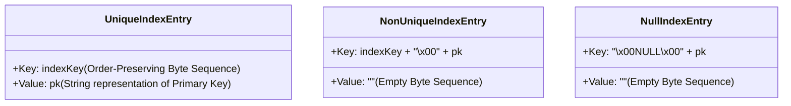

# LionSQL 보조 인덱스 물리 바이너리 포맷 규격서
(`notes/SECONDARY_INDEX_FORMAT.ko.md`)

> - **최초 작성일**: 2026-11-14
> - **최종 갱신일**: 2026-11-14
> - **문서 상태**: 공식 물리 스토리지 규격서 (Physical Storage Specification SSOT)
> - **연계 불변식**: `GEMINI.md` [Invariant 15: Canonical Secondary Index Key/Value Codec], `notes/ENGINEERING_CONTEXT.ko.md` [불변식 ㉜: 보조 인덱스 정렬 보존 바이너리 코덱 및 물리 B-Tree 실체화 불변식]
> - **물리 테이블 포맷 연계**: [`PHYSICAL_TABLE_FORMAT.ko.md`](PHYSICAL_TABLE_FORMAT.ko.md) (LionSQL 물리 테이블 및 바이너리 튜플 V2 규격서), `GEMINI.md` [Invariant 13: Single Canonical V2 Binary Tuple Codec], `notes/ENGINEERING_CONTEXT.ko.md` [불변식 ㉚], [`pkg/storage/tuple.go`](../pkg/storage/tuple.go)

---

## 1. 개요 및 설계 목적 (Overview & Objectives)

LionSQL은 단일 실행 파일 내에 초고속 인메모리 OCC 엔진(`memengine`)과 고신뢰성 디스크 MVCC 엔진(`wiredtiger`)을 동시에 제공합니다.
보조 인덱스(Secondary Index)는 메인 테이블의 기본 키(Primary Key) 및 바이너리 튜플([`PHYSICAL_TABLE_FORMAT.ko.md`](PHYSICAL_TABLE_FORMAT.ko.md)) 외에 추가적인 컬럼 조합에 대해 $O(\log N)$ 탐색, 범위 스캔(Range Scan), 그리고 고유성 제약(Unique Constraint)을 제공하는 핵심 스토리지 자료구조입니다.

본 문서는 보조 인덱스의 디스크 물리 저장 포맷, 순서 보존 바이너리 직렬화 규약, 고유/비고유 인덱스 구분 방식, 복합 인덱스 프리픽스 매칭 프로토콜을 공식 규격으로 정의합니다.

---

## 2. 물리 저장 구조 및 네임스페이스 규약 (Physical URI & Engine Schema)

### 2.1 테이블 URI 네임스페이스
LionSQL의 각 보조 인덱스는 기본 테이블([`PHYSICAL_TABLE_FORMAT.ko.md`](PHYSICAL_TABLE_FORMAT.ko.md), `table:<PhysicalTableName>`)과 격리된 독립된 물리 B-Tree 테이블로 생성 및 관리됩니다.
```
URI: table:_idx_<PhysicalTableName>_<IndexName>
```
- `PhysicalTableName`: 기본 테이블의 물리 식별자(`tbl.PhysicalName`). 테이블 이름 변경(`RenameTable`, 트랜잭션 DDL 톰스톤 등) 시에도 물리 URI는 변경되지 않고 보존됩니다.
- `IndexName`: 인덱스 식별자.

### 2.2 WiredTiger 컬럼 포맷 설정
```
config: "key_format=u,value_format=u"
```
- **`key_format=u` (Raw Binary Items, `WT_ITEM`)**:
  - `key_format=S` (C NUL-종단 문자열)를 사용할 경우, 복합 컬럼 구분자나 NULL 마커로 사용되는 `\x00` 바이트에서 문자열이 조기 절단(NUL-termination truncation)되는 치명적 결함이 발생합니다.
  - `key_format=u`를 채택하여 임의의 바이너리 바이트 시퀀스를 완벽히 보존하며, WiredTiger B-Tree의 기본 바이트 단위 `memcmp` 비교를 통해 Go 언어의 문자열 사전순 정렬(`str1 < str2`)과 100% 동일한 정렬 동작을 보장합니다.
- **`value_format=u` (Raw Binary Items, `WT_ITEM`)**:
  - 인덱스 엔트리에 대응하는 기본 키(Primary Key) 문자열을 바이트 손실 없이 저장합니다.

---

## 3. 순서 보존 데이터 타입 인코딩 (Order-Preserving Encodings)

모든 인덱스 키는 B-Tree 내에서 이진 비교(`memcmp`)만으로 데이터 타입 고유의 정렬 순서가 완벽히 유지되도록 `storage.EncodeIndexKeyPart(v)` 함수를 통해 순서 보존 문자열(Order-Preserving Byte Sequence)로 변환됩니다.

| 데이터 타입 (`storage.DataType`) | 인코딩 방식 | 크기 및 특징 | 정렬 불변식 |
| :--- | :--- | :--- | :--- |
| **`TypeInt`** (signed 64-bit) | `u := uint64(v.IVal) ^ 0x8000000000000000` 후 16자리 Hex 문자열 | 16 바이트 고정 | 최상위 부호 비트 반전으로 `MinInt64(00...00) < -1(7f...ff) < 0(80...00) < 1(80...01) < MaxInt64(ff...ff)` 순서 완벽 보존 |
| **`TypeFloat`** (IEEE 754 float64) | 부호 비트 확인 후 양수는 부호비트 반전, 음수는 전체 비트 반전 후 16자리 Hex | 16 바이트 고정 | 음수 부동소수점부터 양수 부동소수점까지 단조 증가 순서 보존 |
| **`TypeDateTime`** | ISO 8601 UTC `2006-01-02T15:04:05.000000000Z` 문자열 | 30 바이트 고정 | UTC 기준 사전순 비교와 시간순 비교가 정확히 일치 |
| **`TypeDate`** | `YYYY-MM-DD` 문자열 | 10 바이트 | 사전순 정렬 |
| **`TypeTime`** | `HH:MM:SS` 문자열 | 8 바이트 | 사전순 정렬 |
| **`TypeVarChar` / `TypeJSON`** | 원본 UTF-8 바이트 시퀀스 | 가변 길이 | 사전순 정렬 |
| **`TypeUUID`** | 정규화된 36자리 소문자 하이픈 UUID 문자열 | 36 바이트 | 사전순 정렬 |
| **`NULL`** | `\x00NULL` | 5 바이트 | 최하위 바이트 `0x00`으로 시작하여 모든 ASCII/UTF-8 문자보다 항상 최우선 정렬 |

---

## 4. 인덱스 키 및 값 레이아웃 (Index Key & Value Layout)



### 4.1 고유 인덱스 (Unique Index: `idx.Unique == true`)

#### 1) Non-Null 데이터 엔트리
- **Key**: `indexKey`
  - 단일 컬럼: `EncodeIndexKeyPart(colVal)`
  - 복합 컬럼: `EncodeIndexKeyPart(col1) + "\x00" + EncodeIndexKeyPart(col2) + ...`
- **Value**: `pk` (메인 테이블의 기본 키 문자열)
- **충돌 감지**: B-Tree에서 `search(indexKey)` 시 레코드가 이미 존재하고 저장된 `pk != currentPK`이면 즉시 `ErrUniqueViolation` 발생 ($O(\log N)$).

#### 2) NULL 데이터 엔트리 (SQL 표준 다중 NULL 허용 규약)
- SQL 표준 및 ANSI 규약에 따라, 고유 인덱스라도 `NULL` 값은 여러 행에 걸쳐 중복 저장될 수 있습니다.
- 고유 인덱스에서 `keyVal.IsNull == true`인 행은 단일 `indexKey` 대신 **비고유 엔트리 포맷(`\x00NULL\x00 + pk`, Value `""`)**으로 분기 저장되어, 중복 에러 없이 B-Tree 내에 안전하게 공존합니다.

### 4.2 비고유 인덱스 (Non-Unique Index: `idx.Unique == false`)
WiredTiger B-Tree는 기본적으로 키의 유일성을 전제하므로, 동일한 인덱스 키를 가진 복수 행을 분실 없이 정렬 보관하기 위해 **기본 키(Primary Key)를 인덱스 키의 접미사로 합성**합니다.
- **Key**: `indexKey + "\x00" + pk`
- **Value**: `""` (0바이트 빈 값)
- **특징**: 메인 테이블의 PK는 고유하므로, 합성된 인덱스 키 전체는 항상 고유성이 보장되며, B-Tree 내에서 동일한 `indexKey`를 가진 엔트리들이 `pk` 순으로 오름차순 밀집 정렬됩니다.

---

## 5. 범위 검색 및 프리픽스 매칭 규약 (`compareCompositePrefix`)

`IndexScan` 및 `IndexScanDesc` 호출 시 커서 탐색 알고리즘은 다음 프로토콜을 준수합니다.

### 5.1 커서 초기 위치 지정 ($O(\log N)$ Seek)
1. **정방향 인덱스 스캔 (`IndexScan`, Ascending)**:
   - 하한값 `low` 존재 시:
     - 고유 인덱스: `searchKey = lowKey`
     - 비고유 인덱스: `searchKey = lowKey + "\x00"`
     - `search_near(searchKey)` 호출 후, 위치한 키가 `searchKey`보다 작으면(`exact < 0`) `next()`를 1회 호출하여 하한선 이상 최초 키로 이동.
   - 하한값 미지정(`low == nil`) 시: `next()`로 B-Tree 최선두에서 시작.
2. **역방향 인덱스 스캔 (`IndexScanDesc`, Descending)**:
   - 상한값 `high` 존재 시:
     - 고유 인덱스: `searchKey = highKey`
     - 비고유 인덱스: `searchKey = highKey + "\x00\xff\xff\xff\xff"`
     - `search_near(searchKey)` 호출 후, 위치한 키가 `searchKey`보다 크면(`exact > 0`) `prev()`를 1회 호출하여 상한선 이하 최대 키로 이동.
   - 상한값 미지정(`high == nil`) 시: `prev()`로 B-Tree 최후미에서 시작.

### 5.2 복합 인덱스 프리픽스 비교 (`compareCompositePrefix`)
복합 인덱스 `(tenant_id, user_id)`에서 사용자가 `WHERE tenant_id = 10`과 같이 선행 컬럼 일부만 조건으로 제공한 경우:
- `curKey`와 `boundKey`를 `\x00` 구분자로 분할하여 `boundKey`에 명시된 컬럼 수만큼만 비교합니다.
- 선행 컬럼이 일치하면 `0`을 반환하여 유효한 엔트리로 인정하고, 상한선 초과 시 즉시 순회를 중단($O(\log N + M)$)합니다.

---

## 6. 트랜잭션 ACID 수명주기 불변식 (Transaction Lifecycle)

1. **원자적 동기화 (Single-Transaction Parity)**:
   - 기본 테이블 쓰기(`table:<name>`)와 모든 보조 인덱스 B-Tree 쓰기는 **단일 WiredTiger `WT_SESSION` 트랜잭션 핸들 내에서 원자적으로 실행**됩니다.
   - 트랜잭션 롤백(`tx.Rollback()`) 시 기본 테이블과 보조 인덱스 변경 사항이 동시 무효화됩니다.
2. **세이브포인트(Savepoint) 보상 로직**:
   - `RollbackToSavepoint` 실행 시 내부 `undoLog`를 역순 순회하며:
     - Undo Insert: 메인 테이블 행 삭제 및 모든 보조 인덱스 B-Tree 엔트리 삭제.
     - Undo Delete / Update: 메인 테이블 구 데이터 복원 및 이전 보조 인덱스 B-Tree 엔트리 복원.
3. **DDL 물리 격리 및 정리**:
   - `DropIndex`: 커서 풀 evict ➔ `go_wt_session_drop` 물리 B-Tree 삭제.
   - `DropTable`: 메인 테이블과 연관된 모든 보조 인덱스 B-Tree 일괄 자동 삭제.
   - `TruncateTables`: 연결된 모든 보조 인덱스 B-Tree 일괄 Truncate.

---

## 7. 관련 문서 및 교차 참조 (Cross References)

- **물리 테이블 포맷 규격서**: [`PHYSICAL_TABLE_FORMAT.ko.md`](PHYSICAL_TABLE_FORMAT.ko.md)
- **핵심 불변식 정의**: `GEMINI.md` [Invariant 15: Canonical Secondary Index Key/Value Codec], [Invariant 13: Single Canonical V2 Binary Tuple Codec]
- **엔지니어링 컨텍스트**: `notes/ENGINEERING_CONTEXT.ko.md` [불변식 ㉜: 보조 인덱스 정렬 보존 바이너리 코덱], [불변식 ㉚: 스키마 진화 및 V2 튜플 코덱]
- **보조 인덱스 구현체**: [`pkg/storage/wiredtiger/wt_engine.go`](../pkg/storage/wiredtiger/wt_engine.go)
- **보조 인덱스 회귀 검증 스위트**: [`pkg/storage/wiredtiger/wt_secondary_index_test.go`](../pkg/storage/wiredtiger/wt_secondary_index_test.go)

