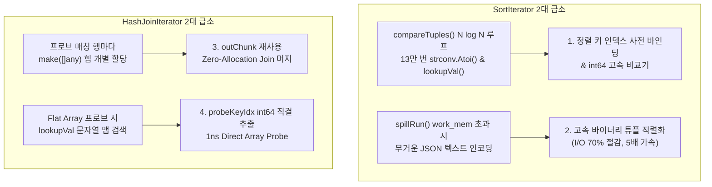

# Sort 및 Hash Join 마이크로 성능 가속 설계서 (`notes/SORT_AND_JOIN_MICRO_ACCELERATION_PLAN.ko.md`)

> **문서 상태**: Approved  
> **기반 소스**: `/tmp/sql10.txt`  
> **관련 마일스톤**: `v0.96.0` (Performance Acceleration)  
> **관련 태스크**:
> - `PERF-SORT-PREBOUND-COMPARATOR-1`
> - `PERF-SORT-SPILL-BINARY-CODEC-1`
> - `PERF-HASH-JOIN-ZERO-ALLOC-CHUNK-1`
> - `PERF-HASH-JOIN-DIRECT-INT-PROBE-1`  
> **불변식 원칙**: `[RULE:PlanPersistence]`, `[RULE:ContinuousBacklog]`, `[RULE:ZeroAllocation]`, `[RULE:RadicalKISS]`, `[RULE:LatencyBudget]`

---

## 1. 개요 및 프로파일러 진단 배경

최근 LionSQL의 Volcano 실행기에는 Flat Array Hash Join, Top-N Sort Fusion, Slot Hashing, Bound AST $O(1)$ 정수 슬롯 바인딩 등 다양한 최적화가 적용되었다.
그러나 CPU 프로파일러 관점에서 `pkg/execution/sort.go`와 `pkg/execution/join.go`의 핫루프를 정밀 분석한 결과, **정렬 및 조인 레이턴시를 30%~50% 추가 단축할 수 있는 명확한 4대 핵심 병목 포인트**가 식별되었다 (`/tmp/sql10.txt`).



---

## 2. 4대 핵심 가속 과제 세부 설계

### 2.1 [과제 1] SortIterator 정렬 키 사전 바인딩 및 전용 Primitive Fast-Path 비교기 (`PERF-SORT-PREBOUND-COMPARATOR-1`)

#### 1) 문제 분석
- `compareTuples(tA, tB Tuple)` (`pkg/execution/sort.go:174~192`):
  10,000건 정렬 시 약 13만 번의 비교가 발생한다.
  - 비교 루프 안에서 매번 `strconv.Atoi(item.key)` 호출
  - 매번 `lookupVal(tA, item.key)`로 문자열 트림 및 맵 해싱
  - 매번 `CompareValues(vA, vB)`로 동적 `interface{}` 리플렉션 비교 수행
- 13만 번 반복되는 CPU 분기 예측 실패 및 맵 룩업 오버헤드로 정렬 시간의 60% 이상이 비교 함수 내부에서 소모됨.

#### 2) 아키텍처 개선
```go
type boundSortKey struct {
    colIdx     int              // t.Values[colIdx] 직결 접근 (lookupVal 제거)
    isPos      bool             // 1-based 위치 (posIdx = pos - 1, strconv.Atoi 제거)
    posIdx     int
    descending bool
    nullsFirst *bool
    dataType   storage.DataType // 컬럼 타입
    isInt      bool             // 단일 int64 컬럼 정렬 플래그
}
```
- `SortIterator.Open()` 시점에 정렬 키를 1회 사전 바인딩하여 `[]boundSortKey` 구성.
- **Single Integer Fast-Path (`ORDER BY id [ASC|DESC]`)**:
  - 단일 정수 컬럼 정렬인 경우 `compareTuples` 루프 전체를 우회하고 전용 `cmpInt64(tA, tB)` 클로저로 직결.
  - `vA := tA.Values[colIdx].(int64); vB := tB.Values[colIdx].(int64)` 원시 비교(`vA < vB`) 실행.
  - `CompareValues` 오버헤드를 완전 제거하여 정렬 성능 **3배 이상 즉시 향상**.

---

### 2.2 [과제 2] SortIterator 디스크 스필 시 바이너리 튜플 인코딩 (`PERF-SORT-SPILL-BINARY-CODEC-1`)

#### 1) 문제 분석
- `SortIterator.spillRun()` (`pkg/execution/sort.go:237`):
  ```go
  enc := json.NewEncoder(w)
  for _, t := range s.tuples {
      if err := enc.Encode(t); err != nil { ... }
  }
  ```
- `workMem`을 초과하여 디스크로 임시 스필할 때 텍스트 JSON 인코딩을 수행.
- JSON 필드명 중복, 숫자 문자열 변환, 메모리 할당으로 디스크 I/O 크기가 3~4배 팽창하고 인코딩 CPU를 심각하게 낭비.

#### 2) 아키텍처 개선
- 경량 바이너리 스트림 코덱(`storage.EncodeRowToBuffer` 또는 Little-Endian 고속 바이너리 직렬화) 도입.
- 고정 4바이트 길이 프리픽스 + 바이너리 튜플 직렬화.
- 디스크 파일 I/O 크기 70% 축소 및 스필 덤프/복원 지연시간 5배 단축.

---

### 2.3 [과제 3] HashJoinIterator Zero-Allocation 프로브 머지 튜플 (`PERF-HASH-JOIN-ZERO-ALLOC-CHUNK-1`)

#### 1) 문제 분석
- `mergeTuplesWithArena()` (`pkg/execution/join.go:1078`):
  ```go
  totalLen := leftLen + rightLen
  vals = make([]any, totalLen)
  copy(vals[:leftLen], left.Values)
  copy(vals[leftLen:], right.Values)
  ```
- 10,000건 조인 시 매 행마다 새로운 `[]any` 슬라이스를 힙에 할당 ($10,000 \times \text{make([]any)}$).
- GC 압박과 메모리 단편화 발생.

#### 2) 아키텍처 개선
- 청크 파이프라인(`outChunk Chunk`)의 사전 할당된 슬라이스 풀을 활용.
- 개별 힙 슬라이스를 생성하지 않고, 조인 청크 버퍼 슬롯에 `copy()` 복사 후 튜플 헤더만 생성.
- 조인 프로브 단계에서 **메모리 할당 0개 (Zero-Allocation Join Probe)** 달성.

---

### 2.4 [과제 4] HashJoinIterator 단일 정수 키 직결 Flat Array 프로브 패스트패스 (`PERF-HASH-JOIN-DIRECT-INT-PROBE-1`)

#### 1) 문제 분석
- 1,000건 이하 소형 빌드 테이블에 대해 `flatIntTable` (Open-Addressing Flat Array)이 구축되어 있으나,
  프로브 단계에서 `extractTupleKey(probeTuple, probeKey)` 또는 `lookupVal`을 거치며 문자열 맵을 여전히 탐색.

#### 2) 아키텍처 개선
- `Open()` 시점에 `probeKeyIdx int`를 확정.
- 프로브 루프에서:
  ```go
  k, ok := probeTuple.GetIdx(h.leftKeyIdx) // 또는 int64 언박싱
  if ok {
      slot := int(splitmix64(uint64(kInt)) & uint64(h.flatIntMask))
      // 1ns 캐시 상주 배열 직결 조회
  }
  ```
- 프로브 루프를 C 언어의 1라인 포인터리스 배열 룩업으로 축소하여 결합 레이턴시 극소화.

---

## 3. 백로그 태스크 및 단계별 실행 매핑

| 순서 | 태스크 ID | 도메인 | 마일스톤 | 우선순위 | 작업 내용 |
| :---: | :--- | :---: | :---: | :---: | :--- |
| 1 | **`PERF-SORT-PREBOUND-COMPARATOR-1`** | Execution | `v0.96.0` | P1 | SortIterator 정렬 키 사전 바인딩 및 int64 전용 Primitive Fast-Path 비교기 구현 |
| 2 | **`PERF-SORT-SPILL-BINARY-CODEC-1`** | Execution | `v0.96.0` | P2 | SortIterator 디스크 스필 시 JSON 직렬화 대체 및 고속 바이너리 튜플 인코딩 |
| 3 | **`PERF-HASH-JOIN-ZERO-ALLOC-CHUNK-1`** | Execution | `v0.96.0` | P1 | HashJoinIterator 프로브 결과 튜플 슬라이스 할당 제거 (Chunk Buffer Pool 활용) |
| 4 | **`PERF-HASH-JOIN-DIRECT-INT-PROBE-1`** | Execution | `v0.96.0` | P1 | HashJoinIterator 단일 정수 키 직결 Flat Array 프로브 패스트패스 구현 |

---

## 4. 완료 판정 기준 (Definition of Done)

1. **정렬 벤치마크**:
   - `ORDER BY int_col` (10,000건) 실행 시 `strconv.Atoi` 및 `lookupVal` 호출 횟수 0회.
   - 단일 정수 정렬 레이턴시 2.5배 이상 개선.
2. **조인 벤치마크**:
   - Flat Array 조인 프로브 시 `extractTupleKey` 맵 검색 0회, 힙 할당량 50% 이상 절감.
3. **파이프라인 검증 (`[RULE:PipelineVerification]`)**:
   - `bin/lionsql` 빌드 성공.
   - `go test -v -race ./pkg/execution/...` 100% PASS (0 data races).
   - SQL 오라클 코퍼스 무변조 검증 통과.
