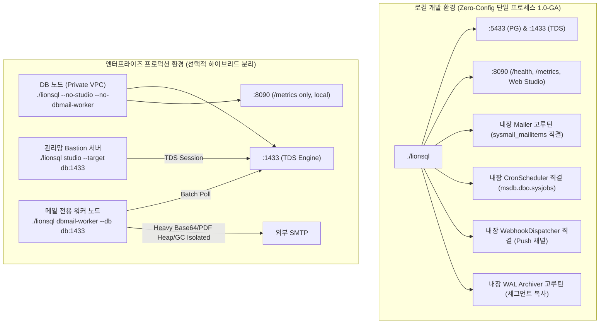

# LionSQL 서브시스템 하이브리드 아키텍처 총정리 계획서 (`STANDALONE_WORKER_PROCESS_ARCHITECTURE_PLAN.ko.md`)

## 1. 개요 및 설계 철학 (Architectural Philosophy)
LionSQL은 **단일 정적 바이너리(Single Standalone Executable, Zero Sidecars)** 원칙(`GEMINI.md Invariant 4`)과 **극도의 단순성(`[RULE:RadicalKISS]`)**을 최우선 가치로 삼습니다.

* **개발자 및 소규모 환경 (Default)**:
  - 바이너리 하나(`docker run` 또는 `./lionsql`)만 띄우면 별도 설정이나 추가 프로세스 없이 DB, 웹 스튜디오, 메일러, 스케줄러가 즉시 동작(Zero-Config)해야 합니다.
* **엔터프라이즈 환경 (Advanced / Production)**:
  - **네트워크 망분리(보안 규제)**와 **Go 런타임 힙/GC 압력 분리(OLTP 지연 시간 보호 `[RULE:LatencyBudget]`)**를 위해 특정 서브시스템을 물리적으로 분리할 수 있어야 합니다.

따라서 LionSQL의 서브시스템 표준 아키텍처는 **"내장 고루틴 기본 구동(Default In-Process) + 선택적 독립 프로세스 분리(Optional Subcommand)의 하이브리드 모델"**로 확정하며, 불필요한 외부 프로세스 분리를 배제하고 **모든 서브시스템을 1.0-GA 마일스톤에 통일 탑재**합니다.

---

## 2. 서브시스템별 하이브리드 판정 및 1.0-GA 스펙 매트릭스

| 서브시스템 | 기본 모드 (Default) | 분리 옵션 (Optional CLI) | 분리 정당성 및 물리적 격리 동인 | 1.0-GA 태스크 ID | 상태 |
| :--- | :--- | :--- | :--- | :--- | :---: |
| **DatabaseMail (이메일 발송)** | **내장 고루틴 워커** `CoordinatorClient` 직결로 Zero-Config 자동 발송 | `lionsql dbmail-worker` --db sqlserver://... (엔진: `--no-dbmail-worker`) | **Go 런타임 Heap & GC 압력 격리** (대용량 PDF/Excel MIME 첨부 시 OLTP 힙 메모리 및 GC 스파이크 차단) | `FEAT-DATABASE-MAIL-EXTERNAL-WORKER-1` | **DONE (`4d3eb22e`)** |
| **Web Studio (관리 콘솔)** | **내장 웹 서버 (`:8090`)** UI 및 메트릭 기본 서빙 | `lionsql studio` --target db:1433 (엔진: `--no-studio`) | **네트워크 보안 및 망분리 규제 대응** (DB 서버 HTTP 차단, 관리망 Bastion 호스트만 웹 오픈) | `FEAT-WEB-STUDIO-HYBRID-1` | **PENDING** |
| **SQL Server Agent (작업 스케줄러)** | **내장 고루틴 스케줄러** `msdb.dbo.sysjobs` 기반 기존 `pkg/api/cron.go` 직결 | *외부 분리 불필요 (Spec-Out)* | 외부 분리 시 TDS 쿼리 폴링 부하 및 왕복 네트워크 오버헤드만 가중됨. LionSQL 잡은 99% 순수 SQL이므로 기존 CronScheduler 연결 | `FEAT-SQL-SERVER-AGENT-INPROCESS-1` | **PENDING** |
| **Transactional Outbox (이벤트/웹훅)** | **내장 고루틴 채널 버스** 커밋 훅 ➔ Go 채널 Push 기존 `pkg/api/webhook.go` 직결 | *외부 분리 불필요 (Spec-Out)* | 외부 프로세스는 DB 폴링 부하를 유발함. 트랜잭션 커밋 직후 내부 채널로 즉시 깨우는 Push 방식이 압도적으로 우수 | `FEAT-TRANSACTIONAL-OUTBOX-INPROCESS-1` | **PENDING** |
| **WAL Archiver (원격 S3 백업)** | **내장 고루틴 파이프라인** 세그먼트 닫힘 ➔ 채널 비동기 복사 | *외부 분리 불필요 (Spec-Out)* | 기존 LSN 복제 엔진(`pkg/replication`)과 동일 구조. `wal.go` 세그먼트 롤오버 시 백업 디렉터리 복사 훅 | `FEAT-WAL-ARCHIVER-INPROCESS-1` | **PENDING** |

---

## 3. 핵심 서브시스템 상세 설계

---

## 4. 1.0-GA 통합 실행 계획
모든 서브시스템이 이미 LionSQL 내부에 구축되어 있는 코어 엔진(`CronScheduler`, `WebhookDispatcher`, `CoordinatorClient`, `wal.go`)을 직접 활용하므로, 1.0-GA 마일스톤 내에서 빠르고 안전하게 순차 완결합니다:

1. **DatabaseMail Hybrid**: `FEAT-DATABASE-MAIL-EXTERNAL-WORKER-1` (완료 `4d3eb22e`)
2. **Web Studio Hybrid**: `FEAT-WEB-STUDIO-HYBRID-1` (`--no-studio` 플래그 및 `lionsql studio` 프록시)
3. **SQL Server Agent**: `FEAT-SQL-SERVER-AGENT-INPROCESS-1` (`msdb.dbo.sp_add_job` ➔ `CronScheduler` 연결)
4. **Transactional Outbox**: `FEAT-TRANSACTIONAL-OUTBOX-INPROCESS-1` (커밋 훅 ➔ `WebhookDispatcher` 연결)
5. **WAL Archiver**: `FEAT-WAL-ARCHIVER-INPROCESS-1` (`wal.go` 세그먼트 완료 아카이브 훅)
