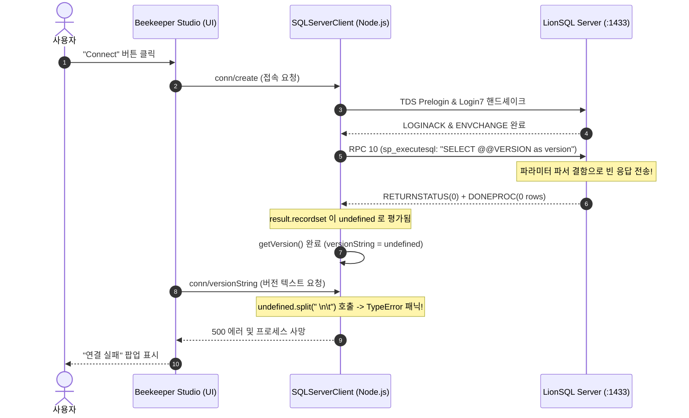

# TDS RPC 파라미터 해석과 순수 위치 기반(Ordinal Positional) 폴백 장애 분석 (`notes/TDS_RPC_POSITIONAL_MAPPING_POSTMORTEM.ko.md`)

## 1. 장애 개요 (Incident Overview)

* **발생 일시**: 2026-10-24
* **장애 현상**: Beekeeper Studio를 통해 LionSQL Microsoft SQL Server TDS 포트(`:1433`)에 접속을 시도할 때, UI에 즉시 "연결 실패"가 표시되며 백그라운드 유틸리티 로그(`~/Library/Logs/beekeeper-studio/utility.log`)에 다음 예외가 기록되고 연결이 무산됨:
  ```text
  [error] (UtilityProcess) HANDLER: ERROR TypeError: Cannot read properties of undefined (reading 'split')
      at SQLServerClient.versionString (/Applications/Beekeeper Studio.app/Contents/Resources/app.asar/dist/utility.js:615797:39)
      at Object.conn/versionString (/Applications/Beekeeper Studio.app/Contents/Resources/app.asar/dist/utility.js:586022:47)
  ```
* **대조군 현황**:
  * **DBeaver** (Java JDBC 기반): 정상 연결 및 쿼리 실행 성공.
  * **DbGate** (Svelte/Node 기반): 정상 연결 및 쿼리 실행 성공.
  * **Go 공식 드라이버** (`github.com/microsoft/go-mssqldb`): 정상 통과.
  * **Python 드라이버** (`pymssql`): 정상 통과.
  * **Beekeeper Studio** (`tedious` / `node-mssql` 기반): **유일하게 전면 실패**.

---

## 2. 프로토콜 및 클라이언트 내부 메커니즘 분석

### 2.1 Beekeeper Studio의 접속 라이프사이클
Beekeeper Studio는 전자(Electron) 기반 데스크톱 애플리케이션으로, 내부적으로 Node.js의 `tedious` 및 `node-mssql` 드라이버를 사용하여 SQL Server와 통신합니다. 접속 핸드셰이크는 다음과 같이 진행됩니다:



Beekeeper Studio의 소스코드(`SQLServerClient` in `app.asar`) 핵심 로직:
```typescript
async getVersion(): Promise<SQLServerVersion> {
    const result = await this.executeQuery("SELECT @@VERSION as version");
    const versionString = result[0]?.rows[0]?.version; // <--- 결과 행이 없으면 undefined
    const yearRegex = /SQL Server (\d+)/g;
    const yearResults = yearRegex.exec(versionString);
    const releaseYear = (yearResults && _.toNumber(yearResults[1])) || 2017;
    return {
        supportOffsetFetch: releaseYear >= 2012,
        releaseYear,
        versionString
    };
}

async versionString(): Promise<string> {
    // getVersion()에서 versionString이 undefined이면 split()에서 크래시 발생!
    return this.version.versionString.split(" \n\t")[0];
}
```

### 2.2 드라이버별 TDS RPC 파라미터 전송 차이
클라이언트가 `SELECT @@VERSION as version` 쿼리를 실행할 때 각 드라이버가 네트워크로 보낸 패킷의 형태는 판이했습니다:

| 클라이언트 / 드라이버 | 전송 패킷 유형 | ProcID / 프로시저 | 0번째 파라미터 이름 (`B_VARCHAR`) | 동작 결과 |
| :--- | :---: | :---: | :---: | :---: |
| **DbGate** | `PacketSQLBatch` (`0x01`) | - (배치 직접 전송) | 없음 (원시 텍스트) | 정상 |
| **DBeaver** (JDBC) | `PacketRPC` (`0x03`) | 10 (`sp_executesql`) | `""` (빈 문자열 / 순서형) | 정상 |
| **Go-MSSQLDB** | `PacketRPC` (`0x03`) | 10 (`sp_executesql`) | `""` 또는 `@stmt` | 정상 |
| **Beekeeper** (`tedious`) | `PacketRPC` (`0x03`) | 10 (`sp_executesql`) | **`"@statement"`** (풀네임 전송) | **크래시** |

`tedious` 드라이버의 내부 구현(`lib/request.js`)은 RPC 호출을 구성할 때 쿼리문 파라미터의 내부 식별자로 관례상 `@statement`라는 문자열을 할당하여 패킷을 빌드하고 있었습니다.

---

## 3. 결함 분석 (The Flaw & Root Cause)

### 3.1 리그레션이 발생한 코드 (commit `dda66cc`)
최근 Prepared Statement(`sp_prepare`, `sp_execute`, `sp_prepexec`) 및 복합 파라미터 바인딩을 고도화하면서 `handleRPCExecuteSQL`([pkg/wire/tds/server.go](file:///Users/maro/Projects/SQLion/pkg/wire/tds/server.go))에 2-Pass 파서가 도입되었습니다:

```go
func (s *Server) handleRPCExecuteSQL(conn net.Conn, rpc *parsedRPC, sess *ConnectionSession, ctx context.Context) {
    var stmt string
    var paramsDecl string
    var boundParams []RPCParam

    stmtFound := false
    paramsFound := false

    // [1차 패스: 공식 이름 검색]
    for _, p := range rpc.Params {
        name := strings.ToLower(strings.TrimSpace(p.Name))
        if name == "@stmt" {
            if str, ok := p.Value.(string); ok {
                stmt = str
                stmtFound = true
            }
        } else if name == "@params" {
            if str, ok := p.Value.(string); ok {
                paramsDecl = str
                paramsFound = true
            }
        }
    }

    // [2차 패스: 위치 기반 매핑 - 결함 발생 지점]
    for i, p := range rpc.Params {
        name := strings.ToLower(strings.TrimSpace(p.Name))
        if name == "@stmt" || name == "@params" {
            continue
        }
        // ★ 치명적 결함: name == "" 라는 불필요하고 잘못된 제약 ★
        if !stmtFound && (name == "" && i == 0) {
            if str, ok := p.Value.(string); ok {
                stmt = str
                stmtFound = true
                continue
            }
        }
        if !paramsFound && (name == "" && i == 1) {
            if str, ok := p.Value.(string); ok {
                paramsDecl = str
                paramsFound = true
                continue
            }
        }
        boundParams = append(boundParams, p)
    }

    execSQL := s.buildBoundSQL(stmt, paramsDecl, boundParams)
    s.executeRPCAndRespond(conn, execSQL, sess, nil, ctx)
}
```

### 3.2 단계별 장애 전개 (Failure Execution Trace)
1. **1차 패스 탈락**:
   - `tedious`가 보낸 0번째 파라미터의 이름은 `"@statement"`입니다.
   - 파서는 `name == "@stmt"`만 검사하므로 일치하지 않아 `stmtFound`는 `false`로 유지됩니다.
2. **2차 패스 탈락 (결정적 버그)**:
   - 파서는 인덱스 `i == 0`을 검사합니다. `!stmtFound`는 `true`입니다.
   - 그러나 조건문에 **`name == ""`**가 명시되어 있었습니다.
   - `tedious`의 파라미터 이름은 `"@statement"`(비어 있지 않음)이므로, `(name == "" && i == 0)` 평가는 **`false`**가 됩니다!
   - 결국 0번째 파라미터는 쿼리문으로 채택되지 못하고, 엉뚱하게 `boundParams` 슬라이스로 흘러 들어갑니다.
   - 결과적으로 루프가 끝난 뒤 `stmt`는 기본값인 **빈 문자열(`""`)**로 남게 됩니다.
3. **서버의 빈 응답 송출**:
   - `executeRPCAndRespond`는 `trimmed == ""`일 경우 실행할 SQL이 없다고 판단하여 `ReturnStatus(0)`과 `DoneProc(0)`만 작성하고 소켓을 마감합니다.
   - 결과셋을 나타내는 `COLMETADATA` 토큰과 `ROW` 토큰이 일절 전송되지 않았습니다.
4. **클라이언트의 런타임 패닉**:
   - 행 데이터가 0건이므로 Beekeeper Studio의 `result3[0]?.rows[0]?.version`은 `undefined`가 됩니다.
   - 이어진 `versionString()`에서 `undefined.split(" \n\t")`을 실행하면서 `TypeError` 예외가 발생하고 연결 절차가 강제 중단되었습니다.

---

## 4. 아키텍처적 진실: 이전 버전이 제대로 하고 있었다

초기 디버깅 단계에서는 *"이전 버전에서는 우연히 동작했던 것"*으로 오해하기 쉬웠으나, 코드 역사를 추적한 결과 **이전 버전의 설계가 본질적으로 옳았음**이 확인되었습니다.

### 4.1 이전 버전(`dda66cc` 이전)의 구현
```go
func readRPCFirstStringParam(r *bytes.Reader) string {
    paramName, err := ReadBVarChar(r)
    if err != nil {
        return ""
    }
    _ = paramName // 파라미터 이름을 아예 무시함!

    // 이름이 무엇이든 첫 번째 문자열 값을 무조건 쿼리문으로 추출
    ...
}
```
* 이전 버전은 `sp_executesql`의 본질인 **"첫 번째 파라미터는 이름이 무엇으로 표기되어 있든 위치상 무조건 실행할 쿼리문이다"**라는 순수 위치 기반(Ordinal Positional) 시맨틱을 완벽하게 만족하고 있었습니다.
* 따라서 `tedious`가 `@statement`를 보내든, 다른 도구가 `@query`나 빈 이름을 보내든 아무런 문제 없이 작동했습니다.

### 4.2 최근 리팩토링의 패착과 교훈
* 최근 리팩토링 과정에서 명명된 파라미터(`@stmt`)를 지원하려는 과정에서, *"위치 기반 인자라면 당연히 클라이언트가 이름을 비워서(`""`) 보낼 것"*이라는 근거 없는 경직된 가정을 추가한 것이 본질적인 원인이었습니다.
* 즉, **이전 버전이 이미 제대로 하고 있던 위치 기반 매핑에 불필요한 제약(`name == ""`)을 걸어버린 전형적인 리그레션(퇴행)**이었습니다.

---

## 5. 해결 방안: 오버스펙 배제와 순수 위치 기반 폴백 복원

### 5.1 기각된 안티패턴: 드라이버별 식별자 하드코딩
일부 임시방편으로 다음과 같이 드라이버별 이름을 열거하는 방안이 검토될 수 있습니다:
```go
// 안티패턴: YAGNI 및 KISS 원칙 위반
if name == "@stmt" || name == "@statement" || name == "@query" ...
```
이 방식은 특정 라이브러리의 구현 세부사항에 엔진을 결합시키는 취약한 오버스펙(Over-Specification)입니다. 내일 다른 클라이언트가 `@sql`이나 `@command`를 사용하면 또다시 깨지게 됩니다.

### 5.2 정규 해결책: 순수 위치 기반(Positional Fallback) 원칙 복원
Microsoft SQL Server 커널의 실제 C++ 디스패처와 동일하게 다음과 같은 2단계 규칙으로 단순화했습니다:

1. **1차 (공식 이름 우선)**: 공식 T-SQL 명세에 정의된 **`@stmt`**와 **`@params`**만 이름으로 매핑합니다.
2. **2차 (순수 위치 매핑)**: 공식 명칭으로 매핑되지 않은 파라미터는, 클라이언트가 이름을 생략했든(`""`) 임의의 이름을 붙였든(`@statement`, `@sql` 등) **이름 문자열을 일절 따지지 않고 위치(`i == 0`, `i == 1`)에 따라 매핑**합니다:
   - `i == 0` (0번째 인자): 실행할 SQL 쿼리문(`stmt`).
   - `i == 1` (1번째 인자): 파라미터 선언문(`paramsDecl`, 단 특정 바인딩 변수명이 아닌 경우).
   - `i >= 2`: 바인딩 변수 목록(`boundParams`).

### 5.3 최종 수정 코드 (`pkg/wire/tds/server.go`)
```go
func (s *Server) handleRPCExecuteSQL(conn net.Conn, rpc *parsedRPC, sess *ConnectionSession, ctx context.Context) {
    if len(rpc.Params) == 0 {
        done := BuildDoneProc(DoneFinal, 0, 0)
        _ = sess.writePacket(conn, PacketTabular, done)
        return
    }

    var stmt string
    var paramsDecl string
    var boundParams []RPCParam

    stmtFound := false
    paramsFound := false

    // 1차 패스: 공식 표준 명칭(@stmt, @params) 명시 여부 우선 검사
    for _, p := range rpc.Params {
        name := strings.ToLower(strings.TrimSpace(p.Name))
        if name == "@stmt" {
            if str, ok := p.Value.(string); ok {
                stmt = str
                stmtFound = true
            }
        } else if name == "@params" {
            if str, ok := p.Value.(string); ok {
                paramsDecl = str
                paramsFound = true
            }
        }
    }

    // 2차 패스: 순수 위치 기반(Ordinal Positional) 폴백
    // 클라이언트가 이름을 비워두었든(@statement 등 임의의 이름을 붙였든 상관없이
    // 0번째 인자는 무조건 실행할 쿼리문으로 위치 매핑함.
    for i, p := range rpc.Params {
        name := strings.ToLower(strings.TrimSpace(p.Name))
        if name == "@stmt" || name == "@params" {
            continue
        }
        if !stmtFound && i == 0 {
            if str, ok := p.Value.(string); ok {
                stmt = str
                stmtFound = true
                continue
            }
        }
        if !paramsFound && i == 1 {
            if str, ok := p.Value.(string); ok && (p.Name == "" || name == "@params") {
                paramsDecl = str
                paramsFound = true
                continue
            }
        }
        boundParams = append(boundParams, p)
    }

    execSQL := s.buildBoundSQL(stmt, paramsDecl, boundParams)
    s.executeRPCAndRespond(conn, execSQL, sess, nil, ctx)
}
```

---

## 6. 재발 방지 엔지니어링 불변식 (Engineering Invariants)

1. **와이어 프로토콜 파서에서의 위치 우선권 불변식**:
   - `sp_executesql` (ProcID 10) 및 `sp_prepare` (ProcID 11)와 같은 핵심 RPC 시스템 콜은 일반 유저 프로시저와 다릅니다.
   - 드라이버마다 파라미터 이름을 다르게 직렬화할 수 있으므로, 공식 명칭이 아닌 파라미터는 **반드시 위치(Ordinal Index)를 최우선 기준으로 매핑**해야 하며 파라미터 이름이 빈 값(`""`)일 것이라고 예단해서는 안 됩니다.
2. **골든 룰 #15 (Radical KISS & YAGNI) 준수**:
   - 서드파티 도구의 비표준 동작을 수용할 때, 해당 도구 전용의 예외 플래그나 문자열(`@statement`)을 코드에 증식시키지 마십시오.
   - 항상 프로토콜 본연의 위치 기반 추상화로 문제를 단순화하여 해결해야 합니다.
3. **외부 클라이언트 E2E 실측 검증**:
   - TDS 와이어 프로토콜 변경 시 Go 내부 드라이버뿐만 아니라 실제 Electron(`tedious`) 및 Java JDBC 드라이버를 대상으로 실제 연결 및 버전 조회 쿼리가 올바른 토큰 스트림(`COLMETADATA` ➔ `ROW` ➔ `DONE`)을 수신하는지 실측 검증해야 합니다.
