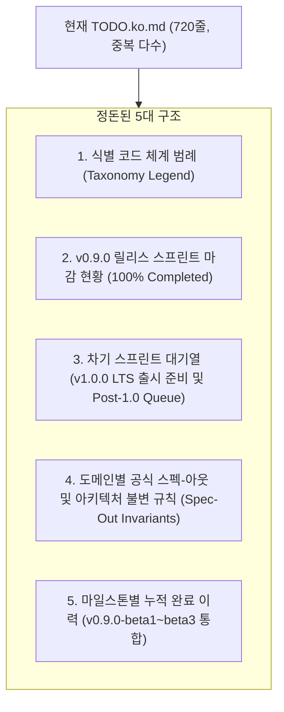

# TODO.ko.md 전면 리팩토링 및 0.9.0 스프린트 마감 계획서 (`TODO_REFACTORING_PLAN.md`)

> **상태 (Status)**: 완료됨 (Completed) `[x]`  
> **적용 일자**: 2026-10-24  
> **구현 산출물**: `TODO.ko.md` 전면 개편, `notes/TODO_SPEC_ARCHIVE.ko.md` 분리 아카이빙

## 1. 배경 및 리팩토링 필요성

현재 [TODO.ko.md](file:///Users/maro/Projects/SQLion/TODO.ko.md)는 `v0.9.0-feature-freeze`부터 `v0.9.0-beta1 ~ beta3`에 이르는 고강도 하드닝 작업을 거치면서 720줄 이상의 방대한 작업 대시보드로 성장했습니다.

그러나 현재 시점에서 다음과 같은 구조적 부조화와 정보 중복이 발생하고 있습니다:

1. **활성 스프린트 상태의 괴리**:
   * 제2절의 제목이 `현재 활성 스프린트 과제 (Active Sprint Queue)`이지만, 실제로는 0.9.0 대상 과제 46건이 **전수 완료(`[x]`)**되어 0.9.0 스프린트가 100% 마감되었습니다.
2. **다중 섹션 간 과도한 중복 (DRY 위반)**:
   * 동일한 과제(`PERF-1`, `VPERF-1~18`, `KISS-1~5`, `TOOL-AUDIT-1`, `UI-1~16` 등)가 제2절 테이블, 제2절 세부 설명문, 제3절 도메인 매트릭스, 제5절 완료 이력에 3~4중으로 중복 기재되어 있습니다.
3. **차기 과제의 파편화**:
   * 제2절 테이블 내의 `Post-1.0 연기` 표기, 제3절 내의 `연기` 표기, 제4절의 `보류 사유`가 분산되어 있어, 0.9.0 이후 실제로 추진해야 할 1.0 LTS 정식 출시 및 차기 백로그가 한눈에 들어오지 않습니다.

---

## 2. 정돈 및 재구성 제안 (Target Architecture)

`TODO.ko.md`를 **"0.9.0 스프린트 마감 완료 선언" + "1.0 LTS 출시 준비 및 Post-1.0 차기 스프린트 대기열" + "영구 스펙-아웃 사유"** 중심의 명쾌한 5단계 구조로 전면 재정편합니다.

---

## 3. 세부 섹션별 개편 방안

### 제1절. 식별 코드 체계 범례 (Taxonomy Legend)
* **현행 유지 및 정돈**: 기존 범례 테이블을 유지하되, 0.9.0에서 완결된 트랙과 차기 트랙을 깔끔하게 구분.

### 제2절. v0.9.0 릴리스 스프린트 마감 현황 (100% Completed)
* **제목 갱신**: `현재 활성 스프린트 과제` ➔ **`2. v0.9.0 릴리스 스프린트 마감 현황 (100% Completed)`**
* **상태 선언**: 0.9.0 릴리스 대상 46개 과제 전수 완료(`[x]`) 및 5대 릴리스 품질 관문(Gate 1~5) 충족 선언 (`v0.9.0-feature-freeze` ~ `v0.9.0-beta3`).
* **중복 제거 및 그룹화**:
  * 46개의 긴 평면 테이블을 6대 핵심 영역(와이어/호환성, 도구감사/스모크, 쿼리엔진 2-Tier, In-Memory OCC 튜닝, 단일 바이너리/UI, 무결성/보안)으로 그룹화하여 가독성 극대화.
  * 이미 개별 기술 문서([`notes/PITFALLS_AND_TRICKS.ko.md`](notes/PITFALLS_AND_TRICKS.ko.md), [`doc/internal/ZERO_ALLOCATION_ARCHITECTURE.md`](doc/internal/ZERO_ALLOCATION_ARCHITECTURE.md) 등)에 상세히 기록된 장문의 구현 세부 설명문을 링크 중심의 컴팩트한 요약으로 압축.

### 제3절. 차기 스프린트 대기열 (v1.0.0 LTS 출시 준비 및 Post-1.0 Queue)
* **신설/재편**:
  * **Part A: v1.0.0 LTS 출시 태스크**: 1.0 LTS 공식 태깅, 최종 릴리스 바이너리 빌드 및 배포 패키징, 1.0 릴리스 노트 발행.
  * **Part B: Post-1.0 (v1.1.0+) 백로그**:
    1. `AUDIT-LOG-1`: 엔터프라이즈 암호학적 SHA-256 불변 감사 로그 서브시스템 ([`notes/IMMUTABLE_AUDIT_LOG_PLAN.md`](notes/IMMUTABLE_AUDIT_LOG_PLAN.md))
    2. `TDS-MOD-1`: TDS 거대 단일 파일(`server.go` 2.6k줄) 관심사별 모듈 분해 (Handshake/RPC/Batch/Server)
    3. `TDS-COMPAT-6`: 다중 결과셋 (Multiple Result Sets) 스트리밍 지원 (Dapper `QueryMultiple`)
    4. `S3-1` ~ `S3-4`: 클라우드 S3 Pre-signed URL 직접 업로드 및 제로-의존성 SigV4 서명기 ([`notes/S3_PRESIGNED_STORAGE_PLAN.md`](notes/S3_PRESIGNED_STORAGE_PLAN.md))
    5. `LOC-1` ~ `LOC-4`: MSSQL Collation/로케일 지원 및 `COLLATE` 관용 파싱 ([`notes/COLLATION_AND_LOCALE_PLAN.md`](notes/COLLATION_AND_LOCALE_PLAN.md))
    6. `DOC-EN-1`: 사용자/레퍼런스/성능/스튜디오 4대 핵심 매뉴얼 공식 영문판 작성
    7. `VPERF-5, 6, 10~12`: 고위험 무복사 스트리밍 파이프라인 (Attention 동기화, RawRows 직결 등)

### 제4절. 공식 스펙-아웃 및 아키텍처 불변 규칙 (Spec-Out Invariants)
* **GEMINI.md 제8절과 일치화**:
  * 엔진 단순성(KISS)과 20k TPS 초고속 OLTP 성능을 위해 **영구 배제(Spec-Out)**된 11대 핵심 아키텍처(PL/pgSQL 배제, XML 배제, Vacuum 배제, Arrow IPC 배제, 2PC 배제, 커널 OAuth2 웹플로우 배제, 커널 S3 파일서버 배제, 슬로우쿼리 웹훅 직발송 배제, Wasm UDF 배제, 2-Tier 쿼리엔진 불변 등)의 기술적 사유를 명확히 고정.

### 제5절. 마일스톤별 누적 완료 이력 (Completed History)
* **0.9.0 Beta 1~3 반영**:
  * 최근 완료 이력(5.1절)에 `v0.9.0-beta1`, `v0.9.0-beta2`, `v0.9.0-beta3`에서 이룬 핵심 성과(TDS 위치 매핑, In-Memory OCC 779k tpmC, 13대 도메인 스모크 테스트 등)를 최신 날짜순으로 온전히 반영.

---

## 4. 리팩토링 효과

1. **가독성 및 명확성 극대화**: 비대해진 문서에서 중복 텍스트 150~200줄을 제거하고 단일 책임 원칙(SRP) 적용.
2. **개발 동선의 명확화**: 0.9.0 스프린트 완결 상태와 v1.0.0 LTS 출시 준비 및 차기 작업 큐가 한눈에 명확히 구분됨.
3. **GEMINI.md & ROADMAP.md와의 100% 싱크**: `v0.9.0 (Feature Freeze & Betas 1~3)` 명칭과 마일스톤 정의가 세 문서 간에 오차 없이 일치.
